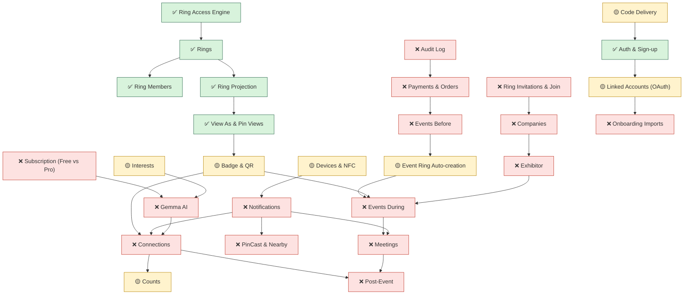

# Feature Graph

How the features depend on and relate to each other. Green = done, yellow = partial, red = TODO, purple = open decision. Obsidian's own graph view (filter `tag:#feature OR tag:#decision`) shows the same relationships from the wikilinks; this one is fixed and readable without plugins.

```mermaid
graph LR
  classDef done fill:#d8f3dc,stroke:#2d6a4f,color:#1b4332;
  classDef partial fill:#fff3cd,stroke:#b8860b,color:#5c4300;
  classDef todo fill:#fde2e1,stroke:#c0392b,color:#641e16;
  classDef frontend fill:#eeeeee,stroke:#888,color:#333;
  classDef decision fill:#e9d8fd,stroke:#6f42c1,color:#3b1d6e;
  subgraph identity["Identity Core"]
    auth["✅ Auth & Sign-up"]:::done
    account["✅ Account"]:::done
    profiles["✅ Profiles & Pin Name"]:::done
    rings["✅ Rings"]:::done
    ring_members["✅ Ring Members"]:::done
    ring_projection["✅ Ring Projection"]:::done
    view_as["✅ View As & Pin Views"]:::done
    files["✅ Files Upload"]:::done
    ring_access["✅ Ring Access Engine"]:::done
    counts["🟡 Counts"]:::partial
    photo_library["🟡 Photo Library"]:::partial
    widgets["🟡 Widgets"]:::partial
    onboarding_imports["❌ Onboarding Imports"]:::todo
  end
  subgraph connections["Connections"]
    connections["❌ Connections"]:::todo
  end
  subgraph shared_rings["Shared Rings & Companies"]
    delegated_admins["🟡 Delegated Admins"]:::partial
    ring_invitations["❌ Ring Invitations & Join"]:::todo
    companies["❌ Companies"]:::todo
  end
  subgraph discovery["Discovery"]
    badge_qr["🟡 Badge & QR"]:::partial
    discover_hub["❌ Discover Hub & Search"]:::todo
    pincast["❌ PinCast & Nearby"]:::todo
  end
  subgraph events["Events"]
    event_ring_auto["🟡 Event Ring Auto-creation"]:::partial
    events_before["❌ Events Before"]:::todo
    events_during["❌ Events During"]:::todo
    exhibitor["❌ Exhibitor"]:::todo
    post_event["❌ Post-Event"]:::todo
  end
  subgraph meetings["Meetings"]
    meetings["❌ Meetings"]:::todo
  end
  subgraph commerce["Commerce"]
    payments["❌ Payments & Orders"]:::todo
    subscription["❌ Subscription (Free vs Pro)"]:::todo
  end
  subgraph platform["Platform & Cross-cutting"]
    error_contract["🟡 Error Contract"]:::partial
    code_delivery["🟡 Code Delivery"]:::partial
    devices["🟡 Devices & NFC"]:::partial
    interests["🟡 Interests"]:::partial
    linked_accounts["🟡 Linked Accounts (OAuth)"]:::partial
    notifications["❌ Notifications"]:::todo
    gemma["❌ Gemma AI"]:::todo
    audit_log["❌ Audit Log"]:::todo
    cleanup_jobs["❌ Cleanup Jobs"]:::todo
    e2e_tests["❌ E2E Test Run"]:::todo
    app_shell["⬜ App Shell & Onboarding Narrative"]:::frontend
  end
  subgraph decisions["Open decisions"]
    D_01["✅ ND-01 Passwordless login"]:::decision
    D_02["✅ ND-02 Base profile work fields"]:::decision
    D_03["✅ ND-03 Field library vs per-Ring copies"]:::decision
    D_04["✅ ND-04 Ring settings"]:::decision
    D_05["✅ ND-05 Copy or inherit"]:::decision
    D_06["✅ ND-06 Pin name rules"]:::decision
  end
  auth --- account
  auth --- profiles
  auth --- rings
  auth --- code_delivery
  auth --- linked_accounts
  account --- counts
  account --- linked_accounts
  account --- devices
  account --- subscription
  profiles --- ring_projection
  profiles --- onboarding_imports
  rings --- ring_members
  rings --- ring_projection
  rings --- ring_access
  rings --- counts
  rings --- delegated_admins
  rings --- ring_invitations
  rings --- event_ring_auto
  rings --- cleanup_jobs
  ring_members --- ring_access
  ring_members --- connections
  ring_members --- delegated_admins
  ring_projection --- view_as
  ring_projection --- files
  ring_projection --- widgets
  view_as --- ring_access
  view_as --- badge_qr
  view_as --- connections
  files --- photo_library
  error_contract --- auth
  error_contract --- view_as
  ring_access --- connections
  ring_access --- events_during
  ring_access --- meetings
  ring_access --- pincast
  code_delivery --- notifications
  counts --- connections
  delegated_admins --- companies
  delegated_admins --- ring_access
  badge_qr --- connections
  badge_qr --- events_during
  badge_qr --- devices
  badge_qr --- subscription
  badge_qr --- ring_access
  event_ring_auto --- events_before
  event_ring_auto --- events_during
  event_ring_auto --- post_event
  photo_library --- ring_projection
  photo_library --- profiles
  devices --- auth
  devices --- notifications
  interests --- gemma
  interests --- account
  widgets --- meetings
  linked_accounts --- onboarding_imports
  onboarding_imports --- ring_projection
  connections --- notifications
  connections --- gemma
  ring_invitations --- companies
  ring_invitations --- ring_members
  ring_invitations --- notifications
  companies --- exhibitor
  companies --- rings
  discover_hub --- view_as
  discover_hub --- pincast
  discover_hub --- connections
  discover_hub --- gemma
  pincast --- notifications
  pincast --- cleanup_jobs
  pincast --- connections
  events_before --- payments
  events_before --- events_during
  events_before --- connections
  events_before --- notifications
  events_during --- meetings
  events_during --- exhibitor
  events_during --- subscription
  meetings --- rings
  meetings --- event_ring_auto
  meetings --- exhibitor
  meetings --- notifications
  meetings --- gemma
  exhibitor --- badge_qr
  exhibitor --- gemma
  post_event --- rings
  post_event --- events_during
  post_event --- connections
  post_event --- badge_qr
  post_event --- gemma
  payments --- subscription
  payments --- audit_log
  payments --- event_ring_auto
  subscription --- gemma
  gemma --- ring_access
  gemma --- audit_log
  audit_log --- auth
  audit_log --- ring_members
  cleanup_jobs --- auth
  e2e_tests --- auth
  e2e_tests --- view_as
  app_shell --- auth
  D_01 -.-> auth
  D_01 -.-> linked_accounts
  D_02 -.-> profiles
  D_02 -.-> ring_projection
  D_02 -.-> onboarding_imports
  D_02 -.-> photo_library
  D_03 -.-> ring_projection
  D_03 -.-> widgets
  D_04 -.-> rings
  D_04 -.-> ring_members
  D_04 -.-> ring_invitations
  D_04 -.-> delegated_admins
  D_04 -.-> companies
  D_05 -.-> rings
  D_05 -.-> ring_projection
  D_05 -.-> photo_library
  D_06 -.-> profiles
  D_06 -.-> gemma
```

## Dependency spine (what unblocks what)



Read an arrow as "the left one must exist (or be decided) before the right one is complete".

## Decisions → features

Decided ones no longer block; the features still have to build what was decided. The full list, with the Connections and Badge decisions, is [[Decisions]].

| Decision | Blocks |
|---|---|
| [[Passwordless login]] (decided, [[D-01 Code-only login\|D-01]]) | [[Auth & Sign-up]], [[Linked Accounts (OAuth)]] |
| [[Base profile work fields]] (decided, [[D-02 One main profile every Ring starts from\|D-02]]) | [[Profiles & Pin Name]], [[Ring Projection]], [[Onboarding Imports]], [[Photo Library]] |
| [[Field library vs per-Ring copies]] (decided, [[D-03 Links entered once, switched on or off per Ring\|D-03]]) | [[Ring Projection]], [[Widgets]] |
| [[Ring settings]] (decided, [[D-04 Ring settings at launch and their defaults\|D-04]]) | [[Rings]], [[Ring Members]], [[Ring Invitations & Join]], [[Delegated Admins]], [[Companies]] |
| [[Copy or inherit]] (decided, [[D-05 Inherit per field, copy without members\|D-05]]) | [[Rings]], [[Ring Projection]], [[Photo Library]] |
| [[Pin name rules]] (decided, [[D-06 Yearly rename, old name freed, case-insensitive\|D-06]]) | [[Profiles & Pin Name]], [[Gemma AI]] |
