# Navigation Map

> ⚠ Affected by [[D-04 Ring settings at launch and their defaults]] (2026-10-25): ND-04 decided, six Ring settings at launch with private defaults (join with a code or invite, approve each one, members can't see each other, invite or save attachments); the owner and the Ring's admins change them; members who may see each other see full cards.

The prototype's click-through map (`socialPin-design/.wire.json`), rendered. The first diagram keeps only the product spine (tab-bar jumps to Home / Events / Discover / Me / Badge are removed so the flows stay readable); the table below has every edge.

```mermaid
graph LR
  s00a["s00a Splash"] -->|"SocialPin"| s00b["s00b Value · Rings"]
  s00b["s00b Value · Rings"] -->|"Next"| s00c["s00c Value · PinCast"]
  s00b["s00b Value · Rings"] -->|"Skip"| s01["s01 Welcome"]
  s00c["s00c Value · PinCast"] -->|"Next"| s00d["s00d Value · Events"]
  s00c["s00c Value · PinCast"] -->|"Skip"| s01["s01 Welcome"]
  s00d["s00d Value · Events"] -->|"Get started"| s01["s01 Welcome"]
  s01["s01 Welcome"] -->|"Send me a code"| s02["s02 Verify"]
  s01["s01 Welcome"] -->|"Continue with LinkedIn"| s04["s04 Importing"]
  s02["s02 Verify"] -->|"Verify and continue"| s03["s03 Start from"]
  s02["s02 Verify"] -->|"Use a different email"| s01["s01 Welcome"]
  s03["s03 Start from"] -->|"Import from LinkedIn"| s04["s04 Importing"]
  s03["s03 Start from"] -->|"Fill it in myself"| s06["s06 Claim your Pin"]
  s03["s03 Start from"] -->|"Scan a paper business card"| s03a["s03a Scan a card"]
  s03["s03 Start from"] -->|"Behance or a portfolio URL"| s03b["s03b Portfolio URL"]
  s03a["s03a Scan a card"] -->|"Use this card"| s05["s05 Review import"]
  s03a["s03a Scan a card"] -->|"Type it in instead"| s06["s06 Claim your Pin"]
  s03b["s03b Portfolio URL"] -->|"Import from this site"| s05["s05 Review import"]
  s03b["s03b Portfolio URL"] -->|"Skip for now"| s06["s06 Claim your Pin"]
  s04["s04 Importing"] -->|"Skip and fill it in myself"| s06["s06 Claim your Pin"]
  s05["s05 Review import"] -->|"Confirm & continue"| s06["s06 Claim your Pin"]
  s06["s06 Claim your Pin"] -->|"Continue"| s07["s07 Interests"]
  s07["s07 Interests"] -->|"Continue · 3 picked"| s08["s08 First Ring"]
  s08["s08 First Ring"] -->|"Create my first Ring"| s09["s09 Create first Ring"]
  s08["s08 First Ring"] -->|"Take me to the app"| s11["s11 Home · Broadcasting"]
  s09["s09 Create first Ring"] -->|"Create Ring"| s10["s10 View as teaser"]
  s09["s09 Create first Ring"] -->|"Later"| s11["s11 Home · Broadcasting"]
  s10["s10 View as teaser"] -->|"Got it"| s11["s11 Home · Broadcasting"]
  s11["s11 Home · Broadcasting"] -->|"My badge"| s34["s34 Badge (flip)"]
  s11["s11 Home · Broadcasting"] -->|"PinCast"| s40["s40 PinCast · live"]
  s11["s11 Home · Broadcasting"] -->|"Scan"| s35["s35 Scanner"]
  s11["s11 Home · Broadcasting"] -->|"Meetings"| s66["s66 Meetings"]
  s11["s11 Home · Broadcasting"] -->|"All 5"| s16["s16 My Rings"]
  s11["s11 Home · Broadcasting"] -->|"Browse all"| s48["s48 Events tab"]
  s11["s11 Home · Broadcasting"] -->|"Stop"| s12["s12 Home · Idle"]
  s11["s11 Home · Broadcasting"] -->|"Add manually"| s45["s45 Requests"]
  s11["s11 Home · Broadcasting"] -->|"TechSummit '26"| s53["s53 Event mode"]
  s11["s11 Home · Broadcasting"] -->|"Clients"| s14["s14 Ring data"]
  s12["s12 Home · Idle"] -->|"Go visible · Clients, 30 min"| s11["s11 Home · Broadcasting"]
  s12["s12 Home · Idle"] -->|"My badge"| s34["s34 Badge (flip)"]
  s12["s12 Home · Idle"] -->|"Meetings"| s66["s66 Meetings"]
  s12["s12 Home · Idle"] -->|"All 5"| s16["s16 My Rings"]
  s12["s12 Home · Idle"] -->|"Change"| s41["s41 PinCast setup"]
  s12["s12 Home · Idle"] -->|"Ask Gemma"| s13["s13 Gemma sheet"]
  s12["s12 Home · Idle"] -->|"Browse all"| s48["s48 Events tab"]
  s12["s12 Home · Idle"] -->|"Clients"| s14["s14 Ring data"]
  s13["s13 Gemma sheet"] -->|"Accept into Clients"| s46["s46 Accept · pick a Ring"]
  s13["s13 Gemma sheet"] -->|"Later"| s11["s11 Home · Broadcasting"]
  s13["s13 Gemma sheet"] -->|"Open meeting"| s67["s67 Meeting detail"]
  s13["s13 Gemma sheet"] -->|"Ask Gemma for intros"| s60["s60 Smart Match"]
  s14["s14 Ring data"] -->|"People · 148"| s15["s15 Ring people"]
  s14["s14 Ring data"] -->|"View as Clients"| s31["s31 View as (flip)"]
  s14["s14 Ring data"] -->|"Rename"| s22["s22 Edit · name & purpose"]
  s14["s14 Ring data"] -->|"+ Add information to this Ring"| s36["s36 Add to this Ring"]
  s15["s15 Ring people"] -->|"Ring data"| s14["s14 Ring data"]
  s15["s15 Ring people"] -->|"Rename"| s22["s22 Edit · name & purpose"]
  s15["s15 Ring people"] -->|"Scan someone in"| s35["s35 Scanner"]
  s15["s15 Ring people"] -->|"Move from a Ring"| s16["s16 My Rings"]
  s15["s15 Ring people"] -->|"Add"| s46["s46 Accept · pick a Ring"]
  s16["s16 My Rings"] -->|"Shared with me · 2"| s17["s17 Shared with me"]
  s16["s16 My Rings"] -->|"+ New"| s18["s18 New Ring · step 1"]
  s16["s16 My Rings"] -->|"Join"| s74["s74 Join a company Ring"]
  s16["s16 My Rings"] -->|"Public"| s14["s14 Ring data"]
  s17["s17 Shared with me"] -->|"My Rings · 5"| s16["s16 My Rings"]
  s17["s17 Shared with me"] -->|"+ New"| s18["s18 New Ring · step 1"]
  s17["s17 Shared with me"] -->|"Acme Team"| s14["s14 Ring data"]
  s17["s17 Shared with me"] -->|"Review invite"| s74["s74 Join a company Ring"]
  s18["s18 New Ring · step 1"] -->|"Next · who is in it"| s19["s19 New Ring · step 2 (who is in it)"]
  s18["s18 New Ring · step 1"] -->|"Cancel"| s16["s16 My Rings"]
  s19["s19 New Ring · step 2 (who is in it)"] -->|"Next · what it shows"| s20["s20 New Ring · step 3 (what it shows)"]
  s19["s19 New Ring · step 2 (who is in it)"] -->|"Cancel"| s16["s16 My Rings"]
  s19["s19 New Ring · step 2 (who is in it)"] -->|"Back"| s18["s18 New Ring · step 1"]
  s20["s20 New Ring · step 3 (what it shows)"] -->|"Next · how you appear"| s21["s21 New Ring · step 4 (how you appear)"]
  s20["s20 New Ring · step 3 (what it shows)"] -->|"Cancel"| s16["s16 My Rings"]
  s20["s20 New Ring · step 3 (what it shows)"] -->|"Back"| s19["s19 New Ring · step 2 (who is in it)"]
  s21["s21 New Ring · step 4 (how you appear)"] -->|"Create Ring"| s14["s14 Ring data"]
  s21["s21 New Ring · step 4 (how you appear)"] -->|"Cancel"| s16["s16 My Rings"]
  s21["s21 New Ring · step 4 (how you appear)"] -->|"Back"| s20["s20 New Ring · step 3 (what it shows)"]
  s22["s22 Edit · name & purpose"] -->|"Save"| s14["s14 Ring data"]
  s23["s23 Edit · how you appear"] -->|"Save"| s14["s14 Ring data"]
  s23["s23 Edit · how you appear"] -->|"Change"| s29["s29 Photo for this Ring"]
  s23["s23 Edit · how you appear"] -->|"Copy a Ring"| s28["s28 Copy from a Ring"]
  s23["s23 Edit · how you appear"] -->|"Upload"| s30["s30 Photo library"]
  s24["s24 Edit · what it shows"] -->|"Save"| s14["s14 Ring data"]
  s24["s24 Edit · what it shows"] -->|"+ Add a field, link or file"| s36["s36 Add to this Ring"]
  s25["s25 Edit · social profiles"] -->|"Save"| s14["s14 Ring data"]
  s25["s25 Edit · social profiles"] -->|"+ Connect another account"| s36["s36 Add to this Ring"]
  s26["s26 Edit · access"] -->|"Save"| s14["s14 Ring data"]
  s26["s26 Edit · access"] -->|"Permissions"| s27["s27 Edit · permissions"]
  s26["s26 Edit · access"] -->|"Delete Ring"| s16["s16 My Rings"]
  s27["s27 Edit · permissions"] -->|"Save"| s26["s26 Edit · access"]
  s28["s28 Copy from a Ring"] -->|"Use this bio"| s23["s23 Edit · how you appear"]
  s29["s29 Photo for this Ring"] -->|"Use for Clients"| s23["s23 Edit · how you appear"]
  s29["s29 Photo for this Ring"] -->|"Upload"| s30["s30 Photo library"]
  s30["s30 Photo library"] -->|"Done"| s29["s29 Photo for this Ring"]
  s34["s34 Badge (flip)"] -->|"Get Pro"| s70["s70 Subscription"]
  s36["s36 Add to this Ring"] -->|"Widget"| s37["s37 Widgets"]
  s36["s36 Add to this Ring"] -->|"Done"| s14["s14 Ring data"]
  s36["s36 Add to this Ring"] -->|"Field"| s24["s24 Edit · what it shows"]
  s36["s36 Add to this Ring"] -->|"Social profile"| s25["s25 Edit · social profiles"]
  s37["s37 Widgets"] -->|"Add 2 widgets"| s14["s14 Ring data"]
  s37["s37 Widgets"] -->|"Cancel"| s36["s36 Add to this Ring"]
  s38["s38 Discover hub"] -->|"PinCast"| s39["s39 PinCast · hidden"]
  s38["s38 Discover hub"] -->|"Import contacts"| s03["s03 Start from"]
  s38["s38 Discover hub"] -->|"People"| s45["s45 Requests"]
  s38["s38 Discover hub"] -->|"Companies"| s72["s72 My companies"]
  s38["s38 Discover hub"] -->|"Exhibitors"| s54["s54 Exhibitors"]
  s38["s38 Discover hub"] -->|"!vertexlabs"| s55["s55 Exhibitor"]
  s38["s38 Discover hub"] -->|"!tareknassar"| s44["s44 Scanned Pin"]
  s39["s39 PinCast · hidden"] -->|"Go visible · Clients, 30 min"| s40["s40 PinCast · live"]
  s39["s39 PinCast · hidden"] -->|"Change"| s41["s41 PinCast setup"]
  s40["s40 PinCast · live"] -->|"Stop"| s42["s42 PinCast results"]
  s40["s40 PinCast · live"] -->|"Change Ring or range"| s41["s41 PinCast setup"]
  s40["s40 PinCast · live"] -->|"Dana Al-Amin"| s44["s44 Scanned Pin"]
  s41["s41 PinCast setup"] -->|"Start PinCast"| s40["s40 PinCast · live"]
  s42["s42 PinCast results"] -->|"Done"| s11["s11 Home · Broadcasting"]
  s42["s42 PinCast results"] -->|"Broadcast again"| s41["s41 PinCast setup"]
  s42["s42 PinCast results"] -->|"Connect"| s46["s46 Accept · pick a Ring"]
  s43["s43 Reading the code"] -->|"Checking which Ring they belong in"| s44["s44 Scanned Pin"]
  s44["s44 Scanned Pin"] -->|"Connect"| s46["s46 Accept · pick a Ring"]
  s44["s44 Scanned Pin"] -->|"Save for later"| s11["s11 Home · Broadcasting"]
  s45["s45 Requests"] -->|"Accept"| s46["s46 Accept · pick a Ring"]
  s45["s45 Requests"] -->|"Omar Zayed"| s47["s47 Connection detail"]
  s46["s46 Accept · pick a Ring"] -->|"Accept & add to Ring"| s47["s47 Connection detail"]
  s46["s46 Accept · pick a Ring"] -->|"Not now"| s45["s45 Requests"]
  s47["s47 Connection detail"] -->|"Request meeting"| s59["s59 Request a meeting"]
  s47["s47 Connection detail"] -->|"Introduce"| s45["s45 Requests"]
  s47["s47 Connection detail"] -->|"Revoke access"| s15["s15 Ring people"]
  s48["s48 Events tab"] -->|"TechSummit '26"| s49["s49 Event landing"]
  s49["s49 Event landing"] -->|"RSVP & get tickets"| s50["s50 Tickets & levels"]
  s49["s49 Event landing"] -->|"Exhibitors"| s54["s54 Exhibitors"]
  s49["s49 Event landing"] -->|"Floor map"| s57["s57 Floor map"]
  s49["s49 Event landing"] -->|"Catalogue"| s58["s58 Catalogue"]
  s49["s49 Event landing"] -->|"Lounges"| s53["s53 Event mode"]
  s50["s50 Tickets & levels"] -->|"Continue · $160"| s51["s51 Payment"]
  s50["s50 Tickets & levels"] -->|"Set up"| s63["s63 Business account"]
  s51["s51 Payment"] -->|"Pay $160"| s52["s52 Event Ring granted"]
  s52["s52 Event Ring granted"] -->|"Enter event mode"| s53["s53 Event mode"]
  s52["s52 Event Ring granted"] -->|"See it in my Ring hub"| s16["s16 My Rings"]
  s53["s53 Event mode"] -->|"Your pass · Full Access"| s56["s56 Event pass"]
  s53["s53 Event mode"] -->|"Schedule"| s58["s58 Catalogue"]
  s53["s53 Event mode"] -->|"Floor map"| s57["s57 Floor map"]
  s53["s53 Event mode"] -->|"Exhibitors"| s54["s54 Exhibitors"]
  s53["s53 Event mode"] -->|"Smart Match"| s60["s60 Smart Match"]
  s53["s53 Event mode"] -->|"Lounges"| s70["s70 Subscription"]
  s53["s53 Event mode"] -->|"Nearby by Ring"| s40["s40 PinCast · live"]
  s53["s53 Event mode"] -->|"My meetings today"| s61["s61 My meetings"]
  s53["s53 Event mode"] -->|"Exit"| s11["s11 Home · Broadcasting"]
  s54["s54 Exhibitors"] -->|"Meet"| s59["s59 Request a meeting"]
  s54["s54 Exhibitors"] -->|"Vertex Labs"| s55["s55 Exhibitor"]
  s55["s55 Exhibitor"] -->|"Request a meeting"| s59["s59 Request a meeting"]
  s55["s55 Exhibitor"] -->|"Save"| s54["s54 Exhibitors"]
  s56["s56 Event pass"] -->|"Show my badge"| s34["s34 Badge (flip)"]
  s57["s57 Floor map"] -->|"Northwind Retail"| s55["s55 Exhibitor"]
  s57["s57 Floor map"] -->|"List"| s54["s54 Exhibitors"]
  s58["s58 Catalogue"] -->|"Northwind · Shelf-edge displays"| s55["s55 Exhibitor"]
  s59["s59 Request a meeting"] -->|"Send request · 11:20"| s61["s61 My meetings"]
  s59["s59 Request a meeting"] -->|"Cancel"| s55["s55 Exhibitor"]
  s60["s60 Smart Match"] -->|"Request meeting"| s59["s59 Request a meeting"]
  s61["s61 My meetings"] -->|"Propose a new meeting"| s59["s59 Request a meeting"]
  s61["s61 My meetings"] -->|"Confirm"| s67["s67 Meeting detail"]
  s62["s62 Post-event summary"] -->|"Confirm"| s11["s11 Home · Broadcasting"]
  s62["s62 Post-event summary"] -->|"Review 4"| s46["s46 Accept · pick a Ring"]
  s63["s63 Business account"] -->|"Create business Ring"| s64["s64 Incoming meetings"]
  s64["s64 Incoming meetings"] -->|"Accept — offer slots"| s59["s59 Request a meeting"]
  s64["s64 Incoming meetings"] -->|"See booth analytics"| s65["s65 Booth analytics"]
  s66["s66 Meetings"] -->|"Propose a meeting"| s59["s59 Request a meeting"]
  s66["s66 Meetings"] -->|"Vertex Labs"| s67["s67 Meeting detail"]
  s67["s67 Meeting detail"] -->|"Show my badge"| s34["s34 Badge (flip)"]
  s67["s67 Meeting detail"] -->|"Reschedule"| s59["s59 Request a meeting"]
  s67["s67 Meeting detail"] -->|"Cancel"| s66["s66 Meetings"]
  s67["s67 Meeting detail"] -->|"Directions"| s57["s57 Floor map"]
  s68["s68 Me / Account"] -->|"Upgrade"| s70["s70 Subscription"]
  s68["s68 Me / Account"] -->|"Photo library"| s30["s30 Photo library"]
  s68["s68 Me / Account"] -->|"Interests"| s71["s71 Interests"]
  s68["s68 Me / Account"] -->|"My companies"| s72["s72 My companies"]
  s68["s68 Me / Account"] -->|"My devices"| s75["s75 My devices"]
  s68["s68 Me / Account"] -->|"Business account"| s63["s63 Business account"]
  s68["s68 Me / Account"] -->|"Notifications"| s69["s69 Notifications"]
  s69["s69 Notifications"] -->|"See results"| s42["s42 PinCast results"]
  s69["s69 Notifications"] -->|"Scan now"| s35["s35 Scanner"]
  s69["s69 Notifications"] -->|"Choose a Ring"| s46["s46 Accept · pick a Ring"]
  s69["s69 Notifications"] -->|"Temporary Ring created"| s67["s67 Meeting detail"]
  s69["s69 Notifications"] -->|"Suggest another day"| s59["s59 Request a meeting"]
  s70["s70 Subscription"] -->|"Go Pro — $9 / month"| s68["s68 Me / Account"]
  s71["s71 Interests"] -->|"Save · 3 picked"| s68["s68 Me / Account"]
  s72["s72 My companies"] -->|"Acme Studio"| s73["s73 Company detail"]
  s72["s72 My companies"] -->|"Review"| s74["s74 Join a company Ring"]
  s73["s73 Company detail"] -->|"Acme Team"| s14["s14 Ring data"]
  s73["s73 Company detail"] -->|"22 colleagues"| s15["s15 Ring people"]
  s73["s73 Company detail"] -->|"Leave company"| s72["s72 My companies"]
  s74["s74 Join a company Ring"] -->|"Join Ring"| s16["s16 My Rings"]
  s74["s74 Join a company Ring"] -->|"Decline"| s72["s72 My companies"]
  s75["s75 My devices"] -->|"Sign out all other devices"| s68["s68 Me / Account"]
```

## Every edge

| From | Tap | To |
|---|---|---|
| [[Screen Index#s00a\|s00a]] Splash | SocialPin | [[Screen Index#s00b\|s00b]] Value · Rings |
| [[Screen Index#s00b\|s00b]] Value · Rings | Next | [[Screen Index#s00c\|s00c]] Value · PinCast |
| [[Screen Index#s00b\|s00b]] Value · Rings | Skip | [[Screen Index#s01\|s01]] Welcome |
| [[Screen Index#s00c\|s00c]] Value · PinCast | Next | [[Screen Index#s00d\|s00d]] Value · Events |
| [[Screen Index#s00c\|s00c]] Value · PinCast | Skip | [[Screen Index#s01\|s01]] Welcome |
| [[Screen Index#s00d\|s00d]] Value · Events | Get started | [[Screen Index#s01\|s01]] Welcome |
| [[Screen Index#s00d\|s00d]] Value · Events | Skip | [[Screen Index#s01\|s01]] Welcome |
| [[Screen Index#s01\|s01]] Welcome | Send me a code | [[Screen Index#s02\|s02]] Verify |
| [[Screen Index#s01\|s01]] Welcome | Continue with LinkedIn | [[Screen Index#s04\|s04]] Importing |
| [[Screen Index#s02\|s02]] Verify | Verify and continue | [[Screen Index#s03\|s03]] Start from |
| [[Screen Index#s02\|s02]] Verify | Use a different email | [[Screen Index#s01\|s01]] Welcome |
| [[Screen Index#s03\|s03]] Start from | Import from LinkedIn | [[Screen Index#s04\|s04]] Importing |
| [[Screen Index#s03\|s03]] Start from | Fill it in myself | [[Screen Index#s06\|s06]] Claim your Pin |
| [[Screen Index#s03\|s03]] Start from | Scan a paper business card | [[Screen Index#s03a\|s03a]] Scan a card |
| [[Screen Index#s03\|s03]] Start from | Behance or a portfolio URL | [[Screen Index#s03b\|s03b]] Portfolio URL |
| [[Screen Index#s03a\|s03a]] Scan a card | Use this card | [[Screen Index#s05\|s05]] Review import |
| [[Screen Index#s03a\|s03a]] Scan a card | Type it in instead | [[Screen Index#s06\|s06]] Claim your Pin |
| [[Screen Index#s03b\|s03b]] Portfolio URL | Import from this site | [[Screen Index#s05\|s05]] Review import |
| [[Screen Index#s03b\|s03b]] Portfolio URL | Skip for now | [[Screen Index#s06\|s06]] Claim your Pin |
| [[Screen Index#s04\|s04]] Importing | Skip and fill it in myself | [[Screen Index#s06\|s06]] Claim your Pin |
| [[Screen Index#s05\|s05]] Review import | Confirm & continue | [[Screen Index#s06\|s06]] Claim your Pin |
| [[Screen Index#s05\|s05]] Review import | Skip | [[Screen Index#s06\|s06]] Claim your Pin |
| [[Screen Index#s06\|s06]] Claim your Pin | Continue | [[Screen Index#s07\|s07]] Interests |
| [[Screen Index#s07\|s07]] Interests | Continue · 3 picked | [[Screen Index#s08\|s08]] First Ring |
| [[Screen Index#s07\|s07]] Interests | Skip | [[Screen Index#s08\|s08]] First Ring |
| [[Screen Index#s08\|s08]] First Ring | Create my first Ring | [[Screen Index#s09\|s09]] Create first Ring |
| [[Screen Index#s08\|s08]] First Ring | Take me to the app | [[Screen Index#s11\|s11]] Home · Broadcasting |
| [[Screen Index#s09\|s09]] Create first Ring | Create Ring | [[Screen Index#s10\|s10]] View as teaser |
| [[Screen Index#s09\|s09]] Create first Ring | Later | [[Screen Index#s11\|s11]] Home · Broadcasting |
| [[Screen Index#s10\|s10]] View as teaser | Got it | [[Screen Index#s11\|s11]] Home · Broadcasting |
| [[Screen Index#s11\|s11]] Home · Broadcasting | My badge | [[Screen Index#s34\|s34]] Badge (flip) |
| [[Screen Index#s11\|s11]] Home · Broadcasting | PinCast | [[Screen Index#s40\|s40]] PinCast · live |
| [[Screen Index#s11\|s11]] Home · Broadcasting | Scan | [[Screen Index#s35\|s35]] Scanner |
| [[Screen Index#s11\|s11]] Home · Broadcasting | Meetings | [[Screen Index#s66\|s66]] Meetings |
| [[Screen Index#s11\|s11]] Home · Broadcasting | All 5 | [[Screen Index#s16\|s16]] My Rings |
| [[Screen Index#s11\|s11]] Home · Broadcasting | Browse all | [[Screen Index#s48\|s48]] Events tab |
| [[Screen Index#s11\|s11]] Home · Broadcasting | Events | [[Screen Index#s48\|s48]] Events tab |
| [[Screen Index#s11\|s11]] Home · Broadcasting | Discover | [[Screen Index#s38\|s38]] Discover hub |
| [[Screen Index#s11\|s11]] Home · Broadcasting | Me | [[Screen Index#s68\|s68]] Me / Account |
| [[Screen Index#s11\|s11]] Home · Broadcasting | Badge | [[Screen Index#s34\|s34]] Badge (flip) |
| [[Screen Index#s11\|s11]] Home · Broadcasting | Home | [[Screen Index#s11\|s11]] Home · Broadcasting |
| [[Screen Index#s11\|s11]] Home · Broadcasting | Stop | [[Screen Index#s12\|s12]] Home · Idle |
| [[Screen Index#s11\|s11]] Home · Broadcasting | See | [[Screen Index#s48\|s48]] Events tab |
| [[Screen Index#s11\|s11]] Home · Broadcasting | Add manually | [[Screen Index#s45\|s45]] Requests |
| [[Screen Index#s11\|s11]] Home · Broadcasting | TechSummit '26 | [[Screen Index#s53\|s53]] Event mode |
| [[Screen Index#s11\|s11]] Home · Broadcasting | Clients | [[Screen Index#s14\|s14]] Ring data |
| [[Screen Index#s11\|s11]] Home · Broadcasting | Investors | [[Screen Index#s14\|s14]] Ring data |
| [[Screen Index#s12\|s12]] Home · Idle | Go visible · Clients, 30 min | [[Screen Index#s11\|s11]] Home · Broadcasting |
| [[Screen Index#s12\|s12]] Home · Idle | My badge | [[Screen Index#s34\|s34]] Badge (flip) |
| [[Screen Index#s12\|s12]] Home · Idle | Meetings | [[Screen Index#s66\|s66]] Meetings |
| [[Screen Index#s12\|s12]] Home · Idle | All 5 | [[Screen Index#s16\|s16]] My Rings |
| [[Screen Index#s12\|s12]] Home · Idle | Change | [[Screen Index#s41\|s41]] PinCast setup |
| [[Screen Index#s12\|s12]] Home · Idle | Ask Gemma | [[Screen Index#s13\|s13]] Gemma sheet |
| [[Screen Index#s12\|s12]] Home · Idle | Events | [[Screen Index#s48\|s48]] Events tab |
| [[Screen Index#s12\|s12]] Home · Idle | Discover | [[Screen Index#s38\|s38]] Discover hub |
| [[Screen Index#s12\|s12]] Home · Idle | Me | [[Screen Index#s68\|s68]] Me / Account |
| [[Screen Index#s12\|s12]] Home · Idle | Badge | [[Screen Index#s34\|s34]] Badge (flip) |
| [[Screen Index#s12\|s12]] Home · Idle | Home | [[Screen Index#s12\|s12]] Home · Idle |
| [[Screen Index#s12\|s12]] Home · Idle | Browse all | [[Screen Index#s48\|s48]] Events tab |
| [[Screen Index#s12\|s12]] Home · Idle | Clients | [[Screen Index#s14\|s14]] Ring data |
| [[Screen Index#s12\|s12]] Home · Idle | Investors | [[Screen Index#s14\|s14]] Ring data |
| [[Screen Index#s12\|s12]] Home · Idle | Family | [[Screen Index#s14\|s14]] Ring data |
| [[Screen Index#s13\|s13]] Gemma sheet | Accept into Clients | [[Screen Index#s46\|s46]] Accept · pick a Ring |
| [[Screen Index#s13\|s13]] Gemma sheet | Later | [[Screen Index#s11\|s11]] Home · Broadcasting |
| [[Screen Index#s13\|s13]] Gemma sheet | Open meeting | [[Screen Index#s67\|s67]] Meeting detail |
| [[Screen Index#s13\|s13]] Gemma sheet | Ask Gemma for intros | [[Screen Index#s60\|s60]] Smart Match |
| [[Screen Index#s13\|s13]] Gemma sheet | Reschedule | [[Screen Index#s67\|s67]] Meeting detail |
| [[Screen Index#s14\|s14]] Ring data | People · 148 | [[Screen Index#s15\|s15]] Ring people |
| [[Screen Index#s14\|s14]] Ring data | View as Clients | [[Screen Index#s31\|s31]] View as (flip) |
| [[Screen Index#s14\|s14]] Ring data | Rename | [[Screen Index#s22\|s22]] Edit · name & purpose |
| [[Screen Index#s14\|s14]] Ring data | + Add information to this Ring | [[Screen Index#s36\|s36]] Add to this Ring |
| [[Screen Index#s14\|s14]] Ring data | + Add | [[Screen Index#s36\|s36]] Add to this Ring |
| [[Screen Index#s15\|s15]] Ring people | Ring data | [[Screen Index#s14\|s14]] Ring data |
| [[Screen Index#s15\|s15]] Ring people | Rename | [[Screen Index#s22\|s22]] Edit · name & purpose |
| [[Screen Index#s15\|s15]] Ring people | Scan someone in | [[Screen Index#s35\|s35]] Scanner |
| [[Screen Index#s15\|s15]] Ring people | Move from a Ring | [[Screen Index#s16\|s16]] My Rings |
| [[Screen Index#s15\|s15]] Ring people | Add | [[Screen Index#s46\|s46]] Accept · pick a Ring |
| [[Screen Index#s16\|s16]] My Rings | Shared with me · 2 | [[Screen Index#s17\|s17]] Shared with me |
| [[Screen Index#s16\|s16]] My Rings | + New | [[Screen Index#s18\|s18]] New Ring · step 1 |
| [[Screen Index#s16\|s16]] My Rings | Join | [[Screen Index#s74\|s74]] Join a company Ring |
| [[Screen Index#s16\|s16]] My Rings | Create a Ring | [[Screen Index#s18\|s18]] New Ring · step 1 |
| [[Screen Index#s16\|s16]] My Rings | Public | [[Screen Index#s14\|s14]] Ring data |
| [[Screen Index#s16\|s16]] My Rings | Family | [[Screen Index#s14\|s14]] Ring data |
| [[Screen Index#s16\|s16]] My Rings | Clients | [[Screen Index#s14\|s14]] Ring data |
| [[Screen Index#s16\|s16]] My Rings | Company | [[Screen Index#s14\|s14]] Ring data |
| [[Screen Index#s16\|s16]] My Rings | Investors | [[Screen Index#s14\|s14]] Ring data |
| [[Screen Index#s16\|s16]] My Rings | TechSummit '26 | [[Screen Index#s14\|s14]] Ring data |
| [[Screen Index#s16\|s16]] My Rings | Home | [[Screen Index#s11\|s11]] Home · Broadcasting |
| [[Screen Index#s16\|s16]] My Rings | Events | [[Screen Index#s48\|s48]] Events tab |
| [[Screen Index#s16\|s16]] My Rings | Discover | [[Screen Index#s38\|s38]] Discover hub |
| [[Screen Index#s16\|s16]] My Rings | Me | [[Screen Index#s68\|s68]] Me / Account |
| [[Screen Index#s16\|s16]] My Rings | Badge | [[Screen Index#s34\|s34]] Badge (flip) |
| [[Screen Index#s17\|s17]] Shared with me | My Rings · 5 | [[Screen Index#s16\|s16]] My Rings |
| [[Screen Index#s17\|s17]] Shared with me | + New | [[Screen Index#s18\|s18]] New Ring · step 1 |
| [[Screen Index#s17\|s17]] Shared with me | Acme Team | [[Screen Index#s14\|s14]] Ring data |
| [[Screen Index#s17\|s17]] Shared with me | TechSummit Speakers | [[Screen Index#s14\|s14]] Ring data |
| [[Screen Index#s17\|s17]] Shared with me | Review invite | [[Screen Index#s74\|s74]] Join a company Ring |
| [[Screen Index#s17\|s17]] Shared with me | Join with a code | [[Screen Index#s74\|s74]] Join a company Ring |
| [[Screen Index#s17\|s17]] Shared with me | Home | [[Screen Index#s11\|s11]] Home · Broadcasting |
| [[Screen Index#s17\|s17]] Shared with me | Me | [[Screen Index#s68\|s68]] Me / Account |
| [[Screen Index#s17\|s17]] Shared with me | Discover | [[Screen Index#s38\|s38]] Discover hub |
| [[Screen Index#s17\|s17]] Shared with me | Events | [[Screen Index#s48\|s48]] Events tab |
| [[Screen Index#s17\|s17]] Shared with me | Badge | [[Screen Index#s34\|s34]] Badge (flip) |
| [[Screen Index#s18\|s18]] New Ring · step 1 | Next · who is in it | [[Screen Index#s19\|s19]] New Ring · step 2 (who is in it) |
| [[Screen Index#s18\|s18]] New Ring · step 1 | Cancel | [[Screen Index#s16\|s16]] My Rings |
| [[Screen Index#s19\|s19]] New Ring · step 2 (who is in it) | Next · what it shows | [[Screen Index#s20\|s20]] New Ring · step 3 (what it shows) |
| [[Screen Index#s19\|s19]] New Ring · step 2 (who is in it) | Cancel | [[Screen Index#s16\|s16]] My Rings |
| [[Screen Index#s19\|s19]] New Ring · step 2 (who is in it) | Back | [[Screen Index#s18\|s18]] New Ring · step 1 |
| [[Screen Index#s20\|s20]] New Ring · step 3 (what it shows) | Next · how you appear | [[Screen Index#s21\|s21]] New Ring · step 4 (how you appear) |
| [[Screen Index#s20\|s20]] New Ring · step 3 (what it shows) | Cancel | [[Screen Index#s16\|s16]] My Rings |
| [[Screen Index#s20\|s20]] New Ring · step 3 (what it shows) | Back | [[Screen Index#s19\|s19]] New Ring · step 2 (who is in it) |
| [[Screen Index#s21\|s21]] New Ring · step 4 (how you appear) | Create Ring | [[Screen Index#s14\|s14]] Ring data |
| [[Screen Index#s21\|s21]] New Ring · step 4 (how you appear) | Cancel | [[Screen Index#s16\|s16]] My Rings |
| [[Screen Index#s21\|s21]] New Ring · step 4 (how you appear) | Back | [[Screen Index#s20\|s20]] New Ring · step 3 (what it shows) |
| [[Screen Index#s22\|s22]] Edit · name & purpose | Save | [[Screen Index#s14\|s14]] Ring data |
| [[Screen Index#s22\|s22]] Edit · name & purpose | Cancel | [[Screen Index#s14\|s14]] Ring data |
| [[Screen Index#s23\|s23]] Edit · how you appear | Save | [[Screen Index#s14\|s14]] Ring data |
| [[Screen Index#s23\|s23]] Edit · how you appear | Cancel | [[Screen Index#s14\|s14]] Ring data |
| [[Screen Index#s23\|s23]] Edit · how you appear | Change | [[Screen Index#s29\|s29]] Photo for this Ring |
| [[Screen Index#s23\|s23]] Edit · how you appear | Copy a Ring | [[Screen Index#s28\|s28]] Copy from a Ring |
| [[Screen Index#s23\|s23]] Edit · how you appear | Upload | [[Screen Index#s30\|s30]] Photo library |
| [[Screen Index#s24\|s24]] Edit · what it shows | Save | [[Screen Index#s14\|s14]] Ring data |
| [[Screen Index#s24\|s24]] Edit · what it shows | Cancel | [[Screen Index#s14\|s14]] Ring data |
| [[Screen Index#s24\|s24]] Edit · what it shows | + Add a field, link or file | [[Screen Index#s36\|s36]] Add to this Ring |
| [[Screen Index#s25\|s25]] Edit · social profiles | Save | [[Screen Index#s14\|s14]] Ring data |
| [[Screen Index#s25\|s25]] Edit · social profiles | Cancel | [[Screen Index#s14\|s14]] Ring data |
| [[Screen Index#s25\|s25]] Edit · social profiles | + Connect another account | [[Screen Index#s36\|s36]] Add to this Ring |
| [[Screen Index#s26\|s26]] Edit · access | Save | [[Screen Index#s14\|s14]] Ring data |
| [[Screen Index#s26\|s26]] Edit · access | Cancel | [[Screen Index#s14\|s14]] Ring data |
| [[Screen Index#s26\|s26]] Edit · access | Permissions | [[Screen Index#s27\|s27]] Edit · permissions |
| [[Screen Index#s26\|s26]] Edit · access | Delete Ring | [[Screen Index#s16\|s16]] My Rings |
| [[Screen Index#s27\|s27]] Edit · permissions | Save | [[Screen Index#s26\|s26]] Edit · access |
| [[Screen Index#s27\|s27]] Edit · permissions | Cancel | [[Screen Index#s26\|s26]] Edit · access |
| [[Screen Index#s28\|s28]] Copy from a Ring | Use this bio | [[Screen Index#s23\|s23]] Edit · how you appear |
| [[Screen Index#s28\|s28]] Copy from a Ring | Cancel | [[Screen Index#s23\|s23]] Edit · how you appear |
| [[Screen Index#s29\|s29]] Photo for this Ring | Use for Clients | [[Screen Index#s23\|s23]] Edit · how you appear |
| [[Screen Index#s29\|s29]] Photo for this Ring | Reset to Pin | [[Screen Index#s23\|s23]] Edit · how you appear |
| [[Screen Index#s29\|s29]] Photo for this Ring | Upload | [[Screen Index#s30\|s30]] Photo library |
| [[Screen Index#s30\|s30]] Photo library | Done | [[Screen Index#s29\|s29]] Photo for this Ring |
| [[Screen Index#s30\|s30]] Photo library | Cancel | [[Screen Index#s29\|s29]] Photo for this Ring |
| [[Screen Index#s30\|s30]] Photo library | + Add | [[Screen Index#s29\|s29]] Photo for this Ring |
| [[Screen Index#s34\|s34]] Badge (flip) | Get Pro | [[Screen Index#s70\|s70]] Subscription |
| [[Screen Index#s36\|s36]] Add to this Ring | Widget | [[Screen Index#s37\|s37]] Widgets |
| [[Screen Index#s36\|s36]] Add to this Ring | Done | [[Screen Index#s14\|s14]] Ring data |
| [[Screen Index#s36\|s36]] Add to this Ring | Field | [[Screen Index#s24\|s24]] Edit · what it shows |
| [[Screen Index#s36\|s36]] Add to this Ring | Social profile | [[Screen Index#s25\|s25]] Edit · social profiles |
| [[Screen Index#s36\|s36]] Add to this Ring | File | [[Screen Index#s24\|s24]] Edit · what it shows |
| [[Screen Index#s36\|s36]] Add to this Ring | Add | [[Screen Index#s37\|s37]] Widgets |
| [[Screen Index#s37\|s37]] Widgets | Add 2 widgets | [[Screen Index#s14\|s14]] Ring data |
| [[Screen Index#s37\|s37]] Widgets | Cancel | [[Screen Index#s36\|s36]] Add to this Ring |
| [[Screen Index#s38\|s38]] Discover hub | PinCast | [[Screen Index#s39\|s39]] PinCast · hidden |
| [[Screen Index#s38\|s38]] Discover hub | Import contacts | [[Screen Index#s03\|s03]] Start from |
| [[Screen Index#s38\|s38]] Discover hub | People | [[Screen Index#s45\|s45]] Requests |
| [[Screen Index#s38\|s38]] Discover hub | Events | [[Screen Index#s48\|s48]] Events tab |
| [[Screen Index#s38\|s38]] Discover hub | Companies | [[Screen Index#s72\|s72]] My companies |
| [[Screen Index#s38\|s38]] Discover hub | Exhibitors | [[Screen Index#s54\|s54]] Exhibitors |
| [[Screen Index#s38\|s38]] Discover hub | Home | [[Screen Index#s11\|s11]] Home · Broadcasting |
| [[Screen Index#s38\|s38]] Discover hub | Me | [[Screen Index#s68\|s68]] Me / Account |
| [[Screen Index#s38\|s38]] Discover hub | Badge | [[Screen Index#s34\|s34]] Badge (flip) |
| [[Screen Index#s38\|s38]] Discover hub | Discover | [[Screen Index#s38\|s38]] Discover hub |
| [[Screen Index#s38\|s38]] Discover hub | !vertexlabs | [[Screen Index#s55\|s55]] Exhibitor |
| [[Screen Index#s38\|s38]] Discover hub | !tareknassar | [[Screen Index#s44\|s44]] Scanned Pin |
| [[Screen Index#s39\|s39]] PinCast · hidden | Go visible · Clients, 30 min | [[Screen Index#s40\|s40]] PinCast · live |
| [[Screen Index#s39\|s39]] PinCast · hidden | Change | [[Screen Index#s41\|s41]] PinCast setup |
| [[Screen Index#s39\|s39]] PinCast · hidden | Home | [[Screen Index#s11\|s11]] Home · Broadcasting |
| [[Screen Index#s39\|s39]] PinCast · hidden | Events | [[Screen Index#s48\|s48]] Events tab |
| [[Screen Index#s39\|s39]] PinCast · hidden | Me | [[Screen Index#s68\|s68]] Me / Account |
| [[Screen Index#s39\|s39]] PinCast · hidden | Badge | [[Screen Index#s34\|s34]] Badge (flip) |
| [[Screen Index#s39\|s39]] PinCast · hidden | Discover | [[Screen Index#s38\|s38]] Discover hub |
| [[Screen Index#s40\|s40]] PinCast · live | Stop | [[Screen Index#s42\|s42]] PinCast results |
| [[Screen Index#s40\|s40]] PinCast · live | Change Ring or range | [[Screen Index#s41\|s41]] PinCast setup |
| [[Screen Index#s40\|s40]] PinCast · live | Dana Al-Amin | [[Screen Index#s44\|s44]] Scanned Pin |
| [[Screen Index#s40\|s40]] PinCast · live | Rami Nasser | [[Screen Index#s44\|s44]] Scanned Pin |
| [[Screen Index#s40\|s40]] PinCast · live | Hala Sabbagh | [[Screen Index#s44\|s44]] Scanned Pin |
| [[Screen Index#s40\|s40]] PinCast · live | Ziad Kanaan | [[Screen Index#s44\|s44]] Scanned Pin |
| [[Screen Index#s40\|s40]] PinCast · live | Home | [[Screen Index#s11\|s11]] Home · Broadcasting |
| [[Screen Index#s40\|s40]] PinCast · live | Events | [[Screen Index#s48\|s48]] Events tab |
| [[Screen Index#s40\|s40]] PinCast · live | Me | [[Screen Index#s68\|s68]] Me / Account |
| [[Screen Index#s40\|s40]] PinCast · live | Badge | [[Screen Index#s34\|s34]] Badge (flip) |
| [[Screen Index#s40\|s40]] PinCast · live | Discover | [[Screen Index#s38\|s38]] Discover hub |
| [[Screen Index#s41\|s41]] PinCast setup | Start PinCast | [[Screen Index#s40\|s40]] PinCast · live |
| [[Screen Index#s42\|s42]] PinCast results | Done | [[Screen Index#s11\|s11]] Home · Broadcasting |
| [[Screen Index#s42\|s42]] PinCast results | Broadcast again | [[Screen Index#s41\|s41]] PinCast setup |
| [[Screen Index#s42\|s42]] PinCast results | Connect | [[Screen Index#s46\|s46]] Accept · pick a Ring |
| [[Screen Index#s42\|s42]] PinCast results | Accept | [[Screen Index#s46\|s46]] Accept · pick a Ring |
| [[Screen Index#s43\|s43]] Reading the code | Checking which Ring they belong in | [[Screen Index#s44\|s44]] Scanned Pin |
| [[Screen Index#s44\|s44]] Scanned Pin | Connect | [[Screen Index#s46\|s46]] Accept · pick a Ring |
| [[Screen Index#s44\|s44]] Scanned Pin | Save for later | [[Screen Index#s11\|s11]] Home · Broadcasting |
| [[Screen Index#s45\|s45]] Requests | Accept | [[Screen Index#s46\|s46]] Accept · pick a Ring |
| [[Screen Index#s45\|s45]] Requests | Omar Zayed | [[Screen Index#s47\|s47]] Connection detail |
| [[Screen Index#s45\|s45]] Requests | Sent · 5 | [[Screen Index#s45\|s45]] Requests |
| [[Screen Index#s46\|s46]] Accept · pick a Ring | Accept & add to Ring | [[Screen Index#s47\|s47]] Connection detail |
| [[Screen Index#s46\|s46]] Accept · pick a Ring | Not now | [[Screen Index#s45\|s45]] Requests |
| [[Screen Index#s47\|s47]] Connection detail | Request meeting | [[Screen Index#s59\|s59]] Request a meeting |
| [[Screen Index#s47\|s47]] Connection detail | Introduce | [[Screen Index#s45\|s45]] Requests |
| [[Screen Index#s47\|s47]] Connection detail | Revoke access | [[Screen Index#s15\|s15]] Ring people |
| [[Screen Index#s48\|s48]] Events tab | TechSummit '26 | [[Screen Index#s49\|s49]] Event landing |
| [[Screen Index#s48\|s48]] Events tab | Design Week Beirut | [[Screen Index#s49\|s49]] Event landing |
| [[Screen Index#s48\|s48]] Events tab | Founders Mixer | [[Screen Index#s49\|s49]] Event landing |
| [[Screen Index#s48\|s48]] Events tab | Retail Futures Forum | [[Screen Index#s49\|s49]] Event landing |
| [[Screen Index#s48\|s48]] Events tab | Founders Night | [[Screen Index#s49\|s49]] Event landing |
| [[Screen Index#s48\|s48]] Events tab | Home | [[Screen Index#s11\|s11]] Home · Broadcasting |
| [[Screen Index#s48\|s48]] Events tab | Events | [[Screen Index#s48\|s48]] Events tab |
| [[Screen Index#s48\|s48]] Events tab | Me | [[Screen Index#s68\|s68]] Me / Account |
| [[Screen Index#s48\|s48]] Events tab | Badge | [[Screen Index#s34\|s34]] Badge (flip) |
| [[Screen Index#s48\|s48]] Events tab | Discover | [[Screen Index#s38\|s38]] Discover hub |
| [[Screen Index#s49\|s49]] Event landing | RSVP & get tickets | [[Screen Index#s50\|s50]] Tickets & levels |
| [[Screen Index#s49\|s49]] Event landing | Exhibitors | [[Screen Index#s54\|s54]] Exhibitors |
| [[Screen Index#s49\|s49]] Event landing | Floor map | [[Screen Index#s57\|s57]] Floor map |
| [[Screen Index#s49\|s49]] Event landing | Catalogue | [[Screen Index#s58\|s58]] Catalogue |
| [[Screen Index#s49\|s49]] Event landing | Mini-events | [[Screen Index#s58\|s58]] Catalogue |
| [[Screen Index#s49\|s49]] Event landing | Lounges | [[Screen Index#s53\|s53]] Event mode |
| [[Screen Index#s50\|s50]] Tickets & levels | Continue · $160 | [[Screen Index#s51\|s51]] Payment |
| [[Screen Index#s50\|s50]] Tickets & levels | Set up | [[Screen Index#s63\|s63]] Business account |
| [[Screen Index#s51\|s51]] Payment | Pay $160 | [[Screen Index#s52\|s52]] Event Ring granted |
| [[Screen Index#s52\|s52]] Event Ring granted | Enter event mode | [[Screen Index#s53\|s53]] Event mode |
| [[Screen Index#s52\|s52]] Event Ring granted | See it in my Ring hub | [[Screen Index#s16\|s16]] My Rings |
| [[Screen Index#s53\|s53]] Event mode | Your pass · Full Access | [[Screen Index#s56\|s56]] Event pass |
| [[Screen Index#s53\|s53]] Event mode | Schedule | [[Screen Index#s58\|s58]] Catalogue |
| [[Screen Index#s53\|s53]] Event mode | Floor map | [[Screen Index#s57\|s57]] Floor map |
| [[Screen Index#s53\|s53]] Event mode | Catalogue | [[Screen Index#s58\|s58]] Catalogue |
| [[Screen Index#s53\|s53]] Event mode | Exhibitors | [[Screen Index#s54\|s54]] Exhibitors |
| [[Screen Index#s53\|s53]] Event mode | Smart Match | [[Screen Index#s60\|s60]] Smart Match |
| [[Screen Index#s53\|s53]] Event mode | Lounges | [[Screen Index#s70\|s70]] Subscription |
| [[Screen Index#s53\|s53]] Event mode | Nearby by Ring | [[Screen Index#s40\|s40]] PinCast · live |
| [[Screen Index#s53\|s53]] Event mode | My meetings today | [[Screen Index#s61\|s61]] My meetings |
| [[Screen Index#s53\|s53]] Event mode | Upgrade access | [[Screen Index#s70\|s70]] Subscription |
| [[Screen Index#s53\|s53]] Event mode | Exit | [[Screen Index#s11\|s11]] Home · Broadcasting |
| [[Screen Index#s54\|s54]] Exhibitors | Meet | [[Screen Index#s59\|s59]] Request a meeting |
| [[Screen Index#s54\|s54]] Exhibitors | Vertex Labs | [[Screen Index#s55\|s55]] Exhibitor |
| [[Screen Index#s54\|s54]] Exhibitors | Northwind Retail | [[Screen Index#s55\|s55]] Exhibitor |
| [[Screen Index#s54\|s54]] Exhibitors | Cedar Cloud | [[Screen Index#s55\|s55]] Exhibitor |
| [[Screen Index#s54\|s54]] Exhibitors | Loop Studio | [[Screen Index#s55\|s55]] Exhibitor |
| [[Screen Index#s54\|s54]] Exhibitors | Alma Group | [[Screen Index#s55\|s55]] Exhibitor |
| [[Screen Index#s54\|s54]] Exhibitors | Tide | [[Screen Index#s55\|s55]] Exhibitor |
| [[Screen Index#s55\|s55]] Exhibitor | Request a meeting | [[Screen Index#s59\|s59]] Request a meeting |
| [[Screen Index#s55\|s55]] Exhibitor | Save | [[Screen Index#s54\|s54]] Exhibitors |
| [[Screen Index#s56\|s56]] Event pass | Show my badge | [[Screen Index#s34\|s34]] Badge (flip) |
| [[Screen Index#s57\|s57]] Floor map | Northwind Retail | [[Screen Index#s55\|s55]] Exhibitor |
| [[Screen Index#s57\|s57]] Floor map | Alma Group | [[Screen Index#s55\|s55]] Exhibitor |
| [[Screen Index#s57\|s57]] Floor map | List | [[Screen Index#s54\|s54]] Exhibitors |
| [[Screen Index#s58\|s58]] Catalogue | Northwind · Shelf-edge displays | [[Screen Index#s55\|s55]] Exhibitor |
| [[Screen Index#s58\|s58]] Catalogue | Loop POS 3 | [[Screen Index#s55\|s55]] Exhibitor |
| [[Screen Index#s58\|s58]] Catalogue | Alma Fulfil | [[Screen Index#s55\|s55]] Exhibitor |
| [[Screen Index#s58\|s58]] Catalogue | Tide Checkout | [[Screen Index#s55\|s55]] Exhibitor |
| [[Screen Index#s58\|s58]] Catalogue | Northstar CRM | [[Screen Index#s55\|s55]] Exhibitor |
| [[Screen Index#s59\|s59]] Request a meeting | Send request · 11:20 | [[Screen Index#s61\|s61]] My meetings |
| [[Screen Index#s59\|s59]] Request a meeting | Cancel | [[Screen Index#s55\|s55]] Exhibitor |
| [[Screen Index#s60\|s60]] Smart Match | Request meeting | [[Screen Index#s59\|s59]] Request a meeting |
| [[Screen Index#s61\|s61]] My meetings | Propose a new meeting | [[Screen Index#s59\|s59]] Request a meeting |
| [[Screen Index#s61\|s61]] My meetings | Confirm | [[Screen Index#s67\|s67]] Meeting detail |
| [[Screen Index#s61\|s61]] My meetings | View | [[Screen Index#s67\|s67]] Meeting detail |
| [[Screen Index#s62\|s62]] Post-event summary | Confirm | [[Screen Index#s11\|s11]] Home · Broadcasting |
| [[Screen Index#s62\|s62]] Post-event summary | Review 4 | [[Screen Index#s46\|s46]] Accept · pick a Ring |
| [[Screen Index#s62\|s62]] Post-event summary | Later | [[Screen Index#s11\|s11]] Home · Broadcasting |
| [[Screen Index#s63\|s63]] Business account | Create business Ring | [[Screen Index#s64\|s64]] Incoming meetings |
| [[Screen Index#s64\|s64]] Incoming meetings | Accept — offer slots | [[Screen Index#s59\|s59]] Request a meeting |
| [[Screen Index#s64\|s64]] Incoming meetings | Offer slots | [[Screen Index#s59\|s59]] Request a meeting |
| [[Screen Index#s64\|s64]] Incoming meetings | See booth analytics | [[Screen Index#s65\|s65]] Booth analytics |
| [[Screen Index#s66\|s66]] Meetings | Propose a meeting | [[Screen Index#s59\|s59]] Request a meeting |
| [[Screen Index#s66\|s66]] Meetings | Vertex Labs | [[Screen Index#s67\|s67]] Meeting detail |
| [[Screen Index#s66\|s66]] Meetings | Northwind Retail | [[Screen Index#s67\|s67]] Meeting detail |
| [[Screen Index#s66\|s66]] Meetings | Rami Nasser | [[Screen Index#s67\|s67]] Meeting detail |
| [[Screen Index#s66\|s66]] Meetings | Alma Group | [[Screen Index#s67\|s67]] Meeting detail |
| [[Screen Index#s66\|s66]] Meetings | Cedar Cloud | [[Screen Index#s67\|s67]] Meeting detail |
| [[Screen Index#s67\|s67]] Meeting detail | Show my badge | [[Screen Index#s34\|s34]] Badge (flip) |
| [[Screen Index#s67\|s67]] Meeting detail | Reschedule | [[Screen Index#s59\|s59]] Request a meeting |
| [[Screen Index#s67\|s67]] Meeting detail | Cancel | [[Screen Index#s66\|s66]] Meetings |
| [[Screen Index#s67\|s67]] Meeting detail | Directions | [[Screen Index#s57\|s57]] Floor map |
| [[Screen Index#s68\|s68]] Me / Account | Upgrade | [[Screen Index#s70\|s70]] Subscription |
| [[Screen Index#s68\|s68]] Me / Account | Photo library | [[Screen Index#s30\|s30]] Photo library |
| [[Screen Index#s68\|s68]] Me / Account | Interests | [[Screen Index#s71\|s71]] Interests |
| [[Screen Index#s68\|s68]] Me / Account | My companies | [[Screen Index#s72\|s72]] My companies |
| [[Screen Index#s68\|s68]] Me / Account | My devices | [[Screen Index#s75\|s75]] My devices |
| [[Screen Index#s68\|s68]] Me / Account | Business account | [[Screen Index#s63\|s63]] Business account |
| [[Screen Index#s68\|s68]] Me / Account | Notifications | [[Screen Index#s69\|s69]] Notifications |
| [[Screen Index#s68\|s68]] Me / Account | Home | [[Screen Index#s11\|s11]] Home · Broadcasting |
| [[Screen Index#s68\|s68]] Me / Account | Events | [[Screen Index#s48\|s48]] Events tab |
| [[Screen Index#s68\|s68]] Me / Account | Me | [[Screen Index#s68\|s68]] Me / Account |
| [[Screen Index#s68\|s68]] Me / Account | Badge | [[Screen Index#s34\|s34]] Badge (flip) |
| [[Screen Index#s68\|s68]] Me / Account | Discover | [[Screen Index#s38\|s38]] Discover hub |
| [[Screen Index#s69\|s69]] Notifications | See results | [[Screen Index#s42\|s42]] PinCast results |
| [[Screen Index#s69\|s69]] Notifications | Scan now | [[Screen Index#s35\|s35]] Scanner |
| [[Screen Index#s69\|s69]] Notifications | Choose a Ring | [[Screen Index#s46\|s46]] Accept · pick a Ring |
| [[Screen Index#s69\|s69]] Notifications | Temporary Ring created | [[Screen Index#s67\|s67]] Meeting detail |
| [[Screen Index#s69\|s69]] Notifications | Suggest another day | [[Screen Index#s59\|s59]] Request a meeting |
| [[Screen Index#s70\|s70]] Subscription | Go Pro — $9 / month | [[Screen Index#s68\|s68]] Me / Account |
| [[Screen Index#s71\|s71]] Interests | Save · 3 picked | [[Screen Index#s68\|s68]] Me / Account |
| [[Screen Index#s71\|s71]] Interests | Cancel | [[Screen Index#s68\|s68]] Me / Account |
| [[Screen Index#s72\|s72]] My companies | Acme Studio | [[Screen Index#s73\|s73]] Company detail |
| [[Screen Index#s72\|s72]] My companies | Northstar | [[Screen Index#s73\|s73]] Company detail |
| [[Screen Index#s72\|s72]] My companies | Review | [[Screen Index#s74\|s74]] Join a company Ring |
| [[Screen Index#s72\|s72]] My companies | Join a company Ring | [[Screen Index#s74\|s74]] Join a company Ring |
| [[Screen Index#s73\|s73]] Company detail | Acme Team | [[Screen Index#s14\|s14]] Ring data |
| [[Screen Index#s73\|s73]] Company detail | Company | [[Screen Index#s14\|s14]] Ring data |
| [[Screen Index#s73\|s73]] Company detail | 22 colleagues | [[Screen Index#s15\|s15]] Ring people |
| [[Screen Index#s73\|s73]] Company detail | Leave company | [[Screen Index#s72\|s72]] My companies |
| [[Screen Index#s74\|s74]] Join a company Ring | Join Ring | [[Screen Index#s16\|s16]] My Rings |
| [[Screen Index#s74\|s74]] Join a company Ring | Decline | [[Screen Index#s72\|s72]] My companies |
| [[Screen Index#s75\|s75]] My devices | Sign out all other devices | [[Screen Index#s68\|s68]] Me / Account |

## Flows that cross into unbuilt backend

- **s44 Scanned Pin → s46 Accept → s47 Connection detail**: read is done, Connect is [[Connections]].
- **s50 Tickets → s51 Payment → s52 Event Ring granted → s53 Event mode**: all [[Events Before]], [[Payments & Orders]], [[Event Ring Auto-creation]].
- **s55 Exhibitor → s59 Request a meeting → s61 / s67**: [[Meetings]].
- **s39 → s40 → s42 PinCast**: [[PinCast & Nearby]].
- **s17 → s74 Join a company Ring**: [[Ring Invitations & Join]], waiting on [[Ring settings]].
