# 🧪 Account · QA Backend

**Feature:** [[Account]] · **Verifies:** [[Account Backend Delivery]] against [[Account Story]] and [[Account Frontend Requirements]] · **Verdict:** 🔴 Failing · 2026-10-26 · `dev 2026-10-26 · localhost:3000`

Expected behaviour of the API, as artefacts a person can check a build against: tables and diagrams, **not test code** (the specs live in the backend repo). `status: passing` or `failing` after a run; the verdict tells the PM whether the story can be fulfilled (passing with nothing pending).

## Scope

**Covered.** The three account endpoints of [[Account Backend Integration]] — `GET /users/me`, `PATCH /users/me`, `DELETE /users/me` — their shapes, their normalisation and uniqueness rules, their error rows, the auth scopes that guard them, and the two sibling reads the Me header is composed from (`GET /profiles`, `GET /rings`), checked only for the fields s68 needs.

**Not covered.** The composition itself and every piece of copy (s68 is [[Account QA Frontend]]'s). The sign-up and sign-in flows beyond what it takes to hold a session and to prove an address was released ([[Auth & Sign-up]] owns them). The Pro upgrade (s70, no backend). Connection counts, linked accounts, devices and subscriptions, all absent by design — see *Not available yet* in [[Account Backend Integration]].

**Test data.** Two throwaway accounts created and soft-deleted inside the run, `qa-bi01-a-20261026@test.local` (renamed to `…-a2-…` by B6) and `qa-bi01-b-20261026@test.local`. Rows B17 and B18 left two PENDING sign-ups on the released address and phone; they never completed registration and hold no Ring.

## Expected behaviour

Every row is one criterion of [[Account Story]], checked against the build named in the verdict. ✅ as expected · 🔴 differs · ⬜ not run.

### `GET /users/me` — S1 Open Me / Account

| # | Given | When | Then | Checked |
|---|---|---|---|---|
| B1 | a signed-in account | `GET /users/me` with the access token | 200 and exactly `id`, `email`, `phone`, `status`, `accountType`, `role`, `emailVerifiedAt`, `phoneVerifiedAt`, `lastLoginAt`, `createdAt`, `updatedAt` | ✅ |
| B2 | any account | `GET /users/me` | the body carries **no password field of any kind**, and no name and no photo | ✅ |
| B3 | a fresh sign-up | `GET /users/me` | `status: "ACTIVE"`, `accountType: "FREE"`, `role: "USER"`, `phone: null`, `lastLoginAt: null`, `emailVerifiedAt` set by the sign-up code | ✅ |
| B4 | that account signs in once | `GET /users/me` | `lastLoginAt` now carries the sign-in instant | ✅ |
| B5 | the Me header's other two sources | `GET /profiles` and `GET /rings` | `data[0]` is the default profile (`isDefault: true`, `pinName`, `fullName`, and `birthdate` / `gender` / `maritalStatus` for the S5 privacy row) and the default Ring (`isDefault: true`, `profileId` pointing at it) | ✅ |

### `PATCH /users/me` — S2 Change the email, S3 Change the phone

| # | Given | When | Then | Checked |
|---|---|---|---|---|
| B6 | a verified email | `PATCH { email: "  QA-BI01-A2-…@Test.Local  " }` | 200; the stored email is trimmed and lower-cased, and `emailVerifiedAt` is back to `null` | ✅ |
| B7 | a free number | `PATCH { phone: "+442071838751" }` and `PATCH { phone: "+44 20 7183 8751" }` | 200 both times; stored as E.164, spaces removed, `phoneVerifiedAt` stays `null` | ✅ |
| B8 | the account's own current email | `PATCH { email: <the same value> }` | 200, not a 409 against itself | ✅ |
| B9 | an email changed by B6 and therefore **unverified** | `POST /auth/login` then `POST /auth/login/verify` with that address | the contract says the address must be proven again before it can sign in. **Actual: a code is issued and a full session is returned.** | 🔴 |
| B10 | the same account | `PATCH {}` (nothing to change) | 200 and the account unchanged — a no-op, not a 400 | ✅ |
| B11 | any account | `PATCH { accountType, role, status }` | 400, one `message` entry per rejected key (`property … should not exist`): the whitelist keeps privilege off the route | ✅ |
| B12 | any account | `PATCH { email: "not-an-email" }` or `{ email: null }` | 400 `["email must be an email"]`, nothing written | ✅ |
| B13 | an address held by another account | `PATCH { email: <theirs> }` / `PATCH { phone: <theirs> }` | 409 "That email is already in use" / "That phone number is already in use" | ✅ |

### `DELETE /users/me` — S4 Delete the account

| # | Given | When | Then | Checked |
|---|---|---|---|---|
| B14 | a signed-in account | `DELETE /users/me`, then any call with the same access token | the integration note says a later call is **404 `E_USER_01`**. **Actual: 200 with an empty body on the delete, then 401 "Account is not active" on `/users/me`, `/rings` and `/profiles`.** The sign-out outcome is right; the documented 404 row is unreachable. | 🔴 |
| B15 | the deleted account's tokens | `POST /auth/refresh` with its refresh token | 401 "Refresh token is no longer valid. Sign in again." — every session revoked in the same transaction | ✅ |
| B16 | the deleted account's address | `POST /auth/login` with it | 201 with **no `devCode`**: the server does not say the account is gone | ✅ |
| B17 | the released email | `POST /auth/sign-up` with it | 201 with a `devCode`: the address is free to sign up again | ✅ |
| B18 | the released phone | `POST /auth/sign-up` with it | 201 with a `devCode`: the number is free too | ✅ |

### Access and scope

| # | Given | When | Then | Checked |
|---|---|---|---|---|
| B19 | no token, a malformed token, or the **refresh** token | `GET`, `PATCH` or `DELETE /users/me` | 401 every time; the refresh scope is rejected on an API route | ✅ |
| B20 | any signed-in account | `GET /users/:id` with its own id | 404: there is no such route, by design | ✅ |
| B21 | a suspended account | any call | 401 `E_AUTH_03`, treated as a sign-out (S6) | ⬜ no route suspends an account until [[T-068 Account moderation and platform role]] ships; the handler is the one B14 hit, so the shape is known but the path is unproven |

## State diagram

The account states `GET /users/me` can report, and what each one does to a call.

```mermaid
stateDiagram-v2
  [*] --> PENDING: POST /auth/sign-up
  PENDING --> ACTIVE: POST /auth/complete-registration
  ACTIVE --> ACTIVE: PATCH /users/me (email or phone, verified flag cleared)
  ACTIVE --> SUSPENDED: operator action (no route yet, T-068)
  ACTIVE --> DELETED: DELETE /users/me (soft, sessions revoked)
  SUSPENDED --> [*]: every call 401 "Account is not active"
  DELETED --> [*]: every call 401 "Account is not active"; email and phone released
```

A `PENDING` account holds no session: `login/verify` answers 403 `E_AUTH_03` for it, the same message a suspended one gets ([[Auth & Sign-up Backend Integration]]).

## Error matrix

What the three endpoints actually answer on this build. The `ErrorCode` column is what [[Account Backend Integration]] promises; **no response body on this build carries it** — a known gap of [[Error Contract Backend Delivery]], tracked as [[T-063 Put the ErrorCode on the error body]]. Until it lands, a client branches on status plus endpoint, never on a code.

| Situation | Status | ErrorCode (promised) | Body on the wire | Row |
|---|---|---|---|---|
| email already on another account | 409 | `E_USER_02` | `{statusCode: 409, message: "That email is already in use", error: "HttpException", path, timestamp}` | B13 ✅ |
| phone already on another account | 409 | `E_USER_03` | `{… "That phone number is already in use" …}` | B13 ✅ |
| the account no longer exists (deleted) | **401, not 404** | `E_USER_01` | `{statusCode: 401, message: "Account is not active", error: "HttpException", …}` | B14 🔴 |
| suspended account on any later call | 401 | `E_AUTH_03` | same body as the row above | B21 ⬜ |
| no, malformed or wrong-scope token | 401 | `E_AUTH_04` | `{statusCode: 401, message: "Unauthorized", error: "UnauthorizedException", …}` | B19 ✅ |
| a field that fails validation | 400 | — | `message` is a **string array**, one entry per constraint | B12 ✅ |
| a body key that is not `email` or `phone` | 400 | — | `message: ["property <key> should not exist"]` | B11 ✅ |

Two bodies therefore carry the sign-out meaning, and they are indistinguishable: a deleted account and a suspended one both read `401 "Account is not active"`. The client treats both as a sign-out, which is what S4 and S6 ask for — only the documented status differs.

## Privacy and access checks

- `GET /users/:id` and user search do not exist: another person is reachable only through a Ring projection (B20 ✅).
- `PATCH /users/me` cannot touch `accountType`, `role` or `status`: the whitelist answers 400 before anything is written, so there is no self-promotion to `PRO` or `ADMIN` (B11 ✅).
- `POST /auth/login` on an unknown, deleted or never-registered address answers 201 with no `devCode`, so the response never reveals whether an account exists (B16 ✅).
- No code, token or password is in any account response (B2 ✅).
- **Standing caveat, not a row:** while `devCode` is returned in every environment, knowing an address is enough to sign in as it ([[Account Backend Integration]], [[T-003 Remove devCode once delivery works]]). Every privacy result above holds only against a caller who does not know the address.
- **Tester trap:** the North-American `+1 555 555 01xx` range is rejected as "phone must be a valid phone number". That is correct E.164 validation of a reserved fictional range, not a defect; use a real-shaped number such as `+442071838750`.

## Verdict

- **Run on:** 2026-10-26 · **build:** `dev 2026-10-26 · localhost:3000` (no commit recorded) · **result:** 🔴 **failing** · 19 of 21 rows as expected, 2 differ, 1 not run.
- **B9 — an unverified, changed email signs in immediately.** [[Account Backend Delivery]] and [[Account Story]] both state that clearing `…VerifiedAt` means the address must be proven again before it can be used to sign in. It is not: `POST /auth/login` issues a code for the new address and `POST /auth/login/verify` returns a full session. Either the backend gates sign-in on `emailVerifiedAt` / `phoneVerifiedAt`, or both notes and S2's copy are corrected to say the new address works for sign-in at once. Filed as [[T-076 An unverified changed email still signs in]], flagged on the delivery note; the backend's to settle.
- **B14 — the delete answers 401, not the documented 404.** [[Account Backend Integration]]'s error matrix tells the client to handle `404 E_USER_01` as a sign-out state. The guard rejects a `DELETED` account before any handler runs, so the 404 row cannot be reached and the client only ever sees `401 "Account is not active"`. The sign-out behaviour is correct; the contract row is wrong. Filed as [[T-077 Deleted account answers 401, not the documented 404 E_USER_01]], flagged on the integration note.
- **B21 — not run.** Nothing can suspend an account until [[T-068 Account moderation and platform role]] ships. The row stays open.
- Everything the feature actually ships — the account shape with no password, normalisation, the verified flags, both uniqueness conflicts, the whitelist, the soft delete with its session revocation and its release of the email and the phone — behaved as [[Account Backend Delivery]] describes.
- **[[Account Story]] (S-01) is not ready to fulfil:** B9 and B14 must be settled and [[Account QA Frontend]] must run before it can be.

## Log

- 2026-10-26 · first run against the local dev server; B9 and B14 differ from the notes, B21 unrun. Flagged [[Account Backend Delivery]] and [[Account Backend Integration]].
- 2026-10-26 · B9 filed as [[T-076 An unverified changed email still signs in]], B14 as [[T-077 Deleted account answers 401, not the documented 404 E_USER_01]], both under [[Account]] with no parent task (the findings are feature-level, [[Agent Rules#2 · Codes, scopes and the "sum of" rule]]). They replace T-074 and T-075, withdrawn the same day and their codes retired.
