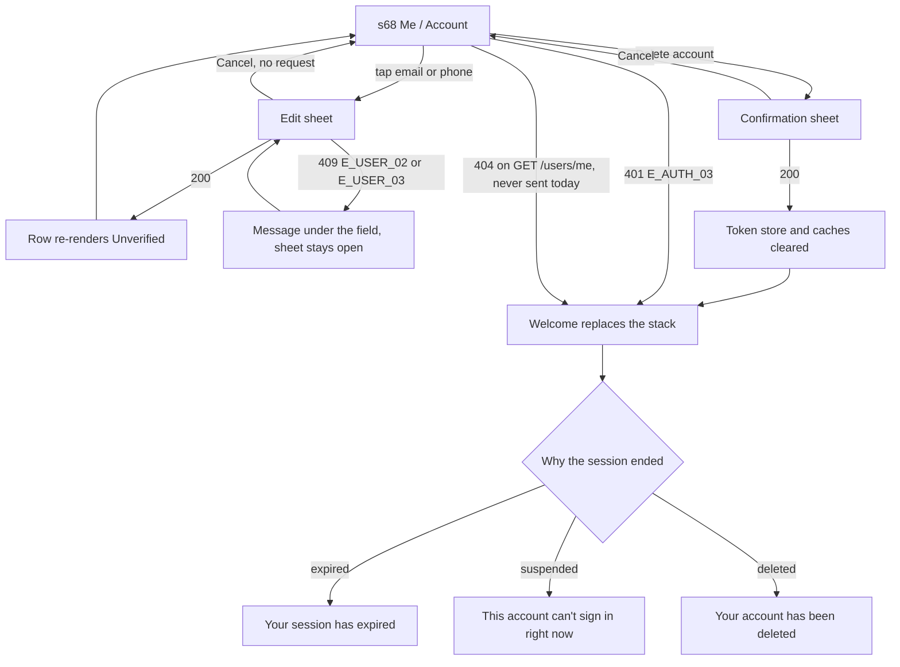

# 🧪 Account · QA Frontend

> ⚠ Affected by [[An unverified changed email still signs in]] (2026-10-26): row F10's expectation is withdrawn. [[DR-20 The changed address still signs in, the words are corrected]] decided option 2, and [[Account Story]] S2 and S3 no longer promise that a new address must be verified before it can sign in — the copy the app ships ("Confirming a new email or number isn't in the app yet") is now the copy the story asks for. Re-run F10 against the corrected story and clear it from `pending`. `/qa`.

**Feature:** [[Account]] · **Verifies:** [[Account Frontend Delivery]] against [[Account Story]] · **Verdict:** ✏️ Draft · not run

Expected behaviour of the screens, as artefacts: journeys, states and copy to check a build against, **not test code**. `status: passing` or `failing` after a run; the verdict tells the PM whether the story can be fulfilled (passing with nothing pending).

## Scope

**Covered.** [[Screen Index#s68|s68]] Me / Account as [[Account Frontend Delivery]] describes it on `social_pin` `main` @ `e032a48`: the header, the plan card, the ACCOUNT group and its verified chips, the change email / phone sheet, delete account, and the three ways a session ends (expired, suspended, deleted) with the message each shows on Welcome.

**Not covered.** The API behind it, which is [[Account QA Backend]]'s (QB-04). The rows s68 only hosts — Photo library (s30), Interests (s71), My companies (s72), My devices (s75), Business account (s63), Notifications (s69), Upgrade (s70) — each belongs to its own feature. The profile editor behind the privacy row ([[Profiles & Pin Name]]).

**How a declared deviation is judged.** [[Account Frontend Delivery]] lists six deliberate departures from [[Account Story]]. A row that differs *only* because of one of them is marked **▲ deviation** and points at the card that settles it — it is not a frontend failure, and it is not a pass either: the story still says something else, so the story or the delivery has to move before S-01 can be fulfilled. A row that differs from *both* the story and the delivery note is a plain failure and gets a bug ([[Agent Rules#2 · Codes, scopes and the "sum of" rule]]).

**Not run.** No verdict is recorded here: the client is not on the machine this note was written on. Every row is ⬜ until someone runs the build named above and records it ([[QA Agent#4B · Record a run]]). The client's own checklist for the same screen is `docs/TEST_CASES_2026-10-18.md`, AC-01…AC-15 and DA-01…DA-08.

## Journeys

✅ as expected · ▲ declared deviation, not settled · 🔴 differs from both the story and the delivery · ⬜ not run.

| # | Story | Steps | Expected | Checked |
|---|---|---|---|---|
| F1 | S1 | Sign in, open Me | Header shows the default profile's full name and `!pinName` from `GET /profiles` `data[0]`; the account rows come from `GET /users/me`. Three sources, never one. | ⬜ |
| F2 | S1 | Open Me with an unverified email or phone | Each destination carries its own verified / unverified chip, read from `emailVerifiedAt` / `phoneVerifiedAt`; never computed on the client. | ⬜ |
| F3 | S1 | Open Me on a `PRO` account | The plan card reads "Pro plan" and hides Upgrade. **The story asks for a Pro badge in the header**; the delivery puts the state on the plan card instead. | ⬜ ▲ |
| F4 | S1 | Open Me, background the app, return | The account is re-read on return to the foreground, and after a token refresh. Triggers that coincide make one request. | ⬜ |
| F5 | S1 | Open Me offline, first launch | The saved copy renders first, the server has 10 s, and a failed refresh keeps what is on screen rather than emptying it. | ⬜ |
| F6 | S1 | Read the screen and the logs | No code, token or password is rendered or logged anywhere. | ⬜ |
| F7 | S2 | Tap the email row | A bottom sheet opens with one field. **The story asks for inline edit**; the delivery uses a sheet with the same input and checks as Welcome. | ⬜ ▲ |
| F8 | S2 | Type ` New.Address@Example.COM `, save | Sent trimmed and lower-cased to `PATCH /users/me { email }`; only the changed key is sent, and an unchanged value sends nothing. | ⬜ |
| F9 | S2 | Save a valid new email | On 200 the row re-renders from the response with the email **Unverified**. There is no "saved" message — the row is the confirmation ([[Account Frontend Delivery]] says a snack bar has no scaffold to show on inside a tab). | ⬜ ▲ |
| F10 | S2 | Read the copy under the ACCOUNT group while anything is unverified | It reads "Confirming a new email or number isn't in the app yet". **The story asks it to say the address must be verified before it can be used to sign in** — which would be untrue: the backend signs in on an unverified address ([[Account QA Backend]] B9, [[An unverified changed email still signs in]]). The copy is right and the story is wrong until B-01 settles it. | ⬜ ▲ |
| F11 | S2 | Save an email that is on another account | "This email is already on another account" under the field, the sheet stays open, the value is kept. Branches on `E_USER_02`, falling back to a bare 409 until [[T-063 Put the ErrorCode on the error body]]; the server `message` is never shown. | ⬜ |
| F12 | S2 | Open the sheet, type, Cancel | No request is sent and the previous value stands. | ⬜ |
| F13 | S3 | Change the phone | Country picker plus number, sent E.164. On 200 the row shows Unverified with the same copy as F10. | ⬜ |
| F14 | S3 | Save a number that is on another account | "This number is already on another account", same placement and fallback as F11 (`E_USER_03`). | ⬜ |
| F15 | S3 | Look for a way to clear the email or phone | Not offered: the account keeps at least one way to sign in. | ⬜ |
| F16 | S4 | Tap Delete account | A confirmation sheet names the consequence: every Ring, projection and session goes, and the email and phone are released. | ⬜ |
| F17 | S4 | Confirm the delete | On 200 the token store and every cache are cleared and Welcome **replaces the whole stack** — no back navigation into the signed-in shell. `POST /auth/logout` is not called. | ⬜ |
| F18 | S4 | A delete that fails | The session is kept and the user stays on s68. | ⬜ |
| F19 | S4 | Return to the app after the account was deleted elsewhere | The session ends quietly with "Your account has been deleted." on Welcome — a sign-out, not an error toast. **The client branches on a 404 from `GET /users/me`, which the server never sends**: it answers `401 "Account is not active"` ([[Account QA Backend]] B14, [[Deleted account answers 401, not the documented 404 E_USER_01]]). Check which message actually appears. | ⬜ |
| F20 | S6 | A suspension lands mid-session | The session ends with no refresh attempted. The message should read "This account can't sign in right now. Contact support…"; until [[T-063 Put the ErrorCode on the error body]] puts `E_AUTH_03` on the wire it reads "Your session has expired" instead. The branch is in and needs no change then. | ⬜ ▲ |
| F21 | S6 | Look for the not-active screen | **The story asks for a sign-out screen of its own**; the delivery uses Welcome with a message, support line included. | ⬜ ▲ |
| F22 | S5 | Open the privacy row | **The story asks it to show whether each sensitive value is set on the profile, and to open the profile editor**; the delivery shows which Rings expose each field and opens nothing. Two departures in one row. | ⬜ ▲ |
| F23 | S1 | Look at the rows that have no backend | Linked accounts, devices and subscription read as "coming soon", never as empty errors or failures. | ⬜ |
| F24 | S1 | Look at the connection count | The delivery renders a **sample 218** ([[T-005 Connection count on Me and Home]] is not built). A number that is not the user's, shown as if it were, is worse than an absent one: it should read as unavailable or coming soon, like F23. Confirm what ships, and file a bug if the sample is live. | ⬜ |
| F25 | S1 | Look at the header photo | Initials until [[T-062 Serve uploaded file bytes by id]]; no broken image and no spinner that never ends. | ⬜ |

## Screen states

| Screen | State | Expected rendering |
|---|---|---|
| [[Screen Index#s68\|s68]] | first launch, cache warm | the saved account renders at once, refreshed in place when the server answers within 10 s |
| s68 | first launch, no cache | loading skeleton for the header, then the three sources fill in |
| s68 | refresh failed | what is on screen stays; no empty state, no error toast over good data |
| s68 | verified | chip on the destination, read from the timestamp |
| s68 | unverified | chip plus the one explanatory line under the ACCOUNT group |
| s68 | Free | plan card with Upgrade (s70, no backend) |
| s68 | Pro | plan card reads "Pro plan", Upgrade hidden |
| s68 | edit sheet, saving | one request at a time behind the loader, not optimistic |
| s68 | edit sheet, conflict | message under the field, sheet open, value kept |
| s68 | delete confirmation | destructive styling, the consequence named |
| Welcome | session expired | "Your session has expired…" |
| Welcome | account suspended | "This account can't sign in right now. Contact support…" |
| Welcome | account deleted | "Your account has been deleted." |

## Flow diagram

## Error copy

| ErrorCode | Where | Copy shown |
|---|---|---|
| `E_USER_02` | edit sheet, email | "This email is already on another account", under the field |
| `E_USER_03` | edit sheet, phone | "This number is already on another account", under the field |
| `E_AUTH_03` | any authenticated call | Welcome · "This account can't sign in right now. Contact support…" — reads as expired until [[T-063 Put the ErrorCode on the error body]] |
| `E_USER_01` | `GET /users/me` | Welcome · "Your account has been deleted." — the client expects a 404, the server sends 401 ([[Deleted account answers 401, not the documented 404 E_USER_01]]) |
| any 401 after a failed refresh | any call | Welcome · "Your session has expired…" |
| — | any of the above | the server's `message` is never shown for these: the copy is the client's |

No body on this build carries `ErrorCode` at all ([[Account QA Backend]], [[T-063 Put the ErrorCode on the error body]]), so every branch above is reached today by status plus endpoint. Checking them means checking the fallback, not the code.

## Verdict

- **Run on:** — · **build:** `social_pin` `main` @ `e032a48`, the build these artefacts describe · **result:** ✏️ draft, not run · **rows:** 25, all ⬜.
- Seven rows are already known to differ from [[Account Story]] by a deviation [[Account Frontend Delivery]] declares: F3, F7, F9, F10, F20, F21, F22. None is a frontend defect; each needs the story or the delivery note to move before `S-01` can be fulfilled, which is the PM's call with the frontend.
- F10 and F19 are the frontend's view of the two bugs QB-04 already filed, [[An unverified changed email still signs in]] and [[Deleted account answers 401, not the documented 404 E_USER_01]]. F10 is worth noting the other way round: the delivery's copy is honest and the **story** is the thing that is wrong, which B-01 should settle.
- F24 is the one row that may be a new bug rather than a deviation — a sample connection count rendered as if it were the user's.
- **[[Account Story]] (S-01) is not ready to fulfil:** [[Account QA Backend]] is failing on B9 and B14, and this note has not been run.

## Log

- 2026-10-26 · written from [[Account Frontend Delivery]] (`social_pin` `main` @ `e032a48`) and [[Account Story]] S1–S6; 25 rows, none run, seven marked as declared deviations. No verdict recorded: the client is not on this machine.
