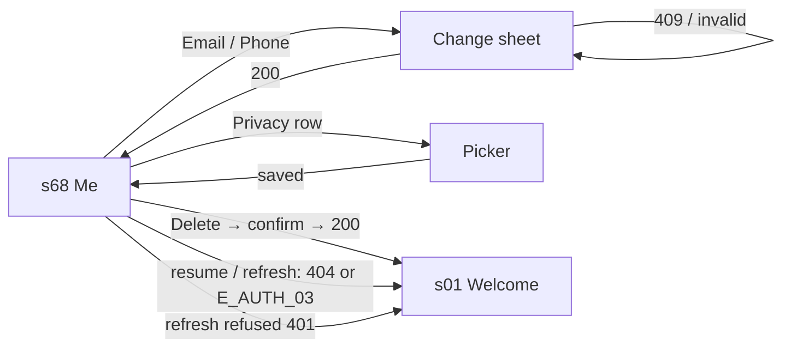

# 🧪 Account · QA Frontend

> ⚠ Affected by [[B-01 An unverified changed email still signs in]] (2026-10-26): this note was written twice in parallel; the merge kept the run on `47ce960` and dropped the unrun draft. B-01's `pending` asks for "row F10" of the draft (the copy under the ACCOUNT group while anything is unverified, now the copy [[D-20 The changed address still signs in, the words are corrected]] accepts): find the row of this run that covers it and clear B-01's item. `/qa`.

**Feature:** [[Account]] · **Verifies:** [[Account Frontend Delivery]] against [[Account Story]] · **Verdict:** ✅ Passing on every row run · 2026-10-26 · `social_pin` `main` @ `47ce960` · 8 rows not run (see `pending`)

Expected behaviour of the screens, as artefacts: journeys, states and copy to check a build against, **not test code**. `status: passing` or `failing` after a run; the verdict tells the PM whether the story can be fulfilled (passing with nothing pending).

## Scope

[[Screen Index#s68|s68]] Me / Account: the header, the plan card, the ACCOUNT group and its change email / phone sheet, the PRIVACY group and its pickers, Delete account; and the sign-out states that land on [[Screen Index#s01|s01]] Welcome. Each row names the step-by-step case in the client's `docs/TEST_CASES_2026-10-18.md` (AC-01…AC-19, DA-01…DA-08, PR, RP-12 / RP-13) that a run follows. Out of scope: what waits on backend tasks and ships as placeholders (photo, connections, devices, linked accounts, subscription), listed in [[Account Frontend Delivery#Not done yet]].

## Journeys

| # | Story | Steps (case) | Expected | Checked |
|---|---|---|---|---|
| F1 | S1 | Sign in → Me (PR-01) | The header shows the default profile's full name and `!pinName`; the photo is initials until [[T-062 Serve uploaded file bytes by id]]. | ✅ |
| F2 | S1 | Me (AC-01, AC-02) | ACCOUNT group under the plan card: Email and Phone with the real values, each **Verified** or **Unverified** from `…VerifiedAt`; "Add" where there is none; "Last signed in" as a relative time. | ✅ |
| F3 | S1 | A Free and a Pro account → Me (AC-03) | Free: "Free plan" and **Upgrade**, which opens [[Screen Index#s70|s70]]. Pro: "Pro plan", no Upgrade (shown on the plan card, not as a header badge: [[Account Frontend Delivery#Deviations from the story or the integration note]]). | ⬜ Free side ✅ (AC-01); Pro side and Upgrade → s70 not run |
| F4 | S1 | Change the plan or verify an address on the backend → background → foreground (AC-12, AC-10) | Me shows the change without a restart. | ⬜ not run: needs the plan or a verification changed on the backend |
| F5 | S1 | Use every Account journey above and below | No sign-in code, access or refresh token is ever on screen; there is no password row. | ⬜ not run: a judgement check, by hand |
| F6 | S2 | Email → new address → Save (AC-04) | The sheet closes; the row shows the new address, **Unverified**, and the note "Confirming a new email or number isn't in the app yet." under the group. | ✅ |
| F7 | S2 | Email → `not-an-email` → Save (AC-06) | "Enter an email like name@example.com." under the field; nothing sent. | ✅ |
| F8 | S2 | Email → an address on another account → Save (AC-07) | "This email is already on another account." under the field; the sheet stays open. | ✅ |
| F9 | S2 | Email → Save unchanged, or Cancel (AC-05) | The sheet closes; nothing sent; the row is unchanged. | ✅ |
| F10 | S3 | Phone → pick the country → new mobile → Save (AC-09) | The sheet closes; the number shows as `+963 …`, **Unverified**. | ✅ |
| F11 | S3 | Phone → a number on another account → Save (AC-08) | "This number is already on another account." under the field. | ✅ |
| F12 | S3 | Phone → clear the field → Save | "Enter your phone number." under the field; nothing sent: a destination cannot be cleared. | ✅ |
| F13 | S4 | Me → Delete account (DA-01, DA-02, DA-03) | "Delete account" in red under Sign out; a sheet names what happens; Cancel or swipe keeps you signed in on Me. | ✅ |
| F14 | S4 | Delete account → Delete my account (DA-04, DA-05) | Loader, then Welcome with "Your account has been deleted."; Back cannot return; the same email then signs up as new. | ⬜ Welcome and "Your account has been deleted." ✅ (every flow's cleanup); Back and DA-05 not run |
| F15 | S4 | Delete from phone B; phone A comes back to the foreground, or opens cold (AC-13, AC-14, DA-06) | Phone A lands on Welcome, not on the saved account. Copy: "Your account has been deleted." only if the API answers 404; today it answers 401 ([[B-02 Deleted account answers 401, not the documented 404 E_USER_01]]), so expect "Your session has expired. Please sign in again." | ⬜ not run: needs a second phone |
| F16 | S4 | Airplane mode → Delete account → Delete my account (DA-07) | The connection error toast; still signed in, still on Me. | ⬜ not run: needs airplane mode |
| F17 | S5 | Me → Privacy (AC-16, RP-13, RP-12) | Each row: on the right what's set on the profile or "Not set"; under the title which of your Rings show it, or "Hidden from all Rings"; never "public". The note says setting a value shows it on no Ring. | ✅ |
| F18 | S5 | Tap Gender → Female; Marital status → the value already set; Birthdate → a date → OK (AC-16, AC-17, AC-18) | Gender shows **Female**; the line under the title is unchanged (no Ring starts showing it). The same value sends nothing. Birthdate shows the picked date. A picker opens, not a profile editor (recorded deviation). | ✅ |
| F19 | S6 | Suspend the account while signed in → use the app (AC-15) | Welcome with "This account can't sign in right now. Contact support…", no retry loop. Until [[T-063 Put the ErrorCode on the error body]] the copy is "Your session has expired."; cannot be run until [[T-068 Account moderation and platform role]] suspends an account. | ⬜ not run: see `pending` |
| F20 | all | Repeat F2, F6, F13 and F18 in **Arabic** (AC-11, AC-19, DA-08) | Texts in Arabic, right-to-left; the phone number stays left-to-right. | ⬜ F2, the change sheet's title, F18 and the delete ✅ in Arabic (AC-19); saving a change in Arabic not run |

## Screen states

| Screen | State | Expected rendering |
|---|---|---|
| [[Screen Index#s68\|s68]] | account not loaded yet | No ACCOUNT group; plan card reads "Free plan". The rest of Me renders. |
| s68 | account loaded | ACCOUNT group with Email, Phone (chips or "Add") and "Last signed in"; plan card from `accountType`. |
| s68 | something unverified | The note under the ACCOUNT group: "Confirming a new email or number isn't in the app yet." |
| s68 · change sheet | open | Title "Change your email" / "Change your phone number", one field (phone with the country button), helper "It shows as unverified after you change it.", Save, Cancel. |
| s68 · change sheet | saving | The loader over the sheet; Save does nothing until the answer. |
| s68 · change sheet | error | The message under the field; the sheet stays open with what was typed. |
| s68 · Privacy | profile not loaded | Each row "Not set"; the sample Ring line under the title. |
| s68 · Privacy picker | open | Gender / Marital status: a sheet of values, the current one ticked. Birthdate: the date picker. |
| s68 · delete sheet | open | "Delete your account?", the consequence, "Delete my account" in red, Cancel. |
| [[Screen Index#s01\|s01]] | after a sign-out state | Welcome, nothing to go back to, one message for why (see *Error copy*). |

## Flow diagram

## Error copy

| ErrorCode | Where | Copy shown |
|---|---|---|
| `E_USER_02` (409) | change email sheet | "This email is already on another account." |
| `E_USER_03` (409) | change phone sheet | "This number is already on another account." |
| — (client check) | change email sheet | "Enter your email." / "Enter an email like name@example.com." |
| — (client check) | change phone sheet | "Enter your phone number." / "That number doesn't look right. Check it and the country code." |
| `E_USER_01` (404) | any return of `GET /users/me` | Welcome: "Your account has been deleted." (unreachable today: [[B-02 Deleted account answers 401, not the documented 404 E_USER_01]]) |
| `E_AUTH_03` (401) | any call | Welcome: "This account can't sign in right now. Contact support if this keeps happening." (once [[T-063 Put the ErrorCode on the error body]] ships) |
| `E_AUTH_04` (401) | the refresh | Welcome: "Your session has expired. Please sign in again." |
| — (no connection) | Delete account | The connection error toast; the session is kept. |

## Verdict

- Run on: 2026-10-26 · build: `social_pin` `main` @ `47ce960`, development debug APK, on an Android phone against the dev API (`social-pin.api.dev.brain-socket.com`) · result: ✅ **passing** on every row run: F1, F2, F6–F13, F17, F18 · failing rows: none
- How: 11 Maestro flows in the client's `.maestro/account/` (one per case, AC-01…AC-19 and DA-01…DA-04), each signing up a throwaway account and deleting it at the end. All 11 passed; one flake (AC-04's cleanup waited past 8 s on a slow delete) passed on re-run.
- Not run (⬜, in `pending`): F3 Pro side, F4, F5, F14 in part, F15, F16, F20 in part — by hand; F19 — waits on [[T-068 Account moderation and platform role]] and [[T-063 Put the ErrorCode on the error body]]. The note stays Partial until they are.
- Seen on the run, not a failure: an account that has only signed up has no "Last signed in" row — `lastLoginAt` is empty until the first sign-in, and the row is hidden then (AC-01b checks it on an account that has signed in).
