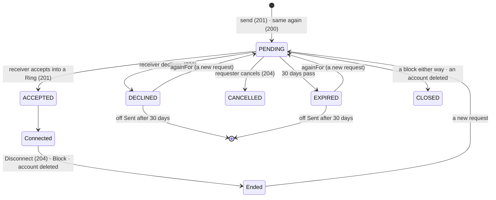

# 🧪 Connections · QA Backend

> Blocked by default until [[BD-14 Connections Backend Delivery]] is `done` (the hand-off order in `docs.config.json`); `blockedBy: []` opts out, `blockedBy: [...]` names other blockers.

**Feature:** [[F-14 Connections]] · **Verifies:** [[BD-14 Connections Backend Delivery]] against [[S-23 Connections Story]] and [[FR-14 Connections Frontend Requirements]], with the shapes, errors and rules of [[BI-16 Connections Backend Integration]] · **Verdict:** Passing on backend `main` `ebdca36`, 2026-11-09: B1–B105, all as expected

Expected behaviour of the API, as artefacts a person can check a build against: tables and diagrams, **not test code** (the specs live in the backend repo). `status: passing` or `failing` after a run; the verdict tells the PM whether the story can be fulfilled (passing with nothing pending or unmet). A failing row is one of two things: a story part the delivery does not fulfil (not built, or built other than the story says) goes in `unmet` and turns the story's badge ✕; a bug (built as asked, but it breaks) is filed against the Backend Integration and goes in `pending`, and leaves the story alone.

## Scope

**Covered:** every row of BI-16's *Screens → calls*, *Shapes that matter*, *Errors to handle* and *Rules the UI must respect* that the API answers for, across the story's S1–S14 and S16: opening a card by Pin name or by scan and asking where you stand (S1, S2); Connect by `pinName`, `qrToken` or `againFor`, with the note rules (S2); Incoming, Sent, the pending count, decline, cancel, expiry and the 30 days on Sent (S3, S4, S6); accept into a Ring with a window (S5); what the requester gets (S7); Contacts, search, *No access*, the count (S8, S12, S14); Connection detail, including a member who is not a connection (S9, D-29); one connection per pair (S10); Disconnect (S11); block and unblock by all three keys (S13); a renamed Pin name and a deleted account (S16).

**Not covered:**
- S15 (after an event, v1), and BI-16's *Not available yet* list: not built, so not checked.
- Blocking a colleague met only in a Ring's roster (`POST /blocks { userId }` for someone from `GET /rings/:ringId/colleagues`). BD-14 lists it as `pending`, built on backend branch `FR-14/connection/block-a-colleague` and not merged. It gets its own rows when it reaches `main`.
- 409 `E_RING_MEMBER_04` on accept. A block closes the pending request in the same transaction (B74), so the API gives no route to an open request between two people who block each other. Not reachable over HTTP; the backend's unit specs cover it.
- `ErrorCode` itself. It is not on the wire until [[S-87 Error Contract Story|Error Contract]] (BI-16: "branch on the status and the route"), so each error row checks the status and the situation, not the code. The codes are listed for when they arrive.
- The screens: the Checklist rows of BI-16 are the client's, and [[FD-13 Connections Frontend Delivery]] reports them. That belongs to QA Frontend.

**How the run was made:** over HTTP against backend `main` `ebdca36` (the merge of `D-25/connection/account-deletion`), built with `nest build` and started on `localhost:3100` (Node 22), on the throwaway database `social_pin_qa_bi16` (migrated with `prisma migrate deploy`, seeded, dropped after the run). Before the run, `pnpm typecheck` was clean and `pnpm test` gave 43 suites, 1,026 tests passing. Every user signed in through the OTP flow. Seeded: **Sara** (`SaraAz`), **Omar** (`OmarK`, in Sara's *E-commerce Clients*; Sara in his *My Ring*), **GulfExpo** (in Sara's *Family*), **SPAdmin** (in no Ring). Signed up for the run: **Lina**, **Dana**, **Rami**, **Zed**, **Yara** (B1–B100), then **Ana** and **Bassel** (B101–B105). Badges came from `POST /rings/:ringId/qr`. Everything went through the API except three direct writes to the database: one request's `expires_at` set one second in the past, to make it expired (B60–B63); then a declined request's `responded_at` and an expired one's `expires_at` set 31 days back, to test the 30 days on Sent (B64); and one read-only count of active memberships (B88). The first run ended 96/97: row B97 expected Sara's name on a Sent row that Yara had sent by scan only. BI-16 says "anyone else only their Pin name", so the row was wrong, not the API. The row was corrected, and B1–B100 were re-run on a freshly recreated database.

## Expected behaviour

"The card's 404" is `GET /views/pin/:pinName` answered for a card you may not see. "Same body" means identical but for `path` and `timestamp`.

### The card and where you stand (S1, S2)

| # | Given | When | Then | Checked |
|---|---|---|---|---|
| B1 | Omar shares with Sara; no request either way | Sara `GET /connections/relationship?pinName=OmarK` | 200 `{ state: NONE, requestId: null }`, those two keys only | ✅ |
| B2 | — | relationship on your own Pin name | `NONE` | ✅ |
| B3 | SPAdmin is in none of Sara's Rings | relationship `?pinName=SaraAz`, and an unknown Pin name | 404, the same body as the card's 404, for both | ✅ |
| B4 | — | relationship with both `pinName` and `qrToken`, or neither | 400, `message` an array | ✅ |
| B5 | no bearer | relationship, `GET /connections`, `GET /blocks` | 401 | ✅ |

### Connect (S2)

| # | Given | When | Then | Checked |
|---|---|---|---|---|
| B6 | Omar can open Sara's card | `POST /connections/requests { pinName: SaraAz, note: "  We met at TechSummit  " }` | 201, `PENDING`, note trimmed, `source: PIN_NAME` | ✅ |
| B7 | B6 | the answer | `expiresAt` exactly 30 days after `createdAt` | ✅ |
| B8 | B6 | the answer | `to { displayName, pinName, avatarUrl }`; no `from`, no `userId`, no key naming a Ring | ✅ |
| B9 | B6 pending | the same send, the Pin name in another case | 200, the same request `id` | ✅ |
| B10 | B6 pending | Omar's relationship | `REQUESTED`, `requestId` = B6 | ✅ |
| B11 | B6 pending | Sara's relationship `?pinName=OmarK` | `THEY_ASKED`, `requestId` = B6 | ✅ |
| B12 | B6 pending | Sara asks Omar | 409 (`E_CONNECTION_REQUEST_03`, D-24) | ✅ |
| B13 | — | a note of 201 characters | 400 | ✅ |
| B14 | — | your own Pin name | 400 (`E_CONNECTION_REQUEST_04`) | ✅ |
| B15 | Sara's card 404s for SPAdmin | SPAdmin sends `{ pinName: SaraAz }` | the card's 404, same body | ✅ |
| B16 | — | `pinName` + `againFor`; only a note; a `userId` | 400 each | ✅ |
| B17 | — | a `qrToken` of 129 characters | 400 | ✅ |

### Incoming and Sent (S3, S4)

| # | Given | When | Then | Checked |
|---|---|---|---|---|
| B18 | B6 pending | Sara `GET /connections/requests?direction=incoming` | the row has `from` with Omar's `userId`, no `to`; no key names a Ring | ✅ |
| B19 | — | Incoming `?limit=1` | one row; `meta.total` is the unpaginated count | ✅ |
| B20 | B6 pending | Omar's Sent | the row has `to`, no `from`, no `userId` anywhere | ✅ |
| B21 | — | no `direction`; `limit=51` | 400 each | ✅ |

### Accept into a Ring (S5, S7)

| # | Given | When | Then | Checked |
|---|---|---|---|---|
| B22 | B6 pending | accept with `expiresAt` in the past | 400 (`E_CONNECTION_REQUEST_05`) | ✅ |
| B23 | — | accept with `expiresAt` before `startsAt` | 400 (`E_CONNECTION_REQUEST_05`) | ✅ |
| B24 | — | Omar accepts his own request | 404 (`E_CONNECTION_REQUEST_01`) | ✅ |
| B25 | — | Sara accepts into Omar's Ring | 403 (`E_RING_05`) | ✅ |
| B26 | — | accept an unknown request id | 404 (`E_CONNECTION_REQUEST_01`) | ✅ |
| B27 | a Ring Sara created, then deleted | accept into it | 404 (`E_RING_02`) | ✅ |
| B28 | B6 pending | Sara accepts into *Family* | 201 `{ connection, membership }`; membership `ACTIVE`, Omar's, in *Family* | ✅ |
| B29 | B28 | `connection` | `userId`, `displayName`, `pinName: OmarK`, `avatarUrl`, `connectedAt`, `source: PIN_NAME`, `ringCount: 2` (*E-commerce Clients* and *Family*) | ✅ |
| B30 | B28 | accept again | 409 (`E_CONNECTION_REQUEST_02`) | ✅ |
| B31 | B28 | Omar refetches | relationship `CONNECTED`; the request has left Sent | ✅ |
| B32 | B28 | Omar `GET /rings/shared-with-me` | Sara is listed; nothing says *Family* (D-14) | ✅ |
| B33 | B28 | Omar asks again | 409 (`E_CONNECTION_01`) | ✅ |

### Contacts, count, search, detail (S8, S9, S12, S14)

| # | Given | When | Then | Checked |
|---|---|---|---|---|
| B34 | B28 | Sara `GET /connections`, `GET /connections/count` | Omar with `ringCount: 2`; `{ connections: 1 }`, equal to `meta.total` | ✅ |
| B35 | B28 | Omar's count | `{ connections: 1 }`: it counts on both sides | ✅ |
| B36 | — | `q=OMA`, `q=Khalil`, `q=gulf` | Omar by Pin name and by name, any case; GulfExpo (a member, not a contact) is not found | ✅ |
| B37 | — | `noAccess=true`, `false`, `maybe`; `limit=51` | none / Omar / 400 / 400 | ✅ |
| B38 | B28 | Sara `GET /connections/:omarId` | `connectedAt`, `source: PIN_NAME`, an integer `mutualCount`, two `memberships` in Sara's Rings, oldest first | ✅ |
| B39 | GulfExpo is in *Family*, not a connection | detail | 200, `connectedAt: null`, `source: null`, memberships listed (D-29) | ✅ |
| B40 | SPAdmin is neither | detail | 404 (`E_CONNECTION_02`) | ✅ |
| B41 | GulfExpo is a member, not a connection | `DELETE /connections/:gulfId` | 404 (`E_CONNECTION_02`) | ✅ |
| B42 | B28 | Omar's detail of Sara | his own Rings only; *Family*'s id never appears | ✅ |

### By scan (S1, S2, D-10)

| # | Given | When | Then | Checked |
|---|---|---|---|---|
| B43 | Lina is in none of Sara's Rings | `GET /views/qr/:token` with Sara's badge | 200 | ✅ |
| B44 | — | relationship `?qrToken=` | `NONE` | ✅ |
| B45 | — | Connect `{ qrToken, note: "   " }` | 201, `source: SCAN`, `note: null` | ✅ |
| B46 | B45 | Sara's Incoming | the row reads `SCAN`, `from.userId` is Lina | ✅ |
| B47 | — | Sara sends to her own badge; relationship with it | 400 (`E_CONNECTION_REQUEST_04`); `NONE` | ✅ |
| B48 | — | relationship with a malformed token | the card's 404; the same body as `GET /views/qr/` with it | ✅ |

### Decline, ask again, cancel (S4, S6)

| # | Given | When | Then | Checked |
|---|---|---|---|---|
| B49 | B45 pending | Sara `POST …/decline` | 200, empty body | ✅ |
| B50 | B49 | Lina's Sent and relationship | `DECLINED` on both; relationship gives the `requestId` | ✅ |
| B51 | B49 | decline again | 409 (`E_CONNECTION_REQUEST_02`) | ✅ |
| B52 | B49 | Sara's Incoming | the request is gone | ✅ |
| B53 | B49 | Lina `{ againFor: <declined id> }` straight away | 201, a new `PENDING` request | ✅ |
| B54 | — | `againFor` someone else's request | 404 (`E_CONNECTION_REQUEST_01`) | ✅ |
| B55 | B53 pending | Lina `DELETE /connections/requests/:id` | 204, empty | ✅ |
| B56 | B55 | Sara's Incoming | the request is gone | ✅ |
| B57 | B55 | cancel again | 409 (`E_CONNECTION_REQUEST_02`) | ✅ |
| B58 | — | cancel someone else's request; an unknown id | 404 (`E_CONNECTION_REQUEST_01`) each | ✅ |
| B59 | B28 accepted | decline it | 409 (`E_CONNECTION_REQUEST_02`) | ✅ |

### Expiry and the 30 days (S4, D-17, D-27)

| # | Given | When | Then | Checked |
|---|---|---|---|---|
| B60 | a pending request whose `expiresAt` has just passed | Sara's Incoming | gone at once | ✅ |
| B61 | B60 | Lina's Sent | the row reads `EXPIRED` | ✅ |
| B62 | B60 | Lina's relationship | `EXPIRED` with its `requestId` | ✅ |
| B63 | B60 | Sara accepts it | 409 (`E_CONNECTION_REQUEST_02`) | ✅ |
| B64 | a declined row and an expired row, both ended 31 days ago | Lina's Sent | neither is listed | ✅ |

### The badge after a reset, and the rate limit (D-10, BI-15)

| # | Given | When | Then | Checked |
|---|---|---|---|---|
| B65 | Sara resets her badge (`POST /rings/:ringId/qr/reset`) | relationship, Connect and Block with the old token | the card's 404, same body, on all three | ✅ |
| B66 | Rami | 22 relationship calls with refused tokens inside a minute | calls 1–20 answer 404; call 21 answers 429 (`E_BADGE_01`) | ✅ |
| B67 | Rami is limited | relationship with the live token | 429 | ✅ |
| B68 | Yara | two successful relationship calls | 200 both; they do not count toward the limit | ✅ |

### Block and unblock (S13)

| # | Given | When | Then | Checked |
|---|---|---|---|---|
| B69 | Lina, after B55, is no contact, member or requester of Sara's | `POST /blocks { userId: lina }` | 404 (`E_BLOCK_02`) | ✅ |
| B70 | — | block yourself by `userId`, your own badge, your own Pin name | 404 (`E_BLOCK_02`) each | ✅ |
| B71 | — | two keys; none | 400 each | ✅ |
| B72 | Dana has a pending request to Sara | Sara blocks `{ userId: dana }` | 201, exactly `{ id, displayName, pinName, avatarUrl: null, blockedAt }` | ✅ |
| B73 | B72 | block again | 200, the same `id` | ✅ |
| B74 | B72 | Sara's Incoming; Dana's relationship by scan | the request is closed; Dana gets the card's 404 | ✅ |
| B75 | B72 | `GET /blocks` | the row is listed; no `userId` in the body | ✅ |
| B76 | B72 | `DELETE /blocks/:id`, then again | 204; then 404 (`E_BLOCK_01`) | ✅ |
| B77 | B76 | Sara's Incoming | Dana's request does not come back | ✅ |
| B78 | Yara opened Sara's card by scan | block `{ qrToken }` | 201, `pinName: SaraAz` | ✅ |
| B79 | B78 | Yara's relationship with that token | the card's 404 | ✅ |

### Disconnect (S11, D-26)

| # | Given | When | Then | Checked |
|---|---|---|---|---|
| B80 | GulfExpo (a *Family* member) asks by Pin name | Sara accepts into *My Ring* with `expiresAt` 2031-01-01 | 201; `membership.expiresAt` kept; `ringCount: 2` | ✅ |
| B81 | B80 | `DELETE /connections/:gulfId` | 204, empty | ✅ |
| B82 | B81 | Sara's detail and Contacts | detail 404 (`E_CONNECTION_02`), so both memberships ended too; gone from Contacts | ✅ |
| B83 | B81 | GulfExpo's relationship with Sara | the card's 404: GulfExpo's access has ended, and nothing says so | ✅ |
| B84 | B81 | disconnect again | 404 (`E_CONNECTION_02`) | ✅ |

### Blocking a connection (S13)

| # | Given | When | Then | Checked |
|---|---|---|---|---|
| B85 | Sara and Omar connected (B28) | Omar blocks `{ pinName: SaraAz }` | 201 | ✅ |
| B86 | B85 | Sara's Contacts, count, detail | Omar gone, `{ connections: 0 }`, detail 404 (`E_CONNECTION_02`) | ✅ |
| B87 | B85 | Sara's relationship `?pinName=OmarK` | the card's 404 (blocked either way) | ✅ |
| B88 | B85 | the memberships between them, both directions | no `ACTIVE` row left | ✅ |
| B89 | B85, then Omar unblocks | Sara's count and relationship | still 0 and the card's 404: unblocking restores nothing | ✅ |

### A deleted account (S16, D-25)

| # | Given | When | Then | Checked |
|---|---|---|---|---|
| B90 | Zed is connected to Sara, Dana has a pending request to her, and Sara has blocked Lina | Zed, Dana and Lina each `DELETE /users/me` | 200 each | ✅ |
| B91 | B90 | Sara's Contacts and count | Zed is gone; the count drops from 1 to 0 | ✅ |
| B92 | B90 | Sara's detail of Zed | 404 (`E_CONNECTION_02`) | ✅ |
| B93 | B90 | Sara's Incoming | Dana's request is gone | ✅ |
| B94 | B90 | Sara's Blocked people | the block on Lina is gone | ✅ |
| B95 | B90 | Sara's Sent | 200 | ✅ |

### The person on a row, and the calls around it

| # | Given | When | Then | Checked |
|---|---|---|---|---|
| B96 | Yara asks Sara by scan | Sara's Incoming | Yara's public card: `displayName` set, her Pin name | ✅ |
| B97 | Sara shares nothing with Yara | Yara's Sent | `to` is the Pin name only: `displayName` and `avatarUrl` `null` | ✅ |
| B98 | Sara shares *E-commerce Clients* with Omar | Omar's send answer (B6) | `to.displayName` is set: the card she shares with him | ✅ |
| B99 | Yara's Incoming row | Sara `GET /views/user/:userId/perspectives` with `from.userId` | 200 | ✅ |
| B100 | — | Sara `GET /rings` (s46's list) | `memberCount` on every Ring | ✅ |
| B101 | Bassel asked Ana by scan, and Ana accepted | Ana asks Bassel back by his badge | 409 (`E_CONNECTION_01`): one connection per pair (S10) | ✅ |
| B102 | B101, and Bassel adds Ana to his Ring | both `GET /connections` | one row each side; `meta.total` 1 each | ✅ |
| B103 | B102 | Ana's Shared with me | Bassel is one person row | ✅ |
| B104 | Bassel renames his Pin name | Ana's Contacts and detail, next fetch | both show the new Pin name (keyed by `userId`, S16) | ✅ |
| B105 | B104 | relationship with the old Pin name | the card's 404 | ✅ |

## State diagram

What relationship reads, as the requester (R) or the receiver (T): `NONE` before anything, after a cancel or on yourself · `REQUESTED` (R) / `THEY_ASKED` (T) while pending · `DECLINED` / `EXPIRED` (R, within 30 days) · `CONNECTED` once accepted · the card's 404 once blocked either way or once the card is no longer shared.

## Error matrix

| Situation | Status | ErrorCode | Same body as | Row |
|---|---|---|---|---|
| relationship, send or block for a card you may not see, an unknown Pin name, blocked either way | 404 | `E_RING_ACCESS_01` | `GET /views/pin/:pinName` | B3, B15, B74, B87 |
| a malformed, reset or unknown `qrToken` | 404 | `E_RING_ACCESS_01` | `GET /views/pin/:pinName`, `GET /views/qr/:token` | B48, B65 |
| more than 20 refused tokens in a minute | 429 | `E_BADGE_01` | — | B66, B67 |
| send: already connected | 409 | `E_CONNECTION_01` | — | B33, B101 |
| send: they asked you first | 409 | `E_CONNECTION_REQUEST_03` | — | B12 |
| cancel, accept, decline, `againFor`: no such request, or not yours | 404 | `E_CONNECTION_REQUEST_01` | — | B24, B26, B54, B58 |
| cancel, accept, decline: answered, cancelled or expired | 409 | `E_CONNECTION_REQUEST_02` | — | B30, B51, B57, B59, B63 |
| send: your own Pin name or badge | 400 | `E_CONNECTION_REQUEST_04` | — | B14, B47 |
| accept: `expiresAt` not after now and after `startsAt` | 400 | `E_CONNECTION_REQUEST_05` | — | B22, B23 |
| accept: the Ring is gone | 404 | `E_RING_02` | — | B27 |
| accept: not your Ring | 403 | `E_RING_05` | — | B25 |
| accept: this person cannot be added | 409 | `E_RING_MEMBER_04` | — | not reachable (*Scope*) |
| detail, disconnect: not a contact or member (disconnected, blocked, deleted) | 404 | `E_CONNECTION_02` | — | B40, B41, B82, B84, B86, B92 |
| block by `userId`: no one you can block from here; yourself by any key | 404 | `E_BLOCK_02` | — | B69, B70 |
| unblock: no such block of yours | 404 | `E_BLOCK_01` | — | B76 |
| not exactly one key; note over 200; `qrToken` over 128; `direction` missing; `noAccess` not boolean; `limit` over 50 | 400 | validation, `message` an array | — | B4, B13, B16, B17, B21, B37, B71 |
| no bearer | 401 | — | — | B5 |

On `ebdca36` the bodies carry `statusCode`, `message`, `error`, `path` and `timestamp`, and no `ErrorCode` yet ([[S-87 Error Contract Story|Error Contract]]).

## Privacy and access checks

- A card you may not see, an unknown Pin name, and blocked either way answer one body on relationship, Connect and Block, the same as the view's own 404 (B3, B15, B74, B87). A malformed or dead badge token answers that same body too, so the shape of a token gives nothing away (B48, B65).
- No request, accept answer, contact, detail or block given to the requester names a Ring: no Ring key, no Ring id, no Ring name (B8, B18, B32, B42). Only the receiver's own accept answer carries `membership.ringId`.
- Before the accept, the requester never receives the other person's `userId`: not on Sent, not on the send answer, not on relationship (B8, B20). A block row carries no `userId` either (B75).
- Disconnect, block and deletion are silent. The other side just loses access, and every error they then get is the same neutral 404 (B83, B87, B91–B94).

## Verdict

- Run on: 2026-11-09 · build: backend `main` `ebdca36` (local; `typecheck` clean, `pnpm test` 1,026/1,026) · result: **passing**, B1–B105 as expected · failing rows: none · story parts unmet: none · bugs: none
- Delivery matches [[BD-14 Connections Backend Delivery]] and [[BI-16 Connections Backend Integration]] on everything run; nothing to flag.
- Waiting: blocking a colleague from a Ring's roster (BD-14 `pending`, not on `main`) gets rows when it merges. S-23 also needs [[Connections QA Frontend]] before it can be fulfilled.
