# 🧪 Badge & QR · QA Backend

**Feature:** [[F-18 Badge & QR]] · **Verifies:** [[BD-18 Badge & QR Backend Delivery]] against [[S-37 Badge & QR Story]] and [[FR-18 Badge & QR Frontend Requirements]], with the shapes and errors of [[BI-15 Badge & QR Backend Integration]] · **Verdict:** ✅ Passing · 2026-11-09 · `main @ ebdca36 (local, not pushed) · localhost:3115, Node 22.22.2`

Expected behaviour of the API, as artefacts a person can check a build against: tables and diagrams, **not test code** (the specs live in the backend repo). `status: passing` or `failing` after a run; the verdict tells the PM whether the story can be fulfilled (passing with nothing pending or unmet). A failing row is one of two things: a story part the delivery does not fulfil (not built, or built other than the story says) goes in `unmet` and turns the story's badge ✕; a bug (built as asked, but it breaks) is filed against the Backend Integration and goes in `pending`, and leaves the story alone.

## Scope

**Covered.** The four routes of [[BI-15 Badge & QR Backend Integration]], `POST /rings/:ringId/qr`, `POST /rings/:ringId/qr/reset`, `GET /rings/:ringId/qr/scans` and `GET /views/qr/:token`, against S-37 S1, S2, S4, S6, S8 (the server side of *Connect*), S10, S11 and S13; and the three routes that act on a card opened by scan, `GET /connections/relationship?qrToken=`, `POST /connections/requests { qrToken }` and `POST /blocks { qrToken }`, for what BI-15 says about them (the shared refusal, the rate limit, the scan count). Their full shapes are [[BI-16 Connections Backend Integration]]'s and its QA note's.

**Not covered.** Everything the phone does alone: drawing the QR, "Changes in {time}", offline (S3), the flip (S5), own badge recognised by the app (S7), Saved scans (S8), *Enter a Pin name* (S9, [[BI-09 View As & Pin Views Backend Integration]]), Save image (S12): those are QA Frontend's. Not built by design or waiting on the domain, so not rows: the `/q/<token>` web page and Share link (S12, [[D-12 The badge QR is a socialpin.me link|D-12]]), a Pro permanent code (S14) and the 60 s event pass (S15). Not run: a suspended badge owner, a Ring ending between the access decision and the card, and the rate limit behind several API instances.

**Test data.** A throwaway database `social_pin_qa_bi15` (migrated, seeded, dropped at the end of the run) and eight accounts made inside the run, `qa-bi15-<P|S|X|K|L|M|D|G>-<run>@test.local`. Expired codes, ended and archived Rings, the delegated Ring admin and the extra scan counts on revoked codes were set directly in that database; everything else went through the API.

## Expected behaviour

Every row is one criterion of [[S-37 Badge & QR Story]] or one promise of [[BI-15 Badge & QR Backend Integration]], checked against the build named in the verdict. ✅ as expected · 🔴 differs · ⬜ not run.

### The code: `POST /rings/:ringId/qr`, S1 and D-11

| # | Given | When | Then | Checked |
|---|---|---|---|---|
| B1 | a live Ring of mine | `POST /rings/:ringId/qr` | 201 with exactly `token`, `issuedAt`, `expiresAt`, `url` | ✅ |
| B2 | that code | read `token` | 32 characters of `A–Z a–z 0–9 _ -` | ✅ |
| B3 | that code | read `url` | `https://socialpin.me/q/<token>` | ✅ |
| B4 | that code | `expiresAt − issuedAt` | exactly 24 h | ✅ |
| B5 | that code | look into the token, as text and base64url-decoded | no Ring id, user id or Pin name in it | ✅ |
| B6 | inside the window | the same call again, and from a second session of the same account (another phone) | 201 both times, the **same** `token`, `issuedAt` and `expiresAt` | ✅ |
| B7 | any code response | read the headers | a `Date` header, for "Changes in {time}" on the server's clock | ✅ |
| B8 | two Rings of mine | open A, open B, open A again | B has its own code; A shows its first code again | ✅ |
| B9 | a new Ring with no code | 5 opens at the same moment | one code across all five, one live row in `ring_qr_tokens` | ✅ |
| B10 | a code issued | look for its plaintext in `ring_qr_tokens.token_hash` | not stored; only the hash | ✅ |
| B11 | a code past its `expiresAt` | open the badge | 201 with a new code; the old row revoked; the old token answers the one 404 | ✅ |

### Reset: `POST /rings/:ringId/qr/reset`, S2

| # | Given | When | Then | Checked |
|---|---|---|---|---|
| B12 | a live code | `POST …/qr/reset` | 201 with a new code and a fresh 24 h window from now; the old token answers the one 404 at once | ✅ |
| B13 | after the reset | open the badge | the new code, not a third one | ✅ |

### Only my Rings, only live ones: S4

| # | Given | When | Then | Checked |
|---|---|---|---|---|
| B14 | someone else's Ring, and a Ring id that does not exist | code, reset and count | 404 "Ring not found" on all three, the same body for both cases | ✅ |
| B15 | a delegated admin of my Ring | code and count | the same 404: a badge is personal | ✅ |
| B25 | a Ring of mine that has ended (window over), and one archived | code and reset | 409 "This ring has ended" (`E_RING_03`); its count still answers 200 | ✅ |
| B26 | a Ring of mine I deleted | code | the same 404 "Ring not found" | ✅ |

### The resolve: `GET /views/qr/:token`, S6, S10, S11

| # | Given | When | Then | Checked |
|---|---|---|---|---|
| B16 | a signed-in viewer in none of my Rings | `GET /views/qr/<token>` | 200; the body equals `GET /views/ring/:ringId` (the owner's View as) plus `expiresAt`, which is the **code's** end | ✅ |
| B17 | that card | read it | no `ringId`, `userId`, owner id, code row id, profile id or token anywhere in the body | ✅ |
| B18 | after the scan | `ring_members` for that viewer | no row: a scan adds nobody to a Ring ([[D-28 Scan someone in is not in the MVP|D-28]]) | ✅ |
| B19 | a scan by someone else, one by the owner, one with a dead token | `GET …/qr/scans` | `{ "scanCount": n }` up by exactly 1; the owner's own scan answers the card and is not counted; the dead one is not | ✅ |
| B20 | a Ring with revoked codes that were scanned, and a live one | `GET …/qr/scans` | the sum across every code the Ring has had | ✅ |

### One refusal: S6

| # | Given | When | Then | Checked |
|---|---|---|---|---|
| B21 | a malformed (short and long), unknown, forged, expired, reset or rotated code; an ended, archived or deleted Ring; a block by the viewer, a block by the owner | `GET /views/qr/<token>` | 404 every time, the body word for word that of `GET /views/pin/<no such pin>`: "This profile is not shared with you" | ✅ |
| B22 | the same twelve refusals | time each answer | none sooner than 300 ms (303–310 ms on this run) | ✅ |
| B23 | any refusal | read the body | no `ErrorCode` field on the wire: branch on `statusCode` ([[S-87 Error Contract Story|Error Contract · S4–S8]]) | ✅ |
| B24 | a malformed token | resolve it | 404, never a 400 | ✅ |

### Too many scans: S6

| # | Given | When | Then | Checked |
|---|---|---|---|---|
| B27 | one account, 20 resolves in a minute (good and dead tokens mixed) | a 21st | 429 "Too many scans, try again in a minute" (`E_BADGE_01`) | ✅ |
| B28 | that 429 | time it, read the headers | answered before any lookup (about 2 ms, no 300 ms floor); no `Retry-After` | ✅ |
| B29 | that account is limited | another account resolves | 200: the limit is per account | ✅ |

### The scanned card's buttons: S8, D-10

| # | Given | When | Then | Checked |
|---|---|---|---|---|
| B30 | a scanned code | `GET /connections/relationship?qrToken=`, then `POST /connections/requests { qrToken, note }` | 200 `{ state: "NONE", requestId: null }`, then 201; `scanCount` unchanged | ✅ |
| B31 | that request | read it | no Ring id and no user id of the presenter | ✅ |
| B32 | my own badge | `POST /connections/requests { qrToken }` | 400 "You cannot ask to connect with yourself" | ✅ |
| B33 | a dead token | relationship, Connect, Block | the one 404 body on each, none sooner than 300 ms | ✅ |
| B34 | a valid token | 26 relationship calls in a row | all 200: a success uses up nothing | ✅ |
| B35 | 20 refused tokens on relationship in the minute | relationship, Block and the resolve with a **valid** token | 429 on all three, before any lookup | ✅ |
| B36 | a scanned code | `POST /blocks { qrToken }` | 201; that code then answers this viewer the one 404 | ✅ |

### Access

| # | Given | When | Then | Checked |
|---|---|---|---|---|
| B37 | no session | each of the four routes | 401 | ✅ |
| B38 | an account deleted while its code is live | resolve, Connect, Block with that code | the card still opens (200); Connect and Block answer the one 404: as BI-15 *Not available yet* says | ✅ |

## State diagram

A Ring's badge code, as the presenter and the scanner see it.

```mermaid
stateDiagram-v2
  [*] --> Live: POST /rings/:ringId/qr (201, issuedAt, +24 h)
  Live --> Live: POST /rings/:ringId/qr inside the window (same code)
  Live --> Live: GET /views/qr/:token by another person (scanCount + 1)
  Live --> Revoked: POST /rings/:ringId/qr/reset (a new Live code)
  Live --> Expired: now ≥ expiresAt
  Expired --> Revoked: POST /rings/:ringId/qr (a new Live code)
  Live --> Refused: the Ring ends, is archived or deleted; a block either way
  Expired --> Refused
  Revoked --> Refused
  Refused --> [*]: 404 "This profile is not shared with you", ≥ 300 ms
```

A `Live` code of an account that was deleted keeps opening the card until `expiresAt` (B38, the gap in [[BD-18 Badge & QR Backend Delivery]]).

## Error matrix

What the routes answer on this build. The `ErrorCode` column is what [[BI-15 Badge & QR Backend Integration]] promises; **no body on this build carries it** (B23).

| Situation | Status | ErrorCode (promised) | Body on the wire | Same body as | Row |
|---|---|---|---|---|---|
| a resolve refused, for any of the twelve reasons | 404 | `E_RING_ACCESS_01` | `{statusCode: 404, message: "This profile is not shared with you", error: "HttpException", path, timestamp}` | `GET /views/pin/:pinName` not found | B21 ✅ |
| a dead token on relationship, Connect, Block | 404 | `E_RING_ACCESS_01` | the same | the resolve's 404 | B33 ✅ |
| more than 20 a minute by one account | 429 | `E_BADGE_01` | `{statusCode: 429, message: "Too many scans, try again in a minute", …}`, no `Retry-After` | — | B27, B35 ✅ |
| code, reset or count for a Ring not mine, not existing, deleted, or delegated to me | 404 | `E_RING_02` | `{statusCode: 404, message: "Ring not found", …}` | each other | B14, B15, B26 ✅ |
| code or reset for my ended or archived Ring | 409 | `E_RING_03` | `{statusCode: 409, message: "This ring has ended", …}` | — | B25 ✅ |
| Connect by my own badge | 400 | `E_CONNECTION_REQUEST_04` | `{statusCode: 400, message: "You cannot ask to connect with yourself", …}` | — | B32 ✅ |
| no session | 401 | `E_AUTH_04` | `Unauthorized` | — | B37 ✅ |

## Privacy and access checks

- A viewer in none of the Rings sees the card of a live code (B16): a valid code is the owner presenting that Ring, by decision. Nothing records them as a member (B18), and nothing tells them the scan was counted.
- A blocked viewer, either way, cannot tell the block from an unknown code: same status, same body, same answer time (B21, B22).
- No token, Ring id, user id, code row id or profile id reaches a scanner, nor the token's own bytes (B5, B17, B31).
- The badge is the owner's alone: a delegated Ring admin is a stranger to it (B15).
- **Standing gap, not a row that fails:** a deleted account's live code still opens its card for the rest of its 24 h, and its Connect and Block 404 come back in about 5 ms, not after 300 ms, and are not counted against the limit (B38). Both are written in [[BD-18 Badge & QR Backend Delivery]] *Gaps* and BI-15 *Not available yet*; nothing is decided yet.
- **Tester traps.** Blocking by Pin name refuses a card that is not shared with the blocker, so a block for a scan test is made from a scanned code (`POST /blocks { qrToken }`), never by Pin name. Emails are stored lower-cased.

## Verdict

- **Run on:** 2026-11-09 · **build:** `main @ ebdca36 (local, not pushed) · localhost:3115, Node 22.22.2`, throwaway database `social_pin_qa_bi15`, dropped · **result:** ✅ **passing** · 38 of 38 rows as expected, none unrun · **story parts unmet:** none · **bugs:** none. Unit tests on the same commit: 1026 of 1026 green, `tsc --noEmit` clean.
- The first pass showed B21 and B22 differing for the two block cases; the cause was the run's own setup (the blocks were attempted by Pin name, refused, and never existed). Made from scanned codes and checked in `user_blocks`, both cases answered the one 404 at 304–305 ms.
- **[[S-37 Badge & QR Story]] (S-37) is not ready to fulfil:** its backend side is clear, but there is no QA Frontend note yet for S1, S3, S5–S9 and S12.

## Log

- 2026-11-09 · `docs/qa/M-04-discovery/F-18-badge-qr/QB-16-passing` · first run, on backend `main @ ebdca36` (local, not pushed), localhost:3115, Node 22.22.2: 38 of 38 as expected; written `passing`. The "no QA Backend card yet" gap of [[BD-18 Badge & QR Backend Delivery]] flagged as answered.
- 2026-11-09 · flagged [[BD-18 Badge & QR Backend Delivery]]: QB-16 Badge & QR QA Backend is written: passing, 38 of 38, on backend main ebdca36 (2026-11-09); the Gaps line 'No QA Backend card yet' can go
