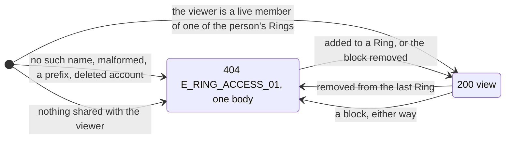

# 🧪 Discover Hub & Search · QA Backend

**Feature:** [[F-19 Discover Hub & Search]] · **Verifies:** [[BD-19 Discover Hub & Search Backend Delivery]] against [[S-42 Discover Hub & Search Story]] and [[FR-19 Discover Hub & Search Frontend Requirements]], with the calls and errors of [[BI-19 Discover Hub & Search Backend Integration]] · **Verdict:** Draft · written 2026-11-16, no row run yet

Expected behaviour of the API, as artefacts a person can check a build against: tables and diagrams, **not test code** (the specs live in the backend repo). `status: passing` or `failing` after a run; the verdict tells the PM whether the story can be fulfilled (passing with nothing pending or unmet). A failing row is one of two things: a story part the delivery does not fulfil (not built, or built other than the story says) goes in `unmet` and turns the story's badge ✕; a bug (built as asked, but it breaks) is filed against the Backend Integration and goes in `pending`, and leaves the story alone.

## Scope

**Covered.** What the hub asks of the backend in the MVP ([[D-37 Discover opens a Pin by its exact Pin name in the MVP|D-37]], S-42 S1–S3), as the hub uses it: opening a Pin by its exact Pin name with `GET /views/pin/:pinName` (S2), that the lookup can't be used to learn whether a name exists or to search by prefix, the viewer's own Pin name on `GET /profiles` (S2), and that the backend keeps nothing about what was looked up (S3: recent searches stay on the phone).

**Not covered.** The view's whole shape, the order of Rings, signed links and the other `/views/*` routes are View As & Pin Views' and are checked in [[QB-14 View As & Pin Views QA Backend]]; the rows here repeat only what the hub depends on. The hub's tiles (S1) call nothing of this feature's. Input normalisation (strip `!` and `@`, trim, lowercase), submit-only, the copy and the recent-searches list are the app's: the QA Frontend covers them. Ask Gemma (S4), import contacts (S5), search by name and a business Pin opening s55 are later (D-37) and have no route.

**Accounts.** The seeded demo accounts, signed in with the one-time code from `devCode`: **Sara** (`SaraAz`, the owner), **Omar** (`OmarK`, a seeded member of her Rings) and the **admin** (`SPAdmin`, in none of her Rings: the stranger). Extra accounts are signed up inside the run where a row needs one (B7, B17, B20).

**Set in the database.** States with no route are written with SQL in the run's throwaway database only: `users.status` `DELETED` (B7) and `SUSPENDED` (B20).

## Expected behaviour

✅ as expected · 🔴 differs · ⬜ not run. Bodies are the API's `{ statusCode, message, error, path, timestamp }`, with `ErrorCode` where the build puts it on the wire. `E_RING_ACCESS_01` reads "This profile is not shared with you".

### Open a Pin by its exact Pin name — S2

| # | Given | When | Then | Checked |
|---|---|---|---|---|
| B1 | no `Authorization` header | `GET /views/pin/saraaz` | 401 | ⬜ |
| B2 | Omar, a member of one of Sara's Rings | `GET /views/pin/saraaz` (lowercase, as the app sends it) | 200 `RingProfileViewEntity`: `pinName` "SaraAz", `displayName` set | ⬜ |
| B3 | Omar | `GET /views/pin/SaraAz` | 200, the same view as B2: the name is matched normalised | ⬜ |
| B4 | B2's body | its keys, and a search of the body text for Sara's user id, her profile id and her Ring ids | no `ringId`, no `userId`, no owner or profile id among the keys; none of the ids appears anywhere | ⬜ |
| B10 | the blocks of B8 and B9 removed | Omar: `GET /views/pin/saraaz` | 200, the view of B2 again | ⬜ |
| B16 | Omar | `GET /views/pin/omark` (his own name; the app opens View as without this call) | 200, his default Ring's view | ⬜ |
| B17 | a person with no name on the shared Ring and no full name on the profile, one of their Rings shared with Omar | Omar resolves their Pin name | 200 with `displayName` `null` (BI-19: it may be `null`); not run if no such account can be made through the API | ⬜ |
| B19 | Sara removes Omar from every Ring of hers he is in, then adds him back to one | Omar: `GET /views/pin/saraaz` after each | 404 as B5 after the removal; 200 on the next read after the add: access is answered per request, which is why a recent entry re-resolves | ⬜ |

### One answer for every way a lookup fails — S2

| # | Given | When | Then | Checked |
|---|---|---|---|---|
| B5 | the admin, in none of Sara's Rings | `GET /views/pin/saraaz` | 404 `E_RING_ACCESS_01` "This profile is not shared with you" | ⬜ |
| B6 | the admin | `GET /views/pin/nosuchpinxyz` | 404, the same body as B5 apart from `path` and `timestamp` | ⬜ |
| B7 | an account signed up with a Pin name, then set `DELETED` | Omar resolves that Pin name | 404, the same body as B5 | ⬜ |
| B8 | Sara blocked Omar | Omar: `GET /views/pin/saraaz` | 404, the same body as B5 | ⬜ |
| B9 | that block removed; Omar blocked Sara | Omar: `GET /views/pin/saraaz` | 404, the same body as B5 | ⬜ |
| B11 | the admin | `GET /views/pin/!!bad%20name` | 404, the same body as B5; never a 400 (BD-19: the route does not validate the name) | ⬜ |
| B12 | Omar | `GET /views/pin/%21saraaz` and `GET /views/pin/%40saraaz` (the `!` or `@` left on) | 404 as B5: the backend does not strip them, the app does | ⬜ |
| B13 | Omar, who can see `SaraAz` | `GET /views/pin/sara` and `GET /views/pin/saraa` | 404, the same body as B5: no partial match, so the route is no prefix probe | ⬜ |
| B14 | the 404 bodies of B5, B6, B7, B8, B9, B11 and B13 | compare them | byte-identical apart from `path` and `timestamp` | ⬜ |
| B20 | an extra account signed in, then set `SUSPENDED`, its token still unexpired | `GET /views/pin/saraaz` | 401 `E_AUTH_03` "Account is not active" | ⬜ |

### My own Pin name, and nothing kept — S2, S3

| # | Given | When | Then | Checked |
|---|---|---|---|---|
| B15 | Omar | `GET /profiles` | his own `pinName` "OmarK" is on it, for the app to compare with what was typed | ⬜ |
| B18 | the build's OpenAPI document; the row count of every table before and after ten resolves by Omar (five 200, five 404) | read the document; compare the counts | no route for recent or saved searches; no table's count changed: the backend keeps nothing about what was looked up | ⬜ |

## State diagram

What one viewer gets from `GET /views/pin/:pinName` for one name, resolved per request.

## Error matrix

| Situation | Status | ErrorCode | Same body as | Rows |
|---|---|---|---|---|
| no token | 401 | — | — | B1 |
| viewer suspended | 401 | `E_AUTH_03` | — | B20 |
| no such Pin name, malformed, `!` or `@` left on, a prefix of a real name | 404 | `E_RING_ACCESS_01` | not shared, blocked, deleted | B6, B11, B12, B13 |
| the person's account is deleted | 404 | `E_RING_ACCESS_01` | no such Pin name | B7 |
| nothing shared with the viewer, or removed from the last Ring | 404 | `E_RING_ACCESS_01` | no such Pin name | B5, B19 |
| blocked, either way | 404 | `E_RING_ACCESS_01` | no such Pin name | B8, B9 |
| a malformed name answering 400 | never today | — | — | B11 |

## Privacy and access checks

- **The lookup is no oracle.** Unknown, malformed, a prefix, deleted, not shared and blocked must be indistinguishable: one status, one body apart from `path` and `timestamp` (B5–B9, B11, B13, B14).
- **No prefix search.** A prefix of a name the viewer can see answers the same 404 (B13).
- **The result names no Ring and no person id.** No Ring id, user id or profile id in the view (B4).
- **Nothing is kept.** No route stores searches and a resolve writes no row (B18).
- **Access is answered per request.** Removed, then added back, shows on the next read (B19); a block and its removal too (B8–B10).

## Verdict

- Run on: — · build: — · result: — · failing rows: — · story parts unmet: — · bugs: —
- Not run yet. A run on backend `main @ 3cef5d7` (local, throwaway database) was handed to a session in the backend repository on 2026-11-16; its results are recorded here when they arrive.

## Log

- 2026-11-16 · `docs/qa/M-04-discovery/F-19-discover-hub/qb-first-run` · written from S-42 S1–S3, FR-19 (approved), BD-19 (done) and BI-19 (current): 20 rows, B1–B20, none run; `draft`
