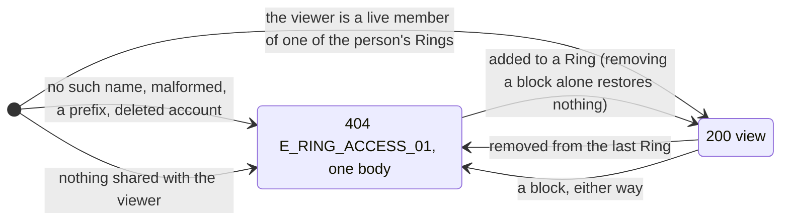

# 🧪 Discover Hub & Search · QA Backend

**Feature:** [[F-19 Discover Hub & Search]] · **Verifies:** [[BD-19 Discover Hub & Search Backend Delivery]] against [[S-42 Discover Hub & Search Story]] and [[FR-19 Discover Hub & Search Frontend Requirements]], with the calls and errors of [[BI-19 Discover Hub & Search Backend Integration]] · **Verdict:** Draft · written 2026-11-16, the search rows added 2026-11-23, no row run yet

Expected behaviour of the API, as artefacts a person can check a build against: tables and diagrams, **not test code** (the specs live in the backend repo). `status: passing` or `failing` after a run; the verdict tells the PM whether the story can be fulfilled (passing with nothing pending or unmet). A failing row is one of two things: a story part the delivery does not fulfil (not built, or built other than the story says) goes in `unmet` and turns the story's badge ✕; a bug (built as asked, but it breaks) is filed against the Backend Integration and goes in `pending`, and leaves the story alone.

## Scope

**Covered.** Two scopes of S-42. The exact-name resolve ([[D-37 Discover opens a Pin by its exact Pin name in the MVP|D-37]], B1–B20): opening a Pin by its exact Pin name with `GET /views/pin/:pinName` (S2), that the resolve can't be used to learn whether a name exists, the viewer's own Pin name on `GET /profiles`, and that the backend keeps nothing about what was looked up (S3). The search by part of a Pin name ([[D-41 Discover searches people by part of their Pin name|D-41]], Q1–Q4, B21–B63): `GET /search/pin-names` (S2: the query, what a row carries, the order, the pages, the four relationships, who is never returned), the limit on searches (S4, Q4) and the switch `findableByPinName` on `GET` / `PATCH /users/me` (S5, Q3).

**Not covered.** The view's whole shape, the order of Rings, signed links and the other `/views/*` routes are View As & Pin Views' and are checked in [[QB-14 View As & Pin Views QA Backend]]; the connection request routes themselves (Connect, Accept, Decline, their codes) are Connections' ([[BI-16 Connections Backend Integration]]); the rows here use them only to put two people in a relationship. The hub's tiles (S1) call nothing of this feature's. The debounce, the shimmer, the copy, the recent-searches list and the Privacy screen are the app's: the QA Frontend covers them. Ask Gemma (S6), import contacts (S7) and a business Pin opening s55 are later (D-37) and have no route.

**Accounts.** The seeded demo accounts, signed in with the one-time code from `devCode`: **Sara** (`SaraAz`, the owner), **Omar** (`OmarK`, a seeded member of her Rings) and the **admin** (`SPAdmin`, in none of her Rings: the stranger). Extra accounts are signed up inside the run where a row needs one (B7, B17, B20), and for the search a set whose Pin names share the letters `qax`, which no seeded name holds: **Vera** (`VeraQaxView`, the searcher), **`Qax`** (the exact name), **`AlphaQax`** and **`ZedQaxRing`** (each puts Vera in one of their Rings), **`BetaQax`** and **`MidQaxOpen`** (strangers to Vera), and 21 more named `QaxPage01` … `QaxPage21` for the pages.

**Set in the database.** States with no route are written with SQL in the run's throwaway database only: `users.status` `DELETED` (B7, B50) and `SUSPENDED` (B20, B50), and a pending request's `expires_at` moved into the past (B42).

**The limit and the run.** One person may search 30 times in a sliding minute (B51–B54), counted in the API's memory. The other search rows are run so that no account passes 30 searches in a minute, or the API is restarted between groups of rows; a 429 on any row other than B51–B54 is the run's mistake, not a finding.

## Expected behaviour

✅ as expected · 🔴 differs · ⬜ not run. Bodies are the API's `{ statusCode, message, error, path, timestamp }`, with the code under `errorCode` on every domain error (validation failures and the plain 401 carry none); `path` carries the query string. `E_RING_ACCESS_01` reads "This profile is not shared with you".

### Open a Pin by its exact Pin name — S2

| # | Given | When | Then | Checked |
|---|---|---|---|---|
| B1 | no `Authorization` header | `GET /views/pin/saraaz` | 401 | ✅ |
| B2 | Omar, a member of one of Sara's Rings | `GET /views/pin/saraaz` (lowercase, as the app sends it) | 200 `RingProfileViewEntity`: `pinName` "SaraAz", `displayName` set | ✅ |
| B3 | Omar | `GET /views/pin/SaraAz` | 200, the same view as B2: the name is matched normalised | ✅ |
| B4 | B2's body | its keys, and a search of the body text for Sara's user id, her profile id and her Ring ids | no `ringId`, no `userId`, no owner or profile id among the keys; none of the ids appears anywhere (the only `id` keys are on `links[]`, the links' own) | ✅ |
| B10 | the blocks of B8 and B9 removed | Omar: `GET /views/pin/saraaz`, then again after Sara adds him to a Ring | still 404 as B5 after the unblock (unblock restores nothing, BI-16); 200, the view of B2 again, once she has added him back. The row first expected 200 straight after the unblock: corrected in the run of 2026-11-23 | ✅ |
| B16 | Omar | `GET /views/pin/omark` (his own name; the app opens View as without this call) | 200, his default Ring's view | ✅ |
| B17 | a person with no name on the shared Ring and no full name on the profile, one of their Rings shared with Omar | Omar resolves their Pin name | 200 with `displayName` `null` (BI-19: it may be `null`); not run if no such account can be made through the API | ✅ |
| B19 | Sara removes Omar from every Ring of hers he is in, then adds him back to one | Omar: `GET /views/pin/saraaz` after each | 404 as B5 after the removal; 200 on the next read after the add: access is answered per request, which is why a recent entry re-resolves | ✅ |

### One answer for every way a lookup fails — S2

| # | Given | When | Then | Checked |
|---|---|---|---|---|
| B5 | the admin, in none of Sara's Rings | `GET /views/pin/saraaz` | 404 `E_RING_ACCESS_01` "This profile is not shared with you" | ✅ |
| B6 | the admin | `GET /views/pin/nosuchpinxyz` | 404, the same body as B5 apart from `path` and `timestamp` | ✅ |
| B7 | an account signed up with a Pin name, Omar put in one of its Rings (his resolve answers 200), then the account set `DELETED`; and a second one deleted with `DELETE /users/me` | Omar resolves each Pin name | 404, the same body as B5. On `c5bc838`: 200 with the view, both times ([[B-28 A deleted account's card still opens for a member of its Ring\|B-28]]); on `e83682d`: 404, byte-identical to B5, both times | ✅ |
| B8 | Sara blocked Omar | Omar: `GET /views/pin/saraaz` | 404, the same body as B5 | ✅ |
| B9 | that block removed and Omar put back in one of Sara's Rings (a block ends the memberships and unblocking restores nothing, [[BI-16 Connections Backend Integration\|BI-16]]); Omar blocked Sara | Omar: `GET /views/pin/saraaz` | 404, the same body as B5 | ✅ |
| B11 | the admin | `GET /views/pin/!!bad%20name` | 404, the same body as B5; never a 400 (BD-19: the route does not validate the name) | ✅ |
| B12 | Omar | `GET /views/pin/%21saraaz` and `GET /views/pin/%40saraaz` (the `!` or `@` left on) | 404 as B5: the backend does not strip them, the app does | ✅ |
| B13 | Omar, who can see `SaraAz` | `GET /views/pin/sara` and `GET /views/pin/saraa` | 404, the same body as B5: no partial match, so the route is no prefix probe | ✅ |
| B14 | the 404 bodies of B5, B6, B7, B8, B9, B11 and B13 | compare them | byte-identical apart from `path` and `timestamp`. On `c5bc838` B7's was a 200 (B-28); on `e83682d` all seven are identical | ✅ |
| B20 | an extra account signed in, then set `SUSPENDED`, its token still unexpired | `GET /views/pin/saraaz` | 401 `E_AUTH_03` "Account is not active" | ✅ |

### My own Pin name, and nothing kept — S2, S3

| # | Given | When | Then | Checked |
|---|---|---|---|---|
| B15 | Omar | `GET /profiles` | his own `pinName` "OmarK" is on it, for the app to compare with what was typed | ✅ |
| B18 | the build's OpenAPI document; the row count of every table before and after ten resolves by Omar (five 200, five 404) | read the document; compare the counts | no route for recent or saved searches; no table's count changed: the backend keeps nothing about what was looked up | ✅ |

### Search by part of a Pin name: the query — S2, S4

Every search is `GET /search/pin-names?q=…` with a bearer token; 200 is `{ data: PinNameResultEntity[], meta: { total } }`.

| # | Given | When | Then | Checked |
|---|---|---|---|---|
| B21 | no `Authorization` header | `q=sara` | 401 | ✅ |
| B22 | Omar | `q=sa` | 400 `E_SEARCH_01` "Type at least 3 letters to search by Pin name", the code on the body | ✅ |
| B23 | Omar | `q=!sa`, `q=@sa` and `q=%20%20sa%20` | 400 `E_SEARCH_01` each: the `!`, the `@` and the spaces around do not count as letters | ✅ |
| B24 | Omar | no `q`; a `q` of 65 characters; `limit=51` | 400 each, a validation body with no `E_SEARCH_*` code | ✅ |
| B25 | the admin | `q=ara` and `q=raa` | 200, `SaraAz` is in `data` both times: the letters match anywhere in the name, not only its start | ✅ |
| B26 | the admin | `q=SARA`, `q=!sara`, `q=@Sara`, `q=%20sara%20` | each answers the same `data` and `total` as `q=sara` | ✅ |
| B27 | the admin | `q=azzam` (Sara's sign-up name is "Sara Azzam"), then a word that is only in one of her Rings (`wholesale`, in the bio of *E-commerce Clients*) | 200 with `data: []`, `total: 0` both times: Pin names only, never a name or anything shared in a Ring | ✅ |
| B28 | Vera | `q=zzqnomatch` | 200 `{ data: [], meta: { total: 0 } }` | ✅ |

### What a row carries — S2

| # | Given | When | Then | Checked |
|---|---|---|---|---|
| B29 | the admin's `q=sara` | the keys of each row | exactly `pinName`, `accountName`, `avatarUrl`, `relationship`, `requestId`, `canOpenCard`; no other key | ✅ |
| B30 | B29's body and Omar's `q=sara` body | a search of the body text for Sara's user id, her profile ids and her Ring ids | none of the ids appears anywhere, for the stranger or for the member of her Ring | ✅ |
| B31 | Sara's row as the admin gets it and as Omar gets it | compare `pinName`, `accountName`, `avatarUrl` | `pinName` "SaraAz" as she spelt it, `accountName` "Sara Azzam" (the sign-up name), the same for both; nothing that is only on one of her Rings, so the row never says which Ring the searcher is in | ✅ |
| B32 | a person with no photo (the seeded accounts have none) | their row | `avatarUrl` `null` | ✅ |
| B33 | an extra account that set a sign-up photo | a stranger's search finds it | `avatarUrl` is a link (a path, `/api/v1/files/content/<token>`) that answers 200 with the image, with no `Authorization` header. The photo is set with `POST /files`, then `PATCH /profiles/:id` `{ avatarFileId }` | ✅ |
| B34 | an extra account with no full name on its default profile | its row | `accountName` `null`; not run if the API does not let an account have no name | ✅ |

### The order and the pages — S2 (Q1, Q2), S4

| # | Given | When | Then | Checked |
|---|---|---|---|---|
| B35 | the `qax` set, before the 21 page accounts exist; Vera | `q=qax&limit=50` | `total` 5 and the order `Qax`, `AlphaQax`, `ZedQaxRing`, `BetaQax`, `MidQaxOpen`: the exact name first, then the two who have Vera in a Ring A→Z, then the strangers A→Z. `VeraQaxView` (herself) is not there | ✅ |
| B36 | the admin, a stranger to all of the set | `q=qax&limit=50` | `total` 6: `Qax` first, then the other five A→Z by Pin name (`AlphaQax`, `BetaQax`, `MidQaxOpen`, `VeraQaxView`, `ZedQaxRing`): with nobody having the admin in a Ring there is no middle group | ✅ |
| B37 | the admin | `q=saraaz` (a full Pin name) | 200, a list like any other with `SaraAz` its first row; the answer is the list, no view of her card | ✅ |
| B38 | the 21 page accounts added; Vera | `q=qax` with no `limit` | 20 rows, `total` 26 | ✅ |
| B39 | the same | `q=qax&skip=20` | the remaining 6 rows, `total` 26; the two pages together are the 26 people once each, in the order of `limit=50` | ✅ |
| B40 | the same | `limit=2` with `skip` 0, 2, 4 | rows 1–2, 3–4, 5–6 of the `limit=50` list: a page that starts in one group and ends in the next loses and repeats nobody | ✅ |
| B41 | the same | `skip=26` and `skip=1000` | 200 `data: []`, `total` 26 | ✅ |

### Where I stand with a result — S2

`canOpenCard` and `relationship` are two separate answers. Because of B43, the requests behind B42, B44 and B45 were made by scanned code (`POST /connections/requests` `{ qrToken }`, and `{ againFor }` for a second one): those rows show what the search answers for each relationship, not that Connect works from a row. For every row met in this section the run also resolves the row's `pinName` as the searcher: **`canOpenCard` is true exactly when `GET /views/pin/:pinName` answers 200** (B47).

| # | Given | When | Then | Checked |
|---|---|---|---|---|
| B42 | Vera and `BetaQax`, nothing between them | Vera finds `BetaQax` | `relationship` `NONE`, `requestId` `null`, `canOpenCard` false. The same after a request of Vera's was declined, and after one's `expires_at` has passed (Connect again; BD-19, *Gaps*) | ✅ |
| B43 | Vera sends `POST /connections/requests` `{ pinName }` with the row's `pinName` (a `NONE` row, `canOpenCard` false) | the request; then Vera finds `BetaQax` and `BetaQax` finds Vera | 201, a request made; Vera: `REQUESTED` with its `requestId`, `canOpenCard` false; `BetaQax`: `ASKED_ME` with the same `requestId`. **Got 404 `E_RING_ACCESS_01` on the request: Connect by Pin name works only for someone whose card the requester can already open (BI-16), so no request can be made from a stranger's row. S2 unmet.** With the request made by scanned code instead (`{ qrToken }`), the two rows read `REQUESTED` and `ASKED_ME` with the same `requestId`, as expected | 🔴 || B44 | `BetaQax` accepts with that `requestId` (`POST /connections/requests/:id/accept` `{ ringId }`) | each finds the other | `CONNECTED`, `requestId` `null`, on both sides; Vera's row for `BetaQax` has `canOpenCard` true (the accept put her in a Ring) | ✅ |
| B45 | `BetaQax` then removes Vera from every Ring of theirs, staying connected | Vera finds `BetaQax` | `CONNECTED` with `canOpenCard` false (BD-19, *Gaps*: connected, nothing shared); not run if the API cannot leave a connection with no Ring | ✅ |
| B46 | Omar, a seeded member of Sara's Ring | `q=sara` | Sara's row has `canOpenCard` true, whatever `relationship` reads | ✅ |
| B47 | every row of B35, B42–B46 | resolve its `pinName` as the searcher | 200 where `canOpenCard` is true, 404 `E_RING_ACCESS_01` where it is false; never the other way | ✅ |

### Who is never returned — S2, S5

| # | Given | When | Then | Checked |
|---|---|---|---|---|
| B48 | Omar | `q=omark` and `q=oma` | his own row is in neither, and `total` does not count him | ✅ |
| B49 | `MidQaxOpen` blocked Vera (by scanned code, `{ qrToken }`: a block by Pin name or user id between strangers answers 404) | Vera searches `q=qax` and `q=midqaxopen`; `MidQaxOpen` searches `q=veraqax` | neither finds the other, by part or by the full name; `total` is one less. The same with the block the other way round (Vera blocked `MidQaxOpen`); both found again once the block is removed | ✅ |
| B50 | an extra account matching `qax`, then set `DELETED`; another set `SUSPENDED` | Vera searches `q=qax` and each one's full name | neither is returned; a suspended searcher's own search answers 401 `E_AUTH_03` | ✅ |

### The limit — S4 (Q4)

| # | Given | When | Then | Checked |
|---|---|---|---|---|
| B51 | the API just started; Vera | 30 searches inside a minute, then a 31st | the 30 answer 200; the 31st 429 `E_SEARCH_02` "Too many searches, try again in a minute", the code on the body | ✅ |
| B52 | B51's minute still running | the admin searches | 200: the limit is per person | ✅ |
| B53 | B51 | Vera searches again 61 seconds after the first of her 30 | 200: the window slides, it is not a lock | ✅ |
| B54 | the API restarted; Vera | 30 searches of 2 letters (`E_SEARCH_01`) inside a minute, then one of 3 letters | the story asks only for a limit of about 30 a minute (Q4), which holds (B51). What the build answers: the 30 are 400 `E_SEARCH_01` and are **not counted**, the 3-letter search answers 200, and 30 more of 3 letters pass before the 429. BD-19 and BI-19 say refused searches count too: they differ from the build and are flagged; not a failing row | ✅ |

### "Let people find me by Pin name" — S5 (Q3)

| # | Given | When | Then | Checked |
|---|---|---|---|---|
| B55 | Sara (seeded before the switch existed) and an account signed up in the run | `GET /users/me` | `findableByPinName` true on both: on by default | ✅ |
| B56 | `ZedQaxRing` | `PATCH /users/me` `{ "findableByPinName": false }`, then `GET /users/me` | 200, the whole account with `findableByPinName` false; the read says false | ✅ |
| B57 | B56 | the admin (a stranger) searches `q=qax` and `q=zedqaxring` at once, with no restart | `ZedQaxRing` is in neither and `total` is one less than before: off applies to the next search, by part and by the full name | ✅ |
| B58 | B56 | Vera, whom `ZedQaxRing` has in a Ring, searches `q=qax` and `q=zedqaxring` | `ZedQaxRing` is found both times, `canOpenCard` true | ✅ |
| B59 | B56; the admin's `q=zedqaxring` body and their `q=zzqnomatch` body | compare them | the same `{ data: [], meta: { total: 0 } }`: a hidden person and a name nobody has look alike | ✅ |
| B60 | `ZedQaxRing` | `PATCH /users/me` `{ "findableByPinName": true }`; the admin searches again | found again on the next search | ✅ |
| B61 | `ZedQaxRing` | `PATCH /users/me` `{ "findableByPinName": "no" }` | 400, a validation body; the value is unchanged. On `c5bc838`: 200, and the value converted (`"no"` and `"false"` saved as true, `0` as false: [[B-29 The find-me switch reads the string false as true\|B-29]]); on `e83682d`: 400 "findableByPinName must be a boolean value" and the value unchanged, the same for `0`, `1`, `null` and `""`; the strings `"true"` and `"false"` are saved as true and false | ✅ |
| B62 | `AlphaQax` switched off, then blocked by Vera | Vera searches `q=qax` | `AlphaQax` is not returned: a block wins whichever way the switch is set | ✅ |

### Nothing kept about a search — S3

| # | Given | When | Then | Checked |
|---|---|---|---|---|
| B63 | the row count of every table before and after ten searches by Vera (five with results, five with none) | compare the counts | no table's count changed: the backend keeps nothing about what was searched | ✅ |

## State diagram

What one viewer gets from `GET /views/pin/:pinName` for one name, resolved per request.

## Error matrix

| Situation | Status | ErrorCode | Same body as | Rows |
|---|---|---|---|---|
| no token | 401 | — | — | B1 |
| viewer suspended | 401 | `E_AUTH_03` | — | B20 |
| no such Pin name, malformed, `!` or `@` left on, a prefix of a real name | 404 | `E_RING_ACCESS_01` | not shared, blocked, deleted | B6, B11, B12, B13 |
| the person's account is deleted | 404 | `E_RING_ACCESS_01` | no such Pin name | B7 |
| nothing shared with the viewer, or removed from the last Ring | 404 | `E_RING_ACCESS_01` | no such Pin name | B5, B19 |
| blocked, either way | 404 | `E_RING_ACCESS_01` | no such Pin name | B8, B9 |
| a malformed name answering 400 | never today | — | — | B11 |
| search: no token | 401 | — | — | B21 |
| search: searcher suspended | 401 | `E_AUTH_03` | — | B50 |
| search: fewer than 3 letters after the `!` / `@` and the spaces are dropped | 400 | `E_SEARCH_01` | — | B22, B23 |
| search: `q` missing or over 64 characters, `limit` over 50 | 400 | — (validation) | — | B24 |
| search: more than 30 in a sliding minute, per person | 429 | `E_SEARCH_02` | — | B51–B54 |
| search: nobody matches, or the only match is hidden (switched off, blocked, deleted, suspended, myself) | 200 | — | `data: []`, `total: 0`, one body | B28, B48–B50, B57, B59 |
| `PATCH /users/me` with a `findableByPinName` that is not a boolean | 400 | — (validation) | — | B61 |

**Who a search returns**, for one searcher and one person whose Pin name holds the letters:

| The person | Switch on | Switch off |
|---|---|---|
| has the searcher in one of their Rings | found, `canOpenCard` true | found, `canOpenCard` true |
| does not | found, `canOpenCard` false | not found |
| is in a block with the searcher, either way | not found | not found |
| is deleted or not active, or is the searcher | not found | not found |

## Privacy and access checks

- **The lookup is no oracle.** Unknown, malformed, a prefix, deleted, not shared and blocked must be indistinguishable: one status, one body apart from `path` and `timestamp` (B5–B9, B11, B13, B14).
- **The resolve stays exact.** A prefix of a name the viewer can see answers the same 404 on `GET /views/pin/:pinName` (B13); matching by part is the search's alone.
- **A search row is the same for everyone.** Pin name, sign-up name and photo, never a Ring's name or photo, no id of any kind (B29–B31).
- **A hidden person looks like nobody.** Switched off, blocked, deleted, suspended: the same empty answer as a name nobody has (B49, B50, B57, B59).
- **`canOpenCard` is the access engine's answer.** True exactly when the resolve answers 200 for that searcher (B47), and independent of `relationship` (B45, B46).
- **The switch and a block apply to the next search.** Nothing is cached (B49, B57, B60).
- **Walking the names is limited.** 30 searches a minute per person (B51–B54).
- **The result names no Ring and no person id.** No Ring id, user id or profile id in the view (B4).
- **Nothing is kept.** No route stores searches, and neither a resolve nor a search writes a row (B18, B63).
- **Access is answered per request.** Removed, then added back, shows on the next read (B19); a block hides at once, and its removal brings nothing back until the person is added to a Ring again (B8–B10).

## Verdict

- Run on: 2026-11-23 (second run) · build: backend `main @ e83682d` · result: **failing**, 62 of 63 rows as expected · failing rows: B43 · story parts unmet: S2, Connect from a not-connected row (B43) · bugs: none open against these rows; B-28 (B7, B14) and B-29 (B61) re-tested, passing and closed (`done`, `resolution: fixed`)
- **The second run.** All 63 rows again, on a database dropped and recreated: backend `main @ e83682d` (the fixes of B-28 and B-29, and PinCast's routes merged with them), no local changes, Node 22.22.2, PostgreSQL 17.4, 13 migrations deployed (`20261123120000_pincast_routes` new), seed loaded; by the same session in the backend repository. **B7 and B14 pass:** a deleted account's Pin name answers 404 `E_RING_ACCESS_01` to a member of its Ring, byte-identical to an unknown name, whether the account was set `DELETED` or deleted with `DELETE /users/me`; that person also leaves the member's Shared with me (3 → 2 people) and the search. **B61 passes:** anything but `true`, `false`, `"true"`, `"false"` answers 400 and leaves the value as it was, from true and from false. **B43 still fails:** 404 on Connect by Pin name from a stranger's row; nothing was built for it. Nothing else moved: the other 59 rows answer as on `c5bc838`, and PinCast's 8 new paths store no search or lookup (B18, B63). The run's database was dropped.
- **First run** · 2026-11-23 · build: backend `main @ c5bc838` · result: failing, 59 of 63 rows as expected · failing rows: B7, B14, B43, B61 · story parts unmet: S2, Connect from a not-connected row (B43) · bugs: [[B-28 A deleted account's card still opens for a member of its Ring|B-28]] (B7, B14), [[B-29 The find-me switch reads the string false as true|B-29]] (B61)
- **The build.** Backend `main @ c5bc838`, no local changes, `nest build` and `node dist/main` on a local port; Node 22.22.2, PostgreSQL 17.4, a throwaway database with all 12 migrations deployed (`20261123120000_findable_by_pin_name` among them) and the seed loaded. Black-box HTTP, by a session in the backend repository; SQL only for the states listed under *Scope*. All 63 rows run, none skipped; no 429 outside B51–B54.
- **What holds.** The search itself: the 3-letter floor, the letters anywhere, Pin names only, the six keys and no id, the same sign-up name and photo for every searcher, the three-group order, the pages and `total`, `canOpenCard` equal to the resolve's answer on 26 row and resolve pairs, the four relationships once a request exists, nobody hidden returned, the limit per person and its sliding minute, the switch applied to the next search, nothing written by a search.
- **S2 unmet (B43).** A stranger's row offers Connect, and `POST /connections/requests` `{ pinName }` answers 404 `E_RING_ACCESS_01` for it: by Pin name a request is accepted only from someone who can already open the person's card ([[BI-16 Connections Backend Integration|BI-16]]: "the scan is how a stranger connects"). The search was built and the Connect it leads to was not opened to strangers, so the story's "Connect sends the normal connection request" cannot happen from a not-connected row. BD-19 (*What exists*) and BI-19 (*Screens → calls*, *Flow* 5) say it works: both flagged. Whether a stranger found by search may be asked is the story's and Connections' to settle (`/pm`).
- **Bugs.** B-28: a deleted account's card still answers 200 to a member of its Ring (B7), so the seven 404 bodies are not all the same (B14). B-29: `PATCH /users/me` saves a non-boolean `findableByPinName` instead of refusing it (B61).
- **Differs from the delivery notes, not from the story (B54).** Searches under 3 letters are refused before they are counted, and a search refused with 429 is not counted either; BD-19 (*How it works* 1) and BI-19 (*Errors to handle*) say every search counts, refused ones included. Flagged on both.
- **Rows corrected in this run.** B10 expected the view back straight after an unblock; unblocking restores nothing (BI-16), and the view returns once the person is added to a Ring again, which is what the build does. B7, B9 and B49 had fixtures that could not show anything or could not be made (a deleted account needs a Ring shared first; a block between strangers is made by scanned code). The error code's key is `errorCode`.
- The lines from **First run** down to here are the first run's, kept as they were written; its database was dropped after the second run.

## Log

- 2026-11-16 · `docs/qa/M-04-discovery/F-19-discover-hub/qb-first-run` · written from S-42 S1–S3, FR-19 (approved), BD-19 (done) and BI-19 (current): 20 rows, B1–B20, none run; `draft`
- 2026-11-23 · `docs/qa/M-04-discovery/F-19-discover-hub/QB-18-first-run` · the search by part of a Pin name added from S-42 S2, S4, S5 (Q1–Q4), BD-19 (`done`, backend `main @ c5bc838`) and BI-19 (`current`): 43 rows, B21–B63 (the query, the row, the order and the pages, the relationships and `canOpenCard`, who is never returned, the limit, the switch, nothing kept), the error matrix and the checks extended; the BD-19 flag of 2026-11-23 cleared. 63 rows, none run; `draft`
- 2026-11-23 · `docs/qa/M-04-discovery/F-19-discover-hub/QB-18-first-run` · first run, all 63 rows, on backend `main @ c5bc838`: 59 as expected, 4 failing. `draft` → `failing`. S2's Connect from a not-connected row in `unmet` (B43); [[B-28 A deleted account's card still opens for a member of its Ring]] (B7, B14) and [[B-29 The find-me switch reads the string false as true]] (B61) filed against BI-19 and in `pending`. Flagged [[BD-19 Discover Hub & Search Backend Delivery]] and [[BI-19 Discover Hub & Search Backend Integration]]: Connect by Pin name from a stranger's row, the deleted account, and which searches the limit counts. Rows B7, B9, B10, B27, B33, B49 and B54 corrected from what the run showed
- 2026-11-23 · `docs/qa/M-04-discovery/F-19-discover-hub/QB-18-first-run` · second run, all 63 rows, on backend `main @ e83682d` (B-28 and B-29 `ready`): 62 as expected. B7, B14 and B61 pass, so both fixes hold; B43 still fails (S2's Connect, `unmet`). Stays `failing`. The two bugs stay in `pending` until they are closed on khaled's word
- 2026-11-23 · `docs/qa/M-04-discovery/F-19-discover-hub/QB-18-first-run` · [[B-28 A deleted account's card still opens for a member of its Ring]] and [[B-29 The find-me switch reads the string false as true]] closed on khaled's word (`done`, `resolution: fixed`) after the second run; their entries removed from `pending`. Still `failing`: S2's Connect (B43) is in `unmet`
- 2026-11-23 · flagged [[BD-19 Discover Hub & Search Backend Delivery]]: /backend: QB-18 ran on backend main c5bc838, failing, 59 of 63 rows as expected. (1) S2 unmet: POST /connections/requests by pinName answers 404 E_RING_ACCESS_01 from a search row with canOpenCard false, so Connect cannot be sent to a stranger found by search; What exists says it works. (2) B-28: GET /views/pin/:pinName answers 200 for a deleted account to a member of its Ring; What exists says deleted answers the same 404. (3) B-29: PATCH /users/me saves a non-boolean findableByPinName. (4) How it works 1 says every search counts toward the limit, refused ones included; the build does not count searches under 3 letters nor ones refused with 429
- 2026-11-23 · flagged [[BI-19 Discover Hub & Search Backend Integration]]: /backend: QB-18 ran on backend main c5bc838, failing. (1) Screens to calls and Flow 5 say Connect on a NONE row is POST /connections/requests by pinName; it answers 404 E_RING_ACCESS_01 unless the requester can already open the card (BI-16), so it never works on a row with canOpenCard false. (2) Flow 7 says a deleted account answers the same 404 on the resolve; a member of its Ring gets 200 (B-28). (3) Errors to handle says every search counts toward E_SEARCH_02, refused ones too; searches under 3 letters and ones refused with 429 are not counted. (4) avatarUrl is a path under /api/v1/files/content/, not an absolute link. B-28 and B-29 are filed against this note
