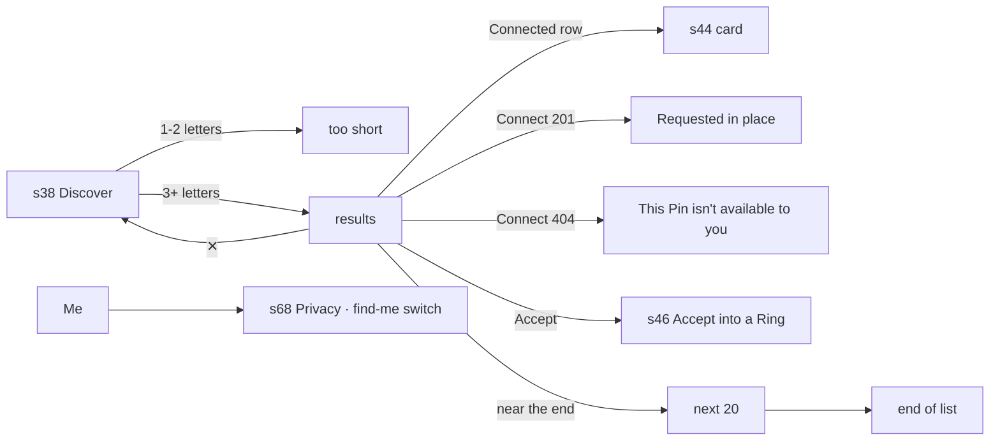

# 🧪 Discover Hub & Search · QA Frontend

**Feature:** [[F-19 Discover Hub & Search]] · **Verifies:** [[FD-18 Discover Hub & Search Frontend Delivery]] against [[S-42 Discover Hub & Search Story]] (S2, S4, S5) · **Verdict:** ✅ Passing on the fake backend · 2026-11-23 · `social_pin` `db62e4d` · 11 of 11 rows pass; not yet run against the development API, and Connect on a stranger's row waits on [[B-30 Connect from a Discover search row is refused for a person you can't already open|B-30]] (both in `pending`)

Expected behaviour of the screens, as artefacts: journeys, states and copy to check a build against, **not test code**. `status: passing` or `failing` after a run; the verdict tells the PM whether the story can be fulfilled (passing with nothing pending or unmet). A failing row is one of two things: a story part the delivery does not fulfil (not built, or built other than the story says) goes in `unmet` and turns the story's badge ✕; a bug (built as asked, but it breaks) is filed against the Frontend Delivery and goes in `pending`, and leaves the story alone.

## Scope

- **Screens:**
  - s38 Discover: the search by part of a Pin name, its rows and its states;
  - s44 the person card, opened from a row;
  - s46 Accept into a Ring, opened from *Accept*;
  - s68 Me › Privacy, the switch "Let people find me by Pin name".
- **11 rows, DS-01 to DS-11**, one per case of the client's Patrol suite `social_pin` `patrol_test/fake/f_discover_search_test.dart`.
- **How the rows run:** Patrol, `development` flavor, Android emulator. Every row runs against a fake backend the test controls, so it chooses each answer, error and timing. No row has run against the development API yet.
- **The fake search** answers four people for any query: `!rana.k2` *Rana Khaled* (`CONNECTED`, opens a card), `!rana.s` *Rana Saad* (`NONE`), `!ranaa` *Ranaa Mourad* (`REQUESTED`), and `!rana.h` (`ASKED_ME`, no sign-up name).
- **Not here:**
  - the S1 hub and S3 recent searches, which FD-18's widget tests cover;
  - what the server answers, which [[QB-18 Discover Hub & Search QA Backend]] checks;
  - the 300 ms pause itself, which the unit tests check (typing on an emulator is slower than that).

## Journeys

| # | Story | Steps | Expected | Checked |
|---|---|---|---|---|
| DS-01 | S4 | Type one, then two letters | "Type at least 3 letters of a Pin name"; no `GET /search/pin-names` | ✅ |
| DS-02 | S2 | Type `!RANA` and pause | One `GET /search/pin-names` with `q=rana`, `limit=20`, `skip=0`. The rows come in the server's order. Each kind of row shows: *Connected*, *Connect*, *Requested*, and "Asked to connect" with *Accept*. A row with no sign-up name shows its Pin name (`!rana.h`) as the name | ✅ |
| DS-03 | S2 | Tap the Connected row (`canOpenCard: true`) | s44 opens with the card; `GET /views/pin/:pinName` asked once | ✅ |
| DS-04 | S2 | Tap the *Rana Saad* row (`canOpenCard: false`) | Nothing opens; no `GET /views/pin/:pinName` | ✅ |
| DS-05 | S2, S4 | *Connect* on `!rana.s`; the request answers 201 | `POST /connections/requests` `{ pinName: "rana.s" }`; "Request sent."; the row reads *Requested* in place; still one search, none sent again | ✅ |
| DS-06 | S2 | *Connect* on `!rana.s`; the request answers 404 | "This Pin isn't available to you"; the row keeps *Connect* | ✅ |
| DS-07 | S2 | *Accept* on `!rana.h` | s46 Accept into a Ring (pick a Ring) opens for their request | ✅ |
| DS-08 | S4 | The search answers no rows, then 429 `E_SEARCH_02`, then no connection; *Try again* | "No Pin names match "{query}""; "Too many searches. Try again in a minute."; "Couldn't search right now" with *Try again*, which sends the same query again and shows the rows | ✅ |
| DS-09 | S2, S4 | 25 people; scroll to the end of the first page, then to the end | The next 20 are asked for (`skip=20`) as the list nears its end; after the last, "That's everyone for "{query}"" | ✅ |
| DS-10 | S2 | Tap ✕ in the field | The field empties; the results go; the hub is back | ✅ |
| DS-11 | S5 | Me › Privacy: turn "Let people find me by Pin name" off; then make the save fail | `PATCH /users/me` `{ findableByPinName: false }` at once, and the switch reads off. A failed save puts the switch back and shows "Couldn't save that. Try again." | ✅ |

## Screen states

| Screen | State | Expected rendering |
|---|---|---|
| [[Screen Index#s38\|s38]] | too short | "Type at least 3 letters of a Pin name"; nothing sent |
| [[Screen Index#s38\|s38]] | searching | shimmer rows in place of the list |
| [[Screen Index#s38\|s38]] | results | Under **PEOPLE**, rows with the sign-up name (or the Pin name), the photo or the outline, and the Pin name. The button follows the relationship: *Connected*, *Connect*, *Requested*, or "Asked to connect" with *Accept* |
| [[Screen Index#s38\|s38]] | next page | shimmer rows under the results; failing: "Couldn't load more" with *Try again*, the rows kept |
| [[Screen Index#s38\|s38]] | end of list | "That's everyone for "{query}"" |
| [[Screen Index#s38\|s38]] | no matches | "No Pin names match "{query}"" and "Check the spelling, or ask them for their Pin name." |
| [[Screen Index#s38\|s38]] | too many searches | "Too many searches. Try again in a minute." in place of the list |
| [[Screen Index#s38\|s38]] | no connection | "Couldn't search right now" with *Try again* |
| [[Screen Index#s44\|s44]] | opened from a row | the card read once, with the Ring's name and photo |
| [[Screen Index#s46\|s46]] | from *Accept* | Accept into a Ring for that request |
| [[Screen Index#s68\|s68]] | find-me switch | under **PEOPLE**, no "NEW" tag; moves at once; a failed save puts it back with "Couldn't save that. Try again." |

## Flow diagram

## Error copy

| ErrorCode | Where | Copy shown |
|---|---|---|
| `E_SEARCH_02` (429) | s38 | "Too many searches. Try again in a minute." |
| — (no connection, timeout, 5xx on the search) | s38 | "Couldn't search right now" + *Try again* |
| — (the next page failing) | s38 | "Couldn't load more" + *Try again* |
| `E_RING_ACCESS_01` (404 on Connect, or on opening a card) | s38 | "This Pin isn't available to you" |
| — (`PATCH /users/me` failing) | s68 | "Couldn't save that. Try again." |

## Verdict

- **Run on:** 2026-11-23.
- **Build:** `social_pin` `rings/F-11/honest-rings` @ `db62e4d`, `development` flavor, emulator Medium_Phone (Android 16), fake backend.
- **Result:** ✅ **passing**, all 11 rows (DS-01 to DS-11).
- **Failing rows:** none. **Story parts unmet:** none. **Bugs:** none filed by this run.
- **Pending:**
  - **Connect on a stranger's row against the real server** waits on [[B-30 Connect from a Discover search row is refused for a person you can't already open|B-30]]. Today the server refuses it with 404. DS-06 shows the app handles that answer, and DS-05 shows it handles the 201 it should get.
  - **A run against the development API.** No row has run against it yet.
- **Differs from the delivery note:**
  - On this build the Requested button reads "Requested" and Connect confirms with "Request sent.", as S-42 says. [[FD-18 Discover Hub & Search Frontend Delivery|FD-18]] says "Request sent" and "Request sent to {name}", and is flagged.
  - FD-18's status line still links this note by its plain name; also flagged.
- **For the PM:** S-42 is not ready to fulfil. The `pending` above stays, and [[QB-18 Discover Hub & Search QA Backend|QB-18]] is failing on B43 (B-30).

## Log

- 2026-11-23 · `docs/qa/M-04-discovery/F-19-discover-hub/QF-06-written` · written from the client's Patrol suite (`patrol_test/fake/f_discover_search_test.dart`, 11 cases DS-01 to DS-11) against FD-18 and S-42 S2, S4, S5. Run the same day on `social_pin` `db62e4d`, Medium_Phone (Android 16), fake backend: 11 of 11 pass. `draft` → `passing`. In `pending`: B-30 (Connect on a stranger's row, real server) and a run against the development API. Flagged [[FD-18 Discover Hub & Search Frontend Delivery]]
