# 🧪 PinCast & Nearby · QA Backend

**Feature:** [[F-20 PinCast & Nearby]] · **Verifies:** [[BD-20 PinCast & Nearby Backend Delivery]] against [[S-45 PinCast & Nearby Story]] and [[FR-20 PinCast & Nearby Frontend Requirements]], with the shapes and errors of [[BI-20 PinCast & Nearby Backend Integration]] · **Verdict:** ✅ Passing · run 2026-11-23 · `main @ ecd93c0 · localhost:3123, Node 22.23.5, PostgreSQL 16.15 + PostGIS 3.4.2`

Expected behaviour of the API, as artefacts a person can check a build against: tables and diagrams, **not test code** (the specs live in the backend repo). `status: passing` or `failing` after a run; the verdict tells the PM whether the story can be fulfilled (passing with nothing pending or unmet). A failing row is one of two things: a story part the delivery does not fulfil (not built, or built other than the story says) goes in `unmet` and turns the story's badge ✕; a bug (built as asked, but it breaks) is filed against the Backend Integration and goes in `pending`, and leaves the story alone.

## Scope

**Covered.** The nine routes of [[BI-20 PinCast & Nearby Backend Integration]]: `POST /pincasts`, `GET /pincasts/current`, `PATCH /pincasts/current`, `POST /pincasts/current/extend`, `POST /pincasts/current/stop`, `POST /pincasts/current/position`, `GET /pincasts/current/people`, `GET /pincasts/:id/results` and `GET /views/pincast/:token`, against S-45 S1 to S5 and the rules N1–N9, N11, N12; and the three Connections routes by `pincastToken` (`GET /connections/relationship`, `POST /connections/requests`, `POST /blocks`) for what BI-20 says about them (the shared refusal, the source, the results' states). Their full shapes are [[BI-16 Connections Backend Integration]]'s and its QA note's.

**Not covered.** Everything the phone does alone: the countdown from `serverNow`, the 10 s and 30 s polling, the last settings kept on the phone, the location permission, the ripple, offline (those are QA Frontend's); Nearby by Ring (S6, later, N10); the notifications (N11, [[S-96 Notifications Story]]); the 30-day purge itself ([[F-31 Cleanup Jobs]]: the results route hiding rows past 30 days is covered, the deletion is not). Not run: two people polling at the same instant (the `skipDuplicates` path), several API instances.

**Test data.** A throwaway PostGIS database `social_pin_qa_qb19` (the 13 migrations applied with `prisma migrate deploy`, `pnpm db:seed` run, dropped at the end), seven accounts made inside the run through the API (`qa-qb19-<A|B|C|D|E|F|G>-1041@test.local`), each with its default Ring; A got a second live Ring and an ended one. Positions around one point in Dubai (25.2048, 55.2708), moved east by 0 m, 60 m and 300 m. Ended Rings, lapsed PinCasts, old `ended_at` values and the one block that D holds against A were set directly in the database (a block by Pin name needs a shared card); everything else went through the API.

## Expected behaviour

Every row is one criterion of [[S-45 PinCast & Nearby Story]] or one promise of [[BI-20 PinCast & Nearby Backend Integration]], checked against the build named in the verdict. ✅ as expected · 🔴 differs · ⬜ not run.

### Start: `POST /pincasts`, S2, N5, N9

| # | Given | When | Then | Checked |
|---|---|---|---|---|
| B1 | A with a live Ring of theirs | `POST /pincasts { ringId, radiusMeters: 100, durationMinutes: 30, lat, lng }` | 201 with exactly `id`, `ring { id, name, colorHex }`, `radiusMeters` 100, `durationMinutes` 30, `startedAt`, `endsAt` = `startedAt` + 30 min, `serverNow`, `positionRefreshSeconds` 30 | ✅ |
| B2 | that body | read it | no `lat`, `lng`, `latitude`, `longitude`, user id or distance anywhere (N3) | ✅ |
| B3 | A | radius 24 and 501; duration 45 | 400 `E_PINCAST_03` each time; no row made | ✅ |
| B4 | A | radius 25 with 5 min; radius 500 with 180 min | 201 both (the edges of N5), `endsAt − startedAt` 5 and 180 min; stopped between the two | ✅ |
| B5 | A | `lat` 91, `lng` missing, `ringId` not a UUID | 400 validation, no `errorCode` | ✅ |
| B6 | B's Ring, and a Ring id that does not exist | A starts | 404 "Ring not found" (`E_RING_02`), the same body for both | ✅ |
| B7 | A's Ring that has ended (`expires_at` in the past) | A starts | 409 "This ring has ended" (`E_RING_03`) | ✅ |
| B8 | A live | A starts again | 409 `E_PINCAST_01`; still one `ACTIVE` row for A | ✅ |

### The current PinCast: `GET /pincasts/current`, S1, S3, S4, N9, N11

| # | Given | When | Then | Checked |
|---|---|---|---|---|
| B9 | an account with no PinCast ever | `GET /pincasts/current` | 200 `{ current: null, lastEnded: null, serverNow }` | ✅ |
| B10 | A live | `GET /pincasts/current` | `current` equals B1's body except `serverNow`, which is now | ✅ |
| B11 | A's PinCast `ends_at` moved into the past in the database | `GET /pincasts/current` | `current` null; `lastEnded` `{ id, endedAt = that ends_at, resultsUntil = endedAt + 30 d }`; the row is `ENDED` with `ended_at` = `ends_at` (the server's end, N9) | ✅ |
| B12 | A stopped a PinCast | `GET /pincasts/current` | `current` null, `lastEnded.endedAt` = the stop's `endedAt`; later, the most recently ended one | ✅ |

### Change, extend, stop: S2, S3, N6

| # | Given | When | Then | Checked |
|---|---|---|---|---|
| B13 | A live | `PATCH /pincasts/current { radiusMeters: 250 }` | 200, `radiusMeters` 250, `endsAt` unchanged | ✅ |
| B14 | A live, a second live Ring of A's | `PATCH … { ringId }` | 200, `ring` is the second Ring, `endsAt` unchanged | ✅ |
| B15 | A live | `PATCH` with B's Ring; with A's ended Ring; with radius 10 | 404 `E_RING_02`; 409 `E_RING_03`; 400 `E_PINCAST_03` | ✅ |
| B16 | A live | `POST /pincasts/current/extend` | 200, `endsAt` = the previous `endsAt` + 15 min exactly, `durationMinutes` unchanged | ✅ |
| B17 | A live | `POST /pincasts/current/stop` | 200 `{ id, endedAt }`, nothing else; then `current` null | ✅ |
| B18 | A with no live PinCast | change, extend, stop, position, people | 404 `E_PINCAST_02` on each | ✅ |

### Position: `POST /pincasts/current/position`, S3, N9

| # | Given | When | Then | Checked |
|---|---|---|---|---|
| B19 | A live | `POST … /position { lat, lng }` | 204, empty body; `latitude` / `longitude` / `position_at` moved in the database; `ends_at` unchanged | ✅ |
| B20 | A live | `lat` 91 | 400 validation; the row unchanged | ✅ |

### Reach: `GET /pincasts/current/people`, S3, N1, N2, N3, N7

| # | Given | When | Then | Checked |
|---|---|---|---|---|
| B21 | A (100 m) and B (100 m) live, 60 m apart, strangers | A reads people; B reads people | A sees B: `displayName` and `avatarUrl` as B's broadcast Ring's card shows them, `isConnection` false, `token` 32 characters, `detectedAt`. B sees A likewise (mutual, N2). `reached_count` on both rows equals their recipient rows | ✅ |
| B22 | C (500 m) live, 300 m from A (100 m) | A and C read people | neither lists the other: the smaller radius decides (N2) | ✅ |
| B23 | C moves to 60 m from A (`POST … /position`) | A reads people | C appears for A, and A for C | ✅ |
| B24 | D live, 60 m from A, A blocked by D | A and D read people | neither lists the other, and nothing says why (D still sees B and F, 60 m from them) | ✅ |
| B25 | E live, 60 m from A, E's Ring ended in the database | A reads people; E reads people | E absent from A; E finds nobody | ✅ |
| B26 | G live 60 m from A, G's PinCast window moved into the past | A reads people; G reads people | G absent from A; G answers 404 `E_PINCAST_02` | ✅ |
| B27 | any row | read it | exactly `displayName`, `avatarUrl`, `isConnection`, `token`, `detectedAt`: no user id, Pin name, Ring id or name, distance, bearing or position (N1, N3) | ✅ |
| B28 | A connected with B (B asked by A's token, A accepted into a Ring) | `?filter=NEW`, then `?filter=ALL` | B absent from NEW; present in ALL with `isConnection` true (N7); `filter=X` is 400 | ✅ |
| B29 | several people reached | `?limit=1&skip=0`, then `skip=1`; `limit=51` | newest first, one row each, `meta.total` the whole count; 400 over 50 | ✅ |
| B30 | A's own Ring ended in the database while live, E (Ring restored) in range | A reads people | nobody new is found; E appears once A's Ring is restored | ✅ |

### The card by token: `GET /views/pincast/:token`, S3, N1

| # | Given | When | Then | Checked |
|---|---|---|---|---|
| B31 | B's token from A's list | A `GET /views/pincast/<token>` | 200, the body equals `GET /views/ring/<B's broadcast Ring>` as B sees it, field for field, plus `expiresAt` = `detectedAt` + 30 d | ✅ |
| B32 | that card | read it | no `ringId`, user id, owner id, row id or token in the body; `pinName` is the card's, as on every card | ✅ |
| B33 | after the open | `ring_members` for A | no row: no membership is made ([[D-28 Scan someone in is not in the MVP\|D-28]]); `opened_at` set on the row, never in a body (N8) | ✅ |
| B34 | the same token used by C | `GET /views/pincast/<token>` | 404: the token is A's alone | ✅ |
| B35 | a malformed (short, long), unknown, another broadcaster's token; B's Ring ended; the token by someone it is not for | the card | 404 every time, the body word for word that of `GET /views/pin/<no such pin>` (`E_RING_ACCESS_01`), none sooner than 300 ms (305–309 ms); never a 400 | ✅ |

### Connect, the button and Block by token: S5, N1, D-10

| # | Given | When | Then | Checked |
|---|---|---|---|---|
| B36 | C's token | `GET /connections/relationship?pincastToken=` | 200 `{ state: "NONE", requestId: null }` | ✅ |
| B37 | C's token | `POST /connections/requests { pincastToken, note }` | 201, `source` `PINCAST`, `to` is C's card with no user id; then relationship `REQUESTED` with the request's id | ✅ |
| B38 | C sends A a request by A's token (from C's list) | A reads relationship by C's token | `THEY_ASKED` with C's `requestId` | ✅ |
| B39 | B's token | `POST /blocks { pincastToken }` | 201; then the card and the relationship by that token answer 404; B leaves A's people; after the unblock B is listed again (and the connection is gone, as blocks end it) | ✅ |
| B40 | a dead token | relationship, Connect, Block | the one 404 body on each, none sooner than 300 ms (304–308 ms) | ✅ |
| B41 | `pincastToken` with `qrToken` or `pinName` in one body | Connect, relationship, Block | 400 validation: exactly one of them | ✅ |

### Results: `GET /pincasts/:id/results`, S5, N8, N12

| # | Given | When | Then | Checked |
|---|---|---|---|---|
| B42 | A's ended PinCast that reached B (connected), C (C asked A, pending), E and F | `GET /pincasts/<id>/results` | 200 `pincast { ring, radiusMeters, startedAt, endedAt }`, `count` 4, `data` newest first with B `CONNECTED` (`requestId` null), C `REQUESTED_ME` with C's `requestId`, E and F `NONE`, each with a 32-character token; `meta.total` 4 | ✅ |
| B43 | A accepts C's request with that `requestId` | results again | C is `CONNECTED`, `requestId` null | ✅ |
| B44 | a row | read it | `state` is only `NONE` / `REQUESTED_ME` / `CONNECTED`; nothing says "opened" (N8); no user id, Ring, distance or position | ✅ |
| B45 | B's PinCast id, and an id that does not exist | A reads results | 404 `E_PINCAST_04`, the same body for both; an id that is not a UUID is 400 | ✅ |
| B46 | A's PinCast with `ended_at` 31 days ago in the database; then 30 days less 2 minutes | results | `data` null, `meta.total` 0, `count` 4 kept, the 4 rows still in the database (N12); on the last day still complete | ✅ |
| B47 | A's live PinCast | results | 200 with `endedAt` null and the people so far, with their states | ✅ |

### Access

| # | Given | When | Then | Checked |
|---|---|---|---|---|
| B48 | no session | each of the nine routes | 401 | ✅ |
| B49 | any domain error above | read the body | `errorCode` **is on the wire** on this build (`E_PINCAST_01`–`04`, `E_RING_02`, `E_RING_03`, `E_RING_ACCESS_01`), beside `statusCode`, `message`, `error`, `path`, `timestamp`; a validation 400 carries none | ✅ |

## State diagram

One user's PinCast, as the server keeps it.

```mermaid
stateDiagram-v2
  [*] --> Hidden: no ACTIVE row
  Hidden --> Live: POST /pincasts (201; endsAt = now + duration)
  Live --> Live: PATCH /pincasts/current (Ring or range; endsAt kept)
  Live --> Live: POST …/extend (endsAt + 15 min)
  Live --> Live: POST …/position (lat, lng; a detection pass)
  Live --> Live: GET …/people (a detection pass; mutual rows)
  Live --> Ended: POST …/stop (endedAt = now)
  Live --> Ended: now ≥ endsAt (endedAt = endsAt, written on the next read)
  Ended --> Hidden: GET /pincasts/current → current null, lastEnded set
  Ended --> Results: GET /pincasts/:id/results (complete 30 days)
  Results --> CountOnly: endedAt + 30 d passed (data null, count kept)
  Hidden --> Live: POST /pincasts again
```

A person reached is a token: it opens their broadcast Ring's card and addresses Connect, Block and the relationship for 30 days from `detectedAt`, as long as that Ring is live and no block stands between the two.

## Error matrix

What the routes answer on this build; every domain error carries its `errorCode` (B49).

| Situation | Status | ErrorCode | Same body as | Row |
|---|---|---|---|---|
| a second start while live | 409 | `E_PINCAST_01` | — | B8 ✅ |
| change, extend, stop, position, people with no live PinCast | 404 | `E_PINCAST_02` | each other | B18, B26 ✅ |
| radius off 25–500, duration off 5 / 30 / 60 / 180 | 400 | `E_PINCAST_03` | — | B3, B15 ✅ |
| results of a PinCast not mine, or unknown | 404 | `E_PINCAST_04` | each other | B45 ✅ |
| start or change with a Ring not mine or unknown | 404 | `E_RING_02` | each other | B6, B15 ✅ |
| start or change with my ended Ring | 409 | `E_RING_03` | — | B7, B15 ✅ |
| the card, relationship, Connect, Block by a malformed, unknown, expired or foreign token, an ended Ring, a block | 404 | `E_RING_ACCESS_01` | `GET /views/pin/:pinName` not found, ≥ 300 ms | B34, B35, B39, B40 ✅ |
| bad types, lat / lng out of range, filter not ALL / NEW, limit over 50, two keys at once, an id that is not a UUID | 400 | — (validation) | — | B5, B20, B28, B29, B41, B45 ✅ |
| no session | 401 | — | — | B48 ✅ |

## Privacy and access checks

- Nobody is ever told where anyone is: no coordinate, distance or bearing in any body, the broadcaster's own included (B2, B27, B44).
- A person reached is a token bound to the broadcaster who reached them (B34); it carries no user id, Pin name or Ring (B27), and opening the card makes no membership (B33).
- Reach is mutual (B21), bounded by the smaller radius (B22, B23), and decided by the access engine: an ended Ring (B25, B30), a lapsed PinCast (B26) and a block either way (B24, B39) remove the person from both sides, and the refusal is the views' one body with the same answer time (B35, B40).
- The results say what happened since, never that the card was opened (B44).
- **Tester traps.** `pincasts_window_ordered` refuses `ends_at` before `starts_at`, so a PinCast is lapsed in the database by moving both. A block by Pin name needs a shared card, so a block for a reach test is written in `user_blocks` directly, or made by token once the two have reached each other (B39). A block ends the connection, so a `CONNECTED` row needs a fresh accept after any block test.

## Verdict

- **Run on:** 2026-11-23 · **build:** `main @ ecd93c0 · localhost:3123, Node 22.23.5, PostgreSQL 16.15 + PostGIS 3.4.2` (the merge of `BD-20/pincast/pincast-routes` on top of F-19's search), throwaway database `social_pin_qa_qb19`, dropped · **result:** ✅ **passing** · B1–B49, 49 of 49 as expected, none unrun · **story parts unmet:** none · **bugs:** none. Unit tests on the same commit: 1163 of 1163 green (53 suites), `tsc --noEmit` clean.
- The run answers [[BD-20 PinCast & Nearby Backend Delivery]]'s first gap: the migration `20261123120000_pincast_routes` applied cleanly on PostGIS 3.4.2 after the twelve before it, and the geo query found and bounded people as N2 says (B21–B23).
- Two rows needed a second pass for the run's own setup, not the API's: B11 and B26 (a PinCast was lapsed by moving `ends_at` alone, which the check constraint refused) and B28 (the request went to the first person on B's list, who was not A). Rerun with the right setup, both as expected.
- Seen on the run, outside the rows, nothing that differs from BI-20: `errorCode` is on the wire on every domain error (B49), so the Error Contract's codes can be branched on for this feature; a block made between two people who reached each other ends their connection and the request between them, as BI-16 says, and the unblock restores nothing (B39).
- **[[S-45 PinCast & Nearby Story]] (S-45) is not ready to fulfil:** its backend side is clear, but there is no Frontend Delivery and no QA Frontend note yet for S1 to S5 on the screens.

## Log

- 2026-11-23 · `docs/qa/M-04-discovery/F-20-pincast/QB-19-passing` · written and run the same day, on backend `main @ ecd93c0`, localhost:3123, Node 22.23.5, PostgreSQL 16.15 + PostGIS 3.4.2, throwaway database: 49 of 49 as expected; `passing`. Flagged [[BD-20 PinCast & Nearby Backend Delivery]]: its "not run against PostGIS yet" gap is answered.
