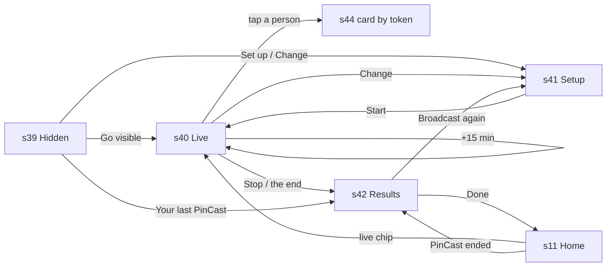

# 🧪 PinCast & Nearby · QA Frontend

**Feature:** [[F-20 PinCast & Nearby]] · **Verifies:** [[FD-24 PinCast & Nearby Frontend Delivery]] against [[S-45 PinCast & Nearby Story]] (S1–S5, N1–N12) · **Verdict:** ✅ Passing · 2026-11-24 · 24 of 24 rows on the fake backend, and the two-device journey on the development API. Two backend bugs are in `pending`: [[B-31 PinCast results offer Connect again for a person I already asked|B-31]] and [[B-32 A live PinCast outlives its session|B-32]]

Expected behaviour of the screens, as artefacts: journeys, states and copy to check a build against, **not test code**. `status: passing` or `failing` after a run; the verdict tells the PM whether the story can be fulfilled (passing with nothing pending or unmet). A failing row is one of two things: a story part the delivery does not fulfil goes in `unmet` and turns the story's badge ✕; a bug is filed and goes in `pending`, and leaves the story alone.

## Scope

- **Screens:** s39 hidden, s41 setup, s40 live, s44 opened by PinCast token, s11 Home's chip and *Go visible* card, s42 results.
- **24 rows, PC-01 to PC-24**, one per case of `social_pin` `docs/testing/patrol/F-20 PinCast test cases.md`, run by the Patrol suite `patrol_test/fake/g_pincast_test.dart`. It runs against a fake backend and a fake phone position, so the test chooses every answer and every position.
- **One journey on the development API (DEV-01):** a real phone (Xiaomi, Android) and the emulator, 20 m apart.
- **Not here:**
  - who is in range of whom (the smaller radius, mutual visibility, blocks), which is the server's and [[QB-19 PinCast & Nearby QA Backend]] checks;
  - Nearby by Ring (S6, later, N10) and notifications ([[S-96 Notifications Story]], N11).

## Journeys

### S1 · hidden (s39)

| # | Story | Steps | Expected | Checked |
|---|---|---|---|---|
| PC-01 | S1 · N2, N4 | Open PinCast, nothing live | "Hidden", "Go visible to see who's around", "Only people who are visible see you, and you see only them."; no count, no sample people; nobody's list asked | ✅ |
| PC-02 | S1 | No last settings | *Set up a PinCast* → s41; no *Change* | ✅ |
| PC-03 | S1 · N9, N3 | Location permission not given | *Allow location* and why: only while PinCast is on and the app is open, never in the background, never shown. Tapping asks; nothing starts | ✅ |
| PC-04 | S1 | A PinCast started and stopped; open PinCast again | "Go visible · Personal · 100 m · 30 min" starts at once with those settings, no setup; *Change* → s41 | ✅ |
| PC-05 | S1 · N11 | One ended | "Your last PinCast · See results" → s42 | ✅ |

### S2 · setup (s41)

| # | Story | Steps | Expected | Checked |
|---|---|---|---|---|
| PC-06 | S2 · N5, N9 | Open the setup, Start | My Ring preselected; 25 m and 500 m at the ends; 5 min, 30 min, 1 hr, 3 hr; "Visible to people within 100 m for 30 min, through Personal". Start sends `ringId`, `radiusMeters`, `durationMinutes`, `lat`, `lng` and opens s40 | ✅ |
| PC-07 | S2 · N9 | The position is refused for good | The reason with *Settings*; nothing sent; still on s41 | ✅ |

### S3 · live (s40) and the card (s44)

| # | Story | Steps | Expected | Checked |
|---|---|---|---|---|
| PC-08 | S3 · N9, N3 | The server 50 min behind the phone | "30 min left", from the server's `endsAt`; my Ring and "100 m" | ✅ |
| PC-09 | S3 · N3, N7 | Two in range, one a connection | Names only, no distance, no %; *All* and *New to me* only; *New to me* asks `filter=NEW` and leaves the connection out | ✅ |
| PC-10 | S3 | Someone new comes into range | They appear on the next read (about 10 s) with no manual refresh; new rows slide in | ✅ |
| PC-11 | S3 · N1 | Tap a person, Connect | `GET /views/pincast/:token`; "Found with PinCast", no *Save for later*; the relationship and *Connect* by `pincastToken`, never `pinName` | ✅ |
| PC-12 | S3 · N6 | *+15 min* | `POST …/extend`; "45 min left" | ✅ |
| PC-13 | S3 | *Change Ring or range*, then *Stop* | s41 as *Save changes*, the time fixed; Stop → `POST …/stop` → s42 | ✅ |
| PC-14 | S3 · N9 | In the background 35 s, then back | No position sent while in the background; one at once on return | ✅ |

### S4 · Home (s11)

| # | Story | Steps | Expected | Checked |
|---|---|---|---|---|
| PC-15 | S4 | Live, started elsewhere | "You're visible · 30 min", my Ring; tap → s40; *+15 min* there → Home says 45 | ✅ |
| PC-16 | S4 · N11 | One ended | "PinCast ended · See results" → s42; no notification | ✅ |
| PC-17 | S4 | *Stop* on s40, then *Done* | Home shows the ended chip | ✅ |
| PC-24 | S1, S4 | The first PinCast ended, back on Home | Home offers "Go visible · Personal · 100 m · 30 min" (one tap, live at once) and *Change*; before any PinCast, *Set up a PinCast* | ✅ |

### S5 · results (s42)

| # | Story | Steps | Expected | Checked |
|---|---|---|---|---|
| PC-18 | S5 · N1, N3, N8 | Three reached: one asked me, one connected, one neither | The Ring, the window, the count. "Sent you a request" → *Accept* (s46); "Connected"; *Connect* by `pincastToken` → *Requested*. Never "Opened your card" | ✅ |
| PC-19 | S5 | Nobody reached | "Nobody was nearby" | ✅ |
| PC-20 | S5 · N12 | `data: null` | The count only, with the 30-day note | ✅ |
| PC-21 | S5 | Start with 1 hr, stop, *Broadcast again* | s41 with the same settings ("…for 1 hr…") | ✅ |
| PC-22 | S5 | From s39's last results, *Done* | Home | ✅ |

### Sign-out

| # | Story | Steps | Expected | Checked |
|---|---|---|---|---|
| PC-23 | S3 · N9 | Live, then Me → Sign out | `POST /pincasts/current/stop` goes **before** `POST /auth/logout`, so nobody finds a signed-out person. The server side, a session that ends without the app, is [[B-32 A live PinCast outlives its session\|B-32]] | ✅ |

### On the development API

| # | Story | Steps | Expected | Checked |
|---|---|---|---|---|
| DEV-01 | S1–S5 · N1, N2, N9 | A real phone (Xiaomi, Android) and the emulator, 20 m apart, both on the development API. Each: hidden, *Allow location*, setup, start. Then: open the other's card, *Connect*, *+15 min*, *Stop*, results, *Accept* | Location is asked when in use only. Each broadcaster finds the other within 15 s, both ways. The card opens by token, and *Connect* goes by `pincastToken`. *+15 min* and *Stop* work. The results show "Sent you a request", and *Accept* turns the row to Connected "Met on PinCast" | ✅ |

## Screen states

| Screen | State | Expected rendering |
|---|---|---|
| [[Screen Index#s39\|s39]] | hidden | "Hidden", "Go visible to see who's around", the mutual sentence; no count |
| [[Screen Index#s39\|s39]] | with last settings | "Go visible · {Ring} · {m} · {min}" and *Change* |
| [[Screen Index#s39\|s39]] | first time | *Set up a PinCast* |
| [[Screen Index#s39\|s39]] | permission needed | *Allow location* with why |
| [[Screen Index#s39\|s39]] | last PinCast | "Your last PinCast · See results" |
| [[Screen Index#s41\|s41]] | setup | Ring, 25–500 m, 5 min / 30 min / 1 hr / 3 hr, the sentence, *Start PinCast* |
| [[Screen Index#s41\|s41]] | from *Change* while live | *Save changes*, the time fixed |
| [[Screen Index#s40\|s40]] | live | my Ring, "100 m", the countdown, the people, *All* / *New to me*, *+15 min*, *Stop*, *Change* |
| [[Screen Index#s44\|s44]] | by token | "Found with PinCast"; *Connect* and *Block*; no *Save for later* |
| [[Screen Index#s11\|s11]] | live | "You're visible · {min}", my Ring |
| [[Screen Index#s11\|s11]] | ended | "PinCast ended · See results" |
| [[Screen Index#s11\|s11]] | hidden, after a first PinCast | "Go visible · {Ring} · {m} · {min}" and *Change* |
| [[Screen Index#s42\|s42]] | with people | the Ring, the window, the count; rows "Sent you a request" (*Accept*), "Connected", or *Connect* |
| [[Screen Index#s42\|s42]] | empty | "Nobody was nearby" |
| [[Screen Index#s42\|s42]] | after 30 days | the count only, with the 30-day note |

## Flow diagram

## Verdict

- **Run 1, 2026-11-24:** `social_pin` `rings/F-11/honest-rings` @ `4989db2`, emulator Medium_Phone (Android 16), fake backend. ✅ 24 of 24 (PC-01 to PC-24).
- **Run 2, 2026-11-24:** the development API (backend `main` `ecd93c0`), a real phone (Xiaomi, Android) and the emulator 20 m apart. ✅ DEV-01 passes.
- **Failing rows:** none. **Story parts unmet:** none.
- **Bugs filed by this run, both for `/backend`:**
  - [[B-31 PinCast results offer Connect again for a person I already asked|B-31]]: on the development API, after A asked B, A's results showed B as `NONE` with *Connect* again. The results need a `REQUESTED` state with `requestId`.
  - [[B-32 A live PinCast outlives its session|B-32]]: the app stops a live PinCast before signing out (PC-23), but an expired or revoked session can't. Logout, logout everywhere, and a suspended or deleted account should end the PinCast on the server.
- **Differs from the delivery note:** [[FD-24 PinCast & Nearby Frontend Delivery|FD-24]] records the "Sent you a request" row without *Accept*; the build has it (PC-18, DEV-01). Flagged.
- **For the PM:** S-45 is not ready to fulfil while B-31 and B-32 are in `pending`.

## Log

- 2026-11-24 · `docs/qa/M-04-discovery/F-20-pincast/QF-07-passing` · written from `social_pin` `docs/testing/patrol/F-20 PinCast test cases.md` (PC-01 to PC-24, `patrol_test/fake/g_pincast_test.dart`) against FD-24 and S-45 S1–S5, N1–N12. Run 1 on `4989db2`, Medium_Phone, fake backend: 24 of 24. Run 2 on the development API, phone and emulator 20 m apart: DEV-01 passes. `draft` → `passing`. In `pending`: [[B-31 PinCast results offer Connect again for a person I already asked|B-31]] and [[B-32 A live PinCast outlives its session|B-32]] (/backend). Flagged [[FD-24 PinCast & Nearby Frontend Delivery]]
