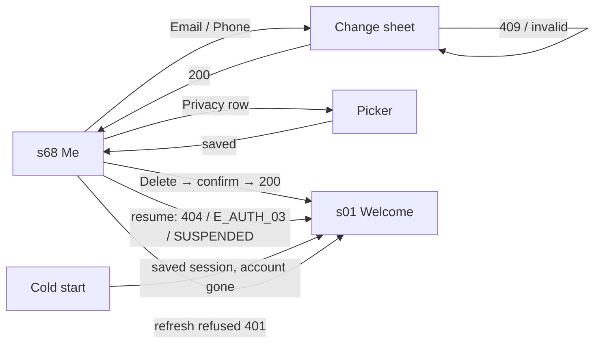

# 🧪 Account · QA Frontend

**Feature:** [[F-01 Account]] · **Verifies:** [[FD-04 Account Frontend Delivery]] against [[S-01 Account Story]] · **Verdict:** ❌ Failing · 2026-11-09 · `social_pin` `b646053` · 36 tests, 31 pass, 5 fail: 5 bugs (B-23 to B-27)

Expected behaviour of the screens, as artefacts: journeys, states and copy to check a build against, **not test code**. `status: passing` or `failing` after a run; the verdict tells the PM whether the story can be fulfilled (passing with nothing pending or unmet). A failing row is one of two things: a story part the delivery does not fulfil goes in `unmet`; a part built as asked that breaks is a bug, named in `pending`.

## Scope

- **Screens:** [[Screen Index#s68|s68]] Me / Account: the profile card (as the header), the plan card, the ACCOUNT group and its change email / phone sheet, the PRIVACY group and its pickers, Delete account; the sign-out states that land on [[Screen Index#s01|s01]] Welcome; Upgrade → [[Screen Index#s70|s70]]. Me also carries the profile editor (F-07) and the Connections and Blocked people rows (F-14): these rows only check that Account's rows still work beside them (AC-21, AC-34).
- **48 rows, AC-01 to AC-40 and DA-01 to DA-08** (with AC-01b, AC-03b, AC-13b, DA-02b, DA-04b), from the client's case list `social_pin/docs/testing/patrol/F-01 Account test cases.md` (2026-11-09), which replaces the checklist F1–F20 and the Maestro flows in `.maestro/account/`. The *Was* column names the old F row. AC-40 was added after the list: it is in the list's run results, not its case tables.
- **How a row runs** (Patrol, Android emulator, `development` flavor):
  - **R**: against the development API, a new account per test (`qa+<timestamp>@socialpin.test`) deleted at the end; read-only rows use the fixed QA account;
  - **F**: against a fake backend the test controls (`GET` / `PATCH` / `DELETE /users/me` that behave like the server), for what the server can't produce on demand;
  - **R+F**: both.
- **S6 (lose access) runs on the fake backend only:** the dev API has no route that suspends an account ([[S-117 Operator Panel Story|Operator Panel · S3]]). The old F19 is now AC-15, AC-32 and AC-33.
- **Not here:** the server's rules (normalisation, uniqueness, the soft delete, released email and phone, revoked sessions), checked by [[QB-04 Account QA Backend]]; the Upgrade flow (s70 has no backend), linked accounts, devices, the connection count's rules (F-03), the profile editor's contents (F-07), Connections and Blocked people (F-14).

## Journeys

### A · Me: who you are, your plan, your account (s68) · S1

| # | Story | Steps | Expected | Run | Was | Checked |
|---|---|---|---|---|---|---|
| AC-01 | S1 | Sign up → Me | Plan card "Free plan" with **Upgrade**; ACCOUNT: Email = the address signed up with, **Verified**; Phone **Add**; no "Confirming a new email…" note | R | F2, F3 | ✅ |
| AC-01b | S1 | The QA account signs in → Me | "Last signed in" as a relative time | R | F2 | ✅ |
| AC-02 | S1 | `emailVerifiedAt: null`, phone verified | Email **Unverified**, Phone `+963 …` **Verified**; the note "Confirming a new email or number isn't in the app yet." | F | F2 | ✅ |
| AC-03 | S1 | `accountType: PRO` | "Pro plan", no Upgrade (no header badge: FD-04 deviation) | F | F3 | ✅ |
| AC-03b | S1 | Free → Upgrade | s70 opens | F | F3 | ✅ |
| AC-10 | S1 | Email unverified; the server now says verified; background → foreground | `GET /users/me` again; **Verified**, the note goes | F | F4 | ✅ |
| AC-12 | S1 | As AC-10, `accountType` now `PRO` | "Pro plan" without a restart | F | F4 | ✅ |
| AC-20 | S1 | Sign up as "Patrol Tester" → Me | The card: the default profile's full name and `!pinName` (`GET /profiles`), the Ring count, avatar or initials; `GET /users/me` carries no name | R+F | F1 | ✅ |
| AC-21 | S1 | Me → tap the card | The profile editor (F-07) opens | F | — | ✅ |
| AC-22 | S1 | Me, top to bottom | No "Manage account", no "password" | R | F5 | ✅ |
| AC-23 | S1 | Known tokens and code → Me, both sheets, Privacy, Delete | No code, token, "Bearer" or "password" rendered | F | F5 | ✅ |
| AC-24 | S1 | Me's first call answers 401, the refresh succeeds | One `POST /auth/refresh`, then `GET /users/me` again; still signed in | F | — | ✅ |
| AC-34 | S1 | Me with Connections (3), Blocked people, Linked accounts | Those rows are there; Privacy "Not set", the email change works, Sign out and Delete under them | F | — | ✅ |
| AC-35 | Motion | Animations off → Me | Me arrives and stays still | F | — | ✅ |
| AC-38 | States | `GET /users/me` answers 500 | No ACCOUNT group; "Free plan"; the rest renders; still signed in | F | state | ✅ |

### B · Change the email (s68 change sheet) · S2

| # | Story | Steps | Expected | Run | Was | Checked |
|---|---|---|---|---|---|---|
| AC-04 | S2 | Email → new address → Save | Sheet closes; "Email changed."; new address **Unverified**; the note; helper "It shows as unverified after you change it."; no promise of a verification email ([[D-20 The changed address still signs in, the words are corrected\|D-20]]) | R | F6 | ✅ |
| AC-05 | S2 | Save unchanged; type → Cancel | Sheet closes; nothing changes | R | F9 | ✅ |
| AC-06 | S2 | `not-an-email` → Save | "Enter an email like name@example.com."; the sheet stays | R | F7 | ✅ |
| AC-07 | S2 | An email on another account → Save | "This email is already on another account."; the sheet stays with what was typed | R | F8 | ✅ |
| AC-25 | S2 | `  Sam.New@Example.COM ` → Save | Body exactly `{ "email": "sam.new@example.com" }`; **Unverified** | F | F6 | ✅ |
| AC-27 | S2, S3 | 409 `E_USER_02`, a bare 409, 409 `E_USER_03` | Taken message inline each time, never `message`; the text kept **and the field focused** | F | F8, F11 | ❌ not focused: [[B-25 The change sheet doesn't focus the field after a taken error\|B-25]] |
| AC-28 | Edges | `PATCH` answers 500 | Error toast; the sheet stays; Cancel → unchanged | F | — | ✅ |
| AC-29 | Edges | `PATCH` unreachable | Connection toast; the sheet stays | F | — | ✅ |
| AC-30 | States | `PATCH` answers after 2 s; Save ×3 | One `PATCH`; closes once | F | — | ✅ |
| AC-31 | S2 | AC-04 → sign out → sign in with the new address | Home at once; Me shows it **Unverified** ([[B-01 An unverified changed email still signs in\|B-01]], by design, D-20) | R | — | ✅ |
| AC-39 | S2, S3 | Empty / `sam@`; `+963 12` / empty → Save | "Enter your email." / "Enter an email like…" / "That number doesn't look right…" / "Enter your phone number."; no `PATCH` | F | F7, F12 | ✅ |

### C · Change the phone · S3

| # | Story | Steps | Expected | Run | Was | Checked |
|---|---|---|---|---|---|---|
| AC-08 | S3 | A number on another account → Save | "This number is already on another account."; still **Add** | R | F11 | ✅ |
| AC-09 | S3 | `+963 93…` → Save; then clear → Save | "Phone number changed."; `+963 …` left to right, **Unverified**. Clearing: "Enter your phone number.", nothing sent | R | F10, F12 | ✅ |
| AC-26 | S3 | `+971 50 123 4567` → Save | Body exactly `{ "phone": "+971501234567" }`; email still **Verified** | F | F10 | ✅ |
| AC-40 | a11y | Open the phone sheet | Opens with no semantics error | F | — | ❌ "Invisible SemanticsNodes should not be added to the tree" (the country-code button): [[B-27 Opening the phone sheet throws an invisible semantics node error\|B-27]] |

### D · Delete the account · S4

| # | Story | Steps | Expected | Run | Was | Checked |
|---|---|---|---|---|---|---|
| DA-01 | S4 | Me → scroll down | "Delete account" in red, under Sign out | R | F13 | ✅ |
| DA-02 | S4 | Delete account | "Delete your account?", the consequence, "Delete my account" | R | F13 | ✅ |
| DA-02b | S4 | Read the sheet's body | Names that **every Ring, projection and session** goes, and the email and phone become free | F | — | ❌ only the sign-out and the freed email and phone: [[B-26 The delete sheet doesn't say every Ring, projection and session goes\|B-26]] |
| DA-03 | S4 | The sheet → Cancel | Still signed in on Me | R | F13 | ✅ |
| DA-04 | S4 | The sheet → Delete my account | Welcome, "Your account has been deleted."; Back can't return; a restart stays on Welcome | R | F14 | ✅ |
| DA-04b | S4 | As DA-04 on the fake | One `DELETE /users/me`, no `POST /auth/logout` | F | F14 | ✅ |
| DA-05 | S4 | After DA-04, sign up with the same email | A new sign-up, completes | R | F14 | ✅ |
| DA-06 | S4 | Deleted on another phone | = AC-13 / AC-14 | R | F15 | ❌ through AC-14 |
| DA-07 | Edges | `DELETE` unreachable | Connection toast; still signed in on Me | F | F16 | ✅ |
| AC-36 | Edges | `DELETE` answers 500 | Error toast; still signed in on Me | F | F16 | ✅ |
| AC-13 | S4 | The test deletes the account via the API; background → foreground | Welcome, "Your account has been deleted." ([[B-02 Deleted account answers 401, not the documented 404 E_USER_01\|B-02]] regression) | R | F15 | ✅ |
| AC-13b | S4 | `GET /users/me` answers a bare 404 on resume | The same, no "not found" toast | F | F15 | ✅ |
| AC-14 | S4 | As AC-13, then open the app cold | Welcome with "Your account has been deleted.", never Home | R | F15 | ❌ lands on Home (530 ms): [[B-23 A deleted account opened cold lands on Home, not Welcome\|B-23]] |

### E · Privacy defaults (s68 PRIVACY) · S5

| # | Story | Steps | Expected | Run | Was | Checked |
|---|---|---|---|---|---|---|
| AC-16 | S5 | New account → Privacy; Gender → Female | Each row "Not set", "Hidden from all Rings"; the note; never "public". **Female**, still hidden | R | F17, F18 | ✅ |
| AC-17 | S5 | Marital status → Single, then Single again | The second pick just closes | R | F18 | ✅ |
| AC-18 | S5 | Birthdate → a date → Done | The date shows; a picker, not the editor (FD-04 deviation) | R | F18 | ✅ |

### F · Lose access while signed in · S6

| # | Story | Steps | Expected | Run | Was | Checked |
|---|---|---|---|---|---|---|
| AC-15 | S6 | Every call answers 401 `E_AUTH_03`; background → foreground | Welcome, "This account can't sign in right now. Contact support if this keeps happening."; no `POST /auth/refresh`; no retry loop | F | F19 | ✅ |
| AC-32 | S6 | A bare 401, then `POST /auth/refresh` answers 401 `E_AUTH_03` | The same not-active message | F | F19 | ✅ |
| AC-33 | S6 | `GET /users/me` answers 200 `status: SUSPENDED` on resume | Signed out with the not-active message, as at startup | F | F19 | ❌ stays signed in: [[B-24 A suspended account stays signed in when the account read says SUSPENDED\|B-24]] |

### G · Across

| # | Story | Steps | Expected | Run | Was | Checked |
|---|---|---|---|---|---|---|
| AC-11 | S3 | Arabic → Phone → Save | Title in Arabic; the number left to right; Unverified in Arabic | R | F20 | ✅ |
| AC-19 | S1, S5 | Arabic → sign up → Me | ACCOUNT in Arabic, right to left; the gender picker in Arabic, Female saved | R | F20 | ✅ |
| DA-08 | S4 | Arabic → Delete → confirm | The deleted message in Arabic | R | F20 | ✅ |

## Screen states

| Screen | State | Expected rendering | Rows |
|---|---|---|---|
| [[Screen Index#s68\|s68]] | account not loaded | No ACCOUNT group; "Free plan"; the rest renders | AC-38 |
| s68 | account loaded | ACCOUNT with Email, Phone (chips or "Add"), "Last signed in"; plan from `accountType` | AC-01, AC-01b |
| s68 | something unverified | "Confirming a new email or number isn't in the app yet." under ACCOUNT | AC-02, AC-04 |
| s68 · change sheet | open | "Change your email" / "Change your phone number", one field, helper "It shows as unverified after you change it.", Save, Cancel | AC-04, AC-09 |
| s68 · change sheet | saving | The loader; Save does nothing until the answer | AC-30 |
| s68 · change sheet | error | The message under the field; the text kept; the field focused | AC-07, AC-27 |
| s68 · Privacy | values | "Not set" or the value; which Rings show it, or "Hidden from all Rings" | AC-16 |
| s68 · delete sheet | open | "Delete your account?", the consequence (every Ring, projection, session; email and phone freed), "Delete my account" in red, Cancel | DA-02, DA-02b |
| [[Screen Index#s01\|s01]] | after a sign-out state | Welcome, nothing to go back to, one message (see *Error copy*) | DA-04, AC-13, AC-15 |

## Flow diagram

## Error copy

| ErrorCode | Where | Copy shown |
|---|---|---|
| `E_USER_02` (409) | change email sheet | "This email is already on another account." |
| `E_USER_03` (409) | change phone sheet | "This number is already on another account." |
| — (client check) | change email sheet | "Enter your email." / "Enter an email like name@example.com." |
| — (client check) | change phone sheet | "Enter your phone number." / "That number doesn't look right. Check it and the country code." |
| `E_USER_01` (404), or a bare 404 | any read of `GET /users/me` | Welcome: "Your account has been deleted." |
| `E_AUTH_03` (401), or `status: SUSPENDED` | any call / the account read | Welcome: "This account can't sign in right now. Contact support if this keeps happening." |
| `E_AUTH_04` (401) | the refresh | Welcome: "Your session has expired. Please sign in again." |
| — (no connection) | a save, Delete account | The connection toast; the session is kept. |

## Verdict

- **Run on: 2026-11-09** · build: `social_pin` `rings/F-11/honest-rings` @ `b646053`, Android emulator `emulator-5554` (Medium_Phone), flavor `development`, Patrol 4.11 · result: ❌ **failing**.
  - `patrol_test/fake/account_test.dart` (fake backend): 26 tests, 22 ✅, 4 ❌ (7 m 59 s).
  - `patrol_test/real/account_test.dart` (dev API): 10 tests, 9 ✅, 1 ❌ (4 m 33 s).
  - **36 tests, 31 pass, 5 fail**; every row run, nothing skipped. Several R rows share one test (one throwaway account), so 48 rows run in 36 tests.
- **Failing rows**, each a bug against [[FD-04 Account Frontend Delivery|FD-04]] for `/frontend`, in `pending`; nothing in `unmet`:
  - AC-14 (and DA-06 through it): opened cold after a delete elsewhere, lands on Home → [[B-23 A deleted account opened cold lands on Home, not Welcome|B-23]]. The API side of B-02 holds (404 to the old token, without the `E_USER_01` code); the app doesn't read `GET /users/me` on a cold start to Home.
  - AC-33: a 200 with `status: SUSPENDED` keeps the session → [[B-24 A suspended account stays signed in when the account read says SUSPENDED|B-24]].
  - AC-27: the field isn't focused after a 409 → [[B-25 The change sheet doesn't focus the field after a taken error|B-25]].
  - DA-02b: the delete sheet doesn't name every Ring, projection and session → [[B-26 The delete sheet doesn't say every Ring, projection and session goes|B-26]].
  - AC-40: a semantics error when the phone sheet opens → [[B-27 Opening the phone sheet throws an invisible semantics node error|B-27]].
- **F19 is now run**, on the fake backend: AC-15 and AC-32 ✅ (the not-active message, no refresh, no loop), AC-33 ❌. A real suspension on the dev API still can't be made ([[S-117 Operator Panel Story|Operator Panel · S3]]); the old `pending` entries on S-87 and S-117 are cleared.
- **Logs:** the run's logcat shows `Authorization: Bearer …` and a cURL line per request from the debug network logger. Every logger is behind `kDebugMode`, so a release build prints none; a release-build check was not run. No code or token was rendered (AC-23 ✅).
- **The client's case list notes the run also had uncommitted Ring Members work** in the tree (since committed); it doesn't touch Account.
- **Differs from [[FD-04 Account Frontend Delivery|FD-04]]** (flagged): the profile card now opens the profile editor (AC-21 ✅; FD-04 says it opens nothing); a deleted account is not signed out at a cold start to Home (AC-14; FD-04 says a 404 ends the session "at startup too"); the not-active message shows on a 401 `E_AUTH_03` mid-session (AC-15 ✅; FD-04's *Not done yet* still says "Your session has expired").
- Earlier runs: 2026-10-26 on `main` @ `47ce960` (11 Maestro flows, F1, F2, F6–F13, F17, F18 ✅) and 2026-11-05 on `f462a28` (by hand, F3, F4, F5, F14, F15, F16, F20 ✅). The Patrol rows above replace both.

## Log

- 2026-11-05 · flagged [[B-02 Deleted account answers 401, not the documented 404 E_USER_01]]: F15 ran by hand on two phones on social_pin f462a28 against the dev API: phone A lands on Welcome with 'Your account has been deleted.' Your QF-04 pending item is settled; /pm clears it
- 2026-11-05 · flagged [[B-01 An unverified changed email still signs in]]: the row F10 asked for is QF-04's F6 and its 'something unverified' state, passing on 2026-10-26 and again 2026-11-05: your QF-04 pending item is settled; /pm clears it
- 2026-11-09 · rewritten from the client's Patrol case list (AC-01 to AC-40, DA-01 to DA-08); run on social_pin b646053, emulator-5554: 36 tests, 31 pass, 5 fail; B-23 to B-27 filed against FD-04; flagged [[FD-04 Account Frontend Delivery]]
