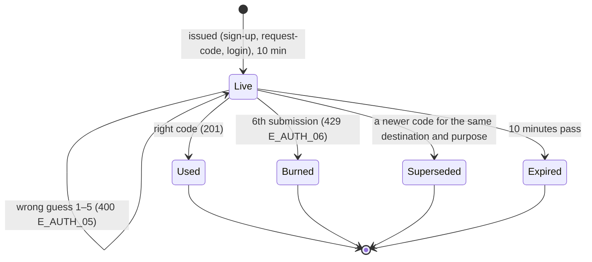

# 🧪 Auth & Sign-up · QA Backend

> Blocked by default until [[Auth & Sign-up Backend Delivery]] is `done` (the hand-off order in `docs.config.json`); `blockedBy: []` opts out, `blockedBy: [...]` names other blockers.

**Feature:** [[Auth & Sign-up]] · **Verifies:** [[Auth & Sign-up Backend Delivery]] against [[Auth & Sign-up Story]] and [[Auth & Sign-up Frontend Requirements]], with the shapes and errors of [[Auth & Sign-up Backend Integration]] · **Verdict:** 🔴 Failing · 2026-10-27 · `main @ b4984d6 · localhost:3001, Node 22.22.2` · 45 of 48 as expected

Expected behaviour of the API, as artefacts a person can check a build against: tables and diagrams, **not test code** (the specs live in the backend repo). `status: passing` or `failing` after a run; the verdict tells the PM whether the story can be fulfilled (passing with nothing pending).

## Scope

**Covered.** The nine auth routes and the one public Pin check of [[Auth & Sign-up Backend Integration]]: the three sign-up calls (`sign-up` → `verify-code` → `complete-registration`), the two sign-in calls (`login` → `login/verify`), resend (`request-code`), the session calls (`refresh`, `logout`, `logout-everywhere`) and `GET /profiles/pin-name/:pinName/availability`. Their shapes, normalisation, the code lifecycle (10 minutes, five wrong guesses, superseded on resend), the token scopes, and the guarantee that `complete-registration` leaves either a whole identity or nothing.

**Not covered.** Copy, timers and screen states (that is the QA Frontend's). Delivery of codes by email or SMS, which does not exist yet ([[T-001 Wire an email provider for one-time codes]], [[T-002 Wire an SMS provider for one-time codes]]): every row reads the code from `devCode`. Suspended and deleted accounts on later calls, already run in [[Account QA Backend]] (B14, B21); rows B46 and B47 here only point at them. The steps between s02 and s06 ([[Onboarding Imports]]) and after s08 ([[Interests]], [[Rings]]). Rate limiting: no route throttles requests today, so there is nothing to check yet.

**Rows that state the contract against the code.** Where the integration note and the code read differently, the row states the integration note's promise (that is the contract), so a difference shows up as 🔴 rather than being written into the expectation. B5 and B30 were such rows and both differ on the run. **B14 vs [[Auth & Sign-up Story]] S2:** the story says the 429 comes "after five wrong tries". The build counts five wrong guesses as 400s and answers the **sixth** submission 429, even when that sixth code is right; the row follows the integration note ("sixth wrong guess") and passes, and the story's wording is the PM's to check (in `pending`).

**Test data.** Throwaway addresses only, `qa-auth-<letter>-<run>@test.local` and `+44 20 718x xxxx` numbers (the `+1 555 01xx` range fails E.164 validation, see [[Account QA Backend]]). Run on Node 20.19 or later: on Node 18 every write answers 500 (see [[Account QA Backend]]'s verdict). The 2026-10-27 run (stamp `10271159`) deleted every account it completed (a, f, g, the phone account, and the re-check accounts) and left six PENDING sign-ups that hold no session and cannot be deleted through the API: `qa-auth-{b,c,d,e,x}-10271159@test.local` and `qa-auth-a-10271159@test.local` (re-signed-up by B10), plus `qa-auth-e2-…`, `qa-auth-e3-…`, `qa-auth-x2-…` and `qa-tz-…` from the re-checks. Time-based rows were set up without waiting: B15 by moving the code's stored `expires_at` back, B30 and B48 with tokens signed by the dev secret with an `exp` in the past.

## Expected behaviour

Every row is one acceptance criterion of [[Auth & Sign-up Story]] or one rule of [[Auth & Sign-up Backend Integration]]. ✅ as expected · 🔴 differs · ⬜ not run. Bodies are the API's `{ statusCode, message, error, path, timestamp }`; `ErrorCode` is not on the wire until [[T-063 Put the ErrorCode on the error body]], so the code column names what the contract promises.

### `POST /auth/sign-up` — S1 Start with an email or a phone (s01)

| # | Given | When | Then | Checked |
|---|---|---|---|---|
| B1 | an email no account holds | `{ email }` | 201 `{ destination, channel: "EMAIL", expiresAt, devCode }`; `expiresAt` is 10 minutes ahead; `devCode` is six digits; a PENDING account now exists | ✅ |
| B2 | an E.164 phone no account holds | `{ phone: "+442071838751" }` | 201, `channel: "PHONE"`, `destination` in E.164 | ✅ |
| B3 | an email typed with spaces and capitals | `{ email: "  QA-Auth-A@Test.Local " }` | 201, `destination` trimmed and lower-cased | ✅ |
| B4 | — | `{}` | 400 `E_AUTH_07` "Provide either an email address or a phone number"; nothing created | ✅ |
| B5 | — | `{ email, phone }` together | 400 `E_AUTH_07` (the integration note: "neither or both"); nothing created. **Actual: 201, the code goes to the email, and the PENDING account stores the unproven phone too; a later sign-up with that phone alone continues the same account.** | 🔴 [[B-04 Sign-up accepts an email and a phone together]] |
| B6 | — | `{ email: "not-an-email" }`, `{ phone: "0501234567" }` (no country code) | 400, `message` an array naming the field; nothing created | ✅ |
| B7 | — | `{ email, password: "x" }` | 400 `["property password should not exist"]`: there is no password anywhere | ✅ |
| B8 | an address whose sign-up is still PENDING | `sign-up` again with it | 201 with a **new** `devCode`, no error; the previous code no longer verifies (B13) | ✅ |
| B9 | an address that finished sign-up (ACTIVE) | `sign-up` with it | 409 `E_AUTH_01` "An account already exists for this email or phone. Sign in instead."; no code issued | ✅ |
| B10 | an address released by a deleted account | `sign-up` with it | 201 with a `devCode`: the address is free again | ✅ |

### `POST /auth/verify-code` and `POST /auth/request-code` — S2 Enter the code (s02)

| # | Given | When | Then | Checked |
|---|---|---|---|---|
| B11 | a fresh sign-up code | `{ destination, code, purpose: "SIGN_UP" }` | 201 `{ onboardingToken, purpose: "SIGN_UP", expiresIn: "15m" }`; the account's `emailVerifiedAt` (or `phoneVerifiedAt`) is set; it is still PENDING | ✅ |
| B12 | the same code | sent a second time | 400 `E_AUTH_05` "That code is invalid or has expired": a code works once | ✅ |
| B13 | a code, then a resend | the **first** code | 400 `E_AUTH_05`: a resend supersedes the previous code; the new one verifies | ✅ |
| B14 | a fresh code | five wrong codes, then a sixth submission **with the right code** | 400 `E_AUTH_05` five times, then 429 `E_AUTH_06` "Too many attempts. Request a new code."; the right code after that is 400 (the code is burned); a resend gives a code that works | ✅ |
| B15 | a code older than 10 minutes | the right code | 400 `E_AUTH_05` | ✅ (the code was aged by moving its stored `expires_at` 11 minutes back; ageing it with Postgres's `now()` did not work and found [[B-06 Timestamps the app writes are stored shifted by the server time zone]]) |
| B16 | — | `destination` typed with other capitals or spaces than at sign-up | 201: the server normalises the destination the same way at both steps | ✅ |
| B17 | — | `purpose: "LOGIN"`; `code: "12345"`; `code: "abcdef"` | 400 validation: `verify-code` takes `SIGN_UP` only, and exactly six digits | ✅ |
| B18 | a PENDING address | `request-code { destination, purpose: "SIGN_UP" }` | 201 with a new `devCode`; the old code is superseded | ✅ |
| B19 | an address no account holds | `request-code` with either purpose | 201 with `destination`, `channel`, `expiresAt` and **no `devCode`**; no code stored, so any code then sent to `verify-code` is 400 | ✅ |

### `GET /profiles/pin-name/:pinName/availability` and `POST /auth/complete-registration` — S3 Claim a Pin name (s06), S4 Land on the first Ring (s08)

| # | Given | When | Then | Checked |
|---|---|---|---|---|
| B20 | no token at all | `GET …/availability` for a free name | 200 `{ pinName, available: true }`: the route is public | ✅ |
| B21 | a name held by another account | the same name in other capitals | 200 `{ available: false }`, and nothing in the body about who holds it | ✅ |
| B22 | — | `GET …/availability` for a name of 2 or 31 characters, or with `!`, a space or `-` | 200 `{ pinName, available }`: the route answers only a boolean and applies no format rule; the client validates 3 to 30 letters, digits, `.` and `_` itself ([[Auth & Sign-up Backend Integration]]), and `complete-registration` refuses a bad name (B26). Observed: `available: true` for each of them | ✅ (expectation corrected: the first draft asked for a 400 no note promises) |
| B23 | an onboarding token from B11 | `{ onboardingToken, pinName: "QA.Auth_A", fullName: "QA Auth A" }` | 201 `{ accessToken, refreshToken, tokenType: "Bearer", expiresIn: "15m" }`; `GET /users/me` with the access token: `status: "ACTIVE"` | ✅ |
| B24 | B23's session | `GET /profiles`, `GET /rings`, `GET /rings/:id/projection` | the default profile (`isDefault: true`, `pinName` with its casing kept, `fullName`), one default Ring pointing at it, and its projection: the whole identity from one call | ✅ |
| B25 | a fresh onboarding token | no `fullName` | 201; the profile's `fullName` is empty | ✅ |
| B26 | a fresh onboarding token | `fullName` of 121 characters; `pinName` that fails the pattern; an extra `password` key | 400 validation each time; the account stays PENDING | ✅ |
| B27 | a Pin name held by another account, in other capitals | `complete-registration` with it | 409 `E_PROFILE_02` "This pin name is already taken"; the account is **still PENDING** with no profile and no Ring (nothing half-built); the same token then succeeds with a free name | ✅ |
| B28 | B23's onboarding token, already used | `complete-registration` again | 409 `E_AUTH_08` "This account is already set up. Sign in instead." | ✅ |
| B29 | an ACTIVE account | `request-code { purpose: "SIGN_UP" }`, `verify-code`, then `complete-registration` | 409 `E_AUTH_08` at the last step: an extra code cannot rebuild an existing identity | ✅ |
| B30 | an onboarding token older than 15 minutes, or one with a broken signature | `complete-registration` | 400 `E_AUTH_05` (the integration note); back to s02. **Actual: 401 "Verification session is invalid or expired", for both.** | 🔴 [[B-05 Expired onboarding token answers 401, not the documented 400]] |
| B31 | an onboarding token | used as `Authorization: Bearer` on `GET /users/me` | 401 `E_AUTH_04` "Token cannot be used for API access": it is not a session | ✅ |

### `POST /auth/login` and `POST /auth/login/verify` — S5 Come back later and sign in with a code (s01 → s02)

| # | Given | When | Then | Checked |
|---|---|---|---|---|
| B32 | an ACTIVE account's email, then its phone | `login { identifier }` | 201 `{ destination, channel, expiresAt, devCode }`, channel matching the identifier | ✅ |
| B33 | an identifier no account holds | `login` | 201 with the **same fields** and no `devCode`; no code stored; `login/verify` with any code is 400 `E_AUTH_05` | ✅ |
| B34 | B32's code | `login/verify { identifier, code }` with the same string | 201 session pair; `GET /users/me` shows `lastLoginAt` at that instant | ✅ |
| B35 | B32's code | `login/verify` with the identifier in other capitals | 201: the server normalises; the client still sends the same string (S5) | ✅ |
| B36 | a login code | wrong code five times, then a sixth submission | as B14: five 400 `E_AUTH_05`, then 429 `E_AUTH_06`, code burned | ✅ |
| B37 | a **sign-up** code for the address | sent to `login/verify` | 400 `E_AUTH_05`: sign-up and login codes do not cross | ✅ |
| B38 | an account whose sign-up stopped after B11 (PENDING) | `login`, then `login/verify` with the right code | 201 with a `devCode`, then 403 `E_AUTH_03` "This account is not active"; no session | ✅ |
| B39 | a SUSPENDED account | `login`, then `login/verify` | 403 `E_AUTH_03`, the **same body** as B38 | ✅ |
| B40 | a login code, then `request-code { purpose: "LOGIN" }` | the first code | 400 `E_AUTH_05`; the resent code signs in | ✅ |

### Sessions — S6 Stay signed in without noticing (s68, s75)

| # | Given | When | Then | Checked |
|---|---|---|---|---|
| B41 | a session | `POST /auth/refresh` with the **refresh** token as bearer | 201 with a new pair; the token sent is now dead: sending it again is 401 `E_AUTH_04` "Refresh token is no longer valid. Sign in again." | ✅ |
| B42 | one refresh token | two `refresh` calls at the same moment | one 201, one 401 `E_AUTH_04` (single use holds under a race). **Actual: 201 and 201; both new refresh tokens stay live and both refresh again: the session forks.** | 🔴 [[B-03 Two refreshes at once both succeed and fork the session]] |
| B43 | a session | the **access** token sent to `refresh`; the **refresh** token sent to `GET /users/me` | 401 both times: each token works only where its scope allows | ✅ |
| B44 | a session | `POST /auth/logout` with the refresh token; then the same call again | 201 both times (idempotent); that refresh token is dead; the access token keeps working until it expires (at most 15 minutes) | ✅ |
| B45 | the same account signed in on two devices | `POST /auth/logout-everywhere` with one device's access token | 201 `{ revoked: N }`, N the live sessions; both devices' refresh tokens are then 401 `E_AUTH_04` | ✅ |
| B46 | a session, then the account is suspended | any call | 401 `E_AUTH_03` "Account is not active" (also [[Account QA Backend]] B21) | ✅ |
| B47 | a session, then the account is deleted | any call | 404 `E_USER_01` "User not found" (also [[Account QA Backend]] B14) | ✅ |
| B48 | an access token older than 15 minutes, or one with a forged signature | `GET /users/me` | 401; a refresh restores the session | ✅ |

## State diagram

The account, as the auth routes move it:

```mermaid
stateDiagram-v2
  [*] --> PENDING: POST /auth/sign-up (new address)
  PENDING --> PENDING: sign-up again / request-code (new code, old one superseded)
  PENDING --> PENDING: verify-code (destination verified, onboarding token 15 min)
  PENDING --> ACTIVE: complete-registration (profile + default Ring + projection, one transaction)
  PENDING --> PENDING: complete-registration fails (pin taken, bad body) — nothing written
  ACTIVE --> ACTIVE: login → login/verify (session)
  ACTIVE --> SUSPENDED: PATCH /admin/users/:id/status
  SUSPENDED --> ACTIVE: PATCH /admin/users/:id/status
  ACTIVE --> DELETED: DELETE /users/me
  PENDING --> [*]: login/verify 403 E_AUTH_03
  SUSPENDED --> [*]: login/verify 403 E_AUTH_03, any call 401 E_AUTH_03
  DELETED --> [*]: any call 404 E_USER_01; address released
```

One code, from issue to end:

Every end state answers 400 `E_AUTH_05` to a further attempt.

## Error matrix

What the contract promises. The message column is the text the build sends; until [[T-063 Put the ErrorCode on the error body]] the client tells rows apart by status and endpoint.

| Situation | Status | ErrorCode | Message | Rows |
|---|---|---|---|---|
| sign-up with neither of email and phone | 400 | `E_AUTH_07` | "Provide either an email address or a phone number" | B4 |
| sign-up with both | **201, not 400** | `E_AUTH_07` (promised) | the code goes to the email; both are stored | B5 🔴 |
| a field fails validation, or an unknown key is sent | 400 | — | an array, one entry per constraint | B6, B7, B17, B22, B26 |
| sign-up for an address that finished sign-up | 409 | `E_AUTH_01` | "An account already exists for this email or phone. Sign in instead." | B9 |
| wrong, expired, used, superseded or burned code; code of the other purpose | 400 | `E_AUTH_05` | "That code is invalid or has expired" | B12–B15, B19, B33, B37, B40 |
| sixth submission of one code | 429 | `E_AUTH_06` | "Too many attempts. Request a new code." | B14, B36 |
| onboarding token expired or forged | **401, not 400** | `E_AUTH_05` | "Verification session is invalid or expired" | B30 🔴 |
| Pin name taken at the last moment | 409 | `E_PROFILE_02` | "This pin name is already taken" | B27 |
| complete-registration on an account already set up | 409 | `E_AUTH_08` | "This account is already set up. Sign in instead." | B28, B29 |
| login/verify for a PENDING or SUSPENDED account | 403 | `E_AUTH_03` | "This account is not active" | B38, B39 |
| refresh token rotated, revoked or replayed | 401 | `E_AUTH_04` | "Refresh token is no longer valid. Sign in again." | B41, B45 (B42 🔴: a concurrent replay is **not** refused) |
| an onboarding or refresh token on an API route | 401 | `E_AUTH_04` | "Token cannot be used for API access" / "Unauthorized" | B31, B43 |
| suspended account on any later call | 401 | `E_AUTH_03` | "Account is not active" | B46 |
| deleted account on any later call | 404 | `E_USER_01` | "User not found" | B47 |

Retired, and never to be seen: `E_AUTH_02` (invalid password), `E_USER_04` (current password), purpose `PASSWORD_RESET`.

## Privacy and access checks

- **Existence is not revealed at step 1 of sign-in.** `login` and `request-code` answer a known and an unknown address with the same status and the same fields (B19, B33). **Standing caveat, not a row:** while `devCode` is returned ([[T-003 Remove devCode once delivery works]]), its presence *does* tell a caller the account exists, and knowing an address is enough to sign in as it. Every privacy result here holds only once T-003 ships.
- `sign-up` on an ACTIVE address answers 409 `E_AUTH_01` (B9): that reveals the account exists, by design, so the client can switch to sign-in without asking (S1).
- PENDING and SUSPENDED accounts get one identical 403 at `login/verify` (B38, B39): the client cannot tell them apart.
- The Pin check never names the holder of a taken name (B21).
- No response carries a password, a code hash, a refresh-token hash or a user id at step 1; the challenge is `destination`, `channel`, `expiresAt` and (for now) `devCode` only (B1, B32).
- Token scopes are not interchangeable: an onboarding or refresh token never opens an API route, an access token never refreshes (B31, B43).
- `complete-registration` leaves no half identity: a failure writes nothing (B27).

## Verdict

- **Run on:** 2026-10-27 · **build:** `main @ b4984d6 · localhost:3001, Node 22.22.2` (the dev server on `localhost:3000` still runs Node 18.18) · **result:** 🔴 **failing** · 45 of 48 rows as expected, 3 differ (B5, B30, B42), none unrun.
- **B42 — the refresh rotation breaks under a race. Security.** Two refreshes with one token at the same moment both succeed and both new tokens stay live, so a replayed (stolen) token used while its owner refreshes forks the session instead of ending it. Filed as [[B-03 Two refreshes at once both succeed and fork the session]], high, `/backend`.
- **B5 — sign-up takes both an email and a phone**, and attaches the phone without proof. Filed as [[B-04 Sign-up accepts an email and a phone together]], medium, `/backend`.
- **B30 — an expired or forged onboarding token is 401, not 400.** Same code, other status. Filed as [[B-05 Expired onboarding token answers 401, not the documented 400]], low, `/backend` (fix the status or the note).
- **Found in passing, not a row: every timestamp the app writes is stored 3 hours early** on this machine (time zone UTC+3), while the API reads them back correctly. Found when ageing a code with Postgres's `now()` had no effect on B15. Filed as [[B-06 Timestamps the app writes are stored shifted by the server time zone]], high, `/backend`; it affects every table, not only auth.
- Everything else behaves as the integration note says: normalisation, the six-digit code with its 10 minutes, five wrong guesses then 429, resend superseding, the onboarding token's scope, a whole identity from `complete-registration` or nothing (B27), one 403 for PENDING and SUSPENDED, the same challenge for unknown addresses, token scopes, logout and logout-everywhere.
- **[[Auth & Sign-up Story]] (S-02) is not ready to fulfil:** B-03, B-04 and B-05 must be settled and B42, B5 and B30 re-run; the PM should look at S2's "five wrong tries"; and [[Auth & Sign-up]] has no QA Frontend note yet.

## Log

- 2026-10-27 · branch `docs/qa/M-01-identity/F-02-auth/QB-05-written` · written: 48 rows across the six stories, the account and code state diagrams, the error matrix and the privacy checks. `status: draft` until the first run on a named build.
- 2026-10-27 · same branch · first run on `main @ b4984d6` (localhost:3001, Node 22.22.2): 45 of 48 ✅, B5, B30 and B42 🔴, filed as [[B-04 Sign-up accepts an email and a phone together]], [[B-05 Expired onboarding token answers 401, not the documented 400]] and [[B-03 Two refreshes at once both succeed and fork the session]]; [[B-06 Timestamps the app writes are stored shifted by the server time zone]] found while setting up B15. B22's expectation corrected to the contract (the route answers a boolean only). Flagged [[Auth & Sign-up Backend Integration]], [[Auth & Sign-up Backend Delivery]] and [[Auth & Sign-up Story]].
