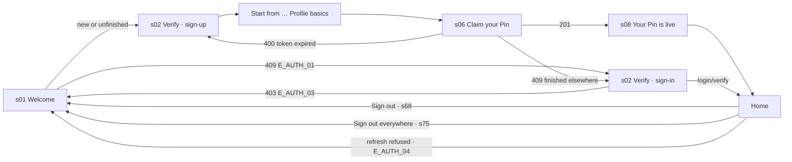

# 🧪 Auth & Sign-up · QA Frontend

**Feature:** [[F-02 Auth & Sign-up]] · **Verifies:** [[FD-05 Auth & Sign-up Frontend Delivery]] against [[S-02 Auth & Sign-up Story]] · **Verdict:** Draft (not run yet)

Expected behaviour of the screens, as artefacts: journeys, states and copy to check a build against, **not test code**. `status: passing` or `failing` after a run; the verdict tells the PM whether the story can be fulfilled (passing with nothing pending or unmet). A failing row is one of two things: a story part the delivery does not fulfil (not built, or built other than the story says) goes in `unmet` and turns the story's badge ✕; a bug (built as asked, but it breaks) is filed against the Frontend Delivery and goes in `pending`, and leaves the story alone.

## Scope

- **Screens:** s01 Welcome, s02 Verify (sign-up and sign-in), s06 Claim your Pin, s08 Your Pin is live, s68 Me · Sign out, s75 My devices · Sign out everywhere. The steps between them (Start from, imports, *Profile basics*, Interests, Create first Ring) belong to F-05, F-07, F-37 and F-11 and are only walked through.
- **62 rows, AU-01 to AU-62**, from the client's case list `social_pin/docs/testing/patrol/F-02 Auth test cases.md` (2026-11-08), which replaces the Maestro checklist PL-01 to PL-22. Rows AU-49 to AU-62 were added after a second check and sit in their sections, so the numbers aren't in order.
- **How a row runs** (Patrol, Android emulator or phone, `development` flavor):
  - **R**: against the development API; the code comes from `devCode`, which the app pre-fills;
  - **F**: against a fake backend the test controls (every answer, error and timing chosen), for the edge cases the server can't produce on demand.
- **The lock** follows [[D-30 The fifth wrong code try locks the code]] (backend `ce2a2e8`): the fifth wrong guess itself answers 429 `E_AUTH_06`.
- **Not here:** the server's rules (codes hashed, rotation, timestamps, the unknown-address challenge), checked by [[QB-05 Auth & Sign-up QA Backend]]; real email and SMS delivery, which doesn't exist yet ([[S-78 Code Delivery Story|Code Delivery]]).

## Journeys

### A · Welcome (s01) · S1

| # | Story | Steps | Expected | Run | Checked |
|---|---|---|---|---|---|
| AU-01 | S1 | Open signed out | One field, Email / Phone switch, *Send me a code*; no "Sign in" link, no password; LinkedIn *Coming soon* | R | ⬜ |
| AU-02 | S1 | Phone, +971, `50 123 4567` → Send | `phone: "+971501234567"`, no `email` | F | ⬜ |
| AU-03 | S1 | Email, switch to Phone, phone → Send | Exactly one of `email` / `phone` ([[B-04 Sign-up accepts an email and a phone together|B-04]]) | F | ⬜ |
| AU-04 | S1 | `sam@`, then a 3-digit phone | Can't send; no request | F | ⬜ |
| AU-05 | S1 | New email → Send | `sign-up` 201; Verify with the step bar, the email, when the code expires, boxes pre-filled | R | ⬜ |
| AU-06 | S1, S5 | `qaEmail` → Send | 409 `E_AUTH_01` → `login` with the same address, no tap; sign-in Verify, no step bar, back arrow | R | ⬜ |
| AU-07 | S1, S5 | `qaPhone` → Send | As AU-06; "Check your messages", number spaced out | R | ⬜ |
| AU-08 | S1 | Unfinished sign-up's address → Send | A new code, no error; sign-up Verify | R | ⬜ |
| AU-09 | — | Airplane mode → Send | Connection toast; address kept; works once online | R + F | ⬜ |
| AU-10 | — | `sign-up` 500 | Generic toast; stays on Welcome | F | ⬜ |
| AU-11 | States | Double tap; answer after 2 s | Button disabled and sending while waiting; one request, one Verify | F | ⬜ |
| AU-52 | S1, S5 | ` Sam@Example.com ` → Send; later sign in `sam@example.com` | Trimmed alike on `sign-up`, `login`, `login/verify`; same account | F | ⬜ |
| AU-61 | — | Tap LinkedIn | *Coming soon*; nothing else | R | ⬜ |

### B · Verify (s02) · S2, S5

| # | Story | Steps | Expected | Run | Checked |
|---|---|---|---|---|---|
| AU-12 | S2 | AU-05 → Verify and continue | `verify-code` `SIGN_UP` → Start from; no password step | R | ⬜ |
| AU-13 | S2 | Type, paste `123456`, delete | Auto-advance; paste fills six; delete moves back; numeric keyboard | F | ⬜ |
| AU-14 | S2 | Challenge without `devCode` | Boxes empty; typing by hand works | F | ⬜ |
| AU-15 | S2 | Wrong code → Verify | Boxes shake and empty; "That code is wrong or has expired." | R + F | ⬜ |
| AU-16 | S2 | 4 wrong (400), a 5th wrong, then the right code | 5th → 429 `E_AUTH_06` (D-30): "Too many tries. Ask for a new code."; boxes disabled; the right code refused; only resend; sign-up and sign-in | R + F | ⬜ |
| AU-17 | S2 | Open Verify | Resend disabled, countdown from 60, enabled at 0 | F | ⬜ |
| AU-18 | S2, S5 | After AU-16 → resend | `request-code` `SIGN_UP` / `LOGIN`; "We've sent you a new code."; boxes enabled, pre-filled with the new code, which works; the old one doesn't | R + F | ⬜ |
| AU-19 | S2 | `expiresAt` = now + 5 s, wait | "This code has expired. Ask for a new one."; boxes disabled; resend fixes it | F | ⬜ |
| AU-20 | — | "Use a different email" | Welcome with the address kept | R | ⬜ |
| AU-21 | S5 | AU-06 → Verify and continue | `login/verify` → Home; Back can't reach Welcome; real name shows | R | ⬜ |
| AU-22 | S5 | Sign in with a phone typed with spaces | `login/verify` identifier byte-identical to `login`'s | F | ⬜ |
| AU-23 | S5 | `login/verify` 403 `E_AUTH_03` | Not-active copy + *Start sign-up again* → can't-sign-in copy | F | ⬜ |
| AU-24 | — | Airplane mode → Verify | Connection toast; code kept; works once online | F | ⬜ |
| AU-25 | S2 | Any flavor | Pre-filled while `DevCode.untilCodeDelivery` is `true` (FD-05 deviation) | F | ⬜ |
| AU-49 | S5 | Sign-in, `login/verify` 400 `E_AUTH_05` | Boxes empty, the wrong-code copy; **no** *Sign up* | F | ⬜ |
| AU-54 | — | Sign-in Verify → back arrow | Welcome with the address kept | R | ⬜ |
| AU-55 | S2 | `request-code` 500 or offline | Error toast; countdown doesn't restart; the sent code still works | F | ⬜ |
| AU-60 | S2 | Phone clock 10 min behind | Expiry follows the server's `expiresAt` (offset from `Date`), not the phone's clock | F | ⬜ |

### C · Claim your Pin and registration (s06 → s08) · S3, S4

| # | Story | Steps | Expected | Run | Checked |
|---|---|---|---|---|---|
| AU-26 | S3 | `ab`, 31 chars, `sam-k`, `sam.k_1` | First three refused on the phone; `sam.k_1` accepted; `!` prefix never sent; "You can change it once a year." shown | F | ⬜ |
| AU-27 | S3 | Type `samk` quickly | One availability call, 400 ms after the last key | F | ⬜ |
| AU-28 | S3 | A taken name in other capitals | "Taken"; never who holds it ([[D-06 Yearly rename, old name freed, case-insensitive|D-06]]) | R + F | ⬜ |
| AU-29 | S3 | Full name "Sam Khoury" → s06 | Chips from that name only; tap fills; no request | F | ⬜ |
| AU-30 | S3, S4 | Profile basics → Claim pin → Continue | `complete-registration { onboardingToken, pinName, fullName }` 201 → Interests → s08; no password anywhere | R | ⬜ |
| AU-31 | S4 | On s08, Back | Can't reach any step before registration | R | ⬜ |
| AU-32 | S4 | After AU-30 | `GET /rings` has the default Ring | R | ⬜ |
| AU-33 | S3 | Bare 409, then `sign-up` 201 | "Taken" on s06, focus on the handle | F | ⬜ |
| AU-34 | S3 | Bare 409, then `sign-up` 409 | Sign-in code; sign-in Verify, "already set up" | F | ⬜ |
| AU-35 | S3 | `complete-registration` 400 (token expired) | "Your verification expired. We've sent you a new code."; Verify with a new code; Claim pin input kept ([[B-05 Expired onboarding token answers 401, not the documented 400|B-05]]) | F | ⬜ |
| AU-36 | — | Continue offline | Connection toast; Continue again | F | ⬜ |
| AU-50 | S3 | 121 characters on Profile basics | Stops at 120; `fullName` ≤ 120 | F | ⬜ |
| AU-51 | S4 | AU-30 with animations on | "New ring forming" plays once; the Ring named and themed | F | ⬜ |
| AU-56 | S3 | Availability 500 or offline | Never "free"; can't-check state; Continue waits | F | ⬜ |
| AU-57 | S4 | Kill the app at Claim pin, reopen | Welcome; the same address continues as an unfinished sign-up | R | ⬜ |

### D · Staying signed in, signing out (s68, s75) · S6

| # | Story | Steps | Expected | Run | Checked |
|---|---|---|---|---|---|
| AU-37 | S6 | Sign in, restart | Home, no code | R | ⬜ |
| AU-38 | S6 | A call answers 401 | One `refresh`; the call retried once; nothing shows | F | ⬜ |
| AU-39 | S6 | Two calls answer 401 together | One refresh; both retried once ([[B-03 Two refreshes at once both succeed and fork the session|B-03]]) | F | ⬜ |
| AU-40 | S6 | `refresh` 401 `E_AUTH_04` | Welcome, "Please sign in again" | F | ⬜ |
| AU-41 | S6 | Any call 401 `E_AUTH_03` | Signed out at once (copy per FD-05 until S-87) | F | ⬜ |
| AU-42 | S6 | Me → Sign out → confirm | Confirmation mentions a code; `logout` with the refresh token; Welcome; restart stays there | R | ⬜ |
| AU-43 | S6 | Sign out offline | Still signed out here | F | ⬜ |
| AU-44 | S6 | My devices → Sign out of all devices | `logout-everywhere`; Welcome, "Signed out everywhere"; a second session refused on its next refresh | R | ⬜ |
| AU-45 | S6 | Sign out everywhere offline | Error toast; still signed in | F | ⬜ |
| AU-46 | S6 | Me; My devices → Security | No "Change password" on either | R | ⬜ |
| AU-58 | S6 | Session revoked elsewhere, open the app | Welcome, "Please sign in again"; never a broken Home | R | ⬜ |
| AU-59 | S6 | `GET /users/me` 404 `E_USER_01` | Signed out (FD-05) | F | ⬜ |

### E · Across the flow

| # | Story | Steps | Expected | Run | Checked |
|---|---|---|---|---|---|
| AU-47 | — | Arabic → AU-05, AU-06, a wrong code, Sign out | Arabic, right-to-left on s01, s02, s06, the errors and the sign-out sheets; boxes and digits left-to-right | R | ⬜ |
| AU-48 | — | Animations off → AU-30 | Same states; no ring animation | F | ⬜ |
| AU-53 | S4 | System Back on each screen | Welcome leaves; sign-in Verify → Welcome; sign-up goes back up to Claim pin, never past registration | R | ⬜ |
| AU-62 | — | TalkBack on s01, s02, s06 | Field, switch, Send, six boxes ("digit 1 of 6"…), Resend, Verify all labelled | F | ⬜ |

## Screen states

| Screen | State | Expected rendering |
|---|---|---|
| [[Screen Index#s01\|s01]] | idle | One field with Email / Phone, *Send me a code*, LinkedIn *Coming soon* |
| [[Screen Index#s01\|s01]] | sending | Button disabled, sending indicator |
| [[Screen Index#s01\|s01]] | offline / error | Toast; the address kept |
| [[Screen Index#s02\|s02]] | waiting (sign-up) | Step bar, the address, "It expires in 10 minutes.", six boxes (pre-filled from `devCode`), resend countdown |
| [[Screen Index#s02\|s02]] | waiting (sign-in) | No step bar, back arrow, otherwise the same |
| [[Screen Index#s02\|s02]] | wrong code | Boxes shake and empty, wrong-code copy |
| [[Screen Index#s02\|s02]] | locked | Boxes disabled, too-many-tries copy, only resend |
| [[Screen Index#s02\|s02]] | expired | Boxes disabled, expired copy, resend |
| [[Screen Index#s02\|s02]] | not active | Not-active copy, *Start sign-up again* |
| [[Screen Index#s06\|s06]] | typing / checking / free / taken / can't check | `!` prefix, the rule line, "once a year", suggestion chips |
| [[Screen Index#s08\|s08]] | live | "Your Pin is live", the new ring forming once (none with reduced motion) |
| [[Screen Index#s68\|s68]] | sign-out sheet | Mentions a code, not a password |
| [[Screen Index#s75\|s75]] | sign-out-everywhere sheet; done | Confirmation; on Welcome, "Signed out everywhere" |

## Flow diagram

## Error copy

| ErrorCode | Where | Copy shown |
|---|---|---|
| `E_AUTH_01` (409) | s01, sign-up | nothing: a sign-in code is asked for instead |
| `E_AUTH_05` (400) | s02 | "That code is wrong or has expired." |
| `E_AUTH_06` (429, the fifth wrong guess: D-30) | s02 | "Too many tries. Ask for a new code." |
| — (client, `expiresAt` passed) | s02 | "This code has expired. Ask for a new one." |
| — (client) | s02 | "Enter all six digits." |
| `E_AUTH_03` (403) | s02, sign-in verify | "This account isn't active. If you never finished signing up, you can start again." + *Start sign-up again* |
| `E_AUTH_01` (409) after *Start sign-up again* | s02 | "This account can't sign in right now. Contact support if this keeps happening." |
| — (client) | s06 | "Use 3 to 30 characters: letters, numbers, dots and underscores." |
| `E_PROFILE_02` (409, or a bare 409 while sign-up is still open) | s06 | "Taken — try another" |
| `E_AUTH_08` (409, or a bare 409 once sign-up finished) | s06 → s02 | "This account is already set up. We've sent you a code to sign in." |
| `E_AUTH_05` (400, onboarding token expired) | s06 → s02 | "Your verification expired. We've sent you a new code." |
| `E_AUTH_04` (401, refresh refused) | any → s01 | "Your session has expired. Please sign in again." |
| `E_AUTH_03` (401, suspended) | any → s01 | "This account can't sign in right now. Contact support if this keeps happening." (once [[S-87 Error Contract Story\|Error Contract · S4–S8]] ships) |
| `E_USER_01` (404 on `GET /users/me`) | any → s01 | signed out |
| — (no connection) | s01, s02, s06 | "Connection error. Please check your internet and try again." |

Accepted wording (2026-11-05, Omar Fostok): the story's "That code is invalid or has expired" is shown as "That code is wrong or has expired."; S2's "a new code replaces the old one" as "We've sent you a new code."; S1's "says when the code expires" as "It expires in 10 minutes." (the expired state itself follows `expiresAt`).

## Verdict

- Run on: — · build: — · result: not run · failing rows: — · story parts unmet: — · bugs: —
- Draft until the Patrol suite in `social_pin` runs all 62 rows on a named build; then `passing` or `failing` with that build and date.

## Log

- 2026-11-08 · `docs/qa/M-01-identity/F-02-auth/QF-05-written` · written from the client's case list (62 rows, AU-01 to AU-62) to be run with Patrol, real API and faked, against FD-05; the lock per D-30; replaces the Maestro checklist PL-01 to PL-22 and the uncommitted 2026-11-05 draft; stays draft until the suite runs
