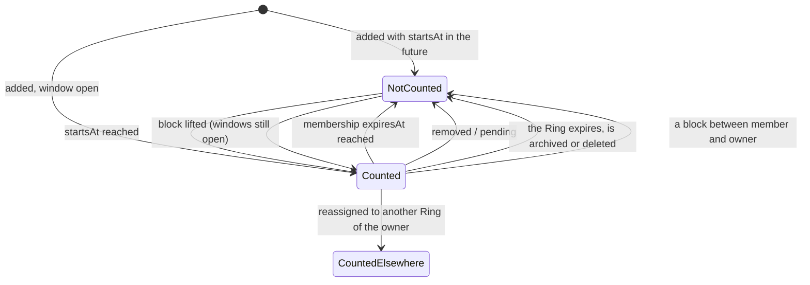

# 🧪 Counts · QA Backend

> Blocked by default until [[BD-03 Counts Backend Delivery]] is `done` (the hand-off order in `docs.config.json`); `blockedBy: []` opts out, `blockedBy: [...]` names other blockers.

**Feature:** [[F-03 Counts]] · **Verifies:** [[BD-03 Counts Backend Delivery]] against [[S-03 Counts Story]] and [[FR-03 Counts Frontend Requirements]], with the shapes of [[BI-14 Counts Backend Integration]] · **Verdict:** Passing on backend `main` `516a78f`, 2026-11-09: S11 (B20–B27) re-run and as expected; B1–B19 passing on `f186ba1`, 2026-11-05

Expected behaviour of the API, as artefacts a person can check a build against: tables and diagrams, **not test code** (the specs live in the backend repo). `status: passing` or `failing` after a run; the verdict tells the PM whether the story can be fulfilled (passing with nothing pending or unmet). A failing row is one of two things: a story part the delivery does not fulfil (not built, or built other than the story says) goes in `unmet` and turns the story's badge ✕; a bug (built as asked, but it breaks) is filed against the Backend Integration and goes in `pending`, and leaves the story alone.

## Scope

**Covered:** the owner's live member count on `GET /rings` and `GET /rings/:id` ([[S-03 Counts Story|Counts · S6–S10]], and the API side of S1, S1b, S3, S5); the number of Rings owned (`meta.total`, S1, S2); the people count `GET /rings/shared-with-me/count` and the absence of `memberCount` on `GET /rings/shared-with-me` ([[S-03 Counts Story|Counts · S2]], S10); the live filters (removed, pending, not yet started, lapsed, expired Ring, blocks both ways); the 404 for a Ring that is not yours; no session. Since 2026-11-09, the connection count on Me, `GET /connections/count` ([[S-03 Counts Story|Counts · S11]], B20–B27), which [[BD-03 Counts Backend Delivery]] points to [[BD-14 Connections Backend Delivery]] for.

**Not covered:** not asked by FR-03, so not checked: "N added today" and a member-side count (story open questions). The screens themselves are the QA Frontend's, including S11's "hidden until connections exist" and the refetch when Me opens: the API answers `{ "connections": 0 }` for someone with none, and what the card shows for it is the client's.

**How the run was made:** over HTTP against backend `main` `f186ba1`, started locally on a **disposable** database (migrated and seeded for the run, dropped after), signed in as the seeded users through the OTP flow. Rings and memberships were created through the API. A pending membership and the blocks were set directly in that database, because no route creates them yet. Time-bounded rows used real windows of a few seconds.

**The S11 re-run (2026-11-09):** the same way, against backend `main` `516a78f` built with `nest build` and started on `localhost:3100` (Node 22.22.2), on the fresh throwaway database `social_pin_qa_rerun` (migrated, seeded, dropped after). Seeded users: **Sara** (`SaraAz`), **Omar** (`OmarK`, seeded into Sara's *E-commerce Clients*), the **organizer** (`GulfExpo`) and the **admin** (`SPAdmin`). Requests, accepts, declines, cancels, the block, the disconnect and the account deletion all went through the API; the one direct write was a request's `expires_at` set one second in the past, to make it expired without waiting 30 days. A requester first had to see a card of the other's (D-10), so the admin was put in a Ring before asking; that membership is itself checked (B21).

## Expected behaviour

The owner is Sara; Omar, the organizer and the admin are the members. "Count" is `memberCount` of the Ring as Sara reads it.

| # | Given | When | Then | Checked |
|---|---|---|---|---|
| B1 | Sara owns Rings with 3, 1, 1 and 0 live members | `GET /rings` | 200; every item has an integer `memberCount`; Family 3, Work 1, Expiring 1 | ✅ |
| B2 | a Ring with no member | `GET /rings` | its `memberCount` is `0`, a real zero | ✅ |
| B3 | the same owner | `GET /rings` | `meta.total` = the number of Rings Sara owns (S1 "All N", S2 "My Rings · N") | ✅ |
| B4 | Family has 3 live members | `GET /rings/:id` (Family) | 200, `memberCount` 3, the same number as the list | ✅ |
| B5 | a member removed with `DELETE /rings/:ringId/members/:userId` | `GET /rings/:id` | the count drops by one (removed is not counted) | ✅ |
| B6 | a member whose row is `PENDING` | `GET /rings/:id` | not counted | ✅ |
| B7 | a member added with `startsAt` tomorrow | `GET /rings/:id` | not counted until the window opens | ✅ |
| B8 | a member added with `expiresAt` a few seconds ahead | `GET /rings/:id` before, then after the instant | counted while open (2), not counted after (1) | ✅ |
| B9 | a Ring whose own `expiresAt` has passed, its member row still `ACTIVE` | `GET /rings/:id` and `GET /rings` | 200 for the owner; `memberCount` 0 on both | ✅ |
| B10 | Family 2, Empty 0 | `POST /rings/:ringId/members/:userId/reassign` Family → Empty, then refetch | Family 2 → 1, Empty 0 → 1 on the next fetch (S5) | ✅ |
| B11 | a Ring of Sara's | Omar calls `GET /rings/:id` on it, and on an id that does not exist | 404 both; the bodies are identical but for `path` and `timestamp`; no `memberCount` | ✅ |
| B12 | Omar is a live member of Sara's Rings | `GET /rings/shared-with-me` as Omar | 200; no item carries `memberCount` (S10) | ✅ |
| B13 | Omar is in three of Sara's Rings | `GET /rings/shared-with-me/count` as Omar | `{ "people": 1 }`: Sara once; the list's `meta.total` is 3 (Rings) | ✅ |
| B14 | — | the same call | the body has the one key `people`, nothing naming a Ring | ✅ |
| B15 | Sara has blocked Omar (then: Omar has blocked Sara) | the count, the list as Omar, and Family's count as Sara | Sara's Rings leave Omar's list, `people` drops to match the list, Omar leaves Family's count; the same in the other direction | ✅ |
| B16 | the block is lifted | `GET /rings/:id` | the count is back | ✅ |
| B17 | another user | `GET /rings/shared-with-me/count` | `people` = the distinct owners on that user's `GET /rings/shared-with-me` | ✅ |
| B18 | — | `GET /rings` / `GET /rings/:id` / the count with no bearer | 401 | ✅ |
| B19 | a member added to Empty | `GET /rings/:id` right after | the count is up by one on the next fetch (S9) | ✅ |

### The connection count on Me — S11 `GET /connections/count`

"Count" is `connections` as the caller reads it. Run on `516a78f`, 2026-11-09.

| # | Given | When | Then | Checked |
|---|---|---|---|---|
| B20 | Sara has no connection; then Omar's request is accepted into *Family* | `GET /connections/count` as Sara, then as each of them | 200 `{ "connections": 0 }`, the one key, then **1 for Sara and 1 for Omar** (one connection per pair, counted on both sides); always equal to `meta.total` of `GET /connections` | ✅ |
| B21 | a request still `PENDING`; the admin put in *Family* by Sara, no request | the count on both sides | neither counts: a pending request is not a connection, and a Ring membership alone is not one either | ✅ |
| B22 | Omar is in two of Sara's Rings (seeded in *E-commerce Clients*, accepted into *Family*) | Sara's count | 1: a person counts once, however many of my Rings they are in (D-15) | ✅ |
| B23 | Sara removes Omar from every one of her Rings, keeping the connection ("Remove from Rings", *No access*) | Sara's count | still 1 | ✅ |
| B24 | one request declined, one cancelled, one expired (`expiresAt` in the past) | the count on both sides | none counts; accepting the expired one answers 409 (it cannot become a connection) | ✅ |
| B25 | Sara has 2 connections (Omar, the organizer); she blocks the organizer; then disconnects Omar (`DELETE /connections/:userId`, 204) | the count on both sides after each | after the block 1 for Sara and 0 for the organizer, `meta.total` 1; after the disconnect 0 for Sara and 0 for Omar | ✅ |
| B26 | Omar is connected to the admin (1), then the admin deletes the account (`DELETE /users/me`) | Omar's count | 0, and `meta.total` 0: a deleted account is not counted | ✅ |
| B27 | — | Omar calls `GET /connections/count?userId=<Sara>`; then the route with no bearer | the route takes no person: it answers Omar's own count (the parameter changes nothing), so nobody can read another's number; 401 with no session | ✅ |

## State diagram

When a member counts toward `memberCount` (both windows checked against `now` on every request):

## Error matrix

| Situation | Status | ErrorCode | Same body as |
|---|---|---|---|
| `GET /rings/:id` on a Ring that is not yours | 404 | `E_RING_02` thrown; **not on the wire** (see below) | an id that does not exist |
| `GET /rings/:id` on an id that does not exist | 404 | `E_RING_02` thrown; not on the wire | a Ring that is not yours |
| any of the four routes with no session | 401 | — | — |
| `GET /connections/count` with no session | 401 | — | every other 401 for a missing token |
| accepting a request that has expired (B24) | 409 | `E_CONNECTION_REQUEST_02` per [[BI-16 Connections Backend Integration]]; not on the wire on `516a78f` either (the same gap) | an answered or cancelled request |

On `f186ba1` the 404 body is `{ statusCode, message: "Ring not found", error: "HttpException", path, timestamp }`, with no `ErrorCode` field. That is the known Error Contract gap ([[BD-35 Error Contract Backend Delivery]], [[S-87 Error Contract Story|Error Contract · S4–S8]]), not a Counts defect: the client branches on 404 and the endpoint. [[BI-14 Counts Backend Integration]]'s error table reads as if the code arrives; it is flagged.

## Privacy and access checks

- A member never sees a member count: `GET /rings/shared-with-me` carries none (B12), and `GET /rings/:id` on someone else's Ring is a 404 with no number (B11).
- "Not yours" and "does not exist" answer the same body (B11): the route is not an oracle for which Ring ids exist.
- The people count names no Ring (B14), and counts a person once however many of their Rings you are in (B13).
- A block hides both ways at once: the Ring leaves the list, the person leaves the people count, the member leaves the owner's count (B15); a blocked connection leaves both sides' connection count (B25).
- The connection count is mine only: the route takes no person, so there is no way to ask for anyone else's number (B27).

## Verdict

- Run on: 2026-11-05 · build: backend `main` `f186ba1` · result: **passing**, B1–B19 as expected (23 checks), B20 not run · failing rows: none · story parts unmet: none · bugs: none
- Re-run on: 2026-11-09 · build: backend `main` `516a78f` (Counts · S11 shipped with F-14 in `4beb29e`), `localhost:3100`, Node 22.22.2, fresh throwaway database `social_pin_qa_rerun` (dropped after) · result: **passing**, B20–B27 as expected (15 checks) · failing rows: none · story parts unmet: none · bugs: none · `pending` cleared: nothing is left in this note. B1–B19 were not re-run; their verdict stands on `f186ba1`.
- Flagged: [[BI-14 Counts Backend Integration]], whose error table names `E_RING_02` as if it is in the body; on this build no error body carries `ErrorCode` ([[BD-35 Error Contract Backend Delivery]]).
- **For the PM:** this note is no longer Partial. [[S-03 Counts Story]] is still not ready to fulfil: it has no QA Frontend note yet.

## Log

- 2026-11-05 · flagged [[BI-14 Counts Backend Integration]]: on backend main f186ba1 the 404 body for GET /rings/:id carries no ErrorCode (statusCode, message, error: HttpException, path, timestamp); the error table reads as if E_RING_02 arrives. Known Error Contract gap (BD-35): say the client branches on 404 + endpoint until S-87 S4–S8 ships
- 2026-11-09 · vault branch `docs/qa/M-01-identity/F-03-counts/QB-07-rerun-b20` · re-ran Counts · S11 on backend `main` `516a78f` (fresh throwaway database): `GET /connections/count` passing, B20 run and B21–B27 added (pending, declined, cancelled, expired, blocked, disconnected and deleted not counted; Remove from Rings still counted; once per person; mine only; 401). The B20 entry leaves `pending`, which is now empty, so this note reads Passing. Flagged nothing.
