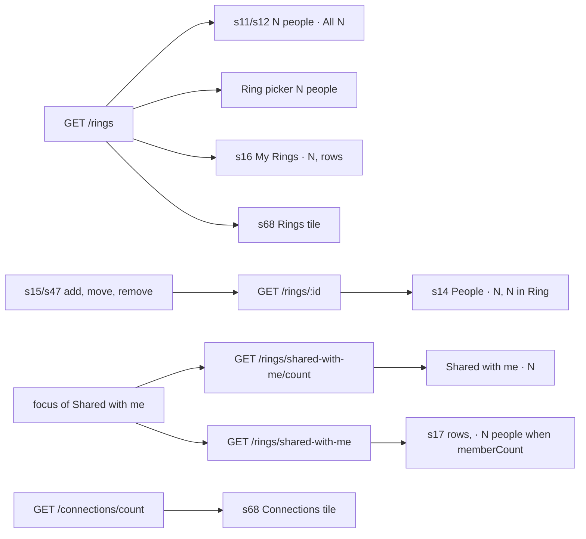

# 🧪 Counts · QA Frontend

**Feature:** [[F-03 Counts]] · **Verifies:** [[FD-06 Counts Frontend Delivery]] against [[S-03 Counts Story]] · **Verdict:** Passing on `social_pin` `main` `866240a`, emulator Medium_Phone (Android 16), 2026-11-24: 39 of 39

Expected behaviour of the screens, as artefacts: journeys, states and copy to check a build against, **not test code**. `status: passing` or `failing` after a run; the verdict tells the PM whether the story can be fulfilled (passing with nothing pending or unmet). A failing row is one of two things: a story part the delivery does not fulfil (not built, or built other than the story says) goes in `unmet` and turns the story's badge ✕; a bug (built as asked, but it breaks) is filed against the Frontend Delivery and goes in `pending`, and leaves the story alone.

## Scope

Every number S-03 asks for, as the app shows it: "N people" on Home's *Recent Rings* and in the Ring picker ([[Screen Index#s11|s11]], [[Screen Index#s12|s12]]); "All N", "My Rings · N", "Shared with me · N" and a count per row ([[Screen Index#s16|s16]], [[Screen Index#s17|s17]]); "N in Ring" and "People · N" on Ring data ([[Screen Index#s14|s14]]); the profile card's three tiles on Me, Rings · Connections · Photos ([[Screen Index#s68|s68]]). The rows check that the app **shows the number the server sends, where and when S-03 says, and never invents one**. Who counts (the live filter, blocks, expiry, "Remove from Rings") is the server's, checked by [[QB-07 Counts QA Backend]]; Contacts and Requests counts are F-14's.

**Source:** `social_pin` `docs/testing/patrol/F-03 Counts test cases.md`, 39 cases, CT-01 to CT-37 plus CT-11b and CT-11c, approved by Omar Fostok 2026-11-24. **F** is Patrol against a faked API (`patrol_test/fake/counts_test.dart`, 32 cases); **R** is Patrol against the development API with accounts the test makes and deletes (`patrol_test/real/counts_test.dart`, 7 cases: CT-06, CT-19, CT-24, CT-29, CT-30, CT-34, CT-35).

**Wording followed:** on My Rings rows the app writes "N connections" and "N people" everywhere else; S-03 S6 says "N people", and which word to use is S-03's own open question (*My Rings wording*). The rows expect the app's words and leave the choice to that question.

## Journeys

### A · Home, Recent Rings (s11, s12) · S1, S8

| # | Story | Steps | Expected | Tag | Checked |
|---|---|---|---|---|---|
| CT-01 | S1, S6, S8 | Rings with `memberCount` 148, 1, 0 → Home | "148 people", "1 person", "0 people" under the three Rings | F | ✅ |
| CT-02 | S1 | 3 Rings → Home; tap "All 3" | "All 3" (never a fixed number); opens My Rings, "My Rings · 3" | F | ✅ |
| CT-03 | S1, States | Rings without `memberCount` → Home | "— people", never "0 people" | F | ✅ |
| CT-04 | S8 | Home, the picker, My Rings | only `GET /rings`: no `GET /rings/:id`, no roster call on any of them | F | ✅ |
| CT-05 | S1 | `GET /rings` answers 6 s late | no "All N" and no "0 people" until it answers; then "All 3" | F | ✅ |
| CT-06 | S1, S2, S6, S7, S11 | a new account signs in | Home "0 people", "All 1"; Me *Rings* 1, *Connections* 0; "My Rings · 1", "Shared with me · 0"; Ring data "People · 0", "0 in Ring" | R | ✅ |

### B · The Ring picker (Home → *My badge*) · S1b, S8

| # | Story | Steps | Expected | Tag | Checked |
|---|---|---|---|---|---|
| CT-07 | S1b, S8 | Rings 148, 1, 0 → the Ring pill | each Ring in the sheet shows the same number as Home | F | ✅ |
| CT-08 | S1b, S10 | someone shares with me; open the picker | only my three Rings; no shared Ring, no sample Ring | F | ✅ |
| CT-36 | S1, S8 | pick Clients, then Family, then Personal | the pill follows; every Recent Rings row keeps its own number (148, 1, 0) | F | ✅ |

### C · My Rings and Shared with me (s16, s17) · S2, S6, S10

| # | Story | Steps | Expected | Tag | Checked |
|---|---|---|---|---|---|
| CT-09 | S2, S6 | Rings 148, 1, 0 → My Rings | "My Rings · 3"; rows "148 connections", "1 connection", "0 connections" (a real zero) | F | ✅ |
| CT-10 | S2 | count `{people: 7}`; list page of 2, `meta.total` 3 | "Shared with me · 7" on both tabs: the count route's number | F | ✅ |
| CT-11 | S2, S10 | a row with `ringName` "Design Team", `memberCount: 4` | "Design Team", "Shared by Lina Farouk · 4 people" | F | ✅ |
| CT-11b | S2, S10, States | a named row without `memberCount`; an unnamed row with `memberCount: 148` | no number on either, never "0 people"; the second shows the person, no "148" | F | ✅ |
| CT-11c | S2 | `ringName`, `memberCount: 1` | "1 person" | F | ✅ |
| CT-12 | S2 | "· 2"; one stops sharing; switch tabs; then 4 | "· 1", then "· 4"; a count call on each switch | F | ✅ |
| CT-13 | S2 | "· 2"; count becomes 3; background and resume | "· 3" | F | ✅ |
| CT-14 | S2, States | count 0 → Shared with me | "Shared with me · 0", no rows, the empty state "Nothing shared with you yet" | F | ✅ |
| CT-15 | S2, States | count 500; then 2; then offline | "—", never "0"; then "· 2"; offline "· 2" stays | F | ✅ |
| CT-16 | S1, S2, S11 | 60 Rings | pages of ≤ 50 until all are read; "All 60", Me *Rings* 60, "My Rings · 60" | F | ✅ |
| CT-17 | S1, S2 | `GET /rings` drops → My Rings | the chip shows no number, no sample | F | ✅ |
| CT-18 | S1, S2, S11 | Rings 12345, 1000, 999; shared 1500; connections 10000 | the numbers in full; nothing overflows | F | ✅ |
| CT-19 | S2, S5, S9, S10 | the owner adds me to a Ring (API), then removes me | "· 0" → "· 1" on focus with the owner's row, no member count; "· 0" after a tab switch. **Found the bug fixed in `866240a`** (see *Verdict*) | R | ✅ |

### D · Ring data (s14) · S3, S7, S9

| # | Story | Steps | Expected | Tag | Checked |
|---|---|---|---|---|---|
| CT-20 | S3, S7, S9 | My Rings says 3, the server now 5; open the Ring | one `GET /rings/:id`; "People · 5", "5 in Ring"; the My Rings row "5 connections" | F | ✅ |
| CT-21 | S3, S7 | `GET /rings/:id` answers 404 with no code (as QB-07 found) | "This Ring no longer exists."; the screen leaves; the list read again, the Ring gone | F | ✅ |
| CT-22 | S3 | `GET /rings/:id` drops | "People · 3" from the list stays; no "gone", no 0 | F | ✅ |
| CT-23 | S3, States | no `memberCount` | "People · —", "— in Ring", never 0 | F | ✅ |
| CT-24 | S3, S5, S9 | the owner's other phone adds a person (API), then removes them | "People · 1", "1 in Ring", row "1 connection"; then "People · 0", "0 connections" | R | ✅ |
| CT-35 | S3, S5, S9 | a person in two of my Rings; s15 → *Move* to the second | "People · 0" at once; the server counts 0 and 1; rows, the second Ring and Home follow | R | ✅ |

### E · Me (s68) · S4, S11

The profile card shows three tiles, **Rings · Connections · Photos** (app `776e6ca`, [[S-03 Counts Story|Counts · S4]]); a count not known shows "–" in its tile, never 0 or a sample.

| # | Story | Steps | Expected | Tag | Checked |
|---|---|---|---|---|---|
| CT-25 | S4, S11 | 3 Rings, `{connections: 218}` → Me | *Rings* 3, *Connections* 218 | F | ✅ |
| CT-26 | S4, S11 | `/connections/count` answers 500 | *Rings* 3, *Connections* "–"; never "0" | F | ✅ |
| CT-27 | S11, States | `{connections: 0}` | *Connections* 0, a real zero | F | ✅ |
| CT-28 | S11 | 12 on Me; the server now 13; Home, then Me | *Connections* 13 | F | ✅ |
| CT-29 | S9, S11 | someone asks (API); accept into my default Ring | the server counts 1; Home "1 person"; *Connections* 1 | R | ✅ |
| CT-30 | S1, S2, S6, S11 | a new Ring from My Rings | "My Rings · 2"; *Rings* 2; Home "All 2" | R | ✅ |
| CT-34 | S4, S11 | connected to one (API); Me → *Connections* → them → *Disconnect* | the server counts 0; *Connections* 0 | R | ✅ |
| CT-37 | S4, S10 | Personal → *View as* | no "148", "218", "3 Rings" or "N people" on the card others see | F | ✅ |

### F · Across

| # | Story | Steps | Expected | Tag | Checked |
|---|---|---|---|---|---|
| CT-31 | States | one of everything | the English singulars: "1 person", "All 1", *Rings* 1, *Connections* 1, "Shared with me · 1", "1 connection", "People · 1", "1 in Ring" | F | ✅ |
| CT-32 | States | Arabic; Rings 2, 3, 11; 100 connections | each count in its Arabic form (`two`, `few`, `many`); the tiles a number over a label | F | ✅ |
| CT-33 | S10, S11 | sign out; another account signs in | nothing of the last person's: "All 1", *Rings* 1, *Connections* 0, "Shared with me · 0" | F | ✅ |

## Screen states

| Screen | State | Expected rendering |
|---|---|---|
| [[Screen Index#s11|s11]] / [[Screen Index#s12|s12]] | loading | no "All N", no "0 people" (CT-05) |
| [[Screen Index#s11|s11]] / [[Screen Index#s12|s12]] | count not sent | "— people" (CT-03) |
| [[Screen Index#s16|s16]] | list failed | the chip without a number (CT-17) |
| [[Screen Index#s16|s16]] / [[Screen Index#s17|s17]] | count failed | "—", then the number once it answers; offline keeps the last (CT-15) |
| [[Screen Index#s17|s17]] | empty | "Shared with me · 0", "Nothing shared with you yet" (CT-14) |
| [[Screen Index#s17|s17]] | row with `memberCount` | "· N people" (CT-11, CT-11c); without, no number (CT-11b) |
| [[Screen Index#s14|s14]] | count not sent / offline | "People · —", "— in Ring" (CT-23); the list's number stays offline (CT-22) |
| [[Screen Index#s14|s14]] | gone (404) | "This Ring no longer exists.", the screen leaves (CT-21) |
| [[Screen Index#s68|s68]] | a count not read | "–" in its tile (CT-26) |

## Flow diagram

## Error copy

| ErrorCode | Where | Copy shown |
|---|---|---|
| — (404 with no code today, [[BI-14 Counts Backend Integration]]) | s14, `GET /rings/:id` | "This Ring no longer exists." (CT-21) |
| — (5xx / offline) | the counts | "—" or "–", never "0" (CT-15, CT-26) |

## Verdict

- Run on: 2026-11-24 · build: `social_pin` `main` `866240a`, `development` flavor, emulator Medium_Phone (Android 16) · result: **39 of 39 pass**, 32 faked and 7 against the development API · failing rows: none · story parts unmet: none · bugs: none open.
- **App bug found and fixed in `866240a`** (no B-NN card: found and fixed before the run recorded here). CT-19's first real run: after someone added me, "Shared with me · 1" showed over an empty list ("Nothing shared with you yet"). Shared with me read the count again on the tab's first focus but not the list, which was read only when My Rings opened. Fixed in `RingsController.onTabChanged`: the list is read on every focus of the tab, so the chip and the rows agree ([[S-03 Counts Story|Counts · S2]]); [[FD-06 Counts Frontend Delivery]] records it.
- The other first-run failures were the tests' own (CT-13, CT-14, CT-20, CT-29, CT-30, CT-37, and CT-04 / CT-08 needing the S-33 routes answered), fixed in the suite; the test-case file has them. The Xiaomi phone could not run Patrol (the Dart side never starts), so the run moved to the emulator.

## Log

- 2026-11-24 · vault branch `docs/qa/M-01-identity/F-03-counts/QF-08-passing` · written from `social_pin` `docs/testing/patrol/F-03 Counts test cases.md` (39 cases, approved by Omar Fostok 2026-11-24) against [[FD-06 Counts Frontend Delivery]] and [[S-03 Counts Story]]; run on `main` `866240a`, Medium_Phone: 39 of 39; the CT-19 app bug, fixed in `866240a`, recorded; the empty-state copy in `pending` · flagged nothing
- 2026-11-24 · vault branch `docs/qa/M-01-identity/F-03-counts/QF-08-copy-decided` · cleared the [[S-03 Counts Story]] flag and the `pending` entry on the Shared with me empty state: Omar Fostok kept the app's wording "Nothing shared with you yet" on 2026-11-24, and S-03's States now say the same. CT-14 passed on those words in the run of 2026-11-24 (`social_pin` `main` `866240a`, Medium_Phone, Android 16); no re-run. Passing with nothing pending or unmet · flagged nothing
