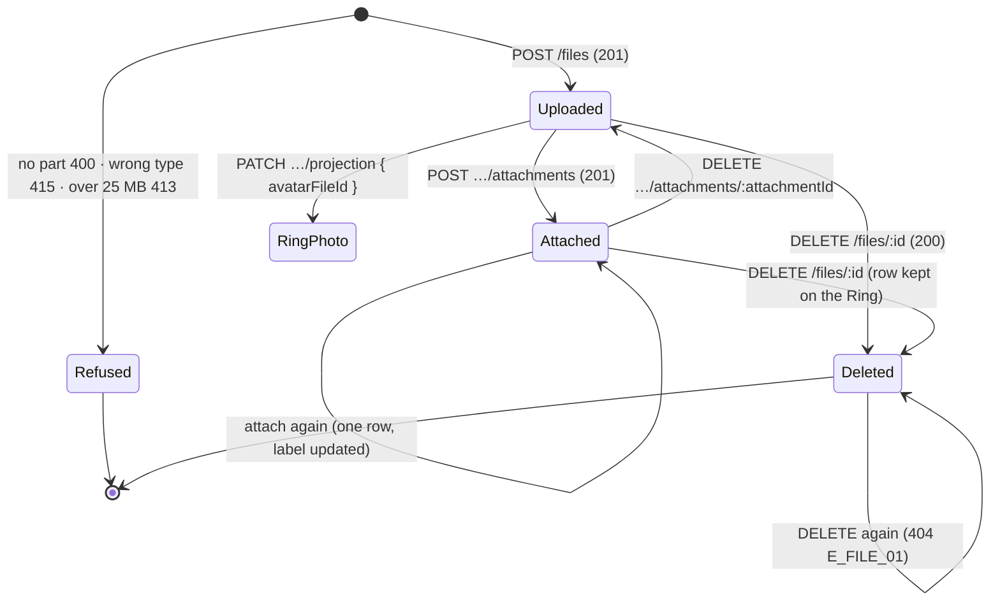

# 🧪 Files Upload · QA Backend

> Blocked by default until [[BD-04 Files Upload Backend Delivery]] is `done` (the hand-off order in `docs.config.json`); `blockedBy: []` opts out, `blockedBy: [...]` names other blockers.

**Feature:** [[F-04 Files Upload]] · **Verifies:** [[BD-04 Files Upload Backend Delivery]] against [[S-06 Files Upload Story]] and [[FR-04 Files Upload Frontend Requirements]], with the shapes and errors of [[BI-03 Files Upload Backend Integration]] and [[BI-07 Ring Projection Backend Integration]] · **Verdict:** 🔴 Failing · 2026-10-29 · `main @ c85db4b · localhost:3101, Node 22.22.2` · 30 of 32 as expected

Expected behaviour of the API, as artefacts a person can check a build against: tables and diagrams, **not test code** (the specs live in the backend repo). `status: passing` or `failing` after a run; the verdict tells the PM whether the story can be fulfilled (passing with nothing pending).

## Scope

**Covered.** Every acceptance criterion of [[S-06 Files Upload Story]] the API can be checked against, for the parts that run on endpoints that exist: upload (S1, S4, S6), metadata, attach and detach on a Ring projection (S1, S3, S12), the Ring photo (S4), delete (S5), and the privacy half of S9 and S11 that holds today: what a viewer's `GET /views/pin/:pinName` carries for files, and that nothing serves a context-scoped file's bytes ([[B-07 Context-scoped uploads are served by the public static mount]]). Each row names the story part or the [[BI-03 Files Upload Backend Integration]] / [[BI-07 Ring Projection Backend Integration]] rule it comes from.

**Not covered.** *Showing files* (S7–S11's display criteria: the photo shows, a file opens, a copied link expires) is not built: [[D-16 Files load from signed links that expire in 15 minutes]] decided how, and rows are added here when the signed links ship. The library list and `GET /files?kind=` (S8, S12's listing) wait on [[S-11 Photo Library Story|Photo Library · S7]]. Client-side checks, copy, progress and screen states (S1's wording, S6's mirroring) are the QA Frontend's.

**Accounts.** The seeded demo accounts, signed in with a one-time code read from `devCode`: **Sara** (`SaraAz`, the owner, uploads to her *E-commerce Clients* Ring), **Omar** (`OmarK`, a member of that Ring), the **organizer** (`GulfExpo`, a member of Sara's *Family* Ring only) and the **admin** (`SPAdmin`, in no Ring of Sara's). Everything a run attaches is detached and every file it uploads is deleted at the end, and Sara's Ring photo is put back, so the seed is left as it was. The API ran with `UPLOADS_DIR` pointed at a scratch folder, so the run could read what landed on disk; a file placed by hand in its `public/` folder served B32.

## Expected behaviour

✅ as expected · 🔴 differs · ⬜ not run. Bodies are the API's `{ statusCode, message, error, path, timestamp }`; `ErrorCode` is not on the wire until [[S-87 Error Contract Story|Error Contract · S4–S8]], so the code column names what the contract promises and the run checks the status and the `message`.

### `POST /files` — S1, S4, S6 Upload a file

| # | Given | When | Then | Checked |
|---|---|---|---|---|
| B1 | Sara signed in | a PDF under 25 MB, multipart part `file`, `application/pdf` | 201 `FileEntity`: `id`, `filename`, `mimeType`, `sizeBytes` (the byte count), `checksum` (the SHA-256 of the bytes), `visibility: "CONTEXT_SCOPED"`, `createdById` = Sara, `createdAt`; **no `storageKey`, no path, no URL** | ✅ |
| B2 | Sara signed in | a PNG, `image/png` | 201, `mimeType: "image/png"` (S4: JPEG, PNG, WebP, GIF accepted) | ✅ |
| B3 | Sara signed in | a request with no `file` part | 400 `E_FILE_02` "No file was uploaded"; nothing stored | ✅ |
| B4 | Sara signed in | a file sent as `text/html` | 415 `E_FILE_02` "text/html is not an accepted file type"; nothing stored | ✅ |
| B5 | Sara signed in | a file of 25 MB + 1 byte | 413 `E_FILE_03` "File exceeds the 25 MB limit"; nothing stored | ✅ |
| B6 | no token | a valid PDF | 401; nothing stored | ✅ |
| B7 | Sara signed in | a PDF named `../../evil.pdf` | 201; `filename` carries no path (`"evil.pdf"`); the bytes land under `<uploadsDir>/files/` as `<uuid>.pdf`, never at a path built from the filename | ✅ |

### `GET /files/:id` — BI-03 *Metadata*, only for the uploader

| # | Given | When | Then | Checked |
|---|---|---|---|---|
| B8 | Sara's file from B1 | Sara asks for it | 200, the same `FileEntity` as B1, still no `storageKey` | ✅ |
| B9 | Sara's file from B1 | **Omar** asks for it | 404 `E_FILE_01` "File not found" | ✅ |
| B10 | — | Sara asks for a uuid no file has | 404 `E_FILE_01`, the same body as B9 apart from `path` and `timestamp` | ✅ |
| B11 | — | `GET /files/not-a-uuid` | 400 validation ("Validation failed (uuid is expected)") | ✅ |

### `POST /rings/:ringId/projection/attachments` and `GET /rings/:ringId/projection` — S1, S3, S12 Attach and see

| # | Given | When | Then | Checked |
|---|---|---|---|---|
| B12 | Sara's PDF, her *E-commerce Clients* Ring | `{ fileId, label: "Portfolio" }` | 201, the owner's projection with an `attachments[]` row: its own `id`, `fileId`, `label`, `filename`, `mimeType`, `sizeBytes`, `sortOrder`, `isVisible: true` ([[BI-07 Ring Projection Backend Integration]]). **Actual: 201, but the row carries only `id`, `label`, `sortOrder`, `isVisible`; `fileId`, `filename`, `mimeType` and `sizeBytes` are missing.** | 🔴 [[B-08 Owner projection drops each attachment's file details]] |
| B13 | the PDF attached in B12 | attached again with `label: "Portfolio v2"` | 201, still **one** row for that file, now labelled "Portfolio v2" | ✅ |
| B14 | a file Omar uploaded | Sara attaches it to her Ring | 400 `E_FILE_04` "That file is not one of yours"; nothing attached | ✅ |
| B15 | Sara's Ring | **Omar** attaches his own file to it | 403 `E_RING_05` "You are not permitted to administer this ring" ([[BI-07 Ring Projection Backend Integration]]: not the owner nor an admin); nothing attached. A Ring id nobody has answers 404 | ✅ |
| B16 | two attachments, `sortOrder` 1 and 0 | Sara reads `GET /rings/:ringId/projection` | `attachments[]` ordered by `sortOrder`, each with `filename`, `mimeType`, `sizeBytes` (S3: the chip's name, the sheet's type and size). **Actual: the order is right (Deck, then Portfolio v2), but no row has `filename`, `mimeType` or `sizeBytes`.** | 🔴 [[B-08 Owner projection drops each attachment's file details]] |

### `PATCH /rings/:ringId/projection { avatarFileId }` — S4 Pick a photo for a Ring

| # | Given | When | Then | Checked |
|---|---|---|---|---|
| B17 | Sara's PNG from B2 | `{ avatarFileId }` on her Ring | 200, the projection's `avatarFileId` is the PNG's id | ✅ |
| B18 | a file Omar uploaded | Sara sets it as her Ring's photo | 400 `E_FILE_04`; the photo is unchanged | ✅ |

### `DELETE /rings/:ringId/projection/attachments/:attachmentId` — S3, S12 Switch a file off

| # | Given | When | Then | Checked |
|---|---|---|---|---|
| B19 | an attachment on Sara's Ring | Sara detaches it | 200; the projection no longer lists it; `GET /files/:id` still answers 200: the file stays in her library | ✅ |
| B20 | — | Sara detaches an attachment id that is not on this Ring | 404 `E_RING_PROFILE_04` "Attachment not found" | ✅ |

### `GET /views/pin/:pinName` — S9, S11 What a viewer gets today

| # | Given | When | Then | Checked |
|---|---|---|---|---|
| B21 | a visible attachment on Sara's *E-commerce Clients* Ring | **Omar** (a member) reads `GET /views/pin/SaraAz` | 200, `attachments[]` carries `id`, `label`, `filename`, `mimeType`, `sizeBytes`; **no `fileId`, no `storageKey`, no `isVisible`**, and the file's id appears nowhere in the body | ✅ |
| B22 | a second attachment on that Ring with `isVisible: false` | Omar reads the view; Sara reads her projection | the hidden file is **absent** from Omar's view; Sara's projection lists it with `isVisible: false` (S11: a hidden attachment is never served to a viewer) | ✅ |
| B23 | the same attachments | the **organizer** (a member of Sara's *Family* Ring only) reads the view | 200 with the Family projection; none of the *E-commerce Clients* attachments appear | ✅ |
| B24 | the same attachments | the **admin** (in no Ring of Sara's) reads the view | 404 "This profile is not shared with you", the same body as `GET /views/pin/<a pin nobody has>` apart from `path` and `timestamp` (S11) | ✅ |
| B25 | Omar can see the visible attachment (B21) | Sara detaches it | Omar's next read of the view no longer lists it (S12: the audience stops seeing it at once) | ✅ |

### `DELETE /files/:id` — S5 Delete a file I uploaded

| # | Given | When | Then | Checked |
|---|---|---|---|---|
| B26 | a file Sara uploaded, attached nowhere | Sara deletes it | 200; `GET /files/:id` is then 404 `E_FILE_01`; the bytes are gone from `<uploadsDir>/files/` | ✅ |
| B27 | the file deleted in B26 | Sara deletes it again | 404 `E_FILE_01`, which the client reads as "already gone" | ✅ |
| B28 | a file Sara uploaded | **Omar** deletes it | 404 `E_FILE_01`; Sara's `GET /files/:id` still answers 200 | ✅ |
| B29 | a file Sara attached to her Ring | Sara deletes the file without detaching it | 200; the Ring keeps its attachment row (S5: "Rings that referenced it keep their attachment row"); a new attach of that deleted file is 400 `E_FILE_04` | ✅ |

### The static `/uploads` mount — S11, [[B-07 Context-scoped uploads are served by the public static mount]]

| # | Given | When | Then | Checked |
|---|---|---|---|---|
| B30 | a context-scoped upload stored as `files/<uuid>.pdf` | `GET /uploads/files/<uuid>.pdf`, with no token and with Sara's token | 404 both times; the bytes are never in the body | ✅ |
| B31 | the same upload | `GET /uploads/public/files/<uuid>.pdf` and `GET /uploads/public/%2e%2e/files/<uuid>.pdf` | not 200 (404 both), and the bytes are never in the body | ✅ |
| B32 | a file placed in `<uploadsDir>/public/` | `GET /uploads/public/<name>` with no token | 200, `X-Content-Type-Options: nosniff`: the public folder is the only thing the mount serves | ✅ |

## State diagram

A file's life as the API sees it. *Attached* is the Ring's "this file is on" record ([[D-03 Links entered once, switched on or off per Ring]]); the same file can be attached to several Rings at once, one row per Ring.

## Error matrix

| Situation | Status | ErrorCode | Same body as |
|---|---|---|---|
| upload with no `file` part | 400 | `E_FILE_02` | — |
| upload of a type not on the allow-list | 415 | `E_FILE_02` | — |
| upload over 25 MB | 413 | `E_FILE_03` | — |
| any files route with no token | 401 | — | every other 401 for a missing token |
| metadata or delete of another user's file | 404 | `E_FILE_01` | a file that does not exist, and a file already deleted |
| `:id` not a uuid | 400 | — (validation) | — |
| attach, or set as photo, a file that is not the caller's (or is deleted) | 400 | `E_FILE_04` | — |
| attach to, or edit, a Ring the caller does not own or administer | 403 | `E_RING_05` | — (a Ring id nobody has is 404 `E_RING_02`) |
| detach an attachment id not on this Ring | 404 | `E_RING_PROFILE_04` | — |
| a viewer in none of the owner's Rings reads the view | 404 | `E_RING_ACCESS_01` | a Pin name nobody has |
| a context-scoped file's path on the static mount | 404 | — | any path the mount does not have |

## Privacy and access checks

- **Another user's file id** → 404 `E_FILE_01` on metadata and delete, 400 `E_FILE_04` on attach and photo: a file id grants nothing to anyone but its uploader (B9, B14, B18, B28). ✅
- **A viewer never receives a file id or a storage path** (B21). The view's attachment `id` is the attachment row's own id, not the file's. ✅
- **A hidden attachment is absent from the view**, excluded by the query rather than blanked (B22). ✅
- **A viewer outside every Ring** gets the same 404 as a Pin name nobody has; the two bodies match apart from `path` and `timestamp` (B24). ✅
- **A viewer in a different Ring** sees that Ring's files only (B23). ✅
- **No context-scoped bytes leave through the static mount**, with or without a token (B30, B31); only `<uploadsDir>/public` is served (B32). ✅
- **Editing someone else's Ring is a 403, not a 404** (B15), as [[BI-07 Ring Projection Backend Integration]] documents. It tells a caller that a Ring id exists; Ring ids are random uuids and the editing routes are owner-only, so this is the contract, not a leak, and the row follows it.

## Verdict

- Run on: 2026-10-29 · build: `main @ c85db4b · localhost:3101, Node 22.22.2` · result: 🔴 failing, 30 of 32 as expected · failing rows: B12, B16 ([[B-08 Owner projection drops each attachment's file details]])
- [[B-07 Context-scoped uploads are served by the public static mount]]: rows B30–B32 show it fixed on this build.
- Seen in passing, not a row here: the `files.created_at` the run wrote reads three hours behind the server's clock, the shift [[B-06 Timestamps the app writes are stored shifted by the server time zone]] already describes.

## Log

- 2026-10-29 · written from [[S-06 Files Upload Story]] S1–S6 and S12, [[BI-03 Files Upload Backend Integration]] and [[BI-07 Ring Projection Backend Integration]]; first run on `main @ c85db4b`: 30 of 32, [[B-08 Owner projection drops each attachment's file details]] filed against BI-07 for B12 and B16. B15 was first written as a 404 and corrected to the documented 403 `E_RING_05` before the recorded run.
