# 🧪 Photo Library · QA Backend

> Blocked by default until [[BD-06 Photo Library Backend Delivery]] is `done` (the hand-off order in `docs.config.json`); `blockedBy: []` opts out, `blockedBy: [...]` names other blockers.

**Feature:** [[F-06 Photo Library]] · **Verifies:** [[BD-06 Photo Library Backend Delivery]] against [[S-11 Photo Library Story]] and [[FR-06 Photo Library Frontend Requirements]], with the shapes and errors of [[BI-13 Photo Library Backend Integration]] (and the shared endpoints of [[BI-03 Files Upload Backend Integration]] and [[BI-07 Ring Projection Backend Integration]] it points to) · **Verdict:** 🟢 Passing · 2026-11-05 · `main @ f186ba1 · localhost:3100, Node 22.22.2` · 40 of 40 delivered cases as expected · re-run 2026-11-09 · `main @ 516a78f · localhost:3100, Node 22.22.2` · B22 and B42–B49 (`isMainPhoto`, `followerCount`) as expected

Expected behaviour of the API, as artefacts a person can check a build against: tables and diagrams, **not test code** (the specs live in the backend repo). `status: passing` or `failing` after a run; the verdict tells the PM whether the story can be fulfilled (passing with nothing pending or unmet). A failing row is one of two things: a story part the delivery does not fulfil (not built, or built other than the story says) goes in `unmet` and turns the story's badge ✕; a bug (built as asked, but it breaks) is filed against the Backend Integration and goes in `pending`, and leaves the story alone.

## Scope

**Covered.** The parts of [[S-11 Photo Library Story]] the backend delivers, as [[BI-13 Photo Library Backend Integration]] documents them: S3 upload a photo (`POST /files`, image types), S7 the library (`GET /files?kind=image|document`, owner only, newest first, paginated, `meta.total` as the count on Me), S8 `usedBy` on every list item, S1 / S5 / S6 the Ring's photo on the projection (`avatarFileId` set and cleared, `avatarUrl`), S5 delete (the client's clear-then-delete flow, and what happens when it does not clear), and the signed links of [[D-16 Files load from signed links that expire in 15 minutes]] (the list's `url`, the projection's and the view's `avatarUrl`). Each row names the story part or the BI-13 rule it comes from.

**Since 2026-11-09, the main photo.** S8's other half, `isMainPhoto` and `followerCount` on every list item (B22, B42–B49), shipped on backend `main` `cb95a39` ([[BD-06 Photo Library Backend Delivery]]); the main photo is the default profile's `avatarFileId`, set and cleared with `PATCH /profiles/:id` ([[BD-07 Profiles & Pin Name Backend Delivery]]). As far as the list shows them, this covers S4 "Make this my main photo" (the mark moves to that photo) and S6 "Reset to Pin" (a Ring that clears its own photo counts as a follower again). **Not run in this re-run:** what a following Ring itself shows after either action (its projection's and its view's `avatarUrl`); that is a row to add. Resized thumbnails are not part of D-16.

**Not covered here.** The type and size checks the client does before uploading, the copy, the grid, the usage line's wording and every screen state: the QA Frontend's. Attachments and documents beyond the `kind=document` filter: [[QB-06 Files Upload QA Backend]].

**Accounts and data.** The seeded demo accounts on a throwaway database (`social_pin_qa_photo`, migrated and seeded for this run, dropped after it; never the dev database), signed in with the one-time code from `devCode`: **Sara** (`SaraAz`, owner of *My Ring*, *Family* and *E-commerce Clients*) and **Omar** (`OmarK`, a member of Sara's *E-commerce Clients*, owner of his own *My Ring*). Sara uploads `me.png`, `work.jpg`, `casual.webp`, `team.gif`, plus `cv.pdf` and `notes.txt` for the document filter; Omar uploads `omar.png`. A *QA Temp* Ring is created and deleted to check that only live Rings count.

## Expected behaviour

✅ as expected · 🔴 differs · ⬜ not run. Bodies are the API's `{ statusCode, message, error, path, timestamp }`; `ErrorCode` is not on the wire until [[S-87 Error Contract Story|Error Contract · S4–S8]], so the code column names what the contract promises and the run checks the status and the `message`.

### `POST /files` — S3 Add a photo

| # | Given | When | Then | Checked |
|---|---|---|---|---|
| B1 | Sara signed in, an empty library | a PNG, multipart part `file`, `image/png` | 201 `FileEntity`: `id`, `filename`, `mimeType: "image/png"`, `sizeBytes`, `checksum`, `visibility: "CONTEXT_SCOPED"`, `createdById`, `createdAt`, and a signed **`url`** `/api/v1/files/content/<token>`; no storage path | ✅ |
| B2 | Sara signed in | a JPEG, a WebP and a GIF (`image/jpeg`, `image/webp`, `image/gif`) | 201 each, with its own `mimeType` (S3: JPEG, PNG, WebP or GIF) | ✅ |
| B3 | Sara signed in | an image type not on the allow-list (`image/svg+xml`) | 415 `E_FILE_02` "image/svg+xml is not an accepted file type"; nothing stored | ✅ |
| B4 | Sara signed in | a request with no `file` part | 400 `E_FILE_02` "No file was uploaded" | ✅ |
| B5 | Sara signed in | an `image/png` of 25 MB + 1 byte | 413 `E_FILE_03` "File exceeds the 25 MB limit"; nothing stored (B8's total stays 4) | ✅ |
| B6 | no token | a PNG | 401; nothing stored | ✅ |
| B7 | the four uploads of B1–B2 | Sara reads the projection of each of her three Rings | `avatarFileId: null`, `avatarUrl: null` on all three (S3: uploading alone does not change any Ring) | ✅ |

### `GET /files?kind=` — S7 List my photos, S4 the count on Me

| # | Given | When | Then | Checked |
|---|---|---|---|---|
| B8 | Sara's four photos and two documents | `GET /files?kind=image` | 200 `{ data, meta: { total: 4 } }`, newest first (`team.gif`, `casual.webp`, `work.jpg`, `me.png`), image types only; each item is a `FileEntity` with `url` and `usedBy` | ✅ |
| B9 | the same | `kind=document` | 200, only `notes.txt` and `cv.pdf`, `meta.total: 2`, `usedBy: []` on each | ✅ |
| B10 | the same | no `kind` | 200, all six, `meta.total: 6` | ✅ |
| B11 | the same | `kind=image&limit=2&skip=0`, then `skip=2` | two disjoint pages (`team.gif`, `casual.webp` / `work.jpg`, `me.png`); `meta.total: 4` on both (unpaginated) | ✅ |
| B12 | the same | `limit=50`; then `limit=51` | 200; then 400 "limit must not be greater than 50" (`limit` ≤ 50) | ✅ |
| B13 | the same | `kind=video` | 400 "kind must be one of the following values: image, document" | ✅ |
| B14 | Omar uploaded `omar.png` | Omar lists `kind=image`; Sara lists `kind=image` | Omar: only `omar.png`, `meta.total: 1`; Sara: her four, Omar's file absent (owner only: nobody else's files, ever) | ✅ |
| B15 | — | `GET /files?kind=image` with no token | 401 | ✅ |
| B16 | Sara's four photos | `kind=image&limit=1` | one item, `meta.total: 4`: the count on Me (s68) | ✅ |

### `usedBy` on the list — S8 Which Rings use each photo

| # | Given | When | Then | Checked |
|---|---|---|---|---|
| B17 | no Ring has a photo | Sara lists `kind=image` | `usedBy: []` on every item ("Not used yet") | ✅ |
| B18 | — | `PATCH /rings/<Family>/projection { avatarFileId: <me.png> }` | 200, `avatarFileId` = `me.png`, `avatarUrl` a signed link | ✅ |
| B19 | `me.png` also set on *E-commerce Clients* | Sara lists `kind=image` | `me.png` has `usedBy: [{ ringId, name: "E-commerce Clients" }, { ringId, name: "Family" }]`, by name, alphabetically; every other photo `[]` | ✅ |
| B20 | `work.jpg` attached to *E-commerce Clients* as an attachment, not as its photo | Sara lists `kind=image` | `work.jpg` still `usedBy: []` (attachments are not counted) | ✅ |
| B21 | a new *QA Temp* Ring whose photo is `casual.webp` | Sara lists; then deletes the Ring (`DELETE /rings/:id`) and lists again | first `casual.webp` `usedBy: [{ name: "QA Temp" }]`; after the delete `[]` (live Rings only) | ✅ |
| B22 | Sara sets `me.png` as her main photo (`PATCH /profiles/<default> { avatarFileId }`, 200); her three live Rings have no photo of their own | Sara lists `kind=image` | `me.png` has `isMainPhoto: true` and `followerCount: 3`; every other image `isMainPhoto: false`, `followerCount: null` | ✅ 2026-11-09 |

### The main photo — S8 `isMainPhoto` / `followerCount`, S4 Make main, S6 Reset to Pin

Run on `516a78f`, 2026-11-09, on the fresh throwaway database `social_pin_qa_rerun`. "Count" is `followerCount` on `me.png` as Sara lists `kind=image`.

| # | Given | When | Then | Checked |
|---|---|---|---|---|
| B42 | Sara has photos but no main photo | Sara lists `kind=image` | no item is marked: every item `isMainPhoto: false`, `followerCount: null`, both keys present | ✅ |
| B43 | the main photo, count 3 | *Family* picks `work.png` as its own photo | the count drops to 2 | ✅ |
| B44 | the same | *E-commerce Clients* picks the main photo itself (`avatarFileId: <me.png>`) | it is in `me.png`'s `usedBy`, not in the count (1): it picked the photo, it does not follow it | ✅ |
| B45 | *Family* shows `work.png` | Reset to Pin (S6): `PATCH /rings/<Family>/projection { avatarFileId: null }` | the count is back up by one (2): the Ring follows the main photo again | ✅ |
| B46 | the count is 2 | a new Ring (no projection row yet); then one starting tomorrow; then one expiring in 4 seconds | the new Ring counts (3); the not-yet-started one does not; the expiring one counts (4) and leaves once it has expired (3) | ✅ |
| B47 | the new Ring | it is deleted (`DELETE /rings/:id`) | it leaves the count (2) | ✅ |
| B48 | Sara makes a second profile and a Ring that presents it (`profileId`) | Sara lists `kind=image` | the count is unchanged: a Ring that presents another profile does not follow the main photo | ✅ |
| B49 | the main photo is set | Omar lists `kind=image`; Sara lists `limit=1` (the newest photo, not the main one), then `kind=document`, then with no `kind`; then she clears the main photo (`PATCH /profiles/<default> { avatarFileId: null }`) | Omar: none of Sara's files, nothing marked; a page without the main photo marks nothing; documents are never marked; with no `kind` the main photo is marked with the same count as with `kind=image`; once cleared, no item is marked | ✅ |

### The Ring's photo on the projection — S1, S5, S6 `avatarFileId` / `avatarUrl`

| # | Given | When | Then | Checked |
|---|---|---|---|---|
| B23 | *Family* shows `me.png` | Sara reads `GET /rings/<Family>/projection`, then loads its `avatarUrl` with no bearer | the projection carries `avatarFileId` and a signed `avatarUrl`; the link answers 200 `image/png` with the photo's bytes (`sizeBytes` of them) | ✅ |
| B24 | Sara's *Family* | **Omar** sends `PATCH /rings/<Family>/projection { avatarFileId: null }` | 403 `E_RING_05` "You are not permitted to administer this ring"; *Family* still shows `me.png` | ✅ |
| B25 | Omar's `omar.png` | Sara sets it as *Family*'s photo | 400 `E_FILE_04` "That file is not one of yours"; *Family* still shows `me.png` | ✅ |
| B26 | Sara's `me.png` | Omar sets it as his own Ring's photo | 400 `E_FILE_04` "That file is not one of yours" | ✅ |
| B27 | the deleted *QA Temp* Ring; a Ring id nobody has | Sara sends `PATCH …/projection { avatarFileId: null }` to each | 404 `E_RING_02` "Ring not found" both times (S5: on delete, skip that Ring and go on) | ✅ |
| B28 | *E-commerce Clients* shows `me.png`, Omar is its member | Omar reads `GET /views/pin/SaraAz`, then loads its `avatarUrl` with no bearer | 200 with the Ring's view and a signed `avatarUrl`; the link answers 200 `image/png` | ✅ |
| B29 | *Family* shows `me.png` | `PATCH /rings/<Family>/projection { avatarFileId: null }` | 200, `avatarFileId: null`, `avatarUrl: null`; `me.png`'s `usedBy` is now only *E-commerce Clients* | ✅ |

### Signed links — [[D-16 Files load from signed links that expire in 15 minutes]]

| # | Given | When | Then | Checked |
|---|---|---|---|---|
| B30 | `me.png` on the list | load its `url` with no bearer | 200, `Content-Type: image/png`, `Content-Disposition: inline` with the original name, `X-Content-Type-Options: nosniff`, `Cache-Control: private, max-age=<seconds left>` (900 at most), the bytes `sizeBytes` long | ✅ |
| B31 | the same `url` | read it | the token names no file id: the photo's `id` is nowhere in the link | ✅ |
| B32 | the same `url` with its last character changed | load it | 404 `E_FILE_01` "File not found" | ✅ |
| B33 | — | `GET /files/content/abc` | 404 `E_FILE_01`, the same body as B32 apart from `path` and `timestamp` | ✅ |
| B34 | `team.gif`'s link, kept from its upload | `team.gif` is deleted (B36), then the link is loaded | 404 `E_FILE_01`, the same body as B32 | ✅ |
| B35 | `work.jpg`'s link from its upload | loaded more than 15 minutes later; then a fresh `url` from the list | the old link 404 `E_FILE_01`, the same body as B32; the fresh one 200 | ✅ |

### `DELETE /files/:id` — S5 Delete a photo

| # | Given | When | Then | Checked |
|---|---|---|---|---|
| B36 | `team.gif`, no Ring uses it | Sara deletes it | 200; the list no longer has it, `meta.total: 3`; `GET /files/<team.gif>` 404 `E_FILE_01` | ✅ |
| B37 | `team.gif` deleted | Sara deletes it again | 404 `E_FILE_01`, which the client reads as already gone | ✅ |
| B38 | Sara's `work.jpg` | **Omar** deletes it | 404 `E_FILE_01`; `work.jpg` still on Sara's list | ✅ |
| B39 | `me.png` with `usedBy: [E-commerce Clients]` | the S5 flow: clear each Ring in `usedBy` (`PATCH … { avatarFileId: null }`), then `DELETE /files/<me.png>` | 200 for the clear, `usedBy: []`; 200 for the delete; the list no longer has it (`meta.total: 2`); *E-commerce Clients* has `avatarFileId: null`, `avatarUrl: null` | ✅ |
| B40 | `casual.webp` set on *My Ring* | Sara deletes it **without** clearing the Ring | 200 (no cascade); *My Ring* keeps `avatarFileId`; its `avatarUrl` is a link that answers 404 `E_FILE_01`, and so does the link handed out before the delete (BI-13: a Ring left pointing at a deleted file shows no photo) | ✅ |
| B41 | `casual.webp` deleted | Sara sets it as *Family*'s photo | 400 `E_FILE_04` "That file is not one of yours" | ✅ |

## State diagram

A photo's life as the library sees it, and the life of a link to it. *In use* means one or more live Rings have it as `avatarFileId` (it shows in `usedBy`).

```mermaid
stateDiagram-v2
  [*] --> Unused: POST /files (201)
  [*] --> Refused: no part 400 · wrong type 415 · over 25 MB 413
  Unused --> InUse: PATCH …/projection { avatarFileId } (usedBy gains the Ring)
  InUse --> InUse: another Ring picks it
  InUse --> Unused: PATCH … { avatarFileId null } on its last Ring, or that Ring deleted
  Unused --> Deleted: DELETE /files/:id (200)
  InUse --> Deleted: DELETE without clearing (200, no cascade; the Ring keeps the id, its avatarUrl answers 404)
  Deleted --> Deleted: DELETE again (404 E_FILE_01) · set as a photo (400 E_FILE_04)
  Refused --> [*]
  Deleted --> [*]

  state Link {
    [*] --> Valid: url / avatarUrl handed out
    Valid --> Gone: 15 minutes pass · the file is deleted · the token is altered
    Gone --> [*]: 404 E_FILE_01, one answer for all three
  }
```

## Error matrix

| Situation | Status | ErrorCode | Same body as |
|---|---|---|---|
| a signed link expired, altered, made up, or pointing at a deleted file | 404 | `E_FILE_01` | each other: one answer for all |
| metadata or delete of another user's file, or of a deleted one | 404 | `E_FILE_01` | a file id nobody has |
| upload of a type not on the allow-list (an SVG) | 415 | `E_FILE_02` | — |
| upload with no `file` part | 400 | `E_FILE_02` | — |
| upload over 25 MB | 413 | `E_FILE_03` | — |
| `avatarFileId` another user's file, or a deleted one of the caller's | 400 | `E_FILE_04` | — |
| `PATCH …/projection` on a deleted Ring, or a Ring id nobody has | 404 | `E_RING_02` | each other |
| `PATCH …/projection` on someone else's Ring | 403 | `E_RING_05` | — |
| `kind` other than `image` / `document`, `limit` over 50 | 400 | — (validation) | — |
| any `/files` route but the link with no token | 401 | — | every other 401 for a missing token |

## Privacy and access checks

- **The library is the caller's own files only**: Omar's list never holds Sara's photos, nor hers his (B14). No route lists anyone else's.
- **A file id grants nothing to anyone but its uploader**: 404 `E_FILE_01` on delete (B38), 400 `E_FILE_04` as a Ring's photo, both ways (B25, B26).
- **A link is the credential and names no file**: it loads with no bearer (B23, B28, B30) and carries no file id (B31); it is `private` in caches for no longer than it lives (B30).
- **An altered, made-up, expired or dead link gets one answer** (B32–B35), so a link tells nothing about whether a file exists.
- **Editing someone else's Ring is a 403** (B24), as [[BI-07 Ring Projection Backend Integration]] documents; a Ring that is gone is a 404 (B27).
- **The main photo is marked on the owner's list only**: Omar's list carries none of Sara's files and no mark, and another user's Rings are never in the count (B49).

## Verdict

- Run on: 2026-11-05 · build: backend `main @ f186ba1` (Photo Library and Counts merged), run from a detached worktree of its own on `localhost:3100`, Node 22.22.2, against the throwaway database `social_pin_qa_photo` (migrated and seeded for the run, dropped after it) · result: 🟢 passing, 40 of 40 delivered cases as expected · failing rows: none · story parts unmet: none · bugs: none
- Re-run on: 2026-11-09 · build: backend `main @ 516a78f` (the main photo shipped in `cb95a39`), built with `nest build` and started on `localhost:3100`, Node 22.22.2, against the fresh throwaway database `social_pin_qa_rerun` (migrated and seeded for the run, dropped after it) · result: 🟢 passing, B22 and B42–B49 as expected (16 checks) · failing rows: none · story parts unmet: none · bugs: none · `pending` cleared: the B22 entry is gone and nothing is left in this note. B1–B21 and B23–B41 were not re-run; their verdict stands on `f186ba1`.
- **Not run:** what a following Ring shows after Make main (S4) or Reset to Pin (S6), on its projection and on its view (`avatarUrl`). This re-run checked the list's mark and count only.
- B35 ran on a link issued at 13:03:42 UTC and loaded at 13:19:06 UTC (15 min 24 s later): 404 `E_FILE_01`; a fresh link to the same file 200.
- Seen in passing, not a row here: Omar's `GET /views/pin/SaraAz` (B28) still carries `avatarFileId`, the gap [[BD-12 View As & Pin Views Backend Delivery]] and [[BI-09 View As & Pin Views Backend Integration]] already document (removed once [[FR-12 View As & Pin Views Frontend Requirements|FR-12]] stops reading it). Nothing to flag: both notes say so.
- **For the PM:** this note is no longer Partial. [[S-11 Photo Library Story]] is still not ready to fulfil: it has no QA Frontend note yet.

## Log

- 2026-11-05 · written from [[S-11 Photo Library Story]] S1, S3, S5–S8, [[BI-13 Photo Library Backend Integration]], [[BD-06 Photo Library Backend Delivery]] and [[FR-06 Photo Library Frontend Requirements]]; run on backend `main @ f186ba1`: 40 of 40 delivered cases as expected, `status: passing`, B22 (`followerCount`) not delivered yet and in `pending`.
- 2026-11-09 · vault branch `docs/qa/M-01-identity/F-06-photo-library/QB-08-rerun-b22` · re-ran S8's main photo on backend `main @ 516a78f` (fresh throwaway database): B22 run and B42–B49 added (`isMainPhoto` and `followerCount`: no mark without a main photo; own photo, picked main photo, Reset to Pin, new, not-yet-started, expiring and deleted Rings, another profile's Ring; other users, other pages, documents, no `kind`, cleared). The B22 entry leaves `pending`, which is now empty, so this note reads Passing; the flag from [[BD-06 Photo Library Backend Delivery]] (2026-11-08) is handled and removed. Flagged nothing.
