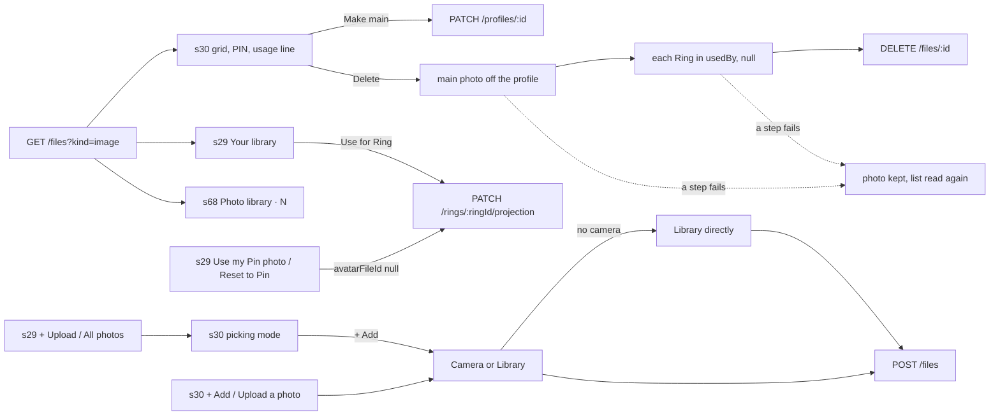

# 🧪 Photo Library · QA Frontend

**Feature:** [[F-06 Photo Library]] · **Verifies:** [[FD-08 Photo Library Frontend Delivery]] against [[S-11 Photo Library Story]] (approved 2026-11-25) and [[FR-06 Photo Library Frontend Requirements]] · **Verdict:** Passing on `social_pin` `main` `d790c11`, emulator Medium_Phone (Android 16), 2026-11-25: 56 of 56

Expected behaviour of the screens, as artefacts: journeys, states and copy to check a build against, **not test code**. `status: passing` or `failing` after a run; the verdict tells the PM whether the story can be fulfilled (passing with nothing pending or unmet). A failing row is one of two things: a story part the delivery does not fulfil (not built, or built other than the story says) goes in `unmet` and turns the story's badge ✕; a bug (built as asked, but it breaks) is filed against the Frontend Delivery and goes in `pending`, and leaves the story alone.

## Scope

[[Screen Index#s29|s29]] Photo for this Ring, [[Screen Index#s30|s30]] Photo library in picking and in management mode, the *Photo library* row on [[Screen Index#s68|s68]] Me, and the Pin photo screen's *Take a photo* row: every criterion of S-11 S1–S8 as the app shows it. **Not here:** S-11 S4 · 4 (the main photo set by an onboarding import or the profile editor) is [[S-08 Onboarding Imports Story]]'s and [[S-14 Profiles & Pin Name Story]]'s; the server's own rules (allow-list, owner only, `usedBy`, `followerCount`) are [[QB-08 Photo Library QA Backend]]'s; here only what the app does with them.

**Source:** `social_pin` `docs/testing/patrol/F-06 Photo Library test cases.md` (in the app's git-ignored `docs/`, not committed), 56 cases, approved by Omar Fostok 2026-11-25. **F** is Patrol against a faked API (`patrol_test/fake/h_photo_library_test.dart`, 49 cases); **R** is Patrol against the development API (`patrol_test/real/photo_library_test.dart`, 6 tests covering 8 cases: PL-11, PL-35, PL-38 with PL-52, PL-50, PL-51, PL-53 with PL-40); **D** is by hand on a real phone and on an emulator without a camera (PL-D1 to PL-D3). Patrol cannot drive the phone's own gallery or camera, so the picker and the camera check are stand-ins in F and R (`ImagePickerService`, `DeviceCamera`); D checks the real ones.

**Decided by Omar Fostok 2026-11-25, and tested as such:** s29's *+ Upload* opens s30 in picking mode, where *+ Add* offers Camera or Library (PL-08, [[S-11 Photo Library Story|S-11 S3]]); a Ring deleted during a delete (404 `E_RING_02`) stops the delete and keeps the photo (PL-42, [[FR-06 Photo Library Frontend Requirements|FR-06]]'s error table).

**Wording followed:** a file that is not an image reads the app's "That file type isn't supported." (the phone's check and, since `d790c11`, a server refusal alike); S-11 S3 and FR-06 quote "Unsupported file type". S3's criterion, the same words as the phone's check, holds; the quoted copy is the story's to align.

## Journeys

### A · Photo for this Ring (s29) · S1

| # | Story | Steps | Expected | Tag | Checked |
|---|---|---|---|---|---|
| PL-01 | S1 · 1, 6 | open s29 on *Clients* | "Photo for Clients", "Pick from your library"; *Use my Pin photo* ("Follows your Pin if you change it later", DEFAULT); *Pick a photo*, *Take a photo*; the "YOUR LIBRARY" grid with the PIN mark on the main photo, *+ Upload*, *All photos*; no *Crop for this Ring*, no large preview | F | ✅ |
| PL-02 | S1 · 1 | a Ring following the Pin photo; then a Ring with its own photo | ✓ on *Use my Pin photo*; then ✓ on that Ring's tile | F | ✅ |
| PL-03 | S1 · 2 | tap another tile, then Back | ✓ moves; no `PATCH`; the Ring keeps its photo | F | ✅ |
| PL-04 | S1 · 2 | select a tile, *Use for Clients* | `PATCH /rings/:ringId/projection { avatarFileId }`; back on s23; the Ring shows that photo | F | ✅ |
| PL-05 | S1 · 2 | select *Use my Pin photo*, *Use for Clients* | `PATCH … { avatarFileId: null }`; back on s23; the Ring shows the main photo | F | ✅ |
| PL-06 | S1 · 3 | *Pick a photo*; the picker returns a JPEG | `POST /files`; the new photo first in the grid and selected, not saved (no `PATCH` until *Use for*) | F | ✅ |
| PL-07 | S1 · 3 | *Take a photo*; the camera returns a photo | as PL-06, from the camera | F | ✅ |
| PL-08 | S1 · 3, S3 · 1 | tap *+ Upload*, then *All photos* | s30 opens in picking mode; there *+ Add* offers Camera or Library; *+ Upload* opens no sheet itself (decided 2026-11-25) | F | ✅ |
| PL-09 | S1 · 4, S6 · 3 | no main photo; open s29 | "You have no Pin photo yet, so the Ring shows its colour"; it can be chosen: `PATCH … null`, the Ring shows its colour; after *Make this my main photo* on s30 the Ring shows that photo | F | ✅ |
| PL-10 | S1 · 5 | *Use for* answers 400 `E_FILE_04` | "That photo isn't in your library any more. Pick another."; still on s29; the tiles read again | F | ✅ |
| PL-11 | S1 · 7, S7 | Ring photo set; the app restarted | the Ring's photo and the library tiles load from their signed links | F, R | ✅ |

### B · Photo library (s30) · S2

| # | Story | Steps | Expected | Tag | Checked |
|---|---|---|---|---|---|
| PL-12 | S2 · 1 | three photos uploaded at different times | newest first; each drawn from its `url`; no `filename` and no name anywhere | F | ✅ |
| PL-13 | S2 · 1 | one photo `isMainPhoto` | PIN on that tile only | F | ✅ |
| PL-14 | S2 · 2 | the main photo with `followerCount` 3, 1, 0; then 3 with `usedBy` *Family* | "3 Rings inherit it"; "1 Ring inherits it"; "No Ring inherits it"; "3 Rings inherit it · Family" | F | ✅ |
| PL-15 | S2 · 2 | `usedBy` of 1, 2, 3 and 4 Rings | "Family"; "Family, Company"; "Family, Company +1"; "Family, Company +2" | F | ✅ |
| PL-16 | S2 · 2 | `usedBy` empty, not the main photo | "Not used yet" | F | ✅ |
| PL-17 | S2 · 3 | from s29: tap a tile, *Done*; again, *Cancel* | *Done*: back on s29 with it selected, nothing saved; *Cancel*: s29 as it was | F | ✅ |
| PL-18 | S2 · 3 | in picking mode, *+ Add* → Library | back on s29 with the new photo selected, nothing saved | F | ✅ |
| PL-19 | S2 · 4 | a photo leaves the list on the server; the app to the background and back | the list is read again; the tile is gone; Me's count drops | F | ✅ |
| PL-20 | States | no photos | s30: "No photos yet", "Upload one here, or add one to a Ring…"; s29's grid: "Photos you upload are kept here, ready for any Ring." | F | ✅ |
| PL-21 | S7 · 1 | 60 photos | scrolling reads the next page by `skip`; all 60, no repeats | F | ✅ |

### C · Add a photo · S3

| # | Story | Steps | Expected | Tag | Checked |
|---|---|---|---|---|---|
| PL-22 | S3 · 1 | s30 *+ Add*; s30 *Upload a photo* | the "Add a photo" sheet: *Camera*, *Library*, Cancel | F | ✅ |
| PL-23 | S3 · 2 | JPEG, PNG, WebP, GIF in turn | each: `POST /files`; the new tile first, "Not used yet" | F | ✅ |
| PL-24 | S3 · 2, 5 | the picker returns a `.pdf` | "That file type isn't supported."; nothing sent | F | ✅ |
| PL-25 | S3 · 2, 5 | the picker returns 26 MB | "Too large (max 25 MB)"; nothing sent | F | ✅ |
| PL-26 | S3 · 5 | `POST /files` answers 415 `E_FILE_02`, then 413 `E_FILE_03` | the phone check's words: "That file type isn't supported."; "Too large (max 25 MB)"; no tile (failed first, fixed in `d790c11`, see *Verdict*) | F | ✅ |
| PL-27 | S3 · 3 | the camera answers *permission denied* | "Camera access is off. Turn it on in Settings, or pick from your library." with *Settings*, which opens the app's page (`social_pin/app_settings`); *Library* still works | F | ✅ |
| PL-28 | S3 · 3 | the gallery answers *permission denied* | "Photo access is off. Turn it on in Settings to pick a photo." with *Settings* | F | ✅ |
| PL-29 | S3 · 4 | `DeviceCamera` says there is none | s30 *+ Add* and *Upload a photo* open the library at once, no sheet; no *Take a photo* on s29 or on the Pin photo screen | F | ✅ |
| PL-30 | S3 · 6 | upload on s30 from Me | no `PATCH` of any projection; every Ring keeps its photo | F | ✅ |
| PL-31 | S3 · 7 | s29, s30, the sheet | no "Pull the one from LinkedIn" | F | ✅ |
| PL-32 | States | a slow upload | "Uploading… N%" while it sends; the screen idle after | F | ✅ |
| PL-33 | S3 · 2 | `POST /files` drops, then answers 500 | a message; no tile; uploading again works | F | ✅ |
| PL-34 | S3 · 2 | the picker returns nothing | nothing sent, nothing shown | F | ✅ |

### D · Manage the library from Me (s68, s30) · S4

| # | Story | Steps | Expected | Tag | Checked |
|---|---|---|---|---|---|
| PL-35 | S4 · 1, S7 · 4 | `meta.total` 4; upload one; delete one | "Photo library" shows 4, then 5, then 4 | F, R | ✅ |
| PL-36 | S4 · 1 | Me → Photo library | no *Done*, no *Cancel*; Back → Me | F | ✅ |
| PL-37 | S4 · 2, 3 | tap a photo; tap the main photo | "This photo": *Make this my main photo* and *Delete*; on the main photo only *Delete* | F | ✅ |
| PL-38 | S4 · 3 | *Make this my main photo* | `PATCH /profiles/:id { avatarFileId }`; "Now your main photo"; the PIN mark moves; Rings following the Pin photo show it; a Ring with its own photo keeps it | F, R | ✅ |

### E · Delete a photo (s30, management mode) · S5

| # | Story | Steps | Expected | Tag | Checked |
|---|---|---|---|---|---|
| PL-39 | S5 · 1 | an unused photo: *Delete*, confirm | "Delete this photo?", "It's on none of your Rings."; `DELETE /files/:id`; "Photo deleted"; the tile gone | F | ✅ |
| PL-40 | S5 · 2, 4 | `usedBy` Family, Company: *Delete*, confirm | "Family and Company will show your Pin photo instead."; `PATCH … null` on each, then `DELETE`, in that order | F, R | ✅ |
| PL-41 | S5 · 3, 4 | the main photo with `followerCount` 0, 1, 3; then 3 with `usedBy` Family | "It's your Pin photo. Your initials will show where it did."; "…The Ring that follows it will show your initials instead."; "…The 3 Rings that follow it…"; plus "Family will show your initials too."; `PATCH /profiles/:id` (photo cleared), then each Ring, then `DELETE` | F | ✅ |
| PL-42 | S5 · 4 | the profile `PATCH` fails; then a Ring's `PATCH` fails, once with 500 and once with 404 `E_RING_02` (the Ring deleted meanwhile) | "Couldn't stop it being your Pin photo, so it wasn't deleted."; "Couldn't take it off Family, so it wasn't deleted."; no `DELETE`; the photo kept; the list read again, and a Ring deleted meanwhile no longer named (decided 2026-11-25) | F | ✅ |
| PL-43 | S5 · 5 | `DELETE` answers 404 `E_FILE_01` | no error; the tile leaves | F | ✅ |
| PL-44 | S5 | *Delete*, then cancel the confirmation | nothing sent; the photo kept | F | ✅ |

### F · Reset to Pin (s29) · S6

| # | Story | Steps | Expected | Tag | Checked |
|---|---|---|---|---|---|
| PL-45 | S6 · 1 | a Ring with its own photo; select another tile; *Reset to Pin* | `PATCH … { avatarFileId: null }` at once; back on s23 | F | ✅ |
| PL-46 | S6 · 2 | after PL-45, make another photo main | the Ring shows the new main photo | F | ✅ |
| PL-47 | S6 · 2 | PL-45's request | the body holds only `avatarFileId`: no other field of the Ring is sent | F | ✅ |

PL-09 covers *Reset to Pin* and *Use my Pin photo* with no Pin photo yet (S6 · 3).

### G · Signed links, the list, the Rings per photo · S7, S8

| # | Story | Steps | Expected | Tag | Checked |
|---|---|---|---|---|---|
| PL-48 | S7 · 3, [[D-16 Files load from signed links that expire in 15 minutes\|D-16]] | a tile's `url` fails to load | the list is read once more and the tile loads from the new `url`; a second failure does not loop | F | ✅ |
| PL-49 | S7 · 3, D-16 | the projection's `avatarUrl` fails | the projection is read once more; the photo loads | F | ✅ |
| PL-50 | S7 · 1 | a second account uploads a photo | it never shows in my grid; its id on *Use for* answers `E_FILE_04` (PL-10's message) | R | ✅ |
| PL-51 | S7 · 2 | a PDF uploaded to my account over the API | not in the grid, not in Me's count | R | ✅ |
| PL-52 | S8 | pick a photo for a Ring in the app; make another main | s30 names that Ring under the photo; "N Rings inherit it" moves to the new main photo | R | ✅ |
| PL-53 | S5 · 2, S8 | delete in the app a photo a Ring uses | the server's projection for that Ring has `avatarFileId: null`; the file answers 404 | R | ✅ |

### H · By hand, on a real phone · S3

| # | Story | Steps | Expected | Tag | Checked |
|---|---|---|---|---|---|
| PL-D1 | S3 · 3 | the first *Camera* | the phone asks for camera access once; *Don't allow* gives PL-27's message, and *Settings* opens the app's page | D | ✅ |
| PL-D2 | S3 · 2 | a 4000 × 3000 photo | it arrives at most 1600 × 1600 (`sizeBytes` on the list) | D | ✅ |
| PL-D3 | S3 · 4 | an emulator or a tablet without a camera | no *Camera* anywhere; Library opens directly | D | ✅ |

## Screen states

| Screen | State | Expected rendering |
|---|---|---|
| [[Screen Index#s29\|s29]] | Pin photo chosen | ✓ on *Use my Pin photo*, DEFAULT (PL-02) |
| [[Screen Index#s29\|s29]] | no Pin photo yet | "You have no Pin photo yet, so the Ring shows its colour"; still choosable (PL-09) |
| [[Screen Index#s29\|s29]] | no camera | no *Take a photo* (PL-29, PL-D3) |
| [[Screen Index#s29\|s29]] | empty library | "Photos you upload are kept here, ready for any Ring." (PL-20) |
| [[Screen Index#s30\|s30]] | empty | "No photos yet", "Upload one here, or add one to a Ring…" (PL-20) |
| [[Screen Index#s30\|s30]] | uploading | "Uploading… N%" (PL-32) |
| [[Screen Index#s30\|s30]] | usage line | "N Rings inherit it" (· Ring names), "Family, Company +N", "Not used yet" (PL-14 to PL-16) |
| [[Screen Index#s30\|s30]] | picking mode | *Done* / *Cancel* (PL-17) |
| [[Screen Index#s30\|s30]] | management mode | no *Done* / *Cancel*, Back → Me; the tile sheet "This photo" (PL-36, PL-37) |
| [[Screen Index#s30\|s30]] | delete confirmation | three wordings: unused, picked by Rings, the main photo (PL-39 to PL-41) |
| [[Screen Index#s30\|s30]] | delete stopped | "Couldn't … so it wasn't deleted.", the photo kept (PL-42) |
| [[Screen Index#s30\|s30]] | camera / photos denied | the message with *Settings* (PL-27, PL-28, PL-D1) |
| [[Screen Index#s30\|s30]] | no camera | *+ Add* and *Upload a photo* open the library, no sheet (PL-29, PL-D3) |
| [[Screen Index#s68\|s68]] | the row | "Photo library" with `meta.total` (PL-35) |

## Flow diagram

## Error copy

| ErrorCode | Where | Copy shown |
|---|---|---|
| `E_FILE_02` (415), or the status alone | `POST /files` | "That file type isn't supported." (PL-26; the phone's check, PL-24) |
| `E_FILE_03` (413), or the status alone | `POST /files` | "Too large (max 25 MB)" (PL-26; the phone's check, PL-25) |
| `E_FILE_04` (400) | `PATCH /rings/:ringId/projection` | "That photo isn't in your library any more. Pick another." (PL-10, PL-50) |
| `E_FILE_01` (404) | `DELETE /files/:id` | none: the tile leaves (PL-43) |
| `E_RING_02` (404), or 5xx | a Ring's `PATCH` during a delete | "Couldn't take it off <Ring>, so it wasn't deleted." (PL-42) |
| — (5xx) | the profile's `PATCH` during a delete | "Couldn't stop it being your Pin photo, so it wasn't deleted." (PL-42) |
| — (drop / 5xx) | `POST /files` | a message, no tile (PL-33) |

## Verdict

- Run on: 2026-11-25 · build: `social_pin` `main` `d790c11`, emulator Medium_Phone (Android 16) · result: **56 of 56 pass**: faked API 49 of 49, development API 6 of 6 tests (8 cases), by hand 3 of 3 (checked by Omar Fostok 2026-11-25: the camera asked for once and *Don't allow* gives the message with *Settings*; a large photo arrives at most 1600 × 1600; no camera means no *Camera* anywhere and Library opens directly) · failing rows: none · story parts unmet: none · bugs: none open.
- **App bug found and fixed in `d790c11`** (no B-NN card: found and fixed before the run recorded here). PL-26's first run, on `e65b7f7`: a server refusal of an upload (415 `E_FILE_02`, 413 `E_FILE_03`) showed the generic network message, not the phone check's words S-11 S3 asks for. Fixed in `PhotoUploader` (decided by Omar Fostok 2026-11-25), with `test/features/photo/photo_uploader_test.dart`; PL-26 then passed with PL-24, PL-25 and PL-33. [[FD-08 Photo Library Frontend Delivery]] records it.
- The other first-run failures were the tests' own (a broken test PNG in the fake, the picking-mode screen's name, Me's count tiles, the stack after a relaunch), fixed in the suite; the test-case file has them.
- [[S-11 Photo Library Story]] is ready to fulfil on the frontend side; [[QB-08 Photo Library QA Backend]] is passing too.

## Log

- 2026-11-25 · vault branch `docs/qa/M-01-identity/F-06-photo-library/QF-09-passing` · written from `social_pin` `docs/testing/patrol/F-06 Photo Library test cases.md` (56 cases, PL-01 to PL-53 and PL-D1 to PL-D3, approved by Omar Fostok 2026-11-25) against [[FD-08 Photo Library Frontend Delivery]], [[S-11 Photo Library Story]] (approved 2026-11-25) and [[FR-06 Photo Library Frontend Requirements]]; run on `main` `d790c11`, Medium_Phone: 56 of 56; the PL-26 app bug, fixed in `d790c11`, recorded; PL-08 and PL-42 as decided 2026-11-25 · flagged nothing
