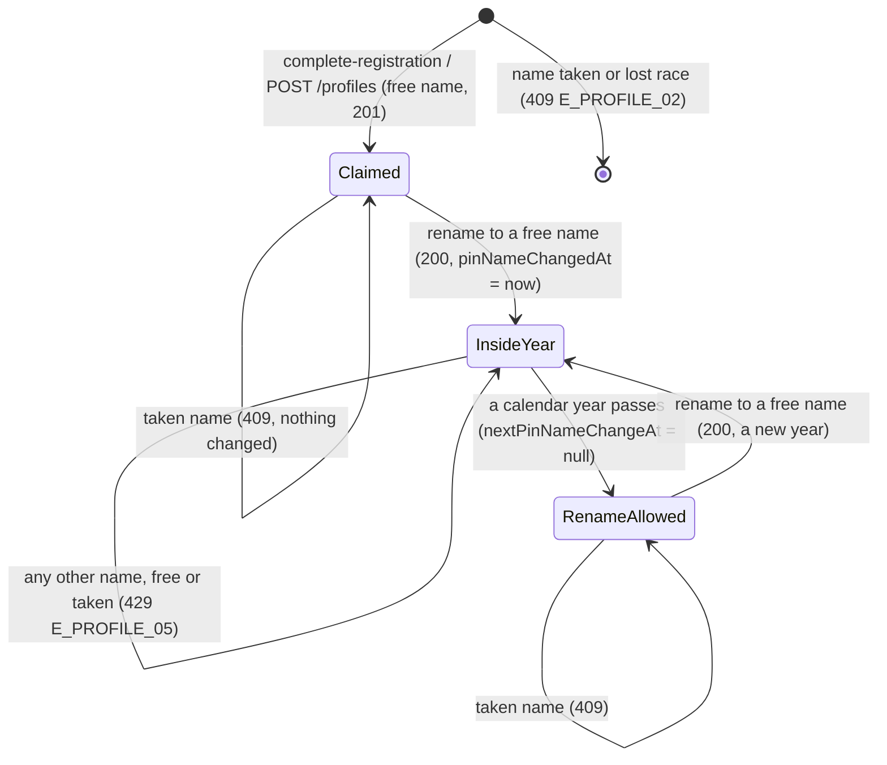

# 🧪 Profiles & Pin Name · QA Backend

> Blocked by default until [[BD-07 Profiles & Pin Name Backend Delivery]] is `done` (the hand-off order in `docs.config.json`); `blockedBy: []` opts out, `blockedBy: [...]` names other blockers.

**Feature:** [[F-07 Profiles & Pin Name]] · **Verifies:** [[BD-07 Profiles & Pin Name Backend Delivery]] against [[S-14 Profiles & Pin Name Story]] and [[FR-07 Profiles & Pin Name Frontend Requirements]], with the shapes and errors of [[BI-04 Profiles & Pin Name Backend Integration]] · **Verdict:** 🟢 Passing · 2026-11-05 · backend `main @ 12172c6` · 56 of 56 as expected, nothing pending or unmet

Expected behaviour of the API, as artefacts a person can check a build against: tables and diagrams, **not test code** (the specs live in the backend repo). `status: passing` or `failing` after a run; the verdict tells the PM whether the story can be fulfilled (passing with nothing pending or unmet). A failing row is one of two things: a story part the delivery does not fulfil (not built, or built other than the story says) goes in `unmet` and turns the story's badge ✕; a bug (built as asked, but it breaks) is filed against the Backend Integration and goes in `pending`, and leaves the story alone.

## Scope

Covered: what [[BD-07 Profiles & Pin Name Backend Delivery]] ships for [[S-14 Profiles & Pin Name Story]]:

- the Pin name rules: the public availability check, the 3–30 pattern on every write, case-insensitive uniqueness, and the 409 `E_PROFILE_02` when a claim loses a race (S1, S2, S13);
- the main profile fields at sign-up and in the editor: headline, role, company, location, bio and the photo (S9, S10, [[D-02 One main profile every Ring starts from]]);
- the name and the nickname, `null` clearing the nickname and refused on `fullName`, `pinName`, `profileType` (S3);
- the sensitive fields and my Rings' `show*` switches in one call, `GET /profiles/ring-privacy` (S4);
- the signed `avatarUrl` on every owner response ([[D-16 Files load from signed links that expire in 15 minutes]]);
- a Ring's view falling back to the main bio and photo (S11), as far as F-07 owns it;
- the yearly rename and its own error, 429 `E_PROFILE_05` (S12, [[D-06 Yearly rename, old name freed, case-insensitive]]);
- owner-only access, and several profiles with the default, which the backend supports although v1 uses one.

Not covered:

- **Not delivered yet, not a failure:** the public look-up by Pin name with no sign-in for [[D-22 The public page only says the Pin exists]]. It is the one open `pending` entry on [[BD-07 Profiles & Pin Name Backend Delivery]], and [[S-14 Profiles & Pin Name Story]] has no part for it yet. It gets rows once it ships.
- Headline, role, company and location on a viewer's view, and a Ring's own value per field: [[F-10 Ring Projection]].
- The sign-up and sign-in calls themselves (codes, tokens, sessions): [[QB-05 Auth & Sign-up QA Backend]]. B3 here only repeats its B22 from the profile side.
- Imports into the main profile: [[F-05 Onboarding Imports]], not built.
- The client rules, copy and screens: a QA Frontend note.

How the run was made: seed accounts Sara (`SaraAz`), Omar (`OmarK`, a member of Sara's *E-commerce Clients* Ring) and GulfExpo (in her *Family* Ring), signed in through the OTP flow (`devCode`), plus accounts made through `sign-up → verify-code → complete-registration` for this run. The year boundaries in B49 and B50 were reached by moving `pin_name_changed_at` in the run's throwaway database, not by waiting.

## Expected behaviour

### Pin name rules — S1 Claim your Pin, S2 Taken at the last moment, S13 Claim at sign-up (s06)

| # | Given | When | Then | Checked |
|---|---|---|---|---|
| B1 | no token | `GET /profiles/pin-name/FreshName_1/availability` | 200 `{ pinName, available: true }`: the route is public | ✅ |
| B2 | `SaraAz` is held | the check for `saraaz` and `SARAAZ` | 200 `{ available: false }` for both; nothing in the body says who holds it | ✅ |
| B3 | — | the check for `ab` (2), 31 characters, `a-b-c`, `!SaraAz` | 200 `{ pinName, available }`: the route answers only a boolean and applies no format rule, as [[QB-05 Auth & Sign-up QA Backend]] B22 settled; the client validates 3–30 itself, and every write refuses a bad name (B5, B7). Observed: `available: true` for each, `!SaraAz` included while `SaraAz` is held | ✅ |
| B4 | `OmarK` is held | `POST /auth/complete-registration { pinName: "omark" }` | 409 "This pin name is already taken" (`E_PROFILE_02`); the same onboarding token then registers with `LateComer`, 201: the typed full name can be sent again (S2) | ✅ |
| B5 | a fresh onboarding token | `complete-registration` with `pinName: "ab"`, with `"!BadName"`, or with a 121-character `fullName` | 400, the pattern message ("pinName must be 3-30 characters using letters, digits, underscore or dot") or the length message | ✅ |
| B6 | B14's new account | `GET /profiles` | `pinName` with its casing kept, `isDefault: true`, `pinNameChangedAt: null`, `nextPinNameChangeAt: null`: claiming the name does not start the year (S13) | ✅ |
| B7 | Sara signed in | `PATCH /profiles/:id { pinName: "ab" }` or `{ pinName: "!SaraAzzam" }` | 400, the pattern message; nothing changed | ✅ |
| B8 | Omar, never renamed; `SaraBoundary` held by Sara | `PATCH` his profile `{ pinName: "saraboundary" }` | 409 "This pin name is already taken"; his `pinName` is still `OmarK` and `pinNameChangedAt` still `null`: a refused claim does not use his rename | ✅ |
| B9 | `OmarK` is held | `POST /profiles { pinName: "OMARK" }` by another account | 409 "This pin name is already taken" | ✅ |

### The 409 on a lost race

| # | Given | When | Then | Checked |
|---|---|---|---|---|
| B10 | two PENDING accounts, a free name | both `complete-registration` with it (one in other capitals) at the same moment | one 201, one 409 "This pin name is already taken", never 500; one profile holds the name | ✅ 3 of 3 races |
| B11 | Omar and GulfExpo, neither renamed this year, a free name | both `PATCH` their profile to it (other capitals) at the same moment | one 200, one 409, never 500; one profile holds it | ✅ 3 of 3 |
| B12 | Omar and GulfExpo, a free name | both `POST /profiles` with it at the same moment | one 201, one 409, never 500; one profile holds it | ✅ 3 of 3 |
| B13 | Sara, rename allowed now | two `PATCH`es to two different free names at the same moment | one 200, one 429 "You can change your Pin name once a year. Next change: …", never two renames; the profile holds the winner's name | ✅ 3 of 3 |

### S9 · Sign-up keeps what I typed (s05b)

| # | Given | When | Then | Checked |
|---|---|---|---|---|
| B14 | a new account registered with `fullName: "Qa Newbie"` | `GET /profiles` | `data[0]` is the default profile with `fullName` set and `headline`, `role`, `company`, `location`, `bio`, `avatarFileId`, `avatarUrl` all `null` | ✅ |
| B15 | B14's session | `POST /files` (a PNG), then one `PATCH /profiles/:id { headline, company, location, avatarFileId }` | 200 with those four values; `role` and `bio` untouched (`null`); `avatarUrl` a signed link that loads as `image/png` | ✅ |

### S10 · See and change my main profile (s68)

| # | Given | When | Then | Checked |
|---|---|---|---|---|
| B16 | Sara, seeded with five of the six fields | `GET /profiles` | 200 `{ data, meta: { total: 1 } }`; the six fields present, `avatarFileId` and `avatarUrl` `null` | ✅ |
| B17 | B16 | `PATCH { role: "COO" }` | 200, `role` changed, every other field as before: one key per save | ✅ |
| B18 | B17 | `PATCH { headline: null }` | 200, `headline: null`: `null` clears | ✅ |
| B19 | — | `headline` 121, `role` 81, `company` 121, `location` 121, `bio` 2001 characters | 400 each, with the field's length message; at the limit (`headline` 120, `bio` 2000) 200 | ✅ |
| B20 | — | `PATCH { tagline: "nope" }`; `PATCH { headline: 42 }` | 400 "property tagline should not exist"; 400 "headline must be a string" | ✅ |
| B21 | Sara | `GET /profiles?pinName=raa`; `GET /profiles?pinName=omar` | her profile, `meta.total: 1` (partial, ignores case); `{ data: [], meta: { total: 0 } }`: another person's profile is never listed | ✅ |

### S3 · Edit my name and nickname (s68)

| # | Given | When | Then | Checked |
|---|---|---|---|---|
| B22 | Sara | `PATCH { nickname: "Sasa" }`, then `PATCH { nickname: null }` | 200 `nickname: "Sasa"`, then 200 `nickname: null` | ✅ |
| B23 | — | `PATCH { nickname: <61 characters> }` | 400 "nickname must be shorter than or equal to 60 characters" | ✅ |
| B24 | — | `PATCH { fullName: null }`, `{ pinName: null }`, `{ profileType: null }` | 400 each (validation messages); the full name, Pin name and type unchanged | ✅ |
| B25 | — | `PATCH { fullName: <121 characters> }`; then `{ fullName: "Sara Azzam" }` | 400; then 200 | ✅ |

### S4 · Sensitive base fields, and my Rings' switches in one call (s68)

| # | Given | When | Then | Checked |
|---|---|---|---|---|
| B26 | Sara | `PATCH { birthdate: "1990-02-03", gender: "FEMALE", maritalStatus: "MARRIED" }`, then all three `null` | 200 with the values; then 200 with all three `null` | ✅ |
| B27 | — | `birthdate: "not-a-date"`; `gender: "ROBOT"`; `maritalStatus: "COMPLICATED"` | 400 each; the enum messages list the allowed values | ✅ |
| B28 | Sara owns *My Ring* (default), *E-commerce Clients* and *Family* | `GET /profiles/ring-privacy` | 200 `{ data, meta: { total: 3 } }`, the default first, then newest, the same order as `GET /rings`; each row `ringId`, `name`, `isDefault`, `showBirthdate`, `showGender`, `showMaritalStatus`, `showPhone`, `showEmail`; *Family* has `showBirthdate: true` ("Family Ring only") | ✅ |
| B29 | Omar; no token | `GET /profiles/ring-privacy` | Omar: his one Ring only; no token: 401 | ✅ |
| B30 | B28 | `PATCH /rings/:ecommerce/projection { showGender: true, showMaritalStatus: true }`, then the list again | 200; the list shows both `true` on *E-commerce Clients* only | ✅ |
| B31 | Omar, a member, not the owner | `PATCH /rings/:sara-ecommerce/projection { showBirthdate: true }` | 403 "You are not permitted to administer this ring"; nothing changed | ✅ |
| B32 | Sara's gender set; *E-commerce Clients* with `showGender: false`, *Family* with `showBirthdate: true` | Omar and GulfExpo `GET /views/pin/SaraAz` | Omar's view: `gender: null`, `birthdate: null`; GulfExpo's: `birthdate` shown, `gender: null`: the profile's values reach a viewer only through the Ring's switch | ✅ |

### D-16 · The signed `avatarUrl`

| # | Given | When | Then | Checked |
|---|---|---|---|---|
| B33 | Sara uploaded a PNG | `PATCH { avatarFileId: <it> }` | 200, `avatarFileId` set and `avatarUrl` `/api/v1/files/content/<token>`; that link with no token: 200 `image/png`, the bytes uploaded | ✅ |
| B34 | B33 | `GET /profiles` again | a fresh `avatarUrl` (another token) that also loads | ✅ |
| B35 | B33's link | the token's last characters changed | 404 | ✅ |
| B36 | a link taken at a known moment | loaded again 14 minutes later, and 16 minutes later | 200 at 14 minutes; 404 at 16 minutes: the link lives 15 minutes | ✅ 200 at 13.9 min, 404 at 16.1 min |
| B37 | Omar's file; an unknown uuid; a PDF Sara uploaded; `"not-a-uuid"` | `PATCH { avatarFileId: … }` | 400 "That file is not one of yours" (`E_FILE_04`) for Omar's and for the unknown one, the same body; 400 "A profile photo must be an image" (`E_FILE_02`) for the PDF; 400 "avatarFileId must be a UUID" | ✅ |
| B38 | a photo set | `PATCH { avatarFileId: null }` | 200, `avatarFileId: null`, `avatarUrl: null` | ✅ |

### S11 · Rings start from the main profile (s23)

| # | Given | When | Then | Checked |
|---|---|---|---|---|
| B39 | Sara's main photo set; *E-commerce Clients* has a bio of its own and no photo | Omar (a member) `GET /views/pin/SaraAz` | the Ring's own bio; `avatarUrl` a link to the main photo; `avatarFileId: null` | ✅ |
| B40 | B39 | Sara `PATCH /rings/:ecommerce/projection { bio: null }`; Omar's view again | the main bio ("Twelve years moving goods across the Gulf."); the `avatarUrl` loads as `image/png` | ✅ |
| B41 | every `/views/…` response of the run | — | none carries the main photo's file id | ✅ |

### S12 · Change my Pin name (s68)

| # | Given | When | Then | Checked |
|---|---|---|---|---|
| B42 | Sara, never renamed | `PATCH { pinName: "saraaz" }`, then `{ pinName: "SaraAz" }` | 200 both, the casing follows; `pinNameChangedAt` stays `null`: capitals only is the same name, not counted | ✅ |
| B43 | B42 | `PATCH { pinName: "SaraAzzam" }` | 200, `pinNameChangedAt` now, `nextPinNameChangeAt` the same instant one year later: the first rename is allowed | ✅ |
| B44 | B43 | Omar `GET /views/pin/SaraAz`; `GET /views/pin/NoSuchPin_qa`; `GET /views/pin/SaraAzzam` | 404 "This profile is not shared with you" for the old name, the same body as a name nobody ever held; 200 for the new one | ✅ |
| B45 | B43 | the check for `SaraAz`; another account `POST /profiles { pinName: "SaraAz" }` | `available: true`; 201: the old name is free for anyone at once | ✅ |
| B46 | B43, inside the year | `PATCH { pinName: "SaraAz2" }` | 429 "You can change your Pin name once a year. Next change: <the profile's nextPinNameChangeAt>" (`E_PROFILE_05`); `GET /profiles` shows `SaraAzzam` unchanged | ✅ |
| B47 | B43, inside the year | `PATCH { pinName: "OmarK" }` (held) | 429, not 409: a refused rename never says whether the name is free | ✅ |
| B48 | B43, inside the year | `PATCH { pinName: "saraAZZAM" }`, then back | 200 both; both dates unchanged | ✅ |
| B49 | the last rename one year minus 2 minutes ago; then one year plus 1 minute ago | `PATCH { pinName: "SaraBoundary" }` each time | first 429 with "Next change:" 2 minutes ahead; then `GET /profiles` shows `nextPinNameChangeAt: null`, and the rename is 200 with a new year from now | ✅ |
| B50 | `pinNameChangedAt` 2028-02-29 12:00 UTC | `GET /profiles/:id` | `nextPinNameChangeAt` 2029-03-01 12:00 UTC: 29 February rolls to 1 March | ✅ |

### Owner only, and several profiles

| # | Given | When | Then | Checked |
|---|---|---|---|---|
| B51 | Sara's profile id | Omar `GET` and `PATCH { headline }` it; Omar `GET` an unknown id; no token `GET /profiles` | 404 "Profile not found" (`E_PROFILE_01`) for both of hers and for the unknown one, the same body; Sara's headline unchanged; no token: 401 | ✅ |
| B52 | an account with one profile | `POST /profiles { pinName }`; `POST /profiles {}` | 201, `profileType: "PERSONAL"`, `isDefault: false`, the six fields `null`; 400 for the missing `pinName` | ✅ |
| B53 | its default profile | `DELETE /profiles/:default` | 409 "Set another profile as default before deleting this one" (`E_PROFILE_03`) | ✅ |
| B54 | its second profile | Omar `POST /profiles/:it/default`; then the owner | 404 for Omar; 201 for the owner, the promoted profile; `GET /profiles` lists it first, `isDefault: true`, the old one `false`, `meta.total: 2` | ✅ |
| B55 | B54 | `DELETE /profiles/:former-default` | 200; the list holds one profile; the deleted profile's name is `available: true` again | ✅ |

### On the wire

| # | Given | When | Then | Checked |
|---|---|---|---|---|
| B56 | every recorded response of the run (127 calls) | — | no `pinNameNormalized`, no `deletedAt`, no 500; error bodies are `statusCode`, `message`, `error`, `path`, `timestamp` with no `ErrorCode` yet, as BI-04 says until [[S-87 Error Contract Story]] ships, so the client tells the errors apart by status | ✅ |

## State diagram

A profile's Pin name and its rename year.

The old name, at the moment of a rename: **held → free** (`available: true`, claimable by anyone, `GET /views/pin/<old>` 404 at once, nothing redirects).

## Error matrix

| Situation | Status | ErrorCode | Same body as |
|---|---|---|---|
| Pin name taken, or a claim that lost the race (`complete-registration`, `POST /profiles`, `PATCH` with no rename this year) | 409 | `E_PROFILE_02` | — |
| A rename inside the year, to a free or a taken name | 429 | `E_PROFILE_05` | — (the message names the next allowed instant) |
| Deleting the default profile | 409 | `E_PROFILE_03` | — |
| Another person's profile id (`GET`, `PATCH`, `POST …/default`) | 404 | `E_PROFILE_01` | an id that does not exist |
| `avatarFileId` of another person's file, or one that does not exist | 400 | `E_FILE_04` | each other |
| `avatarFileId` of a file that is not an image | 400 | `E_FILE_02` | — |
| A field too long, a bad date or enum, a bad Pin name, `null` on `fullName` / `pinName` / `profileType`, an unknown key, a bad uuid | 400 | — (validation, `message` a string array) | — |
| Switching another person's Ring (`PATCH /rings/:ringId/projection`) | 403 | — | — |
| A signed link altered | 404 | — | a link to a deleted or unknown file ([[D-16 Files load from signed links that expire in 15 minutes]]) |
| No token on an owner route | 401 | — | — |
| The old Pin name after a rename (`GET /views/pin/:old`) | 404 | — | a name nobody holds, and "not shared with you" |

The body carries no `ErrorCode` on this build (B56).

## Privacy and access checks

- The availability check answers a boolean only; it never says who holds a name (B2).
- `GET /profiles`, `GET /profiles/:id` and `GET /profiles/ring-privacy` return the caller's own rows only; another person's profile id is the same 404 as one that does not exist (B21, B29, B51).
- A rename refused inside the year never says whether the asked name is free (B47).
- After a rename the old name answers the same 404 as a name nobody holds (B44).
- `avatarFileId` never says whose a file is: another person's file and an unknown id give one body (B37).
- A viewer gets the main photo as a link only, never its file id (B39–B41); the sensitive fields reach a viewer only through a Ring's own switch (B32).
- `pinNameNormalized` and `deletedAt` never reach the wire (B56).

## Verdict

- **Run on:** 2026-11-05 · **build:** backend `main @ 12172c6` · `localhost:3107`, a throwaway seeded database (`prisma:deploy` + `db:seed` on a fresh one, dropped after the run) · **result:** 🟢 **passing** · 56 of 56 rows as expected, none unrun · story parts unmet: none · bugs: none.
- Every story part BD-07 ships behaves as [[BI-04 Profiles & Pin Name Backend Integration]] says: the main profile fields at sign-up and in the editor (S9, S10), `nickname: null` and the `null` refusals (S3), the sensitive fields and `GET /profiles/ring-privacy` with its switches (S4), the signed `avatarUrl` and its 15-minute life (D-16), the S11 fallback to the main bio and photo with no file id to a viewer, the yearly rename with 429 `E_PROFILE_05`, its year boundary and 29 February (S12, S13), and the Pin name rules with one 201/200 and one 409 in each of 9 races (B10–B12), one 200 and one 429 in each of 3 concurrent renames (B13).
- **Not delivered yet, not a failure:** the public look-up by Pin name for [[D-22 The public page only says the Pin exists]], still the one `pending` entry on [[BD-07 Profiles & Pin Name Backend Delivery]]. It has no rows here until it ships.
- **Observed, as the contract says:** the availability check applies no format rule (`ab`, 31 characters, `a-b-c` and `!SaraAz` are all `available: true`, the last while `SaraAz` is held; B3, as [[QB-05 Auth & Sign-up QA Backend]] B22). Every write refuses those names with a 400, so nothing wrong can be stored; a client that skips its own 3–30 rule gets a misleading "available".
- **[[S-14 Profiles & Pin Name Story]] is not ready to fulfil:** this note is passing with nothing pending or unmet, but [[F-07 Profiles & Pin Name]] has no QA Frontend note yet, and the story needs both.

## Log

- 2026-11-05 · branch `docs/qa/M-01-identity/F-07-profiles/qa-backend` · written and first run on backend `main @ 12172c6` (localhost:3107, a throwaway database): 56 rows across S1–S4 and S9–S13, D-16's `avatarUrl`, the lost-race 409s, owner-only access and several profiles; the rename state diagram, the error matrix and the privacy checks. 56 of 56 ✅ → `passing`. A bug scaffolded for B3 was withdrawn before the build, because QB-05 B22 and BI-04 already settle that behaviour as the contract. Test data stayed in the throwaway database, which was dropped.
