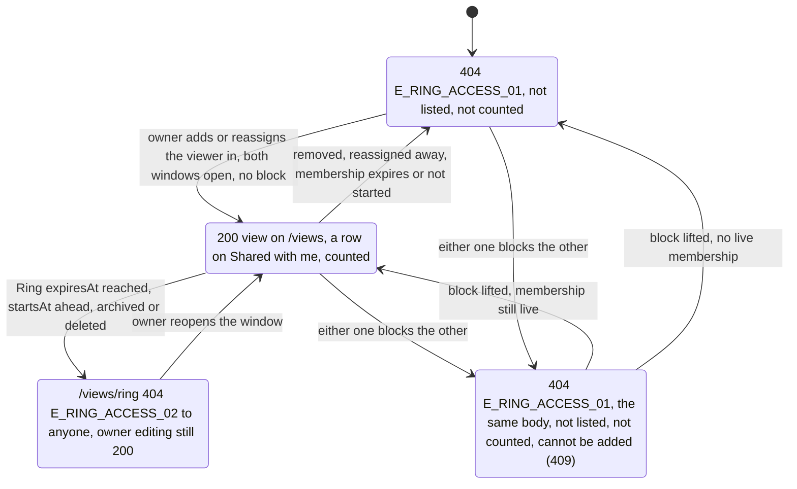

# 🧪 Ring Access Engine · QA Backend

> Blocked by default until [[BD-08 Ring Access Engine Backend Delivery]] is `done` (the hand-off order in `docs.config.json`); `blockedBy: []` opts out, `blockedBy: [...]` names other blockers.

**Feature:** [[F-08 Ring Access Engine]] · **Verifies:** [[BD-08 Ring Access Engine Backend Delivery]] against [[S-15 Ring Access Engine Story]] and [[FR-08 Ring Access Engine Frontend Requirements]], with the contract of [[BI-05 Ring Access Engine Backend Integration]] · **Verdict:** 🟢 Passing · 2026-11-09 · backend `main @ d8267d3` · 58 of 58 delivered rows as expected (B58, D-15, now built and passing); 2 rows waiting on a decision, 1 not built

Expected behaviour of the API, as artefacts a person can check a build against: tables and diagrams, **not test code** (the specs live in the backend repo). `status: passing` or `failing` after a run; the verdict tells the PM whether the story can be fulfilled (passing with nothing pending or unmet). A failing row is one of two things: a story part the delivery does not fulfil (not built, or built other than the story says) goes in `unmet` and turns the story's badge ✕; a bug (built as asked, but it breaks) is filed against the Backend Integration and goes in `pending`, and leaves the story alone.

## Scope

**Covered.** The engine has no routes of its own, so each guarantee of [[BI-05 Ring Access Engine Backend Integration]] is checked through the routes that call it: the three `/views` routes (`assertRingReadable`, `resolveDefaultAccess`, `resolveAccessibleRings`), Shared with me and its count (`sharedWithFilter`, `resolvePeopleSharingWith`, `countPeopleSharingWith`), the owner's member counts on `GET /rings` and `GET /rings/:id` (`countLiveMembers`), the Ring, members and projection editing routes (`assertCanAdminister`) and the owner-only routes (`RingService`'s owner-filtered lookup). Story parts: [[S-15 Ring Access Engine Story|Ring Access Engine · S1–S7]], and S8's member-count gate; the D-15 order of [[S-19 View As & Pin Views Story|View As & Pin Views · S4–S5]] (the Ring a viewer was put in first) as the engine resolves it. Each group names the part it comes from.

**Not covered.** The client's copy, the hidden editing UI and the motion (S3's animation, S6's quiet hide, S7's one message) are the QA Frontend's. S8's other settings are enforced when their flows ship ([[BD-11 Rings Backend Delivery]]). The hidden-row and sensitive-field rules on a view are [[F-10 Ring Projection]]'s and [[F-12 View As & Pin Views]]'s QA.

**Set up by hand, in the throwaway database only.** No route creates a block or grants a delegated-admin level, so the `user_blocks` and `ring_admins` rows were inserted with SQL; the Ring and membership windows were moved with SQL too, so a boundary could be crossed at a known millisecond. Everything else went through the API. (`PATCH /rings/:id` does accept an `expiresAt` in the past: it was used once and put back, not for the timed rows.)

**Accounts.** The seeded demo accounts, signed in with a one-time code read from `devCode`: **Sara** (`SaraAz`, the owner: Rings *My Ring* (default), *E-commerce Clients*, *Family*), **Omar** (`OmarK`, a member of Sara's *E-commerce Clients*; Sara is a member of his *My Ring*), the **organizer** (`GulfExpo`, a member of Sara's *Family*) and the **admin** (`SPAdmin`, the stranger, in no Ring of Sara's).

**Bodies.** Every error is the API's `{ statusCode, message, error, path, timestamp }`. `ErrorCode` is not on the wire yet ([[S-87 Error Contract Story]]), and `error` reads `"HttpException"`; the code column names what the contract promises and the run checks the status and the `message`. "Same body" means identical apart from `path` and `timestamp`.

## Expected behaviour

✅ as expected · 🔴 differs · ⏳ not delivered yet (the actual answer recorded) · ⬜ not run.

### One perspective, never the Ring — S1, S7

| # | Given | When | Then | Checked |
|---|---|---|---|---|
| B1 | Omar, a member of Sara's *E-commerce Clients* | `GET /views/pin/SaraAz` | 200, that Ring's view (its bio, email and phone as its show flags allow); no `ringId`, no owner user id, no membership row | ✅ |
| B2 | the same | `GET /views/ring/:ringId` of *E-commerce Clients* | 200, the same view as B1 | ✅ |
| B3 | the same | `GET /views/user/:userId/perspectives` of Sara | 200, a list of one view, the same as B1 | ✅ |
| B4 | Sara, the owner | `GET /views/ring/:ringId` of her live *E-commerce Clients* (View as) | 200, exactly the body Omar gets in B2 | ✅ |
| B5 | Sara | `GET /views/pin/SaraAz`; `GET /views/user/:userId/perspectives` of herself | 200, her default Ring's view (*My Ring*); her own list starts with the default too, then her other live Rings oldest first (the owner keeps the default, S-19 S5) | ✅ |

### One 404 for three causes — S7

| # | Given | When | Then | Checked |
|---|---|---|---|---|
| B6 | SPAdmin, in no Ring of Sara's | `GET /views/pin/SaraAz` | 404 `E_RING_ACCESS_01` "This profile is not shared with you" | ✅ |
| B7 | SPAdmin | `GET /views/pin/NoSuchPin` | 404, the same body as B6 | ✅ |
| B8 | SPAdmin; *E-commerce Clients* is live | `GET /views/ring/:ringId` of it | 404, the same body as B6 | ✅ |
| B9 | SPAdmin | `GET /views/user/:userId/perspectives` of Sara | 200 `[]` | ✅ |
| B10 | Sara has blocked Omar | Omar: `GET /views/pin/SaraAz` | 404, the same body as B6 and B7 | ✅ |
| B11 | the same | Omar: `GET /views/ring/:ringId` of *E-commerce Clients* | 404, the same body as B8 | ✅ |

### The Ring's window, expiry exclusive — S2

| # | Given | When | Then | Checked |
|---|---|---|---|---|
| B12 | *E-commerce Clients* `expiresAt` = T, 2.5 s ahead | Omar asks `GET /views/ring/:ringId` every 40 ms across T | 200 until T, 404 `E_RING_ACCESS_02` "Ring is not available" from T on. Run on `d8267d3`: T = 08:06:31.585, last 200 answered at .564, first 404 sent at .613 (on `12172c6`: T .312, last 200 .309, first 404 .349) | ✅ |
| B13 | the Ring expired (B12) | Omar: `GET /views/ring/:ringId` | 404 `E_RING_ACCESS_02` | ✅ |
| B14 | the same | Omar: `GET /views/pin/SaraAz` | 404 `E_RING_ACCESS_01` (he is in no other live Ring of hers) | ✅ |
| B15 | the same | Omar: `GET /views/user/:userId/perspectives` of Sara | 200 `[]` | ✅ |
| B16 | the same | Omar: `GET /rings/shared-with-me` and `/count` | `{ data: [], meta: { total: 0 } }` and `{ people: 0 }` | ✅ |
| B17 | the same | Sara: `GET /rings` | *E-commerce Clients* `memberCount: 0` (Family 1) | ✅ |
| B18 | the Ring's `startsAt` 1 h ahead, no end | Omar: `GET /views/ring/:ringId`, `/shared-with-me/count`; Sara: `GET /rings` | 404 `E_RING_ACCESS_02`; `{ people: 0 }`; `memberCount: 0`. With `startsAt` moved 1 min into the past: 200 | ✅ |

### The membership's window — S2

| # | Given | When | Then | Checked |
|---|---|---|---|---|
| B19 | the Ring permanent; Omar's membership `expiresAt` 1 s in the past | Omar: `GET /views/ring/:ringId` | 404 `E_RING_ACCESS_01` (the Ring is live, so the not-shared body) | ✅ |
| B20 | the same | Omar: `GET /views/pin/SaraAz`; `GET /views/user/:userId/perspectives` | 404 `E_RING_ACCESS_01`; 200 `[]` | ✅ |
| B21 | the same | Omar: Shared with me and its count; Sara: `GET /rings` | empty, total 0; `{ people: 0 }`; *E-commerce Clients* `memberCount: 0` | ✅ |
| B22 | the membership's `startsAt` 1 h ahead, no end | the same three calls | the same answers as B19–B21; with `startsAt` cleared: 200 | ✅ |
| B23 | the membership's `expiresAt` = T, 2.5 s ahead | Omar polls `GET /views/ring/:ringId` every 40 ms across T | 200 until T, then 404 `E_RING_ACCESS_01`. Run on `d8267d3`: T = 08:06:40.544, last 200 answered at .537, first 404 sent at .579 (on `12172c6`: T .223, last 200 .193, first 404 .233) | ✅ |

### An expired Ring stays editable by its owner — S5

| # | Given | When | Then | Checked |
|---|---|---|---|---|
| B24 | *E-commerce Clients* expired | Sara: `GET /views/ring/:ringId` of it (View as) | 404 `E_RING_ACCESS_02`, the owner included | ✅ |
| B25 | the same | Sara: `PATCH /rings/:id` `{ colorHex }` | 200, the change saved | ✅ |
| B26 | the same | Sara: `GET` and `PATCH /rings/:ringId/projection` `{ nickname }` | 200 and 200, the change saved | ✅ |
| B27 | the same | Sara: `GET /rings/:ringId/members` | 200, the roster | ✅ |
| B28 | the same | Sara: `GET /rings/:id` | 200, `expiresAt` in the past, `memberCount: 0` | ✅ |

### `assertCanAdminister`: below the level is 403 — S6

| # | Given | When | Then | Checked |
|---|---|---|---|---|
| B29 | Omar, a member with no admin level | `PATCH /rings/:id` of *E-commerce Clients* | 403 `E_RING_05` "You are not permitted to administer this ring" | ✅ |
| B30 | the same | `GET /rings/:ringId/members`; `GET` and `PATCH /rings/:ringId/projection` | 403 `E_RING_05` on each | ✅ |
| B31 | Sara | `PATCH /rings/:id` with an id no Ring has | 404 `E_RING_02` "Ring not found" | ✅ |
| B32 | Omar given `MEMBER_MANAGER` on the Ring | `GET /rings/:ringId/members` | 200 | ✅ |
| B33 | the same | `PATCH /rings/:id`; `GET` and `PATCH /rings/:ringId/projection` | 403 `E_RING_05` on each (they need `CONTENT_MANAGER`) | ✅ |
| B34 | Omar raised to `CONTENT_MANAGER` | `PATCH /rings/:id`; `GET /rings/:ringId/projection`; `GET /rings/:ringId/members` | 200 on each (`CONTENT_MANAGER` is above `MEMBER_MANAGER`) | ✅ |
| B35 | Omar's admin row deleted | `PATCH /rings/:id` on his next request | 403 `E_RING_05` | ✅ |
| B36 | SPAdmin, not a member, no admin row | `PATCH /rings/:id` of *E-commerce Clients* | 403 `E_RING_05` (as BI-05 says for anyone who is neither owner nor admin) | ✅ |

### The owner-only routes: 404 for anyone else — FR-08, S-31 A4

| # | Given | When | Then | Checked |
|---|---|---|---|---|
| B37 | Omar given `FULL` on *E-commerce Clients* | `GET /rings/:id` of it | 404 `E_RING_02` "Ring not found" | ✅ |
| B38 | the same | `POST /rings/:id/default`; `POST /rings/:id/copy`; `POST /rings/:id/disposition` `{ KEEP }`; `DELETE /rings/:id` | 404 `E_RING_02` on each; nothing changed | ✅ |
| B39 | the same | `GET /rings/:id` and `POST /rings/:id/default` with an id no Ring has | 404, the same body as B37 and B38 | ✅ |
| B40 | SPAdmin | `GET /rings/:id`; `POST /rings/:id/default`; `DELETE /rings/:id` | 404 `E_RING_02` on each | ✅ |
| B41 | after B37–B40 | Sara: `GET /rings/:id` | 200, the Ring as it was | ✅ |

### A block cuts both ways — S4

| # | Given | When | Then | Checked |
|---|---|---|---|---|
| B42 | Sara has blocked Omar; he is still an `ACTIVE` member | Omar: both `/views` routes, `/perspectives`, Shared with me and its count | 404 `E_RING_ACCESS_01` twice; `[]`; empty, total 0; `{ people: 0 }` | ✅ |
| B43 | the same; Sara is a member of Omar's *My Ring* | Sara: `GET /views/pin/OmarK`, `GET /views/ring/:ringId` of his Ring, `/perspectives`, Shared with me and its count | the same answers as B42 | ✅ |
| B44 | the same | Sara's and Omar's `GET /rings` | Sara's *E-commerce Clients* `memberCount: 0`, Omar's *My Ring* `memberCount: 0`; the owner's roster still lists the `ACTIVE` row | ✅ |
| B45 | the same | Sara: `POST /rings/:ringId/members` `{ userId: Omar }` on *Family* | 409 `E_RING_MEMBER_04` "This user cannot be added"; the word "blocked" appears nowhere | ✅ |
| B46 | the block reversed: Omar has blocked Sara | Omar: both `/views` routes and the count; Sara: `GET /views/pin/OmarK`, the count, `GET /rings`; the add of B45 | the same answers as B42–B45 | ✅ |
| B47 | the block deleted | Omar: `GET /views/ring/:ringId`; Sara: `GET /views/pin/OmarK`; both counts; Sara's `GET /rings`, next request | 200 on both sides; `{ people: 1 }` each; *E-commerce Clients* `memberCount: 1` | ✅ |

### Shared with me, the counts and the first Ring — S1, S8, S-19 S4–S5, D-14, D-15, D-18

| # | Given | When | Then | Checked |
|---|---|---|---|---|
| B48 | the seed | Omar: `GET /rings/shared-with-me`, `/count` | one row `{ ringId, pinName: "SaraAz", displayName, avatarUrl: null, expiresAt: null, ringName: null, memberCount: null }`, `meta.total: 1`; `{ people: 1 }`, the same number | ✅ |
| B49 | the seed | SPAdmin: the same | empty, `total: 0`; `{ people: 0 }` | ✅ |
| B50 | the seed | Sara: `GET /rings`, `GET /rings/:id` | *My Ring* 0, *Family* 1, *E-commerce Clients* 1; the same 1 on `/rings/:id` | ✅ |
| B51 | GulfExpo in *Family*, then also added to *E-commerce Clients* (an older Ring) | GulfExpo: Shared with me, its count, `/perspectives`; Sara: `GET /rings` | **one** row, its `ringId` *Family*, the Ring he was put in first; `{ people: 1 }`; two views, *Family* first, then *E-commerce Clients* (the order he was added); *E-commerce Clients* `memberCount: 2` | ✅ |
| B52 | *Family* ends in 2 days, GulfExpo's membership in 1 | GulfExpo: Shared with me | the row's `expiresAt` is the membership's (the earlier); with the membership moved past the Ring's end, the Ring's | ✅ |
| B53 | *E-commerce Clients* "members can see each other" switched on | Omar: Shared with me | the row still has `ringName: null`, `memberCount: null` (the owner placed Omar, so D-18 names no Ring to him) | ✅ |
| B58 | GulfExpo in *Family* (put in first) and *E-commerce Clients* (the older Ring, joined second) | `GET /views/pin/SaraAz` | 200, the *Family* view, the same body as Sara's View as *Family*: the Ring he was put in first, not the owner's default nor her oldest Ring; the same Ring his Shared with me row opens (B51) (S1, S-19 S4, D-15) | ✅ on `d8267d3` (⏳ on `12172c6`: the *E-commerce Clients* view) |

### Resolved per request, nothing cached — S3

| # | Given | When | Then | Checked |
|---|---|---|---|---|
| B54 | Omar in *E-commerce Clients*, signed in, the same access token held throughout | Sara: `POST /rings/:ringId/members/:userId/reassign` to *Family*; then Omar's next calls | `GET /views/pin/SaraAz` now the *Family* view, the same body as Sara's View as *Family*; `/views/ring` of *E-commerce Clients* 404 `E_RING_ACCESS_01`, of *Family* 200; Shared with me row's `ringId` *Family*; Sara's counts *Family* 2, *E-commerce Clients* 0 | ✅ |
| B55 | the same | reassigned back | the *E-commerce Clients* view on the next request | ✅ |
| B56 | the same | Sara: `DELETE /rings/:ringId/members/:userId`, then `POST` him back | 404 `E_RING_ACCESS_01` and `{ people: 0 }` on the next request; 200 and `{ people: 1 }`, `memberCount: 1` after the re-add | ✅ |
| B57 | every window and block change of B12–B47 | made in the database while the API ran, nothing restarted, the same token held | the very next answer changed every time | ✅ |

### Not delivered yet

| # | Given | When | Then | Checked |
|---|---|---|---|---|
| B59 | *E-commerce Clients* expired; SPAdmin, never a member | `GET /views/ring/:ringId` of it | the body is BD-08's open question. Actual: 404 `E_RING_ACCESS_02` "Ring is not available", not the not-shared body of B8: a Ring id holder learns the Ring existed and expired | ⏳ |
| B60 | SPAdmin | `GET /views/ring/:ringId` with an id no Ring has | the same open question. Actual: 404 `E_RING_ACCESS_02`, the same body as B59 and **not** B8's, so a live Ring not shared with you answers differently from one that does not exist | ⏳ |
| B61 | a company and its card Ring ([[S-29 Companies Story]] P9) | a member of a lower Ring of the company reads the card Ring | 200, the card Ring's view, with no roster and no other Ring. Not built; no company exists to run it against | ⬜ |

## State diagram

What one viewer gets from one of the owner's Rings, re-decided on every request.

## Error matrix

| Situation | Status | ErrorCode | Same body as |
|---|---|---|---|
| `/views`: live Ring, viewer not a live member (never added, removed, membership lapsed or not started) | 404 | `E_RING_ACCESS_01` "This profile is not shared with you" | — |
| `/views`: a block either way | 404 | `E_RING_ACCESS_01` | not shared (B10, B11) |
| `/views/pin`: no such Pin name | 404 | `E_RING_ACCESS_01` | not shared (B7) |
| `/views/ring`: Ring expired or not started (run), archived or deleted (BD-08, not run), any caller, the owner included | 404 | `E_RING_ACCESS_02` "Ring is not available" | ⏳ pending: a non-member may get the not-shared body (B59) |
| `/views/ring`: an id no Ring has | 404 | `E_RING_ACCESS_02` | the expired Ring (B60), not "not shared" |
| editing route, caller neither owner nor admin at the level | 403 | `E_RING_05` "You are not permitted to administer this ring" | — |
| editing route, an id no Ring has | 404 | `E_RING_02` "Ring not found" | — |
| owner-only route (`GET /rings/:id`, default, copy, disposition, delete) by anyone else, a `FULL` admin included | 404 | `E_RING_02` | an id no Ring has (B39) |
| adding a member across a block, either way | 409 | `E_RING_MEMBER_04` "This user cannot be added" | — |

## Privacy and access checks

- A viewer not in the Ring, a blocked viewer and a Pin name nobody has get one body on `/views/pin` and on `/views/ring` for a live Ring (B6–B11).
- No view carries a `ringId`, an owner user id or a membership row (B1–B3); Shared with me names no Ring and counts no members while no membership is named to its member (B48, B53).
- Two answers still tell something to a caller who holds a Ring id, both as BD-08 and BI-05 describe them: `/views/ring` answers "Ring is not available" for an expired Ring and for an id nobody has, but "not shared" for a live one (B59, B60, pending); and `PATCH /rings/:id` answers 403 for an existing Ring but 404 for an unknown id, to a stranger too (B36, B31).

## Verdict

- Run on: 2026-11-09 · build: backend `main @ d8267d3` (D-15: the first Ring by the viewer's membership), `localhost:3108`, Node 22.22.2, a fresh throwaway database seeded with `pnpm db:seed` and dropped afterwards · result: 🟢 passing, 58 of 58 delivered rows as expected (B1–B58; every row re-run, not only B58) · failing rows: none · story parts unmet: none (S1 · D-15 cleared) · waiting: B59, B60 on the open question in `pending` (actual answers unchanged: `E_RING_ACCESS_02`); B61 not built (S-29 P9) · bugs: none
- Earlier run: 2026-11-05 · build: backend `main @ 12172c6`, `localhost:3108`, Node 22.22.2, a throwaway database seeded with `pnpm db:seed` and dropped afterwards · result: 🔴 failing, on the unmet story part alone: 57 of 57 delivered rows as expected (B1–B57) · failing rows: B58 (a story part not built, no bug) · story parts unmet: S1 · D-15 on `GET /views/pin/:pinName` (B58) · waiting: B59, B60 on the open question in `pending`; B61 not built (S-29 P9) · bugs: none
- Set up by SQL in the throwaway database only: the blocks (B10–B11, B42–B47), the admin levels (B32–B37), and the Ring and membership windows (B12–B23).
- S-15 is not ready to fulfil: two rows wait on a decision (B59, B60), one on S-29 P9 (B61), and the QA Frontend is not written.
