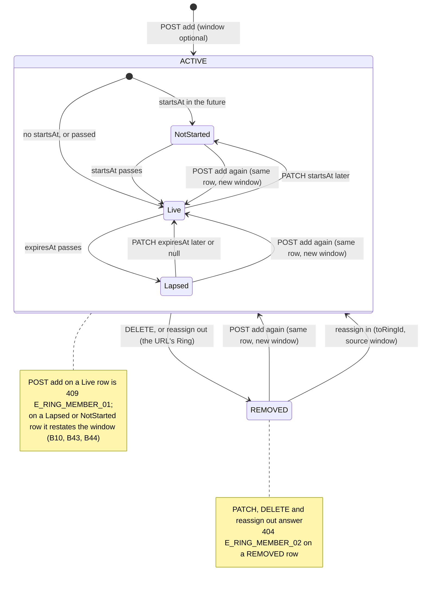

# 🧪 Ring Members · QA Backend

> ⚠ Affected by [[BD-17 Ring Invitations & Join Backend Delivery]] (2026-11-08): backend main 1c460b0: RingMemberEntity carries origin (PLACED, INVITATION, JOIN_CODE, JOIN_REQUEST) on every members route; add and reassign always write PLACED, even on a row first made by joining knowingly (/qa)

**Feature:** [[F-09 Ring Members]] · **Verifies:** [[BD-09 Ring Members Backend Delivery]] against [[S-16 Ring Members Story]] and [[FR-09 Ring Members Frontend Requirements]], on the contract [[BI-06 Ring Members Backend Integration]] · **Verdict:** ✅ Passing · 2026-11-08 · `main @ e483d49 · localhost:3109, Node 22.22.2` · 44 of 44 rows pass; [[B-09 Re-adding a lapsed member answers 409, not a reactivation|B-09]] and [[B-10 Adding an unknown userId answers 500|B-10]] fixed and closed

Expected behaviour of the API, as artefacts a person can check a build against: tables and diagrams, **not test code** (the specs live in the backend repo). `status: passing` or `failing` after a run; the verdict tells the PM whether the story can be fulfilled (passing with nothing pending or unmet). A failing row is one of two things: a story part the delivery does not fulfil (not built, or built other than the story says) goes in `unmet` and turns the story's badge ✕; a bug (built as asked, but it breaks) is filed against the Backend Integration and goes in `pending`, and leaves the story alone.

## Scope

**Covered.** The five routes of [[BI-06 Ring Members Backend Integration]] under `rings/:ringId/members`: the roster (order, the `status` filter, paging, `meta.total`), add with an optional window and its upsert, the window edit with `null` clearing a bound, reassign (direction, same owner, both rows in one step), remove, and the owner-or-admin gate (`assertCanAdminister` at `MEMBER_MANAGER`). Also the live effect of each write on what the person sees (`GET /views/pin/:pinName`, the next request after the write), and that a member never reads a membership row.

**Not covered.** The story parts [[S-16 Ring Members Story]] itself marks *Not available yet*, which belong to other stories: names and search on the roster (S1, [[S-23 Connections Story]]); the Pending filter and join requests (S1, S9, [[S-33 Ring Invitations & Join Story]]); which of my Rings one person is in, in one call, and disconnect (S5); recording how a membership was created (S7, [[D-18 Ring names shown when joined knowingly]]); members who may see each other (S8, [[S-18 Rings Story|Rings · S9]]). Nothing tested here contradicts them, so `unmet` is empty. The Ring's own window (whichever ends first) is [[F-08 Ring Access Engine]]'s QA. The screens are QA Frontend's.

**Test data.** A throwaway database `social_pin_qa_f09` on localhost:5432, migrated and seeded fresh for each run (`main @ 12172c6` on 2026-11-05, `main @ e483d49` on 2026-11-08), dropped after each. The 2026-11-08 re-run also signed up **DanaQA** (`dana.qa09@socialpin.test`) and deleted the account through `DELETE /users/me`, for B42. Seed users signed in through the OTP flow (`devCode`): **Sara** (`sara@socialpin.test`, the owner: Rings *E-commerce Clients*, *Family*, *My Ring*), **Omar** (`omar@socialpin.test`, a member of Sara's *E-commerce Clients*; owner of his own *My Ring*), **GulfExpo** (`organizer@socialpin.test`, a member of Sara's *Family*; made a delegated admin), **SPAdmin** (`admin@socialpin.test`, a stranger to Sara), and **LinaQA** (`lina.qa09@socialpin.test`, a stranger, signed up through the three-call flow for this run). Sara created two Rings for the run, *QA Roster* and *QA Temp* (deleted at once, for B36).

**Set up by SQL, in the throwaway database only.** No route creates a block or a delegated admin, so these rows were written with the backend's `pg` package: a `user_blocks` row Sara → SPAdmin, then SPAdmin → Sara (B12, each removed after its row); a `ring_admins` row GulfExpo at `MEMBER_MANAGER` on Sara's *E-commerce Clients* (B38) and a second on Omar's *My Ring* (B27). `RING_ADMIN_LEVEL` has no level below `MEMBER_MANAGER`, so there is no "admin too low" row: any admin row passes the gate. The transaction id check in B24 read `xmin` from `ring_members`.

## Expected behaviour

Every row is one criterion of [[S-16 Ring Members Story]] or one contract line of [[BI-06 Ring Members Backend Integration]], checked against the build in the verdict. ✅ as expected · 🔴 differs · ⬜ not run. Error bodies on this build carry `statusCode`, `message`, `error`, `path`, `timestamp` and **no `ErrorCode`** ([[BD-35 Error Contract Backend Delivery]], [[S-87 Error Contract Story|Error Contract · S4–S8]]); a code in the *Then* column is the one the service throws, recognised on the wire by its status and message (see the error matrix).

### `GET /rings/:ringId/members` — S1 the roster

| # | Given | When | Then | Checked |
|---|---|---|---|---|
| B1 | Sara, the owner of *E-commerce Clients* | `GET /rings/:ringId/members` | 200 `{ data, meta: { total } }`; each row has exactly `id`, `ringId`, `userId`, `status`, `addedById`, `startsAt`, `expiresAt`, `createdAt`, `updatedAt`, and `meta` only `total` | ✅ |
| B2 | four people added to *QA Roster* half a second apart: Lina, SPAdmin, Omar, GulfExpo | `GET …/members` | newest first: GulfExpo, Omar, SPAdmin, Lina; `meta.total: 4` | ✅ |
| B3 | SPAdmin then removed from *QA Roster* | `GET …/members?status=ACTIVE` | the three active rows only, `meta.total: 3` | ✅ |
| B4 | the same Ring | `GET …/members` (no filter), then `?status=REMOVED` | all four, the `REMOVED` row kept in place by `createdAt`, `meta.total: 4`; then only SPAdmin's row, `meta.total: 1` | ✅ |
| B5 | four rows | `GET …/members?limit=2&skip=1` | two rows, the 2nd and 3rd newest (Omar, SPAdmin); `meta.total: 4`, the **unpaginated** count | ✅ |
| B6 | any roster | `?limit=51`, then `?status=BOGUS` | 400 `["limit must not be greater than 50"]`; 400 `["status must be one of the following values: PENDING, ACTIVE, EXPIRED, REMOVED, LEFT"]` | ✅ |

### `POST /rings/:ringId/members` — S2 add someone

| # | Given | When | Then | Checked |
|---|---|---|---|---|
| B7 | a person in none of Sara's Rings | `POST { userId }` | 201, `status: "ACTIVE"`, `startsAt: null`, `expiresAt: null`, `addedById` = Sara | ✅ |
| B8 | Lina, not in *E-commerce Clients* | `POST { userId, startsAt: <1 h ago>, expiresAt: <in 30 days> }` | 201 with both bounds echoed | ✅ |
| B9 | SPAdmin's row in *QA Roster* is `REMOVED` | `POST { userId, expiresAt: <in 10 days> }` | 201 on the **same row** (same `id`, `createdAt` kept), `status: "ACTIVE"`, the new window, `addedById` = Sara | ✅ |
| B10 | Lina's row in *QA Roster* is `ACTIVE` with `expiresAt` yesterday (**lapsed**) | `POST { userId, expiresAt: <in 10 days> }` | 201, the row reactivated with the new window (BI-06 Flow 2, S2 "Re-adding someone who was removed or lapsed reactivates them") | ✅ (was 🔴 on 12172c6, [[B-09 Re-adding a lapsed member answers 409, not a reactivation]], fixed) |
| B11 | Sara's own user id; then GulfExpo, a delegated admin, sending Sara's id | `POST { userId: <the owner> }` | 400 `E_RING_MEMBER_03` "The ring owner already sees every perspective of their own profile", both times | ✅ |
| B12 | a block Sara → SPAdmin; then instead SPAdmin → Sara | `POST { userId: <SPAdmin> }` | 409 `E_RING_MEMBER_04` "This user cannot be added" in both directions; the message never says "blocked" | ✅ |
| B13 | Omar, already active in *E-commerce Clients* | `POST { userId: <Omar> }` | 409 `E_RING_MEMBER_01` "This user is already an active member of the ring" | ✅ |
| B14 | any Ring | `POST { userId: "nope" }`, `POST {}`, `POST { …, expiresAt: "next week" }`, `POST { …, status: "ACTIVE" }` | 400 `["userId must be a UUID"]` (twice), `["expiresAt must be a valid ISO 8601 date string"]`, `["property status should not exist"]`; nothing written | ✅ |
| B15 | a well-formed UUID that is no user | `POST { userId: "00000000-0000-4000-8000-000000000001" }` | 409 `E_RING_MEMBER_04` "This user cannot be added", the block's body (BI-06 *Errors to handle*); nothing written | ✅ (was 🔴 500 on 12172c6, [[B-10 Adding an unknown userId answers 500]], fixed) |
| B16 | SPAdmin in **no** live row of Sara's (checked in the database first) | `GET /views/pin/SaraAz` as SPAdmin, then SPAdmin is added to *E-commerce Clients*, then the same call | 404 "This profile is not shared with you", then 200 with the *E-commerce Clients* projection: live on the next request | ✅ |
| B42 | DanaQA signed up and deleted through `DELETE /users/me`; separately a block Sara → SPAdmin | `POST { userId: <Dana> }`, `POST { userId: <SPAdmin> }`, `POST { userId: <a UUID that is no user> }` | 409 "This user cannot be added", the **same body** all three times: unknown, deleted and blocked cannot be told apart | ✅ |
| B43 | SPAdmin added to *Family* with `startsAt` tomorrow (**not started yet**) | `POST { userId }` with no window, then the same `POST` again | 201 on the same row, the window now open; then 409 `E_RING_MEMBER_01` (live). Re-adding a not-started row is the backend's choice; the contract names only lapsed | ✅ |
| B44 | SPAdmin's *Family* row lapsed a minute ago, so the view falls back to another Ring of Sara's | `POST { userId, expiresAt: <in 10 days> }`, then `GET /views/pin/SaraAz` as SPAdmin | 201 on the same `id`; the next view is the *Family* projection again ("Sara"): the re-add restores access at once | ✅ |

### `PATCH /rings/:ringId/members/:userId` — S3 the access window, S6 lapsed

| # | Given | When | Then | Checked |
|---|---|---|---|---|
| B17 | Lina active in *E-commerce Clients* | `PATCH { startsAt: <2 h ago>, expiresAt: <in 14 days> }` | 200, both bounds echoed, `updatedAt` moved | ✅ |
| B18 | both bounds set | `PATCH { expiresAt: null }`, then `PATCH { startsAt: null }` | 200: only `expiresAt` cleared ("until removed"), `startsAt` kept; then `startsAt` cleared too | ✅ |
| B19 | a window set | `PATCH {}` | 200, the row unchanged, `updatedAt` unchanged | ✅ |
| B20 | GulfExpo's row in *QA Roster* `REMOVED`; GulfExpo never in *E-commerce Clients* | `PATCH { expiresAt: null }` on each | 404 `E_RING_MEMBER_02` "Membership not found", both | ✅ |
| B21 | SPAdmin active in *E-commerce Clients* and in no other Ring of Sara's, seeing her pin | `PATCH { expiresAt: <a minute ago> }`, view; `PATCH { expiresAt: null }`, view; `PATCH { startsAt: <tomorrow> }`, view | the row stays `ACTIVE` (the backend never writes `EXPIRED`); views 404 (lapsed), 200 (extended through PATCH, no re-add), 404 (not started yet) | ✅ |
| B22 | any row | `PATCH { expiresAt: "tomorrow" }` | 400 `["expiresAt must be a valid ISO 8601 date string"]` | ✅ |

### `POST /rings/:ringId/members/:userId/reassign` — S4 bring people in from another Ring

| # | Given | When | Then | Checked |
|---|---|---|---|---|
| B23 | Omar active in *E-commerce Clients* with `expiresAt` in 10 days | Sara `POST /rings/<E-commerce>/members/<Omar>/reassign { toRingId: <Family> }` | 201, the body is the **target** row: `ringId` = *Family*, `ACTIVE`, the same `expiresAt`; the URL's Ring (*E-commerce Clients*) now holds Omar's row as `REMOVED` | ✅ |
| B24 | the same call | read both rows | both rows carry the same transaction id: one step, never in both Rings or neither | ✅ |
| B25 | Omar viewing Sara's pin | `GET /views/pin/SaraAz` before and after B23 | the *E-commerce Clients* projection ("Wholesale enquiries…"), then the *Family* one ("Sara", birthdate shown): changed on the very next request | ✅ |
| B26 | Sara, owner of *E-commerce Clients*, not of Omar's *My Ring* | `reassign { toRingId: <Omar's My Ring> }` | 403 `E_RING_05`: the target is checked with the same gate, so the owner meets 403 before the same-owner rule | ✅ |
| B27 | GulfExpo, a delegated admin of Sara's *E-commerce Clients* **and** of Omar's *My Ring* | `reassign` SPAdmin from Sara's Ring to Omar's | 400 `E_RING_07` "Both rings must belong to the same owner"; SPAdmin's row in Sara's Ring still `ACTIVE`, none written in Omar's | ✅ |
| B28 | any member | `toRingId` an unknown UUID; `"nope"`; missing | 404 `E_RING_02` "Ring not found"; 400 `["toRingId must be a UUID"]` twice | ✅ |
| B29 | Omar's source row now `REMOVED` (after B23); GulfExpo never in *E-commerce Clients* | `reassign { toRingId: <Family> }` | 404 `E_RING_MEMBER_02` "Membership not found", both | ✅ |
| B30 | Lina active in *E-commerce Clients*, and holding a lapsed row in *QA Roster* | `reassign { toRingId: <QA Roster> }` | 201: the target row (its old `id` and `createdAt`) reactivated with the source's window; the source row `REMOVED` | ✅ |

### `DELETE /rings/:ringId/members/:userId` — S5 remove

| # | Given | When | Then | Checked |
|---|---|---|---|---|
| B31 | SPAdmin active in *E-commerce Clients* | `DELETE …/members/<SPAdmin>` | 200, empty body; the row is kept as `REMOVED` in the unfiltered roster and is gone from `?status=ACTIVE` | ✅ |
| B32 | that row `REMOVED`; Lina moved out by B30; SPAdmin never in *Family* | `DELETE` each | 404 `E_RING_MEMBER_02` "Membership not found", all three | ✅ |
| B33 | SPAdmin viewing Sara's pin, in no other Ring of hers | `GET /views/pin/SaraAz` before and after B31 | 200, then 404 "This profile is not shared with you" | ✅ |

### Owner or admin only — every route

| # | Given | When | Then | Checked |
|---|---|---|---|---|
| B34 | no token | `GET …/members` | 401 "Unauthorized" | ✅ |
| B35 | any caller | `GET /rings/not-a-uuid/members` | 400 "Validation failed (uuid is expected)" | ✅ |
| B36 | an unknown Ring id; a Ring Sara created and deleted | `GET …/members` as Sara | 404 `E_RING_02` "Ring not found", both | ✅ |
| B37 | SPAdmin, a stranger to the Ring | `GET …/members` | 403 `E_RING_05` "You are not permitted to administer this ring" | ✅ |
| B38 | GulfExpo, `MEMBER_MANAGER` on *E-commerce Clients* only | `GET`, then `POST { userId: <SPAdmin> }` on it; `GET` on *Family* | 200; 201 with `addedById` = GulfExpo; 403 `E_RING_05` on *Family* (where GulfExpo is only a member) | ✅ |

### S7 · the member side reads no membership row

| # | Given | When | Then | Checked |
|---|---|---|---|---|
| B39 | Omar, a member of *E-commerce Clients* (later of *Family*); GulfExpo, a member of *Family* | `GET …/members` on the Ring they are in | 403 `E_RING_05`, the body **identical** to the stranger's in B37 (apart from `path` and `timestamp`): no member oracle | ✅ |
| B40 | Omar, on his own row in *E-commerce Clients* | `PATCH …/<Omar>`, `DELETE …/<Omar>`, `POST { userId: <Lina> }`, `POST …/<Omar>/reassign` | 403 `E_RING_05` on all four; nothing written | ✅ |
| B41 | Omar, a member of *Family* | `GET /rings/<Family>` | 404 "Ring not found": the Ring is not readable by its member either | ✅ |

### Observed, not in the contract (no row fails)

- `PATCH { startsAt: <in 10 days>, expiresAt: <tomorrow> }` is accepted (200): an inverted window is stored and simply never opens. [[BI-06 Ring Members Backend Integration]] is silent on it.
- `reassign` with `toRingId` equal to the URL's Ring answers 201 and leaves the row as it was.
- `RING_MEMBER_STATUS` has a fifth value, `LEFT` (B6), which [[BI-06 Ring Members Backend Integration]]'s *Shapes that matter* does not list; nothing in these routes writes it. Flagged on BI-06.
- A reassign into a Ring where the person is already active overwrites their window there with the source's (seen through B30's upsert); S4 says the picker prevents picking them.

## State diagram

One row per `(ring, user)`, ever. The backend writes only `ACTIVE` and `REMOVED`; *not started*, *live* and *lapsed* are computed from the window on every request, never stored.

## Error matrix

The `ErrorCode` column is what [[BI-06 Ring Members Backend Integration]] promises and the service throws; **no body on this build carries it** ([[BD-35 Error Contract Backend Delivery]]). Every body is `{ statusCode, message, error: "HttpException", path, timestamp }`; validation errors carry `error: "Bad Request"` and a `message` array.

| Situation | Status | ErrorCode | Message on the wire | Same body as | Row |
|---|---|---|---|---|---|
| caller neither owner nor admin (a stranger, or a member of that Ring) | 403 | `E_RING_05` | "You are not permitted to administer this ring" | stranger and member identical | B37, B39, B40 ✅ |
| Ring unknown or deleted (URL or `toRingId`) | 404 | `E_RING_02` | "Ring not found" | unknown and deleted identical | B36, B28 ✅ |
| adding the owner | 400 | `E_RING_MEMBER_03` | "The ring owner already sees every perspective of their own profile" | — | B11 ✅ |
| a block either way, or a `userId` that is no user or a deleted one | 409 | `E_RING_MEMBER_04` | "This user cannot be added" | blocked (both directions), unknown and deleted identical | B12, B15, B42 ✅ |
| already a live member (window open now) | 409 | `E_RING_MEMBER_01` | "This user is already an active member of the ring" | — | B13, B43 ✅; a lapsed row is reactivated instead (B10 ✅) |
| no row, or a `REMOVED` row, for that user in that Ring | 404 | `E_RING_MEMBER_02` | "Membership not found" | missing and removed identical | B20, B29, B32 ✅ |
| reassign across owners (an admin of both) | 400 | `E_RING_07` | "Both rings must belong to the same owner" | — | B27 ✅ |
| malformed id, date, enum, limit or extra key | 400 | — | the `class-validator` messages | — | B6, B14, B22, B28, B35 ✅ |
| no token | 401 | — | "Unauthorized" | — | B34 ✅ |

## Privacy and access checks

- A member of the Ring → 403 on every members route, with the same body a stranger gets (B39, B40): the 403 does not tell a member from a stranger, and no route returns their own row.
- The roster row names the Ring (`ringId`); it was only ever returned to the owner and a delegated admin (B1, B38).
- A blocked pair, an unknown id and a deleted account are all refused with the same "This user cannot be added", never "blocked" or "not found" (B12, B15, B42): the add route is no probe for which ids exist.
- Lapsed, not yet started, removed and never added all answer the viewer the same 404 "This profile is not shared with you" (B16, B21, B33).

## Verdict

- **Run on:** 2026-11-08 · **build:** backend `main @ e483d49`, `localhost:3109`, Node 22.22.2, a fresh throwaway database `social_pin_qa_f09` (dropped after the run) · **result:** ✅ passing · **rows:** 44 run, 44 ✅ (all 41 rows of the first run again, plus B42–B44 for the fixes) · **failing rows:** none · **story parts unmet:** none · **bugs:** [[B-09 Re-adding a lapsed member answers 409, not a reactivation]] (B10) and [[B-10 Adding an unknown userId answers 500]] (B15) re-tested and closed, `done`, `resolution: fixed`.
- **Correction to the first run.** On 2026-11-05 SPAdmin was still a live member of *QA Roster* (re-added by B9) during B16, B21 and B33. Those views answered 404 only because of [[B-17 A new Ring answers 404 to its own owner until its projection is opened]], since fixed. On `e483d49` the same script showed 200 there, correctly. The three rows were re-run with SPAdmin first removed from every other Ring of Sara's (no live row left, checked in the database), and pass as written.
- First run: 2026-11-05 on `main @ 12172c6`, 41 rows, 39 ✅, B10 and B15 🔴 (B-09, B-10 filed).
- Blocks and delegated admins were set up by SQL in the throwaway database only (no route creates them), as listed under *Test data*.
- [[BI-06 Ring Members Backend Integration]] still lists four statuses where the enum has five (`LEFT`); that part of the flag is open for `/backend`. Its B-09 and B-10 parts are done.
- [[S-16 Ring Members Story]] is not ready to fulfil yet: this note passes with nothing pending or unmet, but QA Frontend has not run.

## Log

- 2026-11-05 · `docs/qa/M-01-identity/F-09-ring-members/QB-11-failing` · first run, 41 rows on `main @ 12172c6`: 39 pass, B-09 and B-10 filed against BI-06.
- 2026-11-05 · flagged [[BD-09 Ring Members Backend Delivery]]: QA run on main 12172c6: re-adding a lapsed member answers 409 E_RING_MEMBER_01, not the reactivation How it works describes (B-09); an unknown userId on add answers 500 (B-10)
- 2026-11-05 · flagged [[BI-06 Ring Members Backend Integration]]: QA run on main 12172c6: RING_MEMBER_STATUS has a fifth value LEFT that Shapes that matter does not list; re-adding a lapsed member answers 409 (B-09); an unknown userId on add answers 500, not in Errors to handle (B-10)
- 2026-11-08 · `docs/qa/M-01-identity/F-09-ring-members/QB-11-passing` · re-run on `main @ e483d49`: all 44 rows pass (B10 and B15 now ✅, B42–B44 added for the fixes; B16, B21, B33 re-run isolated, see the verdict). B-09 and B-10 closed on their own branches. Status → passing.
