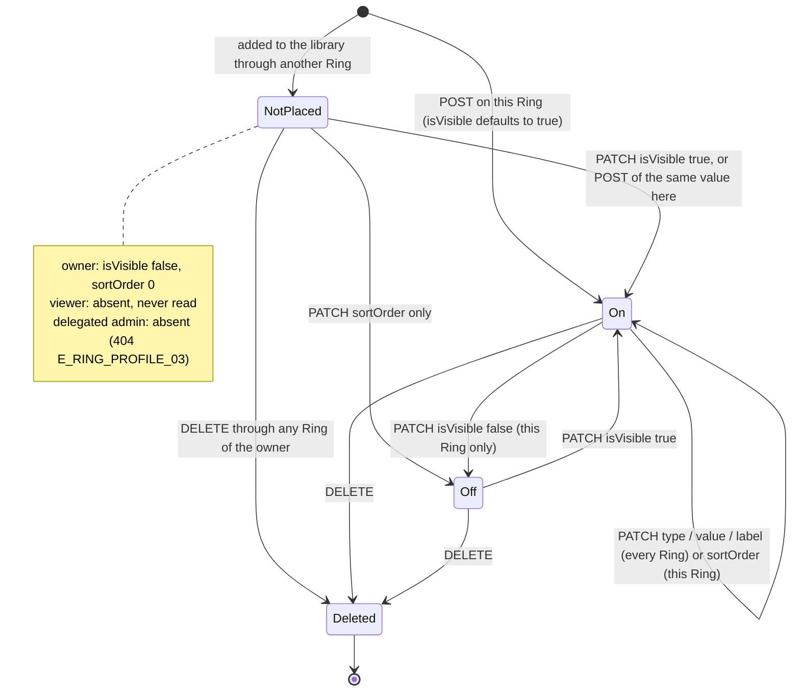

# 🧪 Ring Projection · QA Backend

**Feature:** [[F-10 Ring Projection]] · **Verifies:** [[BD-10 Ring Projection Backend Delivery]] against [[S-17 Ring Projection Story]] and [[FR-10 Ring Projection Frontend Requirements]], through the contract in [[BI-07 Ring Projection Backend Integration]] · **Verdict:** Passing on backend `main @ e483d49`, 2026-11-08 (failing on `12172c6`, 2026-11-05: [[B-11 Projection switches read any string as true]] and [[B-12 Null on a link or custom field's required field answers 500]], both fixed)

Expected behaviour of the API, as artefacts a person can check a build against: tables and diagrams, **not test code** (the specs live in the backend repo). `status: passing` or `failing` after a run; the verdict tells the PM whether the story can be fulfilled (passing with nothing pending or unmet). A failing row is one of two things: a story part the delivery does not fulfil (not built, or built other than the story says) goes in `unmet` and turns the story's badge ✕; a bug (built as asked, but it breaks) is filed against the Backend Integration and goes in `pending`, and leaves the story alone.

## Scope

**Covered:** the owner's projection on [[S-17 Ring Projection Story|S1–S7]] and [[S-17 Ring Projection Story|S9]] as [[BI-07 Ring Projection Backend Integration]] describes it on `main`: the read, `PATCH` of the surface (nickname, bio, `displayName`, `avatarFileId`, `themeConfig`, the five `show*`) and its limits; links and custom fields as **library items switched on per Ring** (S9, [[D-03 Links entered once, switched on or off per Ring]]); the five link types added by D-03 and per-type value validation (S5); attachments; the signed `avatarUrl` and `attachments[].url` ([[D-16 Files load from signed links that expire in 15 minutes]]); who may do what (owner, `CONTENT_MANAGER` delegated admin, `MEMBER_MANAGER` admin, member, stranger); and the error codes. Every write is checked from the viewer's side too, through `GET /views/ring/:ringId` as a member of each Ring, so a switch on one Ring is shown not to leak to the other.

**Not delivered yet, not tested:** S10, per field and per Ring (headline, role, company, location following the Pin, own value, or hidden; "Reset to Pin"). It is open on [[BD-10 Ring Projection Backend Delivery]]'s `pending` and listed under *Not available yet* in BI-07; its rows are added here when it ships. Widgets have no routes ([[F-13 Widgets]]). The viewer's own 404 bodies and pin lookups are [[BI-09 View As & Pin Views Backend Integration]]'s.

**The cast** (seed data plus three accounts made through sign-up for the run):

| Who | Is | Used as |
|---|---|---|
| Sara (`SaraAz`) | owner of **A** "E-commerce Clients", **B** "Family", her default "My Ring", and **F**, a Ring made during the run | the owner |
| Omar (`OmarK`) | member of A; owner of his own Ring; `MEMBER_MANAGER` admin of B | the member of A, another account's library, an admin too low to edit |
| GulfExpo | member of B | the member of B: checks that A's switches never reach B |
| QA Delegate | `CONTENT_MANAGER` admin of A | the delegated admin |
| QA Stranger | in no Ring of Sara's | the stranger |
| QA Orphan | owner of a Ring whose profile is gone | the `E_PROFILE_01` case |

No route appoints a Ring admin yet, so the two admin rows were written into the test database before the run; the Ring with no profile (B111) was prepared the same way. Sara's main profile was given a nickname ("Sari"), a gender, a marital status and a main photo through `PATCH /profiles/:id`, so the fallbacks and the sensitive fields have values to show.

**Error bodies.** Bodies are the API's `{ statusCode, message, error, path, timestamp }`; `ErrorCode` is not on the wire until [[S-87 Error Contract Story|Error Contract · S4–S8]], so the code column names what the contract promises, and the message identifies it.

## Expected behaviour

✅ as expected · 🔴 differs · ⬜ not run. "View A" / "view B" is `GET /views/ring/:ringId` as the member of that Ring.

### 1 · Reading the projection (S1)

| # | Given | When | Then | Checked |
|---|---|---|---|---|
| B1 | Ring A | the owner `GET /rings/:ringId/projection` | 200, the owner entity: `id`, `ringId`, `profileId`, `displayName`, `nickname`, `bio`, `avatarFileId`, `avatarUrl`, `themeConfig`, the five `show*`, `links[]`, `infoBlocks[]`, `widgets[]`, `attachments[]`, `createdAt`, `updatedAt`, nothing else | ✅ |
| B2 | Sara's library holds 5 links; A has rows for 3 of them (Telegram off) | the owner reads A | all 5 listed: A's rows first by A's order (WhatsApp Business on, LinkedIn on, Telegram off), then the 2 A never placed, `isVisible: false`, `sortOrder: 0` ("N of M on") | ✅ |
| B3 | — | the owner reads A | each `links[]` entry is exactly `{ id, type, label, value, sortOrder, isVisible }` | ✅ |
| B4 | the seeded LinkedIn, on in A, not on in B | the owner reads A and B | the same `id` in both (the library id); on in A, off in B | ✅ |
| B5 | a Ring just made with `POST /rings` | the owner reads it | 200, projection created on first access: the five `show*` `false`, the library listed all off, no attachments | ✅ |
| B6 | Omar, a member of A | reads A's projection | 403 `E_RING_05` | ✅ |
| B7 | a stranger | reads A's projection | 403 `E_RING_05` | ✅ |
| B8 | Omar, `MEMBER_MANAGER` admin of B | reads B's projection | 403 `E_RING_05` (below `CONTENT_MANAGER`) | ✅ |
| B9 | the `CONTENT_MANAGER` admin of A | reads A's projection | 200 with **only** A's 3 rows; Website and Instagram (the owner's other audiences) are not read | ✅ |
| B10 | — | a Ring id that does not exist | 404 `E_RING_02` | ✅ |
| B11 | — | a Ring id that is not a uuid | 400 | ✅ |
| B12 | — | no bearer token | 401 | ✅ |

### 2 · The surface: nickname, bio, name, photo, theme, the five switches (S3, S4, S6)

| # | Given | When | Then | Checked |
|---|---|---|---|---|
| B13 | — | the owner `PATCH` A `{ nickname: "  Saz  ", bio }` | 200; nickname trimmed to "Saz"; view A shows both | ✅ |
| B14 | B13 done | the member of B reads B | B's own bio ("Sara") and the profile's nickname: A's edit stays on A | ✅ |
| B15 | the main profile's nickname "Sari" and bio set | `PATCH` A `{ nickname: null, bio: null }` | 200, owner sees `null`; view A shows "Sari" and the main bio: `null` follows the profile | ✅ |
| B16 | — | `PATCH` A `{ displayName: "Sara A." }`, then `{ displayName: null }` | view A shows "Sara A.", then "Sara Azzam" (the full name, never the nickname) | ✅ |
| B17 | a file Sara uploaded | `PATCH` A `{ avatarFileId }` | 200; owner `avatarUrl` and view A's `avatarUrl` both load that file | ✅ |
| B18 | the main profile has its own photo | `PATCH` A `{ avatarFileId: null }` | 200; owner `avatarFileId` and `avatarUrl` `null`; view A's `avatarUrl` loads the **main** photo | ✅ |
| B19 | a file Omar uploaded | Sara `PATCH` A `{ avatarFileId: <Omar's> }` | 400 `E_FILE_04` | ✅ |
| B20 | — | `avatarFileId` that names no file | 400 `E_FILE_04` | ✅ |
| B21 | — | `avatarFileId: "abc"` | 400 | ✅ |
| B22 | a birthdate, gender, marital status, phone and email on the profile and account | `PATCH` A with the five `show*` `true` | view A shows all five values | ✅ |
| B23 | B22 done; B shares phone and birthdate only | the member of B reads B | phone and birthdate; gender, marital status and email `null`: A's switches never reach B | ✅ |
| B24 | — | `PATCH` A with the five `show*` `false` | view A: all five `null` | ✅ |
| B25 | — | `PATCH` A `{ showEmail: "yes" }` | 400: `show*` are booleans | ✅ re-run 2026-11-08 on `main @ e483d49`: 400 "showEmail must be a boolean value" (on `12172c6` it was 200, stored `true`: [[B-11 Projection switches read any string as true]], fixed) |
| B26 | B's email switch off | `PATCH` B `{ showEmail: "false" }` | 200 with `showEmail: false` (BI-07 since 2026-11-08: the strings `"true"` / `"false"` are read as booleans, any other value is a 400); B's email stays hidden | ✅ re-run 2026-11-08 on `main @ e483d49`: 200, `showEmail: false`, the member of B gets `email: null` (on `12172c6` it was `showEmail: true` and the member saw Sara's email: [[B-11 Projection switches read any string as true]], fixed; this row expected a 400 before BI-07 said how strings are read) |
| B27 | — | `{ showPhone: null }` | 400 | ✅ |
| B28 | — | `displayName` 120 / 121, `nickname` 60 / 61, `bio` 2000 / 2001 characters | 200 at the limit, 400 one over, each | ✅ |
| B29 | — | `themeConfig` an object, then a string, then `null` | 200 stored as sent; 400; 200 cleared | ✅ |
| B30 | — | an unknown property (`ringId`) | 400 | ✅ |
| B31 | the member of A | `PATCH` A | 403 `E_RING_05` | ✅ |
| B32 | a stranger | `PATCH` A | 403 `E_RING_05` | ✅ |
| B33 | the `CONTENT_MANAGER` admin of A | `PATCH` A `{ bio }` | 200 | ✅ |
| B34 | — | `PATCH` an unknown Ring | 404 `E_RING_02` | ✅ |

### 3 · Links: one library, a switch per Ring (S5, S9)

| # | Given | When | Then | Checked |
|---|---|---|---|---|
| B35 | — | the owner `POST …/links` on A `{ type: GITHUB, value, label: "Code" }` | 201; on in A; the owner's read of B lists the same id, `isVisible: false`, `sortOrder: 0` | ✅ |
| B36 | B35 done | the members read A and B | view A has GitHub; view B does not | ✅ |
| B37 | B35's link, never on in B | `PATCH` B `…/links/:linkId { isVisible: true, sortOrder: 3 }` | 200; on in B with `sortOrder` 3; view B has it; A keeps its own order (0) | ✅ |
| B38 | on in A and B | `PATCH` A `{ value, label }` | 200; B's owner list and **both** views show the new value and label: edited everywhere | ✅ |
| B39 | on in A and B | `PATCH` A `{ isVisible: false }` | 200; owner list of A has it off; view A without it; view B still has it | ✅ |
| B40 | Telegram off in A; Website, Instagram, GitHub not on in A | view A | none of them, and none of their values anywhere in the body | ✅ |
| B41 | — | view A | a link is `{ id, type, label, value, sortOrder }`: no `isVisible`, and `id` is A's row id, not the library id | ✅ |
| B42 | a link id taken from view A | the owner `PATCH …/links/<that id>` | 404 `E_RING_PROFILE_03` | ✅ |
| B43 | the seeded LinkedIn | the owner `POST` it again on B (same type and value, another label) | 201; no new library item; the existing id switched on in B; its label unchanged | ✅ |
| B44 | — | `POST` a second LinkedIn with another value and label "Work LinkedIn" | 201; two LINKEDIN items | ✅ |
| B45 | Website, never placed in B | `PATCH` B `{ sortOrder: 5 }` only | 200; placed in B **off** with `sortOrder` 5; not in view B | ✅ |
| B46 | a link of Omar's library | Sara `PATCH` it through A | 404 `E_RING_PROFILE_03` | ✅ |
| B47 | the same | Sara `DELETE` it through A | 404 `E_RING_PROFILE_03` | ✅ |
| B48 | — | an id that names no link | 404 `E_RING_PROFILE_03` | ✅ |
| B49 | — | a link id that is not a uuid | 400 | ✅ |
| B50 | a link on in A and B | the owner `DELETE` it through A | 200; gone from the owner's lists of A and B and from view B | ✅ |
| B51 | B50 done | `DELETE` it again | 404 `E_RING_PROFILE_03` | ✅ |
| B52 | the `CONTENT_MANAGER` admin of A | `PATCH` one of A's links `{ isVisible }` | 200: switching and ordering are theirs | ✅ |
| B53 | the same | `PATCH` its `value` | 403 `E_RING_05` "Only the Ring's owner can change this for every Ring" | ✅ |
| B54 | the same | `DELETE` it | 403 `E_RING_05` | ✅ |
| B55 | the same | `PATCH` a library link A has no row for (Instagram) | 404 `E_RING_PROFILE_03` | ✅ |
| B56 | the same | `POST` a link on A | 201; it lands in **Sara's** library (her read of B lists it, off) | ✅ |
| B57 | the member of A | `POST` a link on A | 403 `E_RING_05` | ✅ |
| B58 | the member of A | `PATCH` a link of A | 403 `E_RING_05` | ✅ |
| B59 | a stranger | `DELETE` a link of A | 403 `E_RING_05` | ✅ |
| B60 | — | `POST` a link on an unknown Ring | 404 `E_RING_02` | ✅ |
| B61 | — | `label` 61 characters | 400 | ✅ |
| B62 | — | `value` over 500 characters | 400 | ✅ |
| B63 | — | `type` not a `LINK_TYPE` | 400 | ✅ |
| B64 | a link | `PATCH { value: null }` | 400 | ✅ re-run 2026-11-08 on `main @ e483d49`: 400 "value must be a string" (on `12172c6` a 500: [[B-12 Null on a link or custom field's required field answers 500]], fixed) |
| B65 | a link | `PATCH { type: null }` | 400 | ✅ re-run 2026-11-08 on `main @ e483d49`: 400 "type must be one of the following values …" (on `12172c6` a 500, B-12) |
| B66 | a link with a label | `PATCH { label: null }` | 200, label cleared | ✅ |
| B67 | a link | `PATCH { isVisible: null }` | 400 | ✅ re-run 2026-11-08 on `main @ e483d49`: 400 "isVisible must be a boolean value" (on `12172c6` a 500, B-12) |

### 4 · Link types and their values (S5)

| # | Given | When | Then | Checked |
|---|---|---|---|---|
| B68 | — | `POST` `BOOKING` (calendly.com), `BEHANCE`, `DRIBBBLE`, `GITHUB`, `YOUTUBE` (youtu.be), each an `https` URL | 201 each, stored with its own type | ✅ |
| B69 | — | the same five with `calendly.com/saraaz` (no scheme) | 400 `E_RING_PROFILE_03` each, with a human message ("BOOKING links must be an absolute URL") | ✅ |
| B70 | — | `YOUTUBE` `javascript:alert(1)`, `BEHANCE` `data:text/html,…`, `DRIBBBLE` `ftp://…` | 400 `E_RING_PROFILE_03` each ("… must use http or https") | ✅ |
| B71 | — | `PHONE`, `WHATSAPP`, `WHATSAPP_BUSINESS` with E.164; then `0501234567`, `abc`, `+0123` | 201 ×3; 400 `E_RING_PROFILE_03` ×3 | ✅ |
| B72 | — | `EMAIL` an address; then `not-an-email` | 201; 400 `E_RING_PROFILE_03` | ✅ |
| B73 | — | `LOCATION` `25.2048,55.2708`; then `Dubai` | 201; 400 `E_RING_PROFILE_03` | ✅ |
| B74 | — | the ten other URL types with an `https` URL; then with `javascript:` | 201 each; 400 each | ✅ |
| B75 | a `YOUTUBE` link | `PATCH { type: PHONE }` only; then `{ type: GITHUB }` only | 400 `E_RING_PROFILE_03` (the stored URL is checked against the new type); 200 | ✅ |
| B76 | a URL-type link | `PATCH { value: "not a url" }` only | 400 `E_RING_PROFILE_03` | ✅ |
| B77 | — | the published contract (`/docs-json`) | `LINK_TYPE` has 20 values, the five included | ✅ |

### 5 · Custom fields (info blocks), the same rule (S7, S9)

| # | Given | When | Then | Checked |
|---|---|---|---|---|
| B78 | — | the owner `POST …/info-blocks` on A `{ title, body }` | 201; on in A; listed off in B (`sortOrder` 0); an entry is `{ id, title, body, sortOrder, isVisible }` | ✅ |
| B79 | B78's field | switch it on in B, then `PATCH` A `{ title, body }` | both views show the new title and body | ✅ |
| B80 | B79 done | `POST` the identical title and body on F | 201; no new library item; the same id on in F | ✅ |
| B81 | on in A and B | `PATCH` A `{ isVisible: false }` | view A without it (and without its body text); view B with it | ✅ |
| B82 | — | view B | a field is `{ id, title, body, sortOrder }`, `id` B's row id, not the library id | ✅ |
| B83 | the `CONTENT_MANAGER` admin of A | `PATCH` the field `{ isVisible, sortOrder }` | 200 | ✅ |
| B84 | the same | `PATCH { title }` | 403 `E_RING_05` | ✅ |
| B85 | the same | `DELETE` it | 403 `E_RING_05` | ✅ |
| B86 | the member of A | `POST` a field | 403 `E_RING_05` | ✅ |
| B87 | — | `title` 120 / 121, `body` 4000 / 4001, no `title` | 201, 400, 201, 400, 400 | ✅ |
| B88 | — | an id that names no field | 404 `E_RING_PROFILE_03` "Info block not found" | ✅ |
| B89 | a field of Omar's library | Sara `PATCH` it through A | 404 `E_RING_PROFILE_03` | ✅ |
| B90 | a field | `PATCH { title: null }` | 400 | ✅ re-run 2026-11-08 on `main @ e483d49`: 400 "title must be a string" (on `12172c6` a 500, B-12) |
| B91 | a field with a body | `PATCH { body: null }` | 200, body cleared | ✅ |
| B92 | on in A, B and F | the owner `DELETE` it through A | 200; gone from B, F and view B | ✅ |
| B93 | B92 done | `DELETE` it again | 404 `E_RING_PROFILE_03` | ✅ |

### 6 · Attachments (S6, S7)

| # | Given | When | Then | Checked |
|---|---|---|---|---|
| B94 | a file Sara uploaded | `POST …/attachments` on A `{ fileId, label: "Portfolio" }` | 201; the entry has `id`, `label`, `sortOrder`, `isVisible`, `fileId`, `filename`, `mimeType`, `sizeBytes`, `url` | ✅ |
| B95 | B94's `url` | `GET` it with no bearer token | 200 `image/png`, the uploaded bytes | ✅ |
| B96 | B94 done | view A | the attachment as `{ id, label, filename, mimeType, sizeBytes, url }`: no `fileId`, no `isVisible`; its `url` loads | ✅ |
| B97 | a file Omar uploaded | Sara attaches it to A | 400 `E_FILE_04` | ✅ |
| B98 | — | a `fileId` that names no file | 400 `E_FILE_04` | ✅ |
| B99 | — | `fileId: "abc"` | 400 | ✅ |
| B100 | — | `label` 61 characters | 400 | ✅ |
| B101 | — | attach a second file `{ isVisible: false }` | 201; the owner gets it **with** a `url`; view A does not list it at all | ✅ |
| B102 | the member of A | attaches a file | 403 `E_RING_05` | ✅ |
| B103 | an attachment on B | `DELETE` it through A | 404 `E_RING_PROFILE_04` | ✅ |
| B104 | B94's attachment; the same file also attached on B | `DELETE` it through A | 200; gone from view A; the file still in Sara's library (`GET /files/:id` 200); B's attachment untouched | ✅ |
| B105 | B104 done | `DELETE` it again | 404 `E_RING_PROFILE_04` | ✅ |
| B106 | the member of B | `DELETE` an attachment of B | 403 `E_RING_05` | ✅ |

### 7 · Signed links (D-16)

| # | Given | When | Then | Checked |
|---|---|---|---|---|
| B107 | an attachment `url` | the token altered by one character; a made-up token | 404 each | ✅ |
| B108 | any `url` | read it | `/api/v1/files/content/<token>` ([[BI-03 Files Upload Backend Integration]]: relative without `PUBLIC_BASE_URL`); the file id is not in it | ✅ |
| B109 | the Ring's own photo | two reads | two different links, both load: every read hands out a fresh one | ✅ |
| B110 | an `avatarUrl` handed out at B17 | `GET` it more than 15 minutes later (the file still exists) | 404 | ✅ 404 after 910 s |

### 8 · Errors that need their own setup

| # | Given | When | Then | Checked |
|---|---|---|---|---|
| B111 | a Ring with no projection, no profile of its own, and an owner whose default profile is deleted | the owner reads it | 409 `E_PROFILE_01` "This ring has no profile to present" | ✅ |
| B112 | Ring F, soft-deleted with `DELETE /rings/:id` | the owner reads its projection | 404 `E_RING_02` | ✅ |

## State diagram

One library item (a link or a custom field) as one Ring sees it. The owner lists it in every state but *Deleted*; a viewer of that Ring gets it only while it is **On**.

## Error matrix

| Situation | Status | ErrorCode | Same body as |
|---|---|---|---|
| not the owner, not a `CONTENT_MANAGER`+ admin (member, stranger, `MEMBER_MANAGER`), any projection route | 403 | `E_RING_05` | — |
| a delegated admin changes or deletes a library item (`type`, `value`, `label`, `title`, `body`, `DELETE`) | 403 | `E_RING_05` | a different message: "Only the Ring's owner can change this for every Ring" |
| the Ring does not exist or is deleted | 404 | `E_RING_02` | — |
| a link value that does not match its type, on add or on a type / value change | 400 | `E_RING_PROFILE_03` | the message names the type and the rule |
| a link or field not in the owner's library, another account's, a viewer's row id, or (delegated admin) not on this Ring | 404 | `E_RING_PROFILE_03` | "Link not found" / "Info block not found", one body whichever reason |
| an attachment not on this Ring | 404 | `E_RING_PROFILE_04` | — |
| `avatarFileId` or `fileId` not a file the caller uploaded, or no such file | 400 | `E_FILE_04` | one body for both |
| the Ring has no profile to present | 409 | `E_PROFILE_01` | — |
| a field over its limit, a wrong type, an unknown property, a non-uuid id | 400 | — | the validation body |
| `E_RING_PROFILE_01`, `E_RING_PROFILE_02` | — | — | in the enum, returned by no route |
| a `show*` or `isVisible` switch that is not `true` / `false` (`"yes"`, `"0"`, `"1"`, `null`); the strings `"true"` / `"false"` are read as booleans | 400 | — | the validation body (fixed on `e483d49`, [[B-11 Projection switches read any string as true]]) |
| `null` for a link's `type`, `value`, `isVisible` or a field's `title` | 400 | — | the validation body (fixed on `e483d49`, [[B-12 Null on a link or custom field's required field answers 500]]) |

## Privacy and access checks

- A member reads only what their Ring has on: off rows and library items the Ring never placed are not in the body, values included (B40, B81, B101).
- A switch, a `show*` flag, a nickname or a bio set on one Ring never shows on another (B14, B23, B36, B39, B81).
- A viewer never gets a library id or a `fileId`: links, fields and attachments carry the Ring's row ids (B41, B82, B96), so two Rings of one person share no id with their viewers.
- A delegated `CONTENT_MANAGER` sees and switches only the items of their Ring, cannot change or delete what other Rings show, and adds into the owner's library (B9, B52–B56, B83–B85).
- Another account's link, field or file is unreachable through your Ring (B19, B46, B47, B89, B97).
- A switch sent as a string never shares by accident: `"false"` keeps the field hidden and any other string is refused (B25, B26; on `12172c6` it shared the email, [[B-11 Projection switches read any string as true]], fixed on `e483d49`).

## Verdict

- Run on: 2026-11-08 · build: backend `main @ e483d49` · localhost:3110, a fresh throwaway database `social_pin_qa_f10` (migrated and seeded from that commit, dropped afterwards), Node 22.22.2 · result: **passing**, 112 of 112 rows ✅: every row re-run on this build but B110, the 15-minute expiry, which passed on `12172c6` and whose link code did not change. Nothing else moved, though the view path changed in between (a Ring with no projection now renders as the empty one) · story parts unmet: none (S10 is not delivered yet, open on [[BD-10 Ring Projection Backend Delivery]]) · bugs: none open ([[B-11 Projection switches read any string as true]] and [[B-12 Null on a link or custom field's required field answers 500]] closed, fixed)
- Run on: 2026-11-05 · build: backend `main @ 12172c6` · localhost:3110, throwaway database `social_pin_qa_f10` (migrated and seeded from that commit), Node 22.22.2 · result: **failing**, 106 of 112 rows ✅, 6 🔴 (B25, B26, B64, B65, B67, B90), none ⬜ · story parts unmet: none (S10 is not delivered yet, open on [[BD-10 Ring Projection Backend Delivery]]) · bugs: [[B-11 Projection switches read any string as true]], [[B-12 Null on a link or custom field's required field answers 500]]

## Log

- 2026-11-05 · written and run on backend `main @ 12172c6` (localhost:3110, throwaway database `social_pin_qa_f10`, dropped afterwards): 112 rows; failing; filed [[B-11 Projection switches read any string as true]] (B25, B26) and [[B-12 Null on a link or custom field's required field answers 500]] (B64, B65, B67, B90) against [[BI-07 Ring Projection Backend Integration]]. S10 not delivered yet, no rows.
- 2026-11-08 · re-run on backend `main @ e483d49` (fresh throwaway database, dropped afterwards): all rows but B110 again; B25, B26, B64, B65, B67, B90 now ✅; B26's expectation follows [[BI-07 Ring Projection Backend Integration]] as it now reads (`"false"` is false). Passing; [[B-11 Projection switches read any string as true]] and [[B-12 Null on a link or custom field's required field answers 500]] closed (resolution fixed) on their own branches and removed from `pending`; the BD-10 flag cleared.
- 2026-11-05 · flagged [[BI-07 Ring Projection Backend Integration]]: failing on main 12172c6: a string for show* / isVisible is stored as true, so "false" turns sharing on (B-11); null on a link's type, value, isVisible or a field's title answers 500, not 400 (B-12); for /backend
