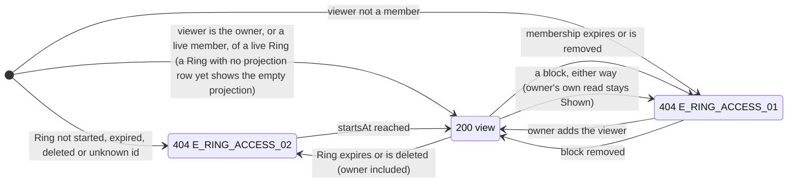

# 🧪 View As & Pin Views · QA Backend

> Blocked by default until [[BD-12 View As & Pin Views Backend Delivery]] is `done` (the hand-off order in `docs.config.json`); `blockedBy: []` opts out, `blockedBy: [...]` names other blockers.

**Feature:** [[F-12 View As & Pin Views]] · **Verifies:** [[BD-12 View As & Pin Views Backend Delivery]] against [[S-19 View As & Pin Views Story]] and [[FR-12 View As & Pin Views Frontend Requirements]], with the shapes and errors of [[BI-09 View As & Pin Views Backend Integration]] · **Verdict:** 🟢 Passing · 2026-11-09 · `main @ d8267d3 · localhost:3112, Node 22.22.2` · 74 of 74 delivered rows as expected, 1 not delivered yet (B32, BD-12 pending)

Expected behaviour of the API, as artefacts a person can check a build against: tables and diagrams, **not test code** (the specs live in the backend repo). `status: passing` or `failing` after a run; the verdict tells the PM whether the story can be fulfilled (passing with nothing pending or unmet). A failing row is one of two things: a story part the delivery does not fulfil (not built, or built other than the story says) goes in `unmet` and turns the story's badge ✕; a bug (built as asked, but it breaks) is filed against the Backend Integration and goes in `pending`, and leaves the story alone.

## Scope

**Covered.** The three viewer routes of [[BI-09 View As & Pin Views Backend Integration]] and what S-19 asks of them: open by Pin name (S4), one Ring by id for a scan and for the owner's View as (S1, S2, S3), every perspective of one person (S5), and the no-preview rule for an expired Ring (S6's backend half: the route answers 404). Also covered: the view's shape (no Ring, owner or membership on it; sensitive fields; hidden rows), the signed links of [[D-16 Files load from signed links that expire in 15 minutes]], with no file id on a view, the main-profile fields each Ring follows, owns or hides ([[S-17 Ring Projection Story|Ring Projection · S10]], as the views render them), and auth on all three routes.

**Not covered.** S2's owner face ("where each field goes") is worked out on the phone. S3's scan context, S7's Save contact and the screens' copy and motion are client work: the QA Frontend covers them. Connect, Block as a feature and the QR token are other features ([[S-23 Connections Story|Connections]], [[F-18 Badge & QR]]); the block rows here insert the block row directly, as below. `widgets[]` is on the view but no route writes a widget yet ([[BD-13 Widgets Backend Delivery]]), so it is checked only as an empty list.

**Accounts.** Seeded demo accounts, signed in with the one-time code from `devCode`: **Sara** (`SaraAz`, the owner), **Omar** (`OmarK`, put in Sara's *E-commerce Clients* first (by the seed), then *My Ring* (her default), *Family* and the Rings the run creates, in that order), the **organizer** (`GulfExpo`, put in *Family* first (by the seed), then *E-commerce Clients*, which is the older Ring; added to *My Ring* last, in B75) and the **admin** (`SPAdmin`, in no Ring of Sara's: the stranger). Two accounts were signed up for the auth rows, **dina** and **eli**; on 2026-11-08 dina was also added to *Fresh* alone for B64. Memberships, files, attachments, custom fields and the run's Rings (*TechSummit*, *FutureLaunch* starting 2027-01-01, *ToDelete*, *Fresh*) were made through the API. On *E-commerce Clients*: a hidden Telegram link (seeded), a hidden custom field "Private note", a hidden attachment "Internal margins", a visible custom field "Terms", a visible attachment "Price list" and a Ring photo. Sara's profile got `gender` and `maritalStatus` so that every sensitive field has a value.

**Set in the database.** These states have no route yet, so they were written with SQL through the project's `pg` package, in the throwaway database `social_pin_qa_f12` only (never `social_pin`): a `user_blocks` row in each direction between Sara and the organizer (then deleted), `rings.expires_at` in the past on *TechSummit*, `ring_members.expires_at` in the past on the organizer's *Family* membership, their first (then cleared), `users.status` `SUSPENDED` on dina and `DELETED` on eli.

## Expected behaviour

✅ as expected · 🔴 differs · ⏳ not delivered yet (a `pending` item of [[BD-12 View As & Pin Views Backend Delivery]]: the row records what the build does today and is not counted as a failure) · ⬜ not run. Bodies are the API's `{ statusCode, message, error, path, timestamp }`. `ErrorCode` is not on the wire until [[S-87 Error Contract Story|Error Contract · S4–S8]], so the code names what the contract promises and the run checks the status and the `message`: `E_RING_ACCESS_01` "This profile is not shared with you", `E_RING_ACCESS_02` "Ring is not available".

### Auth, on all three routes

| # | Given | When | Then | Checked |
|---|---|---|---|---|
| B1 | no `Authorization` header | `GET /views/pin/SaraAz` | 401 `{ statusCode: 401, message: "Unauthorized", error: "UnauthorizedException" }`, no code | ✅ |
| B2 | no `Authorization` header | `GET /views/ring/:ringId` | 401, the same plain body | ✅ |
| B3 | no `Authorization` header | `GET /views/user/:userId/perspectives` | 401, the same plain body | ✅ |
| B4 | a bearer token that is not a JWT | `GET /views/pin/SaraAz` | 401, the same plain body | ✅ |
| B5 | dina signed in, then her account set `SUSPENDED` | each of the three routes, with her still unexpired token | 401 `E_AUTH_03` "Account is not active", on all three | ✅ |
| B6 | eli signed in, then his account set `DELETED` | each of the three routes, with his still unexpired token | 404 `E_USER_01` "User not found", on all three | ✅ |

### `GET /views/pin/:pinName` — S4

| # | Given | When | Then | Checked |
|---|---|---|---|---|
| B7 | Sara | `GET /views/pin/SaraAz` (her own handle) | 200, her **default** Ring's view (*My Ring*) | ✅ |
| B8 | Omar, in Sara's default *My Ring*, but put in *E-commerce Clients* first ([[D-15 Several Rings per connection, remove or disconnect]]) | `GET /views/pin/SaraAz` | 200, the Ring he was **put in first** (*E-commerce Clients*), **not the default** | ✅ |
| B9 | the organizer, put in *Family* first, then *E-commerce Clients* (the older Ring) | `GET /views/pin/SaraAz` | 200, the Ring they were put in first (*Family*), not the oldest Ring | ✅ |
| B10 | the organizer | `GET /views/pin/saraaz` | 200, the same view as B9 (*Family*): the handle is matched normalised | ✅ |
| B11 | the admin, in none of Sara's Rings | `GET /views/pin/SaraAz` | 404 `E_RING_ACCESS_01` "This profile is not shared with you" | ✅ |
| B12 | the admin | `GET /views/pin/NoSuchPinXyz` | 404, **the same body as B11** apart from `path` and `timestamp` | ✅ |
| B13 | the admin | `GET /views/pin/!!bad%20name` | 404, the same body as B11 apart from `path` and `timestamp` (no route validates a Pin name) | ✅ |
| B14 | Sara blocked the organizer | the organizer: `GET /views/pin/SaraAz` | 404, the same body as B11 apart from `path` and `timestamp` | ✅ |
| B15 | the organizer blocked Sara (the other direction) | the organizer: `GET /views/pin/SaraAz` | 404, the same body as B11 apart from `path` and `timestamp` | ✅ |
| B16 | Sara makes *Family* her default (`POST /rings/:id/default`) | Omar: `GET /views/pin/SaraAz` | 200, still *E-commerce Clients*: the owner's default does not decide what a viewer sees | ✅ |
| B17 | the organizer's *Family* membership (their first) has expired, the Ring is live | the organizer: `GET /views/pin/SaraAz` | 200, the next Ring they were put in (*E-commerce Clients*) | ✅ |
| B18 | the block of B14 removed | the organizer: `GET /views/pin/SaraAz` | 200, the *Family* view again on the next read | ✅ |
| B74 | Sara makes *Family* her default (as in B16) | Sara: `GET /views/pin/SaraAz` and her own `GET /views/user/<Sara>/perspectives` | the owner's own lookup follows her default: the Pin renders *Family*, her own perspectives start with *Family* | ✅ |
| B75 | Sara adds the organizer to *My Ring* after the others (her default, and her oldest Ring) | the organizer: `GET /views/pin/SaraAz`, then `GET /views/user/<Sara>/perspectives` | the later membership changes nothing first: the Pin is still *Family*; perspectives *Family*, *E-commerce Clients*, *My Ring*, the new membership last | ✅ |

### `GET /views/ring/:ringId` — S1, S2, S3, S6

| # | Given | When | Then | Checked |
|---|---|---|---|---|
| B19 | Sara | `GET /views/ring/<E-commerce Clients>` (View as) | 200 `RingProfileViewEntity` of that Ring | ✅ |
| B20 | Omar, a member | the same call | 200, the same Ring's view | ✅ |
| B21 | B19 and B20 | compare the two bodies | **identical**, apart from the signed tokens in `avatarUrl` and `attachments[].url`, which are minted per call: one code path for the owner and the member | ✅ |
| B22 | the admin | the same call | 404 `E_RING_ACCESS_01`, the same body as B11 apart from `path` and `timestamp` | ✅ |
| B23 | a block either way between Sara and the organizer | the organizer: the same call | 404 `E_RING_ACCESS_01`, the same body as B22 apart from `path` and `timestamp` | ✅ |
| B24 | that block in place | Sara: the same call (View as) | 200: the block does not touch the owner's own read | ✅ |
| B25 | the organizer's *Family* membership has expired, the Ring is live | the organizer: `GET /views/ring/<Family>` | 404 `E_RING_ACCESS_01`, the same body as B22 apart from `path` and `timestamp` | ✅ |
| B26 | Omar, a member of *TechSummit*: 200 before | `rings.expires_at` set a minute in the past, then the same call | 404 `E_RING_ACCESS_02` "Ring is not available" | ✅ |
| B27 | *TechSummit* expired | Sara: View as on it | 404 `E_RING_ACCESS_02`: View as is for live Rings ("This Ring has expired" on s31) | ✅ |
| B28 | *FutureLaunch*, `startsAt` 2027-01-01 | Omar, then Sara | 404 `E_RING_ACCESS_02` for both | ✅ |
| B29 | *ToDelete* deleted by Sara (`DELETE /rings/:id`, 200) | Omar, then Sara | 404 `E_RING_ACCESS_02` for both | ✅ |
| B30 | — | the admin: a well-formed uuid no Ring has | 404 `E_RING_ACCESS_02` "Ring is not available" | ✅ |
| B31 | — | `GET /views/ring/not-a-uuid` | 400 "Validation failed (uuid is expected)" | ✅ |
| B32 | *TechSummit* expired | the admin, **not a member**: `GET /views/ring/<TechSummit>` | **Not delivered yet (BD-12 pending).** Today: 404 `E_RING_ACCESS_02` "Ring is not available", the expired body, which differs from the not-shared body a non-member gets on a live Ring (B22). Whether a non-member gets the not-shared body instead waits on [[BD-08 Ring Access Engine Backend Delivery]] | ⏳ |
| B33 | *Fresh*, made by Sara with `POST /rings`, Omar a member, its projection never opened | Sara: View as on it (S1: "works on a Ring with almost nothing set") | 200, the **empty projection**: `pinName` "SaraAz", `displayName` "Sara Azzam", `headline`, `role`, `company`, `location` and the bio followed from the main profile (a new Ring follows all six), no `avatarFileId`, every sensitive field `null`, `links`, `infoBlocks`, `widgets`, `attachments` `[]`, no `ringId`. Failed on 12172c6 (404 not-shared, [[B-17 A new Ring answers 404 to its own owner until its projection is opened]]); passes on e483d49 | ✅ |
| B34 | the same Ring | Omar: `GET /views/ring/<Fresh>` | 200, byte for byte the body of B33. Failed on 12172c6 (B-17); passes on e483d49 | ✅ |
| B35 | Sara opens `GET /rings/<Fresh>/projection` once, which creates the projection row | Sara, then Omar: the same call | 200 for both, **byte for byte the body of B33**: the view does not change when the row is created | ✅ |
| B64 | dina, a member of *Fresh* only, its projection still never opened | `GET /views/pin/SaraAz`, then `GET /views/user/<Sara>/perspectives` | pin 200, the empty projection of B33; perspectives one entry, the same view | ✅ |
| B65 | B33, B34 and B64 have run | count the projection rows of *Fresh* in the database | still none: a viewer's read writes nothing | ✅ |

### `GET /views/user/:userId/perspectives` — S5

| # | Given | When | Then | Checked |
|---|---|---|---|---|
| B36 | Omar, put in *E-commerce Clients*, *My Ring* (default), *Family*, *TechSummit*, *FutureLaunch* (not started), *ToDelete*, *Fresh*, in that order | `GET /views/user/<Sara>/perspectives` | 200, six entries in the order he was put in them: *E-commerce Clients*, *My Ring*, *Family*, then the three run Rings; *FutureLaunch* left out. View 1 is what `/views/pin` shows him (B8) | ✅ |
| B37 | B36 | the entries' keys | no `ringId`, `id`, `userId`, owner id or `profileId` on any entry; the switcher indexes by position | ✅ |
| B38 | the admin | the same call | 200 `[]`, not a 404 | ✅ |
| B39 | — | a well-formed uuid no user has | 200 `[]` | ✅ |
| B40 | — | `…/user/not-a-uuid/perspectives` | 400 "Validation failed (uuid is expected)" | ✅ |
| B41 | Sara | her own user id | 200, every live Ring of hers, the default first | ✅ |
| B42 | Sara makes *Family* the default | Omar: the same call | unchanged: *E-commerce Clients*, *My Ring*, *Family*, …; the owner's default does not reorder a viewer's perspectives (her own do follow it, B74) | ✅ |
| B43 | a block either way between Sara and the organizer | the organizer: the same call | 200 `[]` | ✅ |
| B44 | *TechSummit* expired | Omar: the same call | five entries, *TechSummit* gone | ✅ |
| B45 | *Fresh* as in B33 | Omar: the same call, before and after Sara opens its projection | *Fresh* among the entries from the start, as its empty projection: six entries before and six after. Failed on 12172c6 (left out until the projection was opened, B-17); passes on e483d49 | ✅ |

### The view's shape — what a viewer may and may not receive

| # | Given | When | Then | Checked |
|---|---|---|---|---|
| B46 | Omar's view of *E-commerce Clients* (B20) | its keys | exactly `pinName`, `displayName`, `nickname`, `headline`, `role`, `company`, `location`, `bio`, `avatarUrl`, `themeConfig`, `birthdate`, `gender`, `maritalStatus`, `email`, `phone`, `links`, `infoBlocks`, `widgets`, `attachments`: **no `avatarFileId`, no `ringId`, no owner `userId`, no `profileId`, no membership, no `show*` flag or field mode, no Ring name** | ✅ |
| B47 | the same body | search it for the Ring's id, Sara's user id, her profile id | none of them appears anywhere | ✅ |
| B48 | *E-commerce Clients* shows email and phone | Omar's view | `email`, `phone` set; `birthdate`, `gender`, `maritalStatus` `null` though the profile has all three | ✅ |
| B49 | *Family* shows phone and birthdate | Omar's view | `phone`, `birthdate` set; `email`, `gender`, `maritalStatus` `null` | ✅ |
| B50 | Sara turns `showGender` and `showMaritalStatus` on, then off with `showEmail` | Omar reads after each | on: `gender` "FEMALE", `maritalStatus` "MARRIED"; off: all three `null` on the next read | ✅ |
| B51 | *E-commerce Clients* has a hidden Telegram link (on the owner's projection with `isVisible: false`) | Omar's view | `links` holds only WhatsApp Business and LinkedIn; the Telegram value appears nowhere in the body | ✅ |
| B52 | a hidden custom field "Private note" | Omar's view | `infoBlocks` holds only "Terms" | ✅ |
| B53 | a hidden attachment "Internal margins" | Omar's view | `attachments` holds only "Price list"; no link is made for the hidden file | ✅ |
| B54 | the same body | look for `isVisible` and `fileId` | neither appears; an attachment is `id`, `label`, `filename`, `mimeType`, `sizeBytes`, `url` | ✅ |
| B55 | the Ring sets no name | `displayName` | the profile's `fullName` ("Sara Azzam"), never the nickname | ✅ |
| B56 | *E-commerce Clients* has its own photo and an attachment | Omar reads it on `GET /views/ring/:ringId`, `GET /views/pin/SaraAz` and `GET /views/user/<Sara>/perspectives`; Sara reads `GET /rings/<E-commerce Clients>/projection` | **No file id on any `/views/*` route** ([[D-16 Files load from signed links that expire in 15 minutes]]): no `avatarFileId` key, no `fileId` anywhere, and none of the three uploaded file ids in any body text. The owner's projection still carries `avatarFileId` = the photo's id. Not delivered on 12172c6 and e483d49 (BD-12 pending); delivered on cb95a39 | ✅ |

### Main-profile fields resolved per Ring — S-17 S10 on views

[[S-17 Ring Projection Story|Ring Projection · S10]], [[D-02 One main profile every Ring starts from]], [[D-05 Inherit per field, copy without members]]: each of `headline`, `role`, `company`, `location` is the Ring's own value when it set one (**own**), else the main profile's current value (**follow**), and `null` when the Ring has it off (**off**). One field, `headline`, on two Rings of Sara's: *E-commerce Clients*, read by Omar, and *Family*, read by the organizer, a member of each.

| # | Given | When | Then | Checked |
|---|---|---|---|---|
| B66 | both Rings untouched: they follow | Omar reads *E-commerce Clients*, the organizer reads *Family* | both: `headline` "Operations lead, GCC logistics", `role` "Head of Operations", `company` "Azzam Trading", `location` "Dubai, UAE": the main profile's values | ✅ |
| B67 | Sara sets `headline` "Wholesale desk lead" on *E-commerce Clients* (`PATCH /rings/:id/projection`) | the same two reads | *E-commerce Clients* (own): "Wholesale desk lead"; *Family* (follow): still the main headline | ✅ |
| B68 | Sara changes her main headline to "Head of GCC operations" (`PATCH /profiles/:id`) | the same two reads | *Family* (follow): "Head of GCC operations" at once; *E-commerce Clients* (own): still "Wholesale desk lead" | ✅ |
| B69 | B68 | Omar: `GET /views/user/<Sara>/perspectives`; the organizer: `GET /views/pin/SaraAz` | perspectives, in Omar's membership order: *E-commerce Clients* its own value, then *My Ring* and *Family* the new main value, so one person's perspectives show different values; the organizer's Pin view (their first Ring, *Family*): "Head of GCC operations" | ✅ |
| B70 | Sara sets `showHeadline: false` on both Rings (off) | the same two reads | `headline` `null` on both; neither "Wholesale desk lead" nor "Head of GCC operations" appears anywhere in either body | ✅ |
| B71 | Sara sets `showHeadline: true` on both again | the same two reads | *E-commerce Clients*: "Wholesale desk lead" again (the own value was kept while off); *Family*: follows "Head of GCC operations" again | ✅ |
| B72 | B71 | the view's keys; Sara's `GET /rings/<E-commerce Clients>/projection` | the view has no `show*`, mode or follow key: nothing tells a viewer whether a value is the Ring's own or the main one. The owner's projection carries `showHeadline: true`, its own `headline` and the `headlineMode`, `roleMode`, `companyMode`, `locationMode`, `bioMode`, `photoMode` keys | ✅ |
| B73 | *Family* has no photo of its own; Sara sets a main-profile photo (`PATCH /profiles/:id` `avatarFileId`) | the organizer reads *Family* | `avatarUrl` set, the main photo, and it loads with no token (200 `image/png`); no `avatarFileId`, and the file id appears nowhere in the body | ✅ |

### Signed links on the view — D-16

| # | Given | When | Then | Checked |
|---|---|---|---|---|
| B57 | Omar's view (B20) | `GET` its `avatarUrl` with **no** bearer token | 200 `image/png`, the uploaded bytes, `Cache-Control: private, max-age=900` | ✅ |
| B58 | the same view | `GET` its `attachments[0].url` with no token | 200 `application/pdf`, the uploaded bytes | ✅ |
| B59 | both links | read them | neither names a file id | ✅ |
| B60 | `avatarUrl` with its token altered | `GET` it | 404 `E_FILE_01` "File not found" | ✅ |
| B61 | the admin's 404 of B22 | read it | no link at all: a person without access is handed none | ✅ |
| B62 | the two links of B57, B58 | `GET` them again 14 minutes after they were issued, no token | 200 `image/png` and 200 `application/pdf`, both still answer | ✅ |
| B63 | the same links | `GET` them 15½ minutes after they were issued | 404 `E_FILE_01` "File not found", both: waited out, not taken from the unit specs | ✅ |

## State diagram

What one viewer gets from `GET /views/ring/:ringId` for one Ring, resolved per request against `now`; `/views/pin` renders the first Ring in the *Shown* state, and `/perspectives` lists all of them, both in the order the viewer was put in them ([[D-15 Several Rings per connection, remove or disconnect]]); the owner's own lookup puts her default Ring first.

## Error matrix

| Situation | Route | Status | ErrorCode (promised) | Body on the wire | Same body as | Rows |
|---|---|---|---|---|---|---|
| no token, or not a JWT | all three | 401 | — | "Unauthorized", `error: "UnauthorizedException"` | itself on every route | B1–B4 |
| account suspended | all three | 401 | `E_AUTH_03` | "Account is not active" | — | B5 |
| account deleted | all three | 404 | `E_USER_01` | "User not found" | — | B6 |
| no such Pin name, malformed Pin name | pin | 404 | `E_RING_ACCESS_01` | "This profile is not shared with you" | not shared, blocked | B12, B13 |
| not shared (not a member, membership expired) | pin, ring | 404 | `E_RING_ACCESS_01` | "This profile is not shared with you" | no such Pin, blocked | B11, B22, B25 |
| blocked, either way | pin, ring | 404 | `E_RING_ACCESS_01` | "This profile is not shared with you" | no such Pin, not shared | B14, B15, B23 |
| nothing shared, blocked, unknown user | perspectives | 200 | — | `[]` | — | B38, B39, B43 |
| Ring expired, not started, deleted, unknown id | ring | 404 | `E_RING_ACCESS_02` | "Ring is not available" | the owner's and the member's are one body | B26–B30 |
| malformed `ringId` / `userId` | ring, perspectives | 400 | — | "Validation failed (uuid is expected)" | — | B31, B40 |
| expired Ring, viewer not a member | ring | 404 | not decided ([[BD-12 View As & Pin Views Backend Delivery]] pending) | "Ring is not available" today | — | B32 ⏳ |
| signed link forged, expired | `GET /files/content/:token` | 404 | `E_FILE_01` | "File not found" | — | B60, B63 |

## Privacy and access checks

- **No such Pin, not shared, blocked: one body.** B11, B12, B13, B14, B15 return byte-identical bodies apart from `path` and `timestamp`; B22, B23 and B25 return the same body on the Ring route. No retry hint differs by cause.
- **The view names no Ring.** No `ringId`, no Ring name, no owner id, no membership on any view or perspective entry (B37, B46, B47): a viewer learns *what* is shared, never *which* Ring.
- **Sensitive fields are the Ring's decision.** `null` unless that Ring's `show*` flag is on, and a change shows on the next read (B48–B50).
- **Hidden rows never reach the body.** Hidden links, custom fields and attachments are absent, not flagged; no `isVisible` (B51–B54).
- **Links only for what may be seen.** The links load without a token, name no file id, and a person refused access gets none (B57–B61). No `/views/*` route carries a file id: no `avatarFileId`, no `fileId`, the main photo too (B56, B73).
- **Main-profile fields are the Ring's decision.** Own, follow or off per field, resolved on every read; an off field's own value and the main value never reach the body, and the view carries no switch or mode (B66–B72).
- **One code path for View as.** The owner's View as and the member's view are the same body (B21); the owner gets the same 404 `E_RING_ACCESS_02` on an expired Ring (B27).
- **A known leak, waiting on BD-12.** A non-member who has an expired Ring's id gets "Ring is not available" where a live Ring would answer "not shared", so the body tells a stranger the id is a Ring that has expired (B32).

## Verdict

- Run on: 2026-11-09 · build: `main @ d8267d3 · localhost:3112, Node 22.22.2`, a fresh throwaway database `social_pin_qa_f12` (seeded, then dropped) · result: 🟢 passing, 74 of 74 delivered rows as expected · failing rows: none · not delivered yet: B32 (BD-12 pending, not a failure) · story parts unmet: none · bugs: none open.
- The order rows follow S-19 S4/S5 as changed on 2026-11-09 by [[D-15 Several Rings per connection, remove or disconnect]]: a viewer's `/views/pin` and perspectives go by the order they were put in a Ring. B8, B9, B10, B16, B17, B18, B25, B36, B42 and B69 were rewritten. B74 (the owner's own lookup follows her default) and B75 (a later membership goes last) are new.
- 72 rows were re-run on `d8267d3`: every `/views/*` row, auth, shape, the S10 rows and links B57–B61. B62 and B63 (the 15-minute link expiry) were not waited out again and stand from the 2026-11-05 run. `file-link.service.ts`, which signs the links and sets their 15-minute lifetime, has not changed since `12172c6`.
- Previous runs: 2026-11-08 on `cb95a39`, 🟢 passing, 72 of 72 (no file id on views, S10); 2026-11-08 on `e483d49`, 🟢 passing, 63 of 63 (B-17 closed); 2026-11-05 on `12172c6`, 🔴 failing, 58 of 61 (B-17).
- The backend half of S-19 holds on this build. What is left is BD-12's one pending item (row B32); the QA Frontend is still to be run.

## Log

- 2026-11-05 · written and run on `main @ 12172c6` (localhost:3112, throwaway database `social_pin_qa_f12`): 58 of 61 delivered rows as expected, B33, B34, B45 failing, filed [[B-17 A new Ring answers 404 to its own owner until its projection is opened]]; B32 and B56 recorded as not delivered yet (BD-12 pending)
- 2026-11-05 · flagged [[BI-09 View As & Pin Views Backend Integration]]: on main 12172c6, GET /views/ring/:ringId answers 404 E_RING_ACCESS_01 to the owner and to live members of a Ring made with POST /rings until the owner first opens GET /rings/:id/projection, and /perspectives leaves it out: B-17 (/backend)
- 2026-11-08 · re-run on `main @ e483d49` (localhost:3112, fresh throwaway database `social_pin_qa_f12`): 63 of 63 delivered rows as expected. B33, B34 and B45 now pass; B64 and B65 added (a viewer in the new Ring alone; reads write no projection row). B-17 closed on its own branch. Status → passing. B32 and B56 stay not delivered yet (BD-12 pending)
- 2026-11-08 · re-run on `main @ cb95a39` (localhost:3112, fresh throwaway database `social_pin_qa_f12`): 72 of 72 delivered rows as expected. B56 is now a real row and passes (no file id on any `/views/*` route; the owner's projection keeps `avatarFileId`). B46's key list now has `headline`, `role`, `company`, `location` and no `avatarFileId`. S-17 S10 rows B66–B73 added: follow, own and off for `headline` on two Rings, each read by its own member, plus the main photo. B56 removed from `pending`. Cleared the [[BD-10 Ring Projection Backend Delivery]] and [[BD-12 View As & Pin Views Backend Delivery]] flags. B32 stays not delivered yet (BD-12 pending)
- 2026-11-09 · re-run on `main @ d8267d3` (localhost:3112, fresh throwaway database `social_pin_qa_f12`): 74 of 74 delivered rows as expected. The order rows follow D-15 (S-19 S4/S5, 2026-11-09): B8, B9, B10, B16, B17, B18, B25, B36, B42 and B69 rewritten to the order the viewer was put in a Ring. Added B74 (the owner's own lookup follows her default) and B75 (a later membership goes last). Cleared the [[S-19 View As & Pin Views Story]] flag. B32 stays not delivered yet (BD-12 pending)
