# 🧪 Ring Invitations & Join · QA Backend

> Blocked by default until [[BD-17 Ring Invitations & Join Backend Delivery]] is `done` (the hand-off order in `docs.config.json`); `blockedBy: []` opts out, `blockedBy: [...]` names other blockers.

**Feature:** [[F-17 Ring Invitations & Join]] · **Verifies:** [[BD-17 Ring Invitations & Join Backend Delivery]] against [[S-33 Ring Invitations & Join Story]] and [[FR-17 Ring Invitations & Join Frontend Requirements]], with the shapes, errors and rules of [[BI-17 Ring Invitations & Join Backend Integration]] · **Verdict:** Passing on backend `main` `14c6916`, 2026-11-09: B1–B98, all as expected

Expected behaviour of the API, as artefacts a person can check a build against: tables and diagrams, **not test code** (the specs live in the backend repo). `status: passing` or `failing` after a run; the verdict tells the PM whether the story can be fulfilled (passing with nothing pending or unmet). A failing row is one of two things: a story part the delivery does not fulfil (not built, or built other than the story says) goes in `unmet` and turns the story's badge ✕; a bug (built as asked, but it breaks) is filed against the Backend Integration and goes in `pending`, and leaves the story alone.

## Scope

**Covered:** every row of BI-17's *Screens → calls*, *Shapes that matter*, *Errors to handle* and *Rules the UI must respect* that the API answers for, across S-33 S1–S3 and S5–S11:
- invitations: inviting, reading, accepting, declining, dismissing and withdrawing them, lapsing, a Ring that ended, blocks; a member who invites, and a delegated admin (S1, S2, S6);
- join codes: making them, the cap, invitation-only, turning one off, resolving a typed code or a scanned join QR, joining, every code that doesn't work, the try limit (S3, S7, S9);
- join requests on both sides, approval turned off later, approval across a block (S5, S8);
- Shared with me for placed and knowing rows, the member count and D-15's first Ring (S1);
- the member's card in a Ring, the colleagues, and *Leave this Ring* (S10, S11, [[S-16 Ring Members Story|Ring Members · S8]]).

**Not covered:**
- S4 (work email: not in this version, D-33) and S12 (notifications: [[F-39 Notifications]]). Not built, so not checked.
- The PM's open question in BD-17 (whether a placed member also picks a card and may leave). B84, B91 and B95 check what was built: a placed member reads the colleagues, but has no card read and no leave. If the PM decides otherwise, those rows change.
- Blocking a colleague with `POST /blocks`. BD-17 and BD-14 list it as `pending` (branch `FR-14/connection/block-a-colleague`, not on `14c6916`). The block rows here (B5, B29, B60, B74, B92) write the block directly.
- `ErrorCode` itself. It is not on the wire until [[S-87 Error Contract Story|Error Contract]] (BI-17: "branch on the status, and the message where two share a status"), so each error row checks the status, the message where it tells two cases apart, and that bodies which must match do match. The codes are listed for when they arrive. Only `E_RING_02`, `E_RING_03` and `E_RING_05` are in `related`: the F-17 codes (`E_RING_INVITATION_*`, `E_RING_JOIN_CODE_*`, `E_RING_JOIN_REQUEST_*`, `E_RING_MEMBER_05`) are not in [[Frontend Contract]] yet, which BD-17 flagged to `/frontend`.
- The screens: BI-17's *Checklist* is the client's. That belongs to [[Ring Invitations & Join QA Frontend]].

**How the run was made:** over HTTP against backend `main` `14c6916` (the merge of `FR-17/ring-invitation/picked-ring-and-roster`).
- **The build:** checked out alone, built with `nest build` and started on `localhost:3117` (Node 22). Before the run, `pnpm typecheck` was clean and `pnpm test` gave 47 suites, 1,047 tests passing.
- **The database:** `social_pin_qa_f17`, migrated with `prisma migrate deploy` and seeded. It was recreated before the second run and dropped after it.
- **The people:** fifteen, signed up through the OTP flow: Ola (who owns *Acme Team*, approval on, and *Acme Open*, approval off), Ali, Bea, Cem, Dia, Eli, Fay, Gus, Hal, Ivy, Jon, Kim, Lou, Max and Nia.
- **Writes to the database:** everything went through the API except these:
  - a block row, for B5, B29, B60, B74 and B92 (`POST /blocks` can't reach a colleague or a stranger: *Not covered*);
  - a Ring's `expires_at` set in the past (B26), an invitation's `lapses_at` and `created_at` (B27), and a code's `ends_at` (B57);
  - an admin row for Gus (B35: no route appoints admins yet);
  - Jon's failed tries aged 16 minutes (B66).
- **Reads from the database:** an invitation's and a request's status (B28, B68), membership counts and order (B74, B77, B87), and a row's status and card choice (B94, B97).
- **Two runs:** the first ended 94/98. Every failure was in the run script, not the API:
  - B55 matched "doesn't" with a straight apostrophe, but the API sends "doesn’t";
  - B58 made its one-use code on a Ring already at its 10 active codes;
  - B66 was declared with one argument too many;
  - B67 counted on B58.

  The rows were corrected, and B1–B98 were re-run on a freshly recreated database.

## Expected behaviour

"The card's 404" is `GET /views/ring/:ringId` answered for a Ring you may not see. "The not-shared body" is 404 `E_RING_ACCESS_01` "This profile is not shared with you". "Same body" means identical but for `path` and `timestamp`. A Ring id never appears in what an invitee, a code holder or a requester reads.

### Invite (S6, D-31)

| # | Given | When | Then | Checked |
|---|---|---|---|---|
| B1 | Ola owns *Acme Team* | Ola `POST /rings/:ringId/invitations { userId: Ali, expiresAt: +60 days }` | 201, `PENDING`, `invitee { pinName, displayName, headline, avatarUrl }`, `lapsesAt` 30 days after `createdAt` | ✅ |
| B2 | — | invite by `{ pinName }`, any case | 201 for the same person | ✅ |
| B3 | — | invite with both `userId` and `pinName`, or neither | 400 `E_RING_INVITATION_05`, both | ✅ |
| B4 | — | invite with `expiresAt` in the past, or before `startsAt` | 400 `E_RING_INVITATION_07`, both | ✅ |
| B5 | Max blocked Ola | invite an unknown Pin name, Ola herself, and Max | 409 `E_RING_INVITATION_02`, the same body for all three | ✅ |
| B6 | B1 | Ola invites Ali again | 409 `E_RING_INVITATION_03` ("already invited", owner and admins only) | ✅ |
| B7 | Cem is in no Ring of Ola’s | Cem invites someone to *Acme Team* | 403 `E_RING_INVITATION_04` | ✅ |
| B8 | — | invite to a Ring id that does not exist | 404 `E_RING_02` | ✅ |
| B9 | B1, B2 | Ola `GET /rings/:ringId/invitations`; Cem the same | Ola: 200, Ali and Bea `PENDING`, newest first, `meta.total` 2. Cem: 403 `E_RING_05` | ✅ |

### My invitations, accept, decline (S1, S2, D-31, D-36)

| # | Given | When | Then | Checked |
|---|---|---|---|---|
| B10 | B1 | Ali `GET /rings/invitations/mine` | 200, one row: `ringName` "Acme Team", `owner` and `invitedBy` as cards, the window, `lapsesAt`, `valid: true`, `business: null` | ✅ |
| B11 | B10 | the keys of that row | no `ringId`, colour, type, `purpose` or settings anywhere on it (D-36) | ✅ |
| B12 | Ali’s invitation is pending | Ali `GET /rings/shared-with-me`, `GET /views/ring/:ringId`; Ola `GET /rings/:ringId/members` | nothing granted: no row, the card’s 404, Ali not on the roster | ✅ |
| B13 | B12 | Ali `POST /rings/invitations/:id/accept` | 201 `{ ringId, ringName: "Acme Team" }` | ✅ |
| B14 | B13 | Ali reads Shared with me and the card; Ola reads the roster | a row naming "Acme Team" (D-18), the card opens, Ali on the roster with `origin: INVITATION` and the invitation’s window | ✅ |
| B15 | B13 | Ali accepts again; Ali’s mine list | 404 `E_RING_INVITATION_01`; the list is empty | ✅ |
| B16 | B2 | Cem accepts Bea’s invitation | 404 `E_RING_INVITATION_01` (not yours reads as not found) | ✅ |
| B17 | B2 | Bea `POST /rings/invitations/:id/decline` | 201; Bea’s list empty; Ola’s list shows Bea `DECLINED` | ✅ |
| B18 | B17 | Bea accepts after declining | 404 `E_RING_INVITATION_01` | ✅ |
| B19 | Fay has a valid invitation | Fay `POST /rings/invitations/:id/dismiss` | 409 `E_RING_INVITATION_06` (accept or decline it instead) | ✅ |

### Withdraw (S6)

| # | Given | When | Then | Checked |
|---|---|---|---|---|
| B20 | Ola invited Dia | Cem withdraws it | 403 `E_RING_05` | ✅ |
| B21 | B20 | Ola withdraws it | 201, `WITHDRAWN`; Dia’s list empty; Dia’s accept 404 | ✅ |
| B22 | B21 | Ola withdraws it again | 404 `E_RING_INVITATION_01` | ✅ |

### An invitation that is no longer valid, or lapsed (S1, S2, D-31)

| # | Given | When | Then | Checked |
|---|---|---|---|---|
| B23 | Ola invited Eli to *Pop-up*, then deleted *Pop-up* | Eli’s mine list | the row stays, `valid: false` | ✅ |
| B24 | B23 | Eli accepts | 404 `E_RING_ACCESS_02` "This invitation is no longer valid" | ✅ |
| B25 | B23 | Eli dismisses it | 201; the list is empty | ✅ |
| B26 | *Old Fair*’s end date has passed (written to the database) | Ola invites Nia to it | 409 `E_RING_03` | ✅ |
| B27 | Lou’s invitation was sent 31 days ago (its `lapses_at` set in the past) | Lou’s list; Ola’s list; Lou accepts | gone from both lists; accept 404 `E_RING_INVITATION_01` | ✅ |
| B28 | B27 | Ola invites Lou again | 201, a new invitation; the lapsed one reads `EXPIRED` | ✅ |
| B29 | Ola invited Max; then Max blocked Ola | Max’s mine list; Max accepts | the invitation is hidden; accept 404 `E_RING_INVITATION_01` | ✅ |

### A member who invites (S6, D-04)

| # | Given | When | Then | Checked |
|---|---|---|---|---|
| B30 | Ali is a member (B13); “members can invite” is off | Ali invites Cem | 403 `E_RING_INVITATION_04` | ✅ |
| B31 | Ola turns “members can invite” on | Ali invites Cem | 201 | ✅ |
| B32 | B31 | Ali invites Cem again, invites Ola, and an unknown Pin name | 409 `E_RING_INVITATION_02`, one body for all three: a member is never told who is already invited or in | ✅ |
| B33 | B31; Ola can see her roster | Ola invites Ali (already a member) | 409 `E_RING_MEMBER_01` (the owner may be told) | ✅ |
| B34 | Ali sent Cem’s invitation | Ali withdraws it | 201 `WITHDRAWN` (whoever sent it may) | ✅ |

### A delegated admin (S6, S7, S8)

| # | Given | When | Then | Checked |
|---|---|---|---|---|
| B35 | Gus is an admin of *Acme Team* at `MEMBER_MANAGER` (written to the database: no route appoints admins yet) | Gus lists the invitations, codes and requests, and invites Nia | 200, 200, 200, 201 | ✅ |

### Join codes, the owner’s side (S7, D-32, D-35)

| # | Given | When | Then | Checked |
|---|---|---|---|---|
| B36 | — | Ola `POST /rings/:ringId/join-codes { label: "Onboarding week" }` | 201: `code` 8 characters of `A–Z 2–9` without 0/O/1/I, `displayCode` `XXXX-XXXX`, `qrPayload` `socialpin://join/<code>`, `state: ACTIVE`, `useCount: 0` | ✅ |
| B37 | — | make a code with no label, a 41-character label, `useLimit: 0` | 400 each | ✅ |
| B38 | — | make a code whose `endsAt` has passed | 400 `E_RING_JOIN_CODE_06` | ✅ |
| B39 | — | Cem lists or makes *Acme Team*’s codes | 403 `E_RING_05`, both | ✅ |
| B40 | *Acme Open* has 9 active codes | make the 10th, then an 11th | 201, then 409 `E_RING_JOIN_CODE_03` | ✅ |
| B41 | B40 | turn one off, then make another | 201 `state: OFF` with `turnedOffAt`; then 201 (off codes do not count) | ✅ |
| B42 | — | turn off a code id that does not exist | 404 `E_RING_JOIN_CODE_05` | ✅ |

### Resolve and join with a code (S3, S9, D-32, D-35)

| # | Given | When | Then | Checked |
|---|---|---|---|---|
| B43 | B36 | Hal `POST /rings/join-codes/resolve` with the code in lower case, with the dash | 201 `{ ringName: "Acme Team", owner {…}, requireApproval: true, business: null }`, those keys only | ✅ |
| B44 | B36 | resolve the scanned QR text `socialpin://join/<code>` | the same review | ✅ |
| B45 | B43, B44 | Ola’s requests and roster | resolving made nothing: no request, no member | ✅ |
| B46 | *Acme Team* approves each one | Hal `POST /rings/join-codes/join { code }` | 201 `{ outcome: REQUESTED, ringName, ringId: null, requestId }` | ✅ |
| B47 | B46 | Hal joins again | 409 `E_RING_JOIN_REQUEST_02` | ✅ |
| B48 | B46 | Hal `GET /rings/join-requests/mine` | one row `{ id, status: PENDING, createdAt, ringName, business }`: no Ring id, no code label | ✅ |
| B49 | B46 | Ola `GET /rings/:ringId/join-requests` | Hal, with `person {…}` and `codeLabel: "Onboarding week"` | ✅ |
| B50 | B46 | Ola approves | 201, the membership with `origin: JOIN_REQUEST`; Hal’s list empty; Shared with me names "Acme Team" | ✅ |
| B51 | B50 | Ola approves again, declines it | 404 `E_RING_JOIN_REQUEST_01`, both | ✅ |
| B52 | B50 | the code’s `useCount` | 1 (one person, once) | ✅ |
| B53 | *Acme Open* joins at once | Ivy joins with its code | 201 `{ outcome: JOINED, ringId, requestId: null }`; the membership `origin: JOIN_CODE` | ✅ |
| B54 | B53 | Ivy joins again | 409 `E_RING_MEMBER_01`; `useCount` stays 1 | ✅ |

### A code that doesn’t work (S3, D-32)

| # | Given | When | Then | Checked |
|---|---|---|---|---|
| B55 | — | resolve a code that exists nowhere | 404 `E_RING_JOIN_CODE_01` "This code doesn't work" | ✅ |
| B56 | B41 | resolve the code that was turned off | the same body as B55 | ✅ |
| B57 | a code whose `endsAt` has passed (written to the database) | resolve it | the same body as B55; the owner’s list shows it `ENDED` | ✅ |
| B58 | a code with `useLimit: 1` that Fay used | Kim resolves it | the same body as B55; the owner’s list shows it `USED_UP` | ✅ |
| B59 | — | Ola resolves her own code | the same body as B55 | ✅ |
| B60 | Max blocked Ola | Max resolves her code | the same body as B55 | ✅ |
| B61 | *Pop-up* was deleted (B23) | resolve a code of a deleted Ring | the same body as B55 | ✅ |
| B62 | *Acme Open* switched to “only by invitation” after its codes were made | resolve one of its codes; make a new code; list the codes | the same body as B55; making one 409 `E_RING_JOIN_CODE_04`; the list still 200 (codes kept) | ✅ |
| B63 | — | resolve an empty code; a 65-character one | empty: the same body as B55; too long: 400 | ✅ |

### The try limit (D-32, proposed by the backend)

| # | Given | When | Then | Checked |
|---|---|---|---|---|
| B64 | Jon has tried no code yet | Jon resolves 10 wrong codes | 404 each | ✅ |
| B65 | B64 | Jon resolves a code that works, then joins with it | 429 `E_RING_JOIN_CODE_02` "Too many tries. Try again later.", both: the limit is checked before the code | ✅ |
| B66 | B64; Jon’s failed tries are 16 minutes old (written to the database) | Jon resolves the working code | 201: the window is rolling, 15 minutes | ✅ |
| B67 | Kim made several refused tries above (B55–B63) | a code that works resolves for Kim; working resolves do not count | 201; Kim’s failed tries equal the refusals only | ✅ |

### Join requests, both sides (S5, S8)

| # | Given | When | Then | Checked |
|---|---|---|---|---|
| B68 | Nia asked to join *Acme Team* with a code | Nia `DELETE /rings/join-requests/:id` | 200; `CANCELLED`; gone from Nia’s list and from Ola’s | ✅ |
| B69 | Nia asked again; Ola declines | Nia’s list | 201; the row reads `DECLINED` | ✅ |
| B70 | B69 | Nia `DELETE` it (dismiss) | 200; the list is empty | ✅ |
| B71 | B70 | Cem deletes Nia’s request; Nia deletes it again | 404 `E_RING_JOIN_REQUEST_01`, both | ✅ |
| B72 | Cem has no rights on *Acme Team* | Cem lists, approves or declines its requests | 403 `E_RING_05` | ✅ |
| B73 | Nia asked again; Ola then turns approval off | Ola’s list; Ola approves it | the request is still waiting; 201 `origin: JOIN_REQUEST` | ✅ |
| B74 | Max asked to join *Acme Team*; then Ola blocked Max (written to the database) | Ola approves | 409 `E_RING_MEMBER_04`; no membership | ✅ |

### Shared with me (S1, D-14, D-15, D-18)

| # | Given | When | Then | Checked |
|---|---|---|---|---|
| B75 | Ola placed Kim in *Acme Team* (owner add) | Kim’s Shared with me | one row: `ringName`, `memberCount`, `myCardRingId`, `myCardRingName` all null | ✅ |
| B76 | Ali joined knowingly (B13); “members can see each other” is off | Ali’s row | `ringName` "Acme Team", `memberCount` null; `myCardRingId` Ali’s default Ring, `myCardRingName` its name | ✅ |
| B77 | Ola turns “members can see each other” on | Ali’s row | `memberCount` = the live members of *Acme Team* | ✅ |
| B78 | Ivy was put in *Acme Open* first (B53, by code), then Ola placed her in *Acme Team* | Ivy’s row | it opens *Acme Open*, the first Ring (D-15), named because it was joined knowingly | ✅ |
| B79 | Kim was placed in *Acme Team* first (B75), then joined *Acme Open* with a code | Kim’s row | it opens *Acme Team*, unnamed: a Ring joined later is the next perspective | ✅ |

### Your card in this Ring (S10, D-34)

| # | Given | When | Then | Checked |
|---|---|---|---|---|
| B80 | Ali joined *Acme Team* knowingly; members can see each other | Ali `GET /rings/:ringId/my-card` | 200 `{ shownRingId: Ali’s default, shownRingName, picked: false, seenByMembers: true }`, those keys only | ✅ |
| B81 | Ali has a Ring *Work* whose card says "Ali at Work" | Ali `PUT /rings/:ringId/my-card { shownRingId: Work }` | 200 `{ shownRingId: Work, shownRingName: "Work", picked: true }`; Shared with me says the same | ✅ |
| B82 | B81 | Ali picks Ola’s Ring, Hal’s default Ring, a deleted Ring of hers | 400 `E_RING_MEMBER_05` each; the pick stays *Work* | ✅ |
| B83 | — | `PUT` with `{}`, with `shownRingId: "nope"` | 400 each, from validation; nothing reset | ✅ |
| B84 | Kim was placed in *Acme Team* (B75); Cem is in no Ring of Ola’s; Ola owns it | each `GET /rings/:ringId/my-card` | 404 `E_RING_ACCESS_01`, the same body for all three | ✅ |
| B85 | Ali deletes *Work* | Ali’s card read | back to the default Ring, `picked: false` | ✅ |
| B86 | members can see each other is off | Ali’s card read; Ali picks her default explicitly (`null`) | 200 `seenByMembers: false`; the choice is still saved | ✅ |

### Inside the Ring: colleagues and leave (S11, S-16 S8, D-34)

| # | Given | When | Then | Checked |
|---|---|---|---|---|
| B87 | members can see each other; Hal picked his *Desk* Ring ("Hal at the desk") | Ali `GET /rings/:ringId/colleagues` | 200: every other live member, newest first, never Ali or Ola; Hal’s `card` is his *Desk* card; `meta.total` = the list | ✅ |
| B88 | B87 | the rows on the wire | each `{ userId, card }` only; no Ring id or name anywhere (not *Desk*, not *Acme Team*) | ✅ |
| B89 | B87 | `?name=desk`; `?name=requester` | one match, Hal; none (Hal’s *Desk* card shows no "Requester") | ✅ |
| B90 | B87 | `?limit=1&skip=1` | one row, the second; `meta.total` the whole list | ✅ |
| B91 | Kim was placed (B75) | Kim reads the colleagues; Ali’s list | Kim: 200 (any member, S-16 S8); Kim is listed to Ali, on her default card | ✅ |
| B92 | Fay blocked Ali (written to the database) | Ali’s list; Fay’s list | neither lists the other | ✅ |
| B93 | — | Ola, Cem, and Ali while “members can see each other” is off | 404 `E_RING_ACCESS_01`, the same body for all three: nothing hints a list exists | ✅ |
| B94 | Ali picked *Desk2*; Ali joined knowingly | Ali `POST /rings/:ringId/leave` | 201; the card read 404; no Shared with me row for Ola; not on the colleagues; the roster row `LEFT` | ✅ |
| B95 | B94; Kim was placed | Ali leaves again; Kim leaves | 404 `E_RING_ACCESS_01`, both | ✅ |
| B96 | B94 | Ola invites Ali again; Ali accepts; Ali’s card read | back in, `picked: false`: the old choice ended with the membership | ✅ |
| B97 | Hal picked *Desk* (B87) | Ola removes Hal, then adds him back | his choice is gone: Ola’s roster never shows it, and as a placed member Hal is listed on his default card | ✅ |

### Signed out

| # | Given | When | Then | Checked |
|---|---|---|---|---|
| B98 | no bearer | invitations mine, codes resolve, join-requests mine, my-card, colleagues | 401 each | ✅ |

## State diagram

```mermaid
stateDiagram-v2
  state "Invitation" as I {
    [*] --> PENDING: invite (201)
    PENDING --> ACCEPTED: accept (201) · a membership, origin INVITATION
    PENDING --> DECLINED: decline (201)
    PENDING --> WITHDRAWN: withdraw (201)
    PENDING --> EXPIRED: 30 days pass (read as lapsed; written on the next invite)
    PENDING --> Invalid: the Ring ends or is deleted (valid: false)
    Invalid --> [*]: dismiss (201)
  }
  state "Join request" as R {
    [*] --> RPENDING: join with a code, approval on (REQUESTED)
    RPENDING --> APPROVED: approve (201) · a membership, origin JOIN_REQUEST
    RPENDING --> RDECLINED: decline (201)
    RPENDING --> CANCELLED: DELETE by the asker (200)
    RDECLINED --> [*]: DELETE by the asker (dismissed)
  }
  state "Membership" as M {
    [*] --> Member: accept · approve · code with approval off (JOINED, origin JOIN_CODE)
    Member --> Member: PUT my-card (the card choice)
    Member --> LEFT: leave (201) · choice cleared
    Member --> REMOVED: owner removes · reassign · block · disconnect · choice cleared
    LEFT --> Member: invited or joins again · choice starts at the default
  }
```

A code is `ACTIVE`, then `OFF` (turned off), `ENDED` (past `endsAt`) or `USED_UP` (uses = limit), in that order of precedence; only `ACTIVE` resolves.

## Error matrix

| Situation | Status | ErrorCode | Same body as | Row |
|---|---|---|---|---|
| invite with both or neither of `userId` and `pinName` | 400 | `E_RING_INVITATION_05` | — | B3 |
| a window that ends before it starts or in the past | 400 | `E_RING_INVITATION_07` | — | B4 |
| this person can't be invited: unknown, the owner, yourself, a block; to a member inviting, also already in or already invited | 409 | `E_RING_INVITATION_02` | each other | B5, B32 |
| already invited (owner and admins) | 409 | `E_RING_INVITATION_03` | — | B6 |
| already a member (owner and admins; a code join) | 409 | `E_RING_MEMBER_01` | — | B33, B54 |
| not permitted to invite | 403 | `E_RING_INVITATION_04` | — | B7, B30 |
| invite to a Ring that does not exist | 404 | `E_RING_02` | — | B8 |
| invite to a Ring that has ended | 409 | `E_RING_03` | — | B26 |
| not the owner or an admin: lists, codes, requests, withdraw | 403 | `E_RING_05` | — | B9, B20, B39, B72 |
| invitation not yours, answered, withdrawn, lapsed, or from across a block | 404 | `E_RING_INVITATION_01` | — | B15, B16, B18, B22, B27, B29 |
| accept on a Ring that ended or was deleted | 404 | `E_RING_ACCESS_02` | — | B24 |
| dismiss a valid invitation | 409 | `E_RING_INVITATION_06` | — | B19 |
| a code that doesn't work: unknown, off, ended, used up, own, blocked, a deleted Ring, invitation-only, empty | 404 | `E_RING_JOIN_CODE_01` | each other | B55–B63 |
| 10 refused codes in 15 minutes | 429 | `E_RING_JOIN_CODE_02` | — | B65 |
| an 11th active code | 409 | `E_RING_JOIN_CODE_03` | — | B40 |
| a code under "only by invitation" | 409 | `E_RING_JOIN_CODE_04` | — | B62 |
| turn off a code that does not exist | 404 | `E_RING_JOIN_CODE_05` | — | B42 |
| a code's end date not in the future | 400 | `E_RING_JOIN_CODE_06` | — | B38 |
| a bad label, limit or code length | 400 | — (validation) | — | B37, B63 |
| request not found, decided already, or not yours | 404 | `E_RING_JOIN_REQUEST_01` | — | B51, B71 |
| asked again while pending | 409 | `E_RING_JOIN_REQUEST_02` | — | B47 |
| approve across a block | 409 | `E_RING_MEMBER_04` | — | B74 |
| the picked Ring is not one of your own live Rings | 400 | `E_RING_MEMBER_05` | — | B82 |
| my-card or leave on a Ring you were placed in, are not in, own, or left; colleagues for the owner, a stranger, or while members can't see each other | 404 | `E_RING_ACCESS_01` | each other, and the card's 404 | B84, B93, B95 |
| no bearer | 401 | — | — | B98 |

## Privacy and access checks

- **A pending invitation or request grants nothing:** no Shared with me row, the card's 404, not on the roster (B12, B45).
- **The invitee, the code holder and the requester see the Ring's name and nothing else of it:** no Ring id before joining, no colour, type, `purpose` or settings, and no code label (B11, B43, B48).
- **The member side tells nothing about why it refuses:** a placed member, a stranger and the owner get the same 404 from my-card, leave and colleagues (B84, B93, B95). While members can't see each other, a member gets that 404 too, so nothing hints that a list exists (B93).
- **A colleague is seen only as the card they picked:** no Ring id or name on the wire, neither the joined Ring's nor the picked one's (B88). Name search never matches a name that card doesn't show (B89). A blocked pair never appears in each other's list (B92).
- **The card choice ends with the membership:** leave, removal and joining again all start over at the default Ring, and the owner's roster never shows the choice (B94, B96, B97).

## Verdict

- **Run on:** 2026-11-09 · **build:** backend `main` `14c6916` (`typecheck` clean, `pnpm test` 1,047/1,047) · **result:** **passing**, B1–B98 as expected (second run, on a recreated database; the first run's four failures were the script's: *Scope*).
- **Failing rows:** none · **story parts unmet:** none · **bugs:** none.
- **Delivery:** matches [[BD-17 Ring Invitations & Join Backend Delivery]] and [[BI-17 Ring Invitations & Join Backend Integration]] on everything run; nothing to flag.
- **Waiting:**
  - BD-17's `pending`: the PM's answer on placed members (B84, B91 and B95 change if it differs), blocking a colleague (rows when it merges), S4 and S12.
  - S-33 also needs [[Ring Invitations & Join QA Frontend]] before it can be fulfilled.

## Log

- 2026-11-09 · flagged [[BD-17 Ring Invitations & Join Backend Delivery]]: QB-17 Ring Invitations & Join QA Backend written and passing on backend main 14c6916 (B1-B98, S1-S3 and S5-S11): the line in the Log saying no QA Backend card exists yet is answered. B84, B91 and B95 pin the placed-member reading still waiting on the PM; blocking a colleague gets rows when it merges
