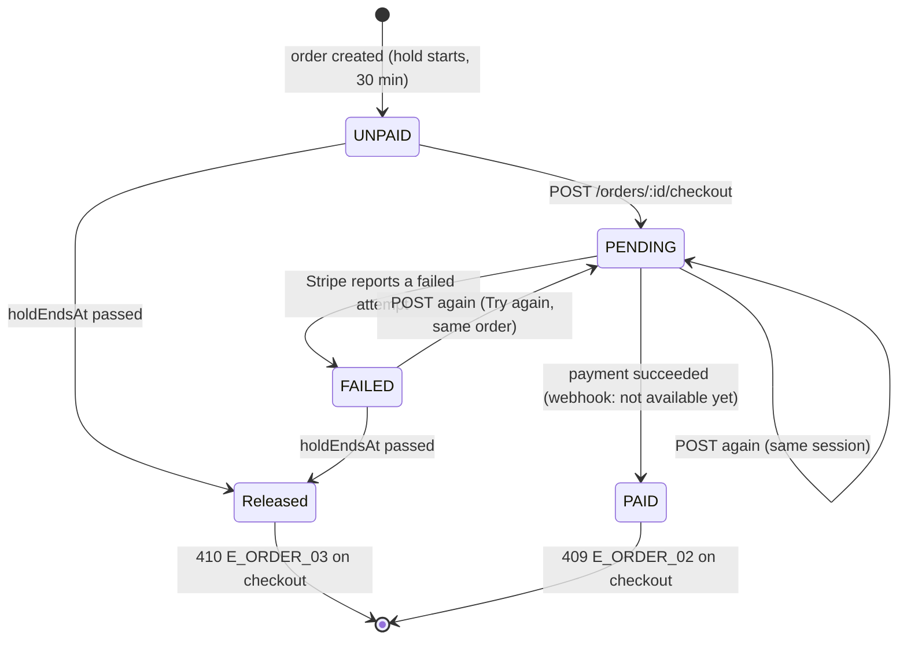

# 🧪 T-065-be · Open a Stripe checkout for an order · QA Backend

> **Simulated run** for the M-09 agent-flow test: build `t065-sim-2026-10-25` has no code behind it (see [[T-065-be Backend Delivery]]); the verdict below records the test, not a real API.

**Task:** [[T-065-be Backend · Open a Stripe checkout for an order]] · **Feature:** [[Pay for an order]] · **Feature-level note:** [[Pay for an order QA Backend]] · **Verifies:** [[T-065-be Backend Delivery]] against [[T-065 Story]] and [[T-065-fe Frontend Requirements]], with the shapes of [[T-065-be Backend Integration]] · **Verdict:** ✅ Passing on `t065-sim-2026-10-25`

Expected behaviour of the API, as artefacts a person can check a build against: tables and diagrams, **not test code** (the specs live in the backend repo). `status: passing` or `failing` after a run; the verdict feeds the story's `verified`.

## Scope

Covered: `GET /orders/:id` and `POST /orders/:id/checkout` for s51 ([[T-065 Story]] S1, S2), the 30-minute hold ([[DR-09 30-minute hold tied to the Stripe checkout]]), card only ([[DR-08 Stripe card checkout only]]), the audit entry. Not covered: the webhook settlement and s52 (no task yet), the order creation on s50 ([[T-035 Registration transaction with order and payment]]); an order reaches `PAID` here only by setting its payment in the test database.

## Expected behaviour

| # | Given | When | Then | Checked |
|---|---|---|---|---|
| B1 | my unpaid order, created now | `GET /orders/:id` | 200 `OrderEntity`, `state: UNPAID`, `holdEndsAt` = creation + 30 min, `total` and `lines[].unitPrice` integers in minor units | ✅ |
| B2 | someone else's order | `GET /orders/:id` | 404 `E_ORDER_01` | ✅ |
| B3 | an order id that does not exist | `GET /orders/:id` | 404 `E_ORDER_01`, byte-for-byte the same body as B2 apart from `path` and `timestamp` | ✅ |
| B4 | my unpaid order, no checkout yet | `POST /orders/:id/checkout` | 201 `{ checkoutUrl, expiresAt }`, one `Payment` row (`provider: STRIPE`), one audit entry `PAYMENT_CHECKOUT_OPENED` | ✅ |
| B5 | the checkout from B4 still open | `POST /orders/:id/checkout` again | 201, the same `checkoutUrl`, still one `Payment` row, a second audit entry | ✅ |
| B6 | the checkout from B4 | read `expiresAt` | equals the order's `holdEndsAt` | ✅ |
| B7 | my order, `holdEndsAt` in the past | `POST /orders/:id/checkout` | 410 `E_ORDER_03`, no `Payment` row, no audit entry | ✅ |
| B8 | my order with a succeeded payment (set in the test database) | `POST /orders/:id/checkout` | 409 `E_ORDER_02`; `GET` shows `state: PAID` | ✅ |
| B9 | Stripe unreachable | `POST /orders/:id/checkout` | 502 `E_PAY_01`, no `Payment` row, no audit entry | ✅ |
| B10 | no access token, or an expired one | either endpoint | 401 `E_AUTH_04` | ✅ |
| B11 | any response above | read the body | no card data, no Stripe secret, no `providerReference` | ✅ |
| B12 | a failed attempt on the Stripe page | `GET /orders/:id` | `state: FAILED`, `failureReason` is the buyer-facing text; B4 again reuses or reopens a checkout on the same order | ✅ |

## State diagram

## Error matrix

| Situation | Status | ErrorCode | Same body as |
|---|---|---|---|
| order not mine | 404 | `E_ORDER_01` | order does not exist |
| order does not exist | 404 | `E_ORDER_01` | order not mine |
| checkout on a paid order | 409 | `E_ORDER_02` | — |
| checkout after the hold ended | 410 | `E_ORDER_03` | — |
| Stripe unreachable | 502 | `E_PAY_01` | — |
| no or expired token | 401 | `E_AUTH_04` | every authenticated endpoint |

`ErrorCode` is not on the wire yet ([[T-063 Put the ErrorCode on the error body]]): the rows were checked on the status, the endpoint and the message.

## Privacy and access checks

- Another user's order → 404 `E_ORDER_01`, indistinguishable from a missing order (B2, B3).
- No response carries card data, the Stripe secret or the `providerReference` (B11).

## Verdict

- Run on: 2026-10-25 · build: `t065-sim-2026-10-25` (simulated) · result: ✅ passing, B1–B12 · failing rows: none
