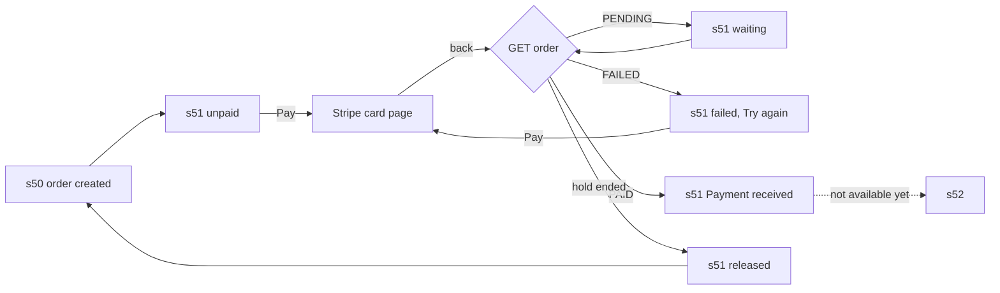

# 🧪 T-065-fe · Open a Stripe checkout for an order · QA Frontend

> **Simulated run** for the M-09 agent-flow test: build `t065-fe-sim-2026-10-25` has no client code behind it (see [[T-065-fe Frontend Delivery]]); the verdict records the test, not a real app.

**Task:** [[T-065-fe Frontend · Open a Stripe checkout for an order]] · **Feature:** [[Pay for an order]] · **Feature-level note:** [[Pay for an order QA Frontend]] · **Verifies:** [[T-065-fe Frontend Delivery]] against [[T-065 Story]] and [[T-065-fe Frontend Requirements]] · **Verdict:** ✅ Passing on `t065-fe-sim-2026-10-25`

Expected behaviour of the screens, as artefacts: journeys, states and copy to check a build against, **not test code**. `status: passing` or `failing` after a run; the verdict feeds the story's `verified`.

## Scope

Covered: s51 for [[T-065 Story]] S1 and S2, against the calls of [[T-065-be Backend Integration]] (the API side passed in [[T-065-be QA Backend]]). Not covered: s52 and the settlement (no task yet); reaching s51 from s50 with a real order ([[T-035 Registration transaction with order and payment]]), so the run starts from an order seeded in the test database.

## Journeys

| # | Story | Steps | Expected | Checked |
|---|---|---|---|---|
| F1 | S1 | open s51 with an unpaid order | the lines, total and currency as the server returns them; "Pay $160" enabled; the hold countdown from `holdEndsAt` | ✅ |
| F2 | S1 | tap "Pay $160" | Stripe's hosted card page opens in an in-app browser tab; no card field anywhere in the app | ✅ |
| F3 | S1 | tap Pay twice quickly | one call; the same checkout opens | ✅ |
| F4 | S2 | close the card page without paying | back on s51, the state read from the server: `UNPAID` or `FAILED`, never inferred from the URL | ✅ |
| F5 | S2 | a declined card on Stripe's page, then back | the failed state: Stripe's reason, "Your tickets are held for N minutes", "Try again" | ✅ |
| F6 | S2 | "Try again" | the checkout opens again on the same order | ✅ |
| F7 | S2 | come back while Stripe has not answered | "Waiting for confirmation"; the order is read every 3 s, then on focus after 2 minutes | ✅ |
| F8 | S2 | leave s51 with an unpaid order, kill and reopen the app | s51 resumes the same order until its hold ends | ✅ |
| F9 | S2 | wait past `holdEndsAt` | "Your tickets were released", a way back to s50 | ✅ |
| F10 | S2 | the order paid (set in the test database) | "Payment received"; no s52 yet | ✅ |

## Screen states

| Screen | State | Expected rendering |
|---|---|---|
| [[Screen Index#s51\|s51]] | loading | the order's skeleton, Pay disabled |
| s51 | unpaid | lines, total, countdown, "Pay $160" |
| s51 | pending | "Waiting for confirmation", progress, Pay disabled |
| s51 | failed | Stripe's reason, "Your tickets are held for N minutes", "Try again" |
| s51 | hold ended | "Your tickets were released", "Back to tickets" → s50 |
| s51 | paid | "Payment received" |
| s51 | error | the copy below, per error |

## Flow diagram

## Error copy

| ErrorCode | Where | Copy shown |
|---|---|---|
| `E_AUTH_04` (401) | either call | sign-in, then back to s51 on the same order |
| `E_ORDER_01` (404) | either call | "This order is not available", back to s50 |
| `E_ORDER_02` (409) | Pay | "Payment received" |
| `E_ORDER_03` (410) | Pay | "Your tickets were released", back to s50 |
| `E_PAY_01` (502) | Pay | "Payment is not available right now", Pay enabled again |

Branched on the status and the endpoint: `ErrorCode` is not on the wire yet ([[T-063 Put the ErrorCode on the error body]]).

## Verdict

- Run on: 2026-10-25 · build: `t065-fe-sim-2026-10-25` (simulated) · result: ✅ passing, F1–F10 and every error copy · failing rows: none
