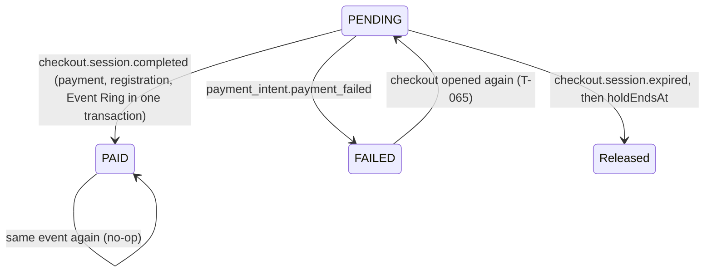

# 🧪 T-066-be · Settle an order and confirm it on s52 · QA Backend

> **Simulated run** for the M-09 agent-flow test: build `t066-sim-2026-10-25` has no code behind it (see [[T-066-be Backend Delivery]]); the verdict records the test, not a real API.

**Task:** [[T-066-be Backend · Settle an order and confirm it on s52]] · **Feature:** [[Pay for an order]] · **Feature-level note:** [[Pay for an order QA Backend]] · **Verifies:** [[T-066-be Backend Delivery]] against [[T-066 Story]] and [[T-066-fe Frontend Requirements]], with the shapes of [[T-066-be Backend Integration]] · **Verdict:** ✅ Passing on `t066-sim-2026-10-25`

Expected behaviour of the API, as artefacts a person can check a build against: tables and diagrams, **not test code** (the specs live in the backend repo). `status: passing` or `failing` after a run; the verdict tells the PM whether the story can be fulfilled (passing with nothing pending).

## Scope

Covered: Stripe's webhook settling an order ([[T-066 Story]] S1) and what the order read gives s51 and s52 after it (S2): `POST /payments/stripe/webhook` and the new fields of `GET /orders/:id`. Events are sent with Stripe's test signing secret against an order seeded in the test database (creating the order is [[T-035 Registration transaction with order and payment]]). Not covered: reading the Event Ring itself ([[Event Ring Auto-creation]]).

## Expected behaviour

| # | Given | When | Then | Checked |
|---|---|---|---|---|
| W1 | my unpaid order with an open checkout | Stripe sends `checkout.session.completed` for its session | 200; the order `PAID`, one `Payment` `SUCCEEDED`, the registration completed and one Event Ring granted, one `PAYMENT_SUCCEEDED` audit entry, all in one transaction | ✅ |
| W2 | the order of W1 | the same event sent again | 200; nothing new: still one payment, one registration, one Event Ring, one audit entry | ✅ |
| W3 | any order | a call without `Stripe-Signature`, or with a wrong one | 400 `E_PAY_02`; nothing read, nothing written | ✅ |
| W4 | my order with an open checkout | Stripe sends `payment_intent.payment_failed` | 200; the order `FAILED`, `failureReason` is Stripe's buyer-facing text, one `PAYMENT_FAILED` entry; `POST /orders/:id/checkout` works again | ✅ |
| W5 | an event for a session no payment holds | the webhook is called | 200; nothing written | ✅ |
| W6 | an open checkout | Stripe sends `checkout.session.expired` | 200; nothing written; the order released once its hold ends | ✅ |
| W7 | the order of W1, read during the transaction | `GET /orders/:id` | either the old state, or `PAID` with `registrationComplete: true` and `eventRingId` set; never `PAID` with a half-written registration | ✅ |
| W8 | the order of W1, after the commit | `GET /orders/:id` | `state: PAID`, `registrationComplete: true`, `eventRingId` the granted Ring's id | ✅ |
| W9 | an unpaid or failed order | `GET /orders/:id` | `registrationComplete: false`, `eventRingId: null` | ✅ |
| W10 | any response above | read the body | no card data, no Stripe secret, no `providerReference` | ✅ |

## State diagram

## Error matrix

| Situation | Status | ErrorCode | Same body as |
|---|---|---|---|
| webhook without a valid Stripe signature | 400 | `E_PAY_02` | — |
| event for an unknown session | 200 | — | (acknowledged, ignored) |
| order not mine / none (order read) | 404 | `E_ORDER_01` | each other |

## Privacy and access checks

- The webhook takes no access token; only Stripe's signature lets it in (W3).
- No body carries card data, the Stripe secret or the `providerReference` (W10).

## Verdict

- Run on: 2026-10-25 · build: `t066-sim-2026-10-25` (simulated) · result: ✅ passing, W1–W10 · failing rows: none
