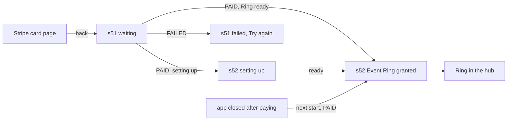

# 🧪 T-066-fe · Settle an order and confirm it on s52 · QA Frontend

> **Simulated run** for the M-09 agent-flow test: build `t066-fe-sim-2026-10-25` has no client code behind it (see [[T-066-fe Frontend Delivery]]); the verdict records the test, not a real app.

**Task:** [[T-066-fe Frontend · Settle an order and confirm it on s52]] · **Feature:** [[Pay for an order]] · **Feature-level note:** [[Pay for an order QA Frontend]] · **Verifies:** [[T-066-fe Frontend Delivery]] against [[T-066 Story]] and [[T-066-fe Frontend Requirements]] · **Verdict:** ✅ Passing on `t066-fe-sim-2026-10-25`

Expected behaviour of the screens, as artefacts: journeys, states and copy to check a build against, **not test code**. `status: passing` or `failing` after a run; the verdict tells the PM whether the story can be fulfilled (passing with nothing pending).

## Scope

Covered: [[T-066 Story]] S1 (the payment counts, even with the app closed) and S2 (s52), against [[T-066-be Backend Integration]] (the API side passed in [[T-066-be QA Backend]]). Stripe's confirmation is sent with Stripe's test tools against an order seeded in the test database (creating it on s50 is [[T-035 Registration transaction with order and payment]]).

## Journeys

| # | Story | Steps | Expected | Checked |
|---|---|---|---|---|
| G1 | S1 | pay on Stripe's page, come back to s51 | "Waiting for confirmation" until the order reads `PAID`; never `PAID` from the success URL alone | ✅ |
| G2 | S2 | the order reads `PAID` with `registrationComplete: true` | s51 goes on to s52 once; the Event Ring with its name, colour and window | ✅ |
| G3 | S2 | the order reads `PAID` with `registrationComplete: false` | s52 shows "Setting up your Ring…" and retries; the Ring appears when ready; never an empty screen | ✅ |
| G4 | S2 | still not ready after 30 s | "Setting up your Ring…" with "Try again"; reads again on focus | ✅ |
| G5 | S2 | s52 shown | the Event Ring joins the Ring carousel; with reduced motion, a fade | ✅ |
| G6 | S1 | pay, kill the app before Stripe answers, reopen | the order is picked up once: s52, then the Event Ring in the hub; it does not open s52 again on the next start | ✅ |
| G7 | S1 | a declined card, then back | the failed state of [[T-065-fe QA Frontend]] (reason, hold time, "Try again"); no s52 | ✅ |
| G8 | S2 | open s52 directly (deep link) for an unpaid order | not reachable: back to s51 for that order | ✅ |
| G9 | S1 | session expired while waiting | sign in, then back on the same order and on to s52 if paid | ✅ |

## Screen states

| Screen | State | Expected rendering |
|---|---|---|
| [[Screen Index#s51\|s51]] | paid, Ring ready | goes on to s52 (no "Payment received" dead end any more) |
| [[Screen Index#s52\|s52]] | granted | the Event Ring card, "Enter event mode", "See it in my Ring hub" |
| s52 | setting up | "Setting up your Ring…", progress |
| s52 | not ready after 30 s | "Setting up your Ring…" with "Try again" |

## Flow diagram

## Error copy

| ErrorCode | Where | Copy shown |
|---|---|---|
| `E_AUTH_04` (401) | s51, s52, app start | sign-in, then back to the same order |
| `E_ORDER_01` (404) | s51, app start | "This order is not available", back to s50 |

Branched on the status and the endpoint: `ErrorCode` is not on the wire yet ([[T-063 Put the ErrorCode on the error body]]).

## Verdict

- Run on: 2026-10-25 · build: `t066-fe-sim-2026-10-25` (simulated) · result: ✅ passing, G1–G9 and every error copy · failing rows: none
