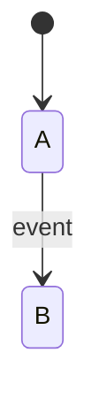

# 🧪 <Feature name> · QA Backend

**Feature:** [[<Feature name>]] · **Verifies:** [[<Feature name> Backend Delivery]] against [[<Feature name> Story]] and [[<Feature name> Frontend Requirements]] · **Verdict:** Draft

Expected behaviour of the API, as artefacts a person can check a build against: tables and diagrams, **not test code** (the specs live in the backend repo). `status: passing` or `failing` after a run; the verdict feeds the story's `verified`.

## Scope

What is covered and what is deliberately not.

## Expected behaviour

| # | Given | When | Then | Checked |
|---|---|---|---|---|
| B1 | … | `POST /…` with … | 201, body has … | ⬜ |
| B2 | … | … | 404 `E_…` | ⬜ |

## State diagram

## Error matrix

| Situation | Status | ErrorCode | Same body as |
|---|---|---|---|

## Privacy and access checks

- Viewer not in the Ring → … (must be indistinguishable from …)

## Verdict

- Run on: — · build: — · result: — · failing rows: —
