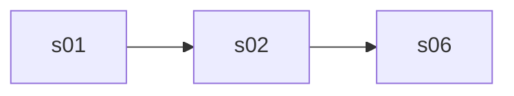

# 🧪 <Feature name> · QA Frontend

> Blocked by default until [[<Feature name> Frontend Delivery]] is `done` (the hand-off order in `docs.config.json`); `blockedBy: []` opts out, `blockedBy: [...]` names other blockers.

**Feature:** [[<Feature name>]] · **Verifies:** [[<Feature name> Frontend Delivery]] against [[<Feature name> Story]] · **Verdict:** Draft

Expected behaviour of the screens, as artefacts: journeys, states and copy to check a build against, **not test code**. `status: passing` or `failing` after a run; the verdict tells the PM whether the story can be fulfilled (passing with nothing pending or unmet). A failing row is one of two things: a story part the delivery does not fulfil (not built, or built other than the story says) goes in `unmet` and turns the story's badge ✕; a bug (built as asked, but it breaks) is filed against the Frontend Delivery and goes in `pending`, and leaves the story alone.

## Scope

Screens and journeys covered.

## Journeys

| # | Story | Steps | Expected | Checked |
|---|---|---|---|---|
| F1 | S1 | … | … | ⬜ |

## Screen states

| Screen | State | Expected rendering |
|---|---|---|
| [[Screen Index#sNN|sNN]] | loading / empty / error / … | … |

## Flow diagram

## Error copy

| ErrorCode | Where | Copy shown |
|---|---|---|

## Verdict

- Run on: — · build: — · result: — · failing rows: — · story parts unmet: — · bugs: —
